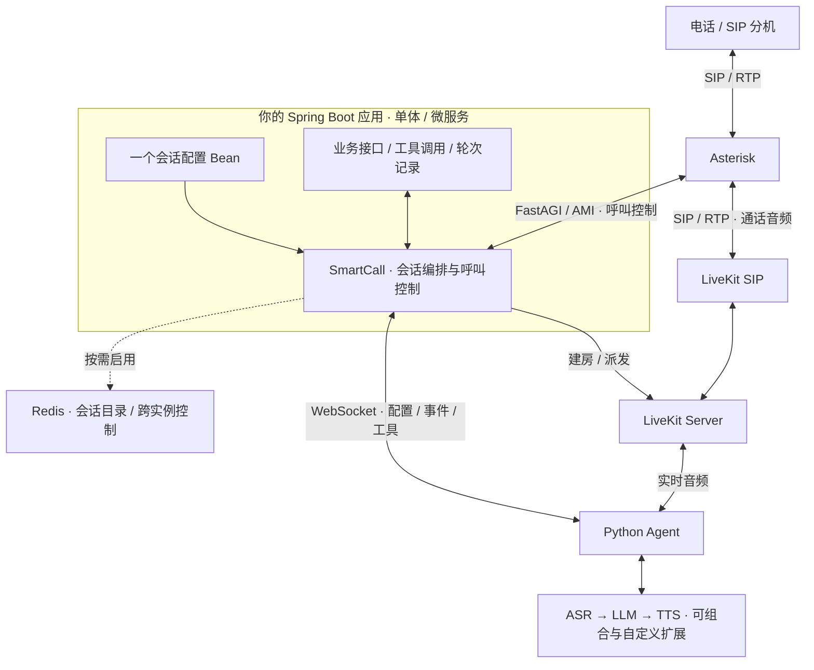

<p align="center">
  
</p>

<h1 align="center">SmartCall · AI 客服呼叫中心</h1>

<p align="center">
  <strong>AI 驱动的智能客服呼叫中心，让每一通电话都被智慧对待</strong>
</p>

<p align="center">
  引入依赖，声明一个 Bean，即可让你的 Spring Boot 项目拥有 AI 语音通话能力。<br />
  单体应用、微服务，均可按需集成。
</p>

<p align="center">
  <a href="https://qidiangk.com">官网</a> ·
  <a href="https://qidiangk.com/docs">使用文档</a> ·
  <a href="https://smartcall.qidiangk.com">在线演示</a> ·
  <a href="README.en.md">English</a>
</p>

<p align="center">
  
  
  
  
  <a href="LICENSE"></a>
  
</p>

---

## 项目简介

**SmartCall** 是一个简单易集成的开源 AI 语音通话框架。引入依赖、配置电话和模型服务、声明一个 Bean，即可让你的 Spring Boot 项目接入 AI 语音对话，适用于智能客服、电话咨询、业务回访等场景。

支持集成到现有单体应用或微服务，沿用自己的业务系统。电话接入、会话管理和模型交互交给框架，业务侧专注于话术与服务逻辑。

## 核心能力

- **接入简单**：Spring Boot 自动装配，一个会话配置 Bean 即可接听来电。
- **自然对话**：流式 ASR → LLM → TTS，支持语音打断、误打断恢复与静默引导，可选开启回声消除和 LLM / TTS 预生成。
- **按通定制**：每通电话可独立配置模型、音色、提示词和开场语，灵活适配客服、咨询、回访等业务话术。
- **模型灵活**：内置百炼、DeepSeek、阿里云 NLS、豆包 TTS 及 OpenAI 兼容 LLM 等适配，可跨厂商组合，支持自定义适配器和兼容协议的自建模型服务。
- **呼入外呼**：支持来电应答、主动外呼及挂断；可转接队列或指定目标，转接结束后按需恢复 AI 对话。
- **业务可扩展**：通过工具调用与轮次拦截接入订单、工单、知识库等业务接口，让 AI 对话连接实际业务。
- **对话可留档**：提供轮次文本、音频和打断状态的记录接口，按需接入业务存储与后续分析。
- **部署灵活**：提供 Docker Compose 部署脚本，配置就绪后一键启动示例及依赖服务，支持集成到单体、微服务及多实例应用。

## 系统架构



上图展示内置的 Python Agent 链路：Spring Boot 负责电话控制与业务编排，通话音频经 Asterisk、LiveKit SIP 和 LiveKit 传递给 Agent；框架的跨实例路由按需使用 Redis。

## 快速开始

### 一键启动示例

项目在 [`script`](script) 中提供 Docker Compose 部署编排。准备 **Java 21、Maven、Docker 和 Docker Compose**，按下面步骤构建、启动并验证示例。

**1. 配置模型与连接信息**

在仓库根目录复制环境变量模板：

```bash
cp script/.env.example script/.env
```

- 填写 [`DemoConfig.java`](smart-demo/src/main/java/com/smart/demo/config/DemoConfig.java) 中 ASR、LLM、TTS 的服务地址和认证信息，使用已开通权限的模型与音色。
- 将 [`pjsip.conf`](script/config/asterisk/pjsip.conf) 的 `external_signaling_address` 和 `external_media_address` 改为软电话可达的部署机器 IP。
- 全容器部署时，将 [`extensions.conf`](script/config/asterisk/extensions.conf) 的 AGI 地址设为 `agi://smart-call:4573/realtime.agi`。自定义配置见[使用文档](https://qidiangk.com/docs)。

**2. 构建应用镜像**

在仓库根目录执行。Java 镜像使用项目内置的 Jib 插件构建，Python Agent 使用 Dockerfile 构建；镜像标签与 Compose 配置一致。

```bash
mvn -pl smart-demo -am clean package jib:dockerBuild -DskipTests
docker build -t smart/smart-agent:2.0.0 ./smart-voice-agent
```

**3. 启动服务**

```bash
cd script
docker compose up -d
docker compose ps
```

**4. 验证呼入与呼出**

**呼入**：使用 SIP 软电话注册到部署机器的 `5060/UDP`，用户名 `1001`、密码 `1001@123`，启用 `ulaw` / `alaw` 编码。注册成功后，随意拨打至少两位的数字号码（如 `1000`、`12345`），即可进入 AI 对话，无需创建对应的被叫分机。

**呼出**：结束呼入测试，保持分机 `1001` 已注册且空闲，在部署机器上请求示例外呼接口：

```bash
curl -X POST http://127.0.0.1:9999/api/calls/outbound -H "Content-Type: application/json" -d '{"number":"1001"}'
```

接口正常响应为 HTTP `202`，返回 `callId` 和 `submission`；`ACCEPTED` 表示外呼已提交。软电话响铃后接听，即可与 AI 对话。跨机请求时，将 `127.0.0.1` 改为部署机器 IP。

当前 [`OutboundCallController`](smart-demo/src/main/java/com/smart/demo/controller/OutboundCallController.java) 使用 `PJSIP/{number}@1001`，上述请求用于回呼测试分机。真实号码外呼时，将末尾的 `1001` 改为已配置的 SIP 中继名称，重新构建示例镜像，`number` 传入实际被叫号码。

**查看日志**：`smart-call` 的运行日志在宿主机挂载目录 `script/logs/aicc/` 中查看（容器内 `/smart/boot/logs/`）。`smart-agent` 查看控制台日志，在 `script` 目录执行：

```bash
docker compose logs -f smart-agent
```

更多使用与配置说明见[使用文档](https://qidiangk.com/docs)。

### 集成到已有项目

运行环境：**Java 21、Spring Boot 3.5.8**。引入依赖、配置服务、声明一个 Bean 即可接入。

**1. 引入依赖**

先在仓库根目录执行 `mvn -pl smart-voice-realtime -am install -DskipTests`，再将依赖加入已有 Spring Boot 项目：

```xml
<dependency>
    <groupId>com.qidiangk.smart</groupId>
    <artifactId>smart-voice-realtime</artifactId>
    <version>2.0.0</version>
</dependency>
```

**2. 准备服务**

集成时可复用上述基础服务，将示例应用替换为自己的应用，电话与 Agent 连接参照[使用文档](https://qidiangk.com/docs)配置。下面使用百炼模型，启动应用前设置 `DASHSCOPE_API_KEY`，使用已开通相应模型权限的北京地域 API Key。

**3. 声明一个 Bean**

服务配置就绪后，将下面的 `VoiceConfiguration` 放入应用扫描的包中。模型、音色和地址已填好，可直接调整提示词和开场语。

<details>
<summary><strong>展开单 Bean 接入示例</strong></summary>

```java
import com.qidiangk.smart.voice.realtime.api.RealtimeSessionConfigProvider;
import com.qidiangk.smart.voice.realtime.model.*;
import org.springframework.beans.factory.annotation.Value;
import org.springframework.context.annotation.Bean;
import org.springframework.context.annotation.Configuration;

import java.util.List;

@Configuration(proxyBeanMethods = false)
public class VoiceConfiguration {

    @Bean
    RealtimeSessionConfigProvider conversationConfig(@Value("${DASHSCOPE_API_KEY}") String apiKey) {
        var auth = new ModelAuthConfig().setApiKey(apiKey);
        var endpoint = "wss://dashscope.aliyuncs.com/api-ws/v1/inference";

        var asr = new BoundModel()
                .setSlot(ModelSlot.ASR).setProvider(ModelProvider.DASHSCOPE)
                .setAdapter(ModelAdapter.FUN_ASR_REALTIME).setModel("paraformer-realtime-8k-v2")
                .setEndpoint(endpoint).setAuthConfig(auth);

        var llm = new BoundModel()
                .setSlot(ModelSlot.LLM).setProvider(ModelProvider.DASHSCOPE)
                .setAdapter(ModelAdapter.CHAT_COMPLETIONS).setModel("qwen-plus")
                .setEndpoint("https://dashscope.aliyuncs.com/compatible-mode/v1")
                .setAuthConfig(auth);

        var tts = new BoundModel()
                .setSlot(ModelSlot.TTS).setProvider(ModelProvider.DASHSCOPE)
                .setAdapter(ModelAdapter.COSYVOICE).setModel("cosyvoice-v3-flash")
                .setEndpoint(endpoint).setVoice("longanyang").setAuthConfig(auth);

        return call -> new RealtimeSessionConfig()
                .setExecutionMode(ExecutionMode.PYTHON_AGENT)
                .setGreeting("您好，我是 SmartCall 语音助手，请问有什么可以帮您？")
                .setInstructions("你是一位电话语音助手，请用简短、自然的中文回答。")
                .setModels(List.of(asr, llm, tts));
    }
}
```

</details>

[`smart-demo`](smart-demo) 提供[会话配置](smart-demo/src/main/java/com/smart/demo/config/DemoConfig.java)和[外呼接口](smart-demo/src/main/java/com/smart/demo/controller/OutboundCallController.java)示例。模型可自由组合并扩展自定义适配器，业务可通过工具调用和拦截器接入；服务配置、使用方式、模型扩展及集群部署详见[使用文档](https://qidiangk.com/docs)。

## 文档与社区

- 官方网站：[qidiangk.com](https://qidiangk.com)
- 使用文档：[qidiangk.com/docs](https://qidiangk.com/docs)
- 源码仓库：[GitHub](https://github.com/g-mr/SmartCall) · [Gitee](https://gitee.com/gdzWork/SmartCall) · [AtomGit](https://gitcode.com/ding1254646/SmartCall)
- 技术文章：[源码解析与实践](https://blog.csdn.net/ding1254646)
- 联系邮箱：[ding931226@yeah.net](mailto:ding931226@yeah.net)

欢迎 Star 支持，或通过 Issue、Pull Request 反馈问题和参与贡献。

## 捐赠支持

如果 SmartCall 对你有所帮助，欢迎请作者喝一杯咖啡，支持项目的持续维护与改进。感谢你的支持！

<p align="center">
  <a href="docs/images/donate-wechat.jpg">
    
  </a>
  <br />
  <sub>微信扫码支持 · 点击图片可查看原图</sub>
</p>

## 开源协议

本项目采用 [Apache License 2.0](LICENSE)，允许商业使用，请遵守许可证并保留适用的版权及许可声明。

## SmartCall 商业版

**让 AI 客服从技术验证走向业务应用。** SmartCall 商业版面向需要完整 AI 客服呼叫中心的企业，提供产品、部署交付与技术支持。

欢迎前往官网了解产品，体验在线演示，或联系我们咨询商业版采购与业务需求。

**[了解商业版](https://qidiangk.com) · [在线体验](https://smartcall.qidiangk.com)**

---

<p align="center">
  <strong>SmartCall — 让 AI 为每一通电话赋能</strong>
</p>
