# kilocode-agents

A tool-enforced multi-agent pipeline architecture for Kilo Code. Decompose
complex software engineering tasks into a structured pipeline of specialized
subagents — triage, context-gather, design, implement, integrate, review,
remediate, and deliver — with every stage enforced by the Kilo `Task()` tool.

> [!NOTE]
> Requires Kilo CLI v7.3.12 or newer. Tested with Claude Opus, GPT-5.4,
> DeepSeek V4, and MiniMax-M2.7 models.

---

## Choose Your Platform

| Platform | Setup | Read more |
|---|---|---|
| **VS Code Extension** | Import `vscode/agents.json` via Settings → About → Import Settings | [`vscode/README.md`](vscode/README.md) |
| **Kilo CLI** | Copy `kilo-cli/.kilo/` into your project, then `kilo` | [`kilo-cli/README.md`](kilo-cli/README.md) |
| **Both** | Same `.kilo/agent/*.md` files work for CLI and CLI-based VS Code | Shared backend |


The VS Code extension is built on the Kilo CLI and reads the same on-disk
config files. Pick either platform — or both — and the same agents work.

---

## 30-Second Setup

### VS Code

```
1. Open Settings → About → Import Settings
2. Select vscode/agents.json
3. Save → ceo is now your default agent
4. Start a session: @ceo <your task>
```

### CLI

```bash
cd /path/to/your/project
cp -r path/to/kilo-cli/.kilo ./
kilo
@ceo <your task>
```

---

## Pipeline Architecture

```mermaid
flowchart TB
    U["User Request"] --> CEO

    CEO["CEO (orchestrator)

    Routes to the right stage by
    delegating to specialized
    subagents via the Task() tool"]

    CEO --> S0["0. Requirement Triage

    Classify task risk and depth.
    Determines pipeline level:
    BOUNDED or COMPLEX."]

    S0 --> S1["1. Context Engineering

    Gather and synthesize context
    from repo structure, code
    history, and external sources."]

    S1 --> S2["2. Solutions Architecture

    Design a technical plan from
    the Context Brief. Produce a
    Design Document for review."]

    S2 --> S3["3. Implementation

    Execute the design in atomic,
    verifiable slices. Each slice
    includes verification evidence."]

    S3 --> S4["4. Integration

    Connect slices together.
    Check cross-file consistency,
    imports, and interfaces."]

    S4 --> S5["5. Independent Review

    Multi-track review gates:
    QA / Fidelity / Security /
    Performance."]

    S5 -- "findings" --> S6["6. Remediation

    Fix review findings with
    minimal blast radius.
    Re-run verification per fix."]

    S6 -- "gates pass" --> S7["7. Delivery

    Verify acceptance criteria.
    Clean up temporary artifacts.
    Confirm delivery."]

    S6 -. "re-enter review" .-> S5
    S7 --> DONE["✅ Delivered Result"]

    style U fill:#1e293b,stroke:#0ea5e9,stroke-width:2,color:#fff
    style CEO fill:#eef2ff,stroke:#6366f1,stroke-width:2,color:#1e293b
    style S0 fill:#e0f2fe,stroke:#3b82f6,stroke-width:2,color:#1e40af
    style S1 fill:#e0f2fe,stroke:#06b6d4,stroke-width:2,color:#155e75
    style S2 fill:#ede9fe,stroke:#8b5cf6,stroke-width:2,color:#4c1d95
    style S3 fill:#dcfce7,stroke:#22c55e,stroke-width:2,color:#166534
    style S4 fill:#fef9c3,stroke:#eab308,stroke-width:2,color:#854d0e
    style S5 fill:#ffedd5,stroke:#f97316,stroke-width:2,color:#9a3412
    style S6 fill:#fecaca,stroke:#dc2626,stroke-width:2,color:#7f1d1d
    style S7 fill:#d1fae5,stroke:#10b981,stroke-width:2,color:#065f46
    style DONE fill:#064e3b,stroke:#10b981,stroke-width:3,color:#a7f3d0
```



Each stage is enforced by the `Task()` tool — skipping a stage produces an
error. Review findings are resolved through structured remediation loops
(remediation → re-enter review) before delivery.

---

## The 16 Agents

| Agent | Role | Mode |
|---|---|---|
| `ceo` | Primary orchestrator | primary |
| `requirement-triage` | Task classification & risk assessment | subagent |
| `context-engineer` | Context gathering & synthesis | subagent |
| `solutions-architect` | Technical design & planning | subagent |
| `implementer` | Code implementation in slices | subagent |
| `integrator` | Cross-file consistency & connection | subagent |
| `remediator` | Review-finding remediation | subagent |
| `delivery-manager` | Acceptance verification & cleanup | subagent |
| `scrum-master` | Sprint planning & work breakdown | subagent |
| `product-manager` | Requirement quality & scope | subagent |
| `repo-explorer` | Codebase mapping & discovery | subagent |
| `qa-reviewer` | Correctness & regression review | subagent |
| `fidelity-reviewer` | Source-of-truth exactness review | subagent |
| `security-reviewer` | Security & trust-boundary review | subagent |
| `performance-reviewer` | Concurrency & resource review | subagent |
| `devops-engineer` | CI, build, & release tooling | subagent |

---

## Repository Structure

```
kilocode-agents/
├── README.md                       ← You are here
├── LICENSE / LICENSE-CODE / NOTICE / AUTHORS
│
├── vscode/                         ← VS Code extension users
│   ├── agents.json                 ← Bundle for Settings → Import
│   ├── agent-imports/              ← Per-agent files
│   └── README.md
│
├── kilo-cli/                       ← Kilo CLI users
│   ├── .kilo/
│   │   ├── agent/                  ← Canonical agent definitions (.md + YAML)
│   │   ├── command/                ← Optional slash commands
│   │   ├── skills/                 ← Optional pipeline skills
│   │   └── kilo.jsonc
│   ├── scripts/
│   │   ├── README.md               ← Platform-specific script guide
│   │   ├── posix/                  ← Linux, macOS, WSL, Termux
│   │   │   ├── setup.sh
│   │   │   └── generate-json.sh
│   │   └── windows/                ← Windows (PowerShell)
│   │       └── setup.ps1
│   └── README.md
│
└── shared/                         ← Cross-platform reference
    ├── context/
    │   ├── context-brief-template.md
    │   └── design-doc-template.md
    ├── old-prompt.md
    └── new-prompt.md
```

The canonical source of truth is the `.md` files in `kilo-cli/.kilo/agent/`.
JSON artifacts in `vscode/` are derived from these files. See
[`kilo-cli/README.md`](kilo-cli/README.md) for the rationale.

---

## Design Principles

1. **Tool-enforced pipeline.** Stages are enforced by Kilo's `Task()` tool,
   not by prompt text. Skipping a stage produces a tool error.

2. **Context is first-class.** Every task starts with context gathering.
   The pipeline treats context engineering as a distinct phase with dedicated
   tooling — not an ad-hoc step buried in a prompt.

3. **Separation of concern.** Each pipeline stage has its own agent with a
   focused role: Context Engineer gathers, Architect designs, Implementer
   builds, Reviewer verifies, Remediator fixes.

4. **Transparent review.** Every significant decision passes through visible
   review with explicit approval gates. Multiple review lanes (QA, fidelity,
   security, performance) for different risk dimensions.

5. **Structured remediation.** Review findings feed a dedicated remediation
   loop. The `remediator` fixes issues, re-runs verification, and re-enters
   the review gate until all checks pass.

---

## Requirements

- **Kilo CLI v7.3.12 or newer**
- A capable model: Claude Opus, GPT-5.4, DeepSeek V4, or similar
- For CLI users: `npm install -g @kilocode/cli` or binary from GitHub releases
- For VS Code users: Kilo Code extension (pre-release) from the marketplace

---

## FAQ

**Why markdown files instead of JSON?**
The Kilo CLI auto-discovers agent definitions from `.kilo/agent/*.md` files.
Markdown is the canonical format; JSON (`vscode/agents.json`) is a derived
artifact for VS Code Settings import.

**Can I use both CLI and VS Code?**
Yes. The VS Code extension is built on the Kilo CLI backend. Both read the
same `.kilo/agent/*.md` files from the same on-disk paths. The `.kilo/`
directory is portable.

**How do I customise an agent?**
Override any agent by creating a `.kilo/agents/<name>.md` file in your project
or by adding it to the `agent` key in `kilo.jsonc`. Properties are merged —
you only need to specify the fields you want to change.

**How do I disable an agent?**
Set `disable: true` in the agent's frontmatter or in the JSON config:
```json
{ "agent": { "some-agent": { "disable": true } } }
```

**What model should I use?**
The `ceo` agent benefits from the strongest model available. Sub-pipeline
agents can use a cheaper model — set `subagent_model` in `kilo.jsonc`.

---

## Contributing

See [`CONTRIBUTING.md`](CONTRIBUTING.md).

## Code of Conduct

See [`CODE_OF_CONDUCT.md`](CODE_OF_CONDUCT.md).

## Licence

Prompts and agent architecture: CC BY 4.0. Code and configuration: Apache-2.0.
See [`LICENSE`](LICENSE) and [`LICENSE-CODE`](LICENSE-CODE).
