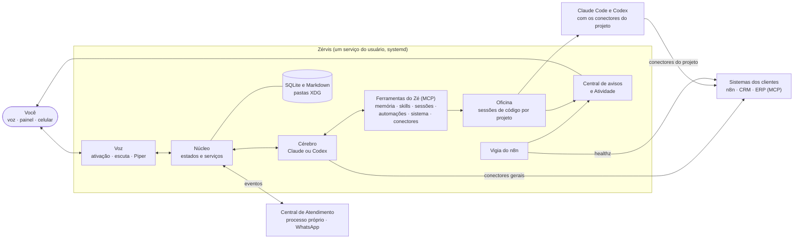

<div align="center">
  
  <h1>Zérvis</h1>
  <p><strong>O assistente de voz e a oficina de IA de quem toca automações, para os próprios projetos e os dos clientes.</strong></p>
  <p>Você dá o norte, por voz ou pelo painel. O Zé conduz os agentes Claude e Codex, liga os sistemas dos clientes por MCP<br>e fica de olho no que está rodando, no seu Linux ou na sua VPS.</p>
  <p>
    <a href="#instalar-no-pc">Instalar no PC</a> ·
    <a href="docs/vps.md">Instalar numa VPS</a> ·
    <a href="#arquitetura">Arquitetura</a> ·
    <a href="#como-se-compara">Hermes e OpenClaw</a> ·
    <a href="docs/roteiro.md">Roteiro</a> ·
    <a href="CONTRIBUTING.md">Contribuir</a>
  </p>
  <p>
    <a href="LICENSE"></a>
    <a href="https://github.com/gestordescomplicaa-web/zervis/actions/workflows/check.yml"></a>
    
    
  </p>
</div>

> **Em desenvolvimento ativo.** Há instaladores para o PC e para a VPS; o da VPS foi provado do
> zero ([guia](docs/vps.md)), o do PC num Omarchy ([prova e limites](docs/pc.md)). O que está
> pronto e o que está em teste vem marcado em cada função.

## Para quem é

Para **gestores e consultores de automação e IA**: quem monta integrações, fluxos e agentes para
empresas e quer um assistente que faça o trabalho pesado sem misturar um cliente com outro. Serve
também a quem só quer um assistente de voz de trabalho no próprio Linux.

## O que o Zé faz

| Função | Estado |
|---|---|
| **Voz de verdade.** "Ei Zé" treinado com a sua voz, conversa contínua, interrupção no meio da fala, fim de turno pela entonação e voz própria (Piper, primeiro som em cerca de 150 ms). Pelo PC ou pelo navegador do celular. | Pronto |
| **Oficina de código.** Sessões com Claude Code e Codex num terminal real, por projeto, com as suas contas. Cópia isolada (Git worktree) com prévia, aplicar e descartar. O Zé narra o andamento e avisa quando termina, falha ou pede aprovação. | Pronto |
| **Conectores MCP.** Cole o JSON ou o `curl` que o serviço fornece: o Zé guarda os tokens como segredos, testa e mostra as ferramentas. Login OAuth com renovação automática, permissão por ferramenta (livre, com aprovação ou bloqueada). | Pronto |
| **Um cliente, uma sessão.** Cada sessão escolhe os conectores do projeto dela, e o conector de um cliente não aparece no projeto de outro nem na conversa. | Pronto |
| **Integrar qualquer sistema.** A skill `integrar-sistema` pesquisa o MCP oficial ou a API, pede o menor acesso, prova com uma leitura real e registra o que aprendeu. A `fluxos-n8n` cria, testa e publica fluxos no n8n, sem mexer em produção sem aprovação. | Pronto |
| **Vigia do n8n.** Todo n8n cadastrado é conferido a cada minuto, sem chave e sem modelo; "fora do ar" e "voltou" chegam por voz, na tela e na Atividade. | Pronto |
| **Memória e skills com aprovação.** Memória curta, longa e por projeto, busca no histórico, linha do tempo e nota do dia. Skills no padrão aberto agentskills.io; o que o Zé propõe passa por você. | Pronto |
| **Controle da máquina.** No Omarchy, cerca de 370 ações do sistema, cada uma com nível de risco: livre, confirmação falada, frase exata ou proibida. | Pronto |
| **Automações, Foco e avisos.** Lembretes e consultas agendadas, frentes de trabalho em andamento e uma central de avisos que fala só o que importa. | Pronto |
| **Atendimento no WhatsApp.** Pareado por QR, com agente de atendimento próprio, testes de conversa antes de publicar e passagem para você. Leads quentes viram aviso. | Em teste |
| **Acesso de fora.** Endereço HTTPS sem abrir porta, com senha e código do autenticador. | Pronto |
| **Melhora o próprio código, com travas.** Numa cópia isolada, com testes, sua aprovação e volta automática se a versão nova não subir. | Pronto |

## Benefícios

- **O modelo pensa uma vez; o resto roda sem tokens.** Os agentes constroem e corrigem; o que se
  repete roda no lugar certo (um fluxo no n8n, uma automação, o vigia), sem chamar o modelo a cada
  execução.
- **Clientes separados de verdade.** Conectores ligados ao projeto pelo caminho da pasta, sessões
  independentes e nomes por cliente: o n8n do cliente A nunca entra na sessão do cliente B.
- **Segredo nunca passa pela conversa.** Tokens e chaves ficam em arquivos `0600` fora do
  repositório; a LLM recebe só o nome da variável.
- **Tudo registrado.** A Atividade guarda o que o Zé executou, inclusive o que foi negado e as
  chamadas aos sistemas de fora.
- **Suas contas, seus dados.** Claude pela assinatura (Agent SDK), Codex pela conta, ou chaves da
  Anthropic, OpenAI, OpenRouter e proxies no formato OpenAI. Os dados ficam nas suas pastas.
- **Falha fechada.** Na dúvida, não envia, não aprova, não apaga, e diz por quê.

## Como se compara

Hermes Agent (Nous Research, MIT) e OpenClaw (MIT) são assistentes generalistas excelentes, com
foco nos mensageiros. O Zérvis escolheu outro foco: **voz, oficina de código e integração de
sistemas de clientes, no Linux e na VPS**. Comparação pela documentação oficial de cada um, em
outubro de 2026; detalhes na [matriz comparativa](docs/matriz-comparativa.md).

| | Hermes | OpenClaw | Zérvis |
|---|---|---|---|
| Conversar pelos mensageiros | ● Telegram, Discord, Slack, WhatsApp e outros | ● mais de 25 canais | ◐ WhatsApp para atendimento, em teste |
| Voz no próprio computador | ◐ provedores de voz | ◐ Talk Mode e apps | ● ativação treinada, interrupção, fim de turno e voz local |
| Sessões de código Claude e Codex | — | — | ● terminal real, cópia isolada, aprovação antes de juntar |
| Conectores MCP | ● stdio e HTTP | ● stdio, SSE e HTTP | ● colar JSON ou curl, OAuth, permissão por ferramenta |
| Separação por cliente | ◐ perfis separados | ◐ agentes e gateways isolados | ● conectores por projeto, fora da conversa |
| Skills | ● cria e melhora sozinho | ● ClawHub | ● cria com aprovação |
| Loja aberta de terceiros | ● Skills Hub e plugins | ● ClawHub | — de propósito: nada de código de terceiros dentro do Zé |
| Registro de tudo o que executa | ◐ | ◐ | ● Atividade, inclusive o negado |
| Ações do sistema com nível de risco | ◐ uso do computador | ◐ comandos nos aparelhos | ● Omarchy, com política de risco |
| Configuração | assistente no terminal | `openclaw onboard` | ● toda pela tela |
| Plataformas | Linux, macOS, Windows, Android | Linux, macOS, Windows, iOS, Android | Linux |

Legenda: **●** tem · **◐** parcial · **—** não tem.

**Quando escolher cada um.** OpenClaw, se o principal é falar com o assistente por muitos
mensageiros e apps de celular. Hermes, se você quer um generalista com centenas de modelos e
integração com IDE. Zérvis, se o seu trabalho é conduzir agentes de código e ligar sistemas de
clientes, falando com ele, com cada cliente no seu lugar.

## Arquitetura



- **Uma linguagem por papel.** Python no núcleo, no cérebro e na voz; Go no WhatsApp (WaCalls);
  JavaScript com tipos no painel, sem etapa de build. Só se reescreve noutra linguagem o que uma
  medição apontar como gargalo ([ADR 0032](docs/adr/0032-arquitetura-para-crescer.md)).
- **Fronteiras por processo.** O que precisa ficar de pé sozinho roda à parte, com API local e
  token: a Central de Atendimento, o WaCalls, a memória longa. Reiniciar o Zé não derruba o
  atendimento.
- **Cérebro trocável.** Claude ou Codex atrás de uma interface única; a via rápida responde o que
  é curto e passa o resto ao cérebro ([ADR 0015](docs/adr/0015-cerebro-agente-sem-orca.md)).
- **Os agentes fazem; o Zé conduz.** As sessões são o Claude Code e o Codex de verdade, com as
  skills e os conectores do projeto ([ADR 0037](docs/adr/0037-integracao-com-sistemas.md)).
- **O n8n executa; o Zé constrói e vigia.** Os fluxos dos clientes rodam no n8n, conhecido e
  auditável; o Zé não vira um motor de fluxos ([ADR 0038](docs/adr/0038-fluxos-no-n8n-ze-constroi-e-vigia.md)).
- **Dados em SQLite**, um banco por área, com migrações automáticas e busca de texto; segredos
  fora do banco, em arquivos `0600`.
- **Uma essência que não muda.** O que o Zé é e não deixa de ser está em
  [docs/essencia.md](docs/essencia.md): nenhuma mudança, nem a feita por ele mesmo, pode
  contrariá-la.

## Instalar no PC

No terminal da sessão gráfica, como usuário comum, com Git, Make e curl instalados:

```sh
git clone https://github.com/gestordescomplicaa-web/zervis.git
cd zervis && deploy/instalar-pc.sh
```

O instalador prepara Python e dependências, os modelos de voz, os agentes de código e o Go
verificado para o WhatsApp. Instala o serviço do usuário, o atalho Zérvis no menu e o comando
`zervis`, e abre o painel na configuração inicial (`http://127.0.0.1:8795/`, só no próprio PC;
acesso por outros aparelhos se liga depois, no painel).

No Ubuntu 24.04, os pré-requisitos são `sudo apt install git make curl xdg-utils pulseaudio-utils`.
Sem as ferramentas de áudio, o instalador avisa; o painel e a conversa por texto continuam
funcionando. O controle completo da máquina é no Omarchy; outros Linux têm o controle reduzido.

## Instalar numa VPS

Num Ubuntu 24.04 ou parecido, com um usuário comum (não root) e Git, Make e curl instalados:

```sh
git clone https://github.com/gestordescomplicaa-web/zervis.git
cd zervis && deploy/instalar-servidor.sh
```

O instalador prepara tudo, deixa o Zé rodando como serviço e termina com um endereço HTTPS e um
código de primeiro acesso: abra o endereço, crie a senha e ligue o código do autenticador, sem
túnel SSH. O passo a passo e o login do Claude e do Codex estão em [docs/vps.md](docs/vps.md).

## O comando `zervis`

| Comando | O que faz |
|---|---|
| `zervis status` | Se o serviço está de pé, a versão e o endereço do painel |
| `zervis doctor` | Cada função, "Disponível" ou "Indisponível", com o motivo e como resolver |
| `zervis update` | Atualiza para a versão publicada mais nova e reinicia; se o painel não voltar, volta para a anterior (`--desenvolvimento` segue a `master`) |
| `zervis logs` | O registro do serviço, ao vivo |
| `zervis abrir` | Abre o painel no navegador |
| `zervis avaliar` | A bateria de avaliação do cérebro: o julgamento do Zé medido em cenários ([como funciona](docs/avaliacao.md)) |
| `zervis uninstall` | Remove o serviço, o atalho e o comando; os seus dados ficam, a não ser que você peça |

Sem terminal, o mesmo `update` fica em **Ajustes → Atualizações**, no painel: o Zé procura uma vez
por dia, avisa quando há versão nova, mostra o que muda e atualiza num clique.

## Desenvolver

Linux, Python 3.12 a 3.14, Node.js 22+ e [uv](https://docs.astral.sh/uv/):

```sh
uv sync
npm ci
make check                 # formatação, lint, tipos e testes
uv run python -m zervis    # sobe o Zé; o painel abre em http://127.0.0.1:8795/
```

Na primeira subida, o Zé baixa os modelos de som e a voz (Cadu, 63 MB), confere o SHA-256 de cada
um e abre a configuração inicial: perfil, acesso ao Claude (assinatura ou chave de API) e a chave
do Deepgram para a voz. Sem a palavra de ativação treinada, ele atende pelo painel e pelo
teclado. `make instalar` instala o serviço do systemd do usuário e o atalho "Zérvis" no menu de
aplicativos (`PORTA=8796 make instalar` para outra porta).

Numa VPS, sem tela e sem som, o Zé não oferece o que a máquina não tem.

## Onde ficam os seus dados

| Raiz | Padrão | O que tem |
|---|---|---|
| Configuração | `~/.config/zervis` | `config.toml`, `perfil.json` (quem é você), chaves (`0600`), conectores MCP |
| Dados | `~/.local/share/zervis` | memória, skills, conversas, linha do tempo, Foco, sessões, automações |
| Estado | `~/.local/state/zervis` | o momento: status, tempos, consumo, avisos |

Nada é enviado ao repositório nem a terceiros sem pedido explícito. Nenhum nome, fuso ou caminho de
alguém fica fixo no código: o que é seu vem da configuração. `ZERVIS_PERFIL=<nome>` usa outro
conjunto de pastas (`zervis-<nome>`); `ZERVIS_RAIZ=<pasta>` põe as três dentro de uma pasta só.

## Documentação

| Documento | Conteúdo |
|---|---|
| [docs/roteiro.md](docs/roteiro.md) | Para onde o projeto vai, em ordem |
| [docs/pc.md](docs/pc.md) | O Zé no PC: instalação, verificação e limites |
| [docs/vps.md](docs/vps.md) | O Zé numa VPS: instalação, acesso e celular |
| [docs/essencia.md](docs/essencia.md) | O que o Zé é e não deixa de ser |
| [docs/conceitos.md](docs/conceitos.md) | Conversa, voz, foco, sessão, automação, memória e skill |
| [docs/04-arquitetura.md](docs/04-arquitetura.md) | Componentes, estado, fluxos e contratos |
| [docs/matriz-comparativa.md](docs/matriz-comparativa.md) | Hermes, OpenClaw e Zérvis, função por função |
| [docs/06-qualidade.md](docs/06-qualidade.md) | Regras de engenharia (obrigatórias) |
| [docs/07-sistema-omarchy.md](docs/07-sistema-omarchy.md) | O Omarchy no núcleo: ações, eventos e risco |
| [docs/adr/](docs/adr/) | Decisões de arquitetura |
| [THIRD_PARTY.md](THIRD_PARTY.md) | Código e modelos de terceiros |

## Licença

[AGPL-3.0-or-later](LICENSE). A voz usa o [Piper](https://github.com/OHF-Voice/piper1-gpl)
(GPL-3.0) e a voz Cadu (CC0); os demais componentes de terceiros e as licenças estão em
[THIRD_PARTY.md](THIRD_PARTY.md).
