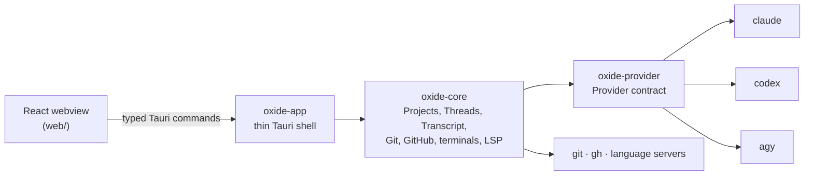

<p align="center">
  
</p>

<h1 align="center">Oxide</h1>

<p align="center">
  <strong>The complete desktop app for agentic coding.</strong><br />
  Prompt, review, pull request and merge, with Claude Code, Codex and Antigravity CLI.
</p>

<p align="center">
  <a href="https://github.com/getoxide/oxide/actions/workflows/ci.yml"></a>
  <a href="LICENSE"></a>
  
  
  
</p>

<p align="center">
  <a href="#install">Install</a> ·
  <a href="#features">Features</a> ·
  <a href="#how-it-works">How it works</a> ·
  <a href="#build-from-source">Build from source</a> ·
  <a href="#faq">FAQ</a> ·
  <a href="CONTRIBUTING.md">Contributing</a>
</p>

<p align="center">
  
</p>

<!-- The invisible site markers in this README delimit content that the Oxide website
     (getoxide/website) extracts during its content sync. Do not remove or rename a marker. -->

## What is Oxide?

<!-- site:definition -->

Oxide is a free, open-source desktop app for agentic coding that drives Claude Code, Codex and Antigravity CLI in one window and shows what each change touched and what was actually checked, so you can merge with confidence.

<!-- /site:definition -->

Oxide is not a coding agent: it doesn't ship an agent of its own. It drives the agent CLIs you already have installed and logged in, and it puts Git, GitHub, a code editor and a terminal around the conversation.

Most agent tools optimize for starting more agents. Oxide optimizes for the other end: the path from a finished agent Turn to a **confident merge**. For every change it shows what the agent touched, which checks actually ran, what stayed unverified, and lets you send line-level feedback or undo the work without leaving the app. It is built for developers who can write code themselves and have AI write it with a clear purpose: they know what the agent is producing, review it, and stay responsible for what lands in `main` ([ADR-0010](docs/adr/0010-prioritize-the-path-to-a-confident-merge.md)).

> [!NOTE]
> **Oxide is pre-release software.** Official builds target **macOS on Apple Silicon** and **Windows x64**. Expect rough edges and breaking changes between versions.

## Features

<!-- site:features -->

### One app, every agent CLI

- **Multiple Providers.** Use [Claude Code](https://docs.claude.com/en/docs/claude-code) (`claude`), [Codex](https://github.com/openai/codex) (`codex`) and Antigravity CLI (`agy`) side by side. Oxide detects which ones are installed and only offers those.
- **Threads.** Each Thread is one conversation with one Provider, mapped one-to-one to the Provider's own session, with its own Model and Effort.
- **Permission modes.** Choose per Thread between *Ask*, *Auto-edit* and *Full access*, and answer Approvals inline. The Attention Center collects every Thread waiting on you, across Projects.
- **Slash commands, attachments and usage limits.** Each Provider's Slash commands and skills in the composer, files and images attached inside the prompt, and the 5-hour and weekly usage limits your Provider reports.
- **Worktrees.** Chat Threads can run in their own Git worktree, with an optional per-Project setup command, so parallel work never collides.

### Review before you merge

- **Line comments.** Drafts from a Blind review that you keep, sent back to the Thread as one prompt.
- **Blind review.** Have a second Provider review the change seeing only the diff and the issue, never the original conversation. Its findings become Line comments you keep or dismiss.
- **Restore.** Put a Thread's files back to how they were before any Turn. It is undoable.
- **Rule suggestions.** Feedback you keep giving turns into a proposed rule for the Project's `AGENTS.md`.
- **Pull requests, from review to merge.** Open the pull request from the Pull request Surface. **Fix** sends failing checks, conflicts and the review threads you select back to the agent, in the branch's Thread or a new one. Merge, squash or rebase when GitHub says it's ready, or turn on auto-merge while checks run.

### A full workspace around the conversation

- **Git and GitHub.** Branches, commit and push, and Issues, through `git` and the [GitHub CLI](https://cli.github.com). Pull requests have their own section above.
- **Code editor.** Monaco with language servers for Rust, TypeScript/JavaScript, Python and C/C++, installed on first use, only when you press Install.
- **Terminal.** Per-Project terminal tabs with Command blocks, kept alive while you switch Threads.
- **Keyboard first.** Full keyboard navigation, themes and reduced-motion support.

<!-- /site:features -->

## Install

Download the installer for your platform from [GitHub Releases](https://github.com/getoxide/oxide/releases):

<!-- site:install -->

| Platform | File | Notes |
| --- | --- | --- |
| macOS (Apple Silicon) | `Oxide_<version>_aarch64.dmg` | Drag `Oxide.app` into `/Applications`. |
| Windows 10/11 (x64) | `Oxide_<version>_x64-setup.exe` | NSIS installer. |

<!-- /site:install -->

Until the first stable release is published, [build from source](#build-from-source). Pre-release (`-rc`) builds are for testing and never reach the in-app updater.

### Requirements

At least one **Provider installed and logged in** before you launch Oxide:

<!-- site:requirements -->

| Provider | Command | Install |
| --- | --- | --- |
| Claude Code | `claude` | [docs.claude.com](https://docs.claude.com/en/docs/claude-code) |
| Codex | `codex` | [github.com/openai/codex](https://github.com/openai/codex) |
| Antigravity CLI | `agy` | Google Antigravity |

`git` is required. The [GitHub CLI](https://cli.github.com) (`gh`, logged in) is optional and enables the pull request and Issues features.

<!-- /site:requirements -->

### Updates

Oxide checks for new versions in **Settings → Updates** and installs them in place. It only offers published stable releases, and only accepts packages signed with Oxide's updater key.

### Verifying a download

Every release lists the SHA-256 checksums in its release notes and attaches a [build-provenance attestation](https://docs.github.com/en/actions/security-guides/using-artifact-attestations-to-establish-provenance-for-builds) for each installer, which ties it to the exact workflow run and commit that built it:

```sh
shasum -a 256 Oxide_<version>_aarch64.dmg   # macOS; compare with the release notes
gh attestation verify Oxide_<version>_aarch64.dmg --repo getoxide/oxide
```

On Windows, compare `(Get-FileHash .\Oxide_<version>_x64-setup.exe).Hash` with the release notes.

### Opening an unsigned build

Each release says whether it is code-signed on your platform.

**macOS.** Oxide does not join the Apple Developer Program, so its releases are **ad-hoc signed and not notarized**, and Gatekeeper blocks them on first launch. To open one:

1. Drag `Oxide.app` from the `.dmg` into `/Applications` and try to open it once.
2. Open **System Settings → Privacy & Security**, scroll to the message about Oxide, and click **Open Anyway**.

Alternatively, remove the quarantine flag from the terminal: `xattr -dr com.apple.quarantine /Applications/Oxide.app`. Updates installed through Oxide are unaffected.

**Windows.** The installer is **not Authenticode-signed**, so SmartScreen may warn on first run. Choose **More info → Run anyway** after verifying the download as above.

## Quick start

<!-- site:quick-start -->

1. Install and log in to at least one Provider (for example, run `claude` once in a terminal).
2. Launch Oxide and press **⌘⇧N** (Ctrl+Shift+N on Windows) to open the Project palette: pick a folder, create one with `git init`, or clone a repository.
3. Start a Thread, choose the Provider, Model and Permission mode, and write your prompt.
4. When the Turn finishes, start a Blind review or restore the files to before any Turn from the Git menu under the Thread title.
5. **Commit & Push** from the same header, then open the pull request from the **Pull request** Surface.

<!-- /site:quick-start -->

## How it works



- **Native Provider adapters.** Each Provider has its own adapter in `oxide-provider` behind one contract, tested against fake Providers, rather than a lowest-common-denominator protocol ([ADR-0001](docs/adr/0001-native-provider-adapters-over-acp.md)).
- **Oxide owns the Transcript.** Turns, Items and Approvals are stored locally in SQLite, so every Provider looks the same in the UI ([ADR-0002](docs/adr/0002-oxide-owns-the-transcript.md)).
- **Core owns files and processes.** The webview gets no filesystem or shell permission. Every action goes through a typed Tauri command generated with [tauri-specta](https://github.com/specta-rs/tauri-specta).

The domain language (Project, Thread, Turn, Provider, Surface…) is defined in [GLOSSARY.md](GLOSSARY.md), and every architecture decision is recorded in [docs/adr/](docs/adr/).

## Build from source

### macOS (Apple Silicon)

- Xcode Command Line Tools (`xcode-select --install`)
- [rustup](https://rustup.rs). The toolchain is pinned in [`rust-toolchain.toml`](rust-toolchain.toml) and installed automatically.
- Node.js 22 and pnpm via [Corepack](https://nodejs.org/api/corepack.html) (`corepack enable`). The pnpm version is pinned in `web/package.json`.

```sh
git clone https://github.com/getoxide/oxide.git
cd oxide
pnpm --dir web install

# Run the app in development mode (hot-reloading frontend), from the repository root.
# The dev config names it "Oxide Dev" and gives it the icon with the amber band,
# so it is never mistaken for an installed release.
web/node_modules/.bin/tauri dev --config crates/oxide-app/tauri.dev.conf.json

# Build the app bundle and .dmg into target/release/bundle/
pnpm --dir web build:app
```

The Tauri CLI must run from the repository root: that is where it finds `crates/oxide-app/tauri.conf.json`.

### Windows (x64)

- Windows 10 (version 1803 or later) or Windows 11. These include the [WebView2 Runtime](https://developer.microsoft.com/microsoft-edge/webview2/); on older or customized installations, install the Evergreen Runtime manually.
- [Microsoft C++ Build Tools](https://visualstudio.microsoft.com/visual-cpp-build-tools/) with the **Desktop development with C++** workload.
- [rustup](https://rustup.rs), Node.js 22 and pnpm through Corepack (`corepack enable`), as on macOS.

In PowerShell:

```powershell
git clone https://github.com/getoxide/oxide.git
Set-Location oxide
pnpm --dir web install

# Run the app in development mode (hot-reloading frontend).
.\web\node_modules\.bin\tauri.cmd dev

# Build a Windows installer (NSIS .exe) into target\release\bundle\nsis\.
.\web\node_modules\.bin\tauri.cmd build --bundles nsis
```

To build an MSI instead, use `--bundles msi`; if that fails with a `light.exe` error, enable the **VBScript** optional Windows feature and try again.

### Tests and checks

```sh
node tools/check.mjs        # everything the CI pull request lanes run on this OS
node tools/check.mjs fast   # rustfmt, ESLint and TypeScript, in seconds
```

The Rust tests run with [cargo-nextest](https://nexte.st) (`cargo install --locked cargo-nextest`). The live smoke tests drive the real Provider CLIs, so they are opt-in and never run in CI:

```sh
cargo test -p oxide-provider --test claude_live_smoke -- --ignored
cargo test -p oxide-provider --test codex_live_smoke -- --ignored
cargo test -p oxide-provider --test agy_live_smoke -- --ignored
```

[docs/devops.md](docs/devops.md) lists every check CI runs, why it exists and its local equivalent.

## FAQ

<!-- site:faq -->

**What is Oxide?**
Oxide is a free, open-source desktop app for agentic coding that drives Claude Code, Codex and Antigravity CLI in one window and shows what each change touched and what was actually checked, so you can merge with confidence.

Oxide is not a coding agent: it is a desktop GUI that drives the agent CLIs you already have installed and logged in. Oxide is not affiliated with Oxide Computer Company.

**Do I need an API key?**
No separate key for Oxide. Each Provider uses its own login and its own subscription or API billing, exactly as it does in the terminal.

**Does Oxide send my code or prompts anywhere?**
Oxide has no telemetry and no server. Your prompts and code go only to the Provider you chose, through its own CLI. The Transcript, Checkpoints and Review ledger stay on your machine.

**How is it different from using Claude Code or Codex in a terminal?**
You keep the same CLIs, sessions and logins. Oxide adds Line comments, Blind review by a second Provider, Restore to before any Turn, worktrees per Thread and GitHub pull request review, in one window, for every Provider.

**Which platforms are supported?**
Official builds target macOS on Apple Silicon and Windows x64. Linux isn't packaged yet.

**Is it free?**
Yes. Oxide is open source under the [MIT License](LICENSE).

<!-- /site:faq -->

## Contributing

Contributions are welcome. Read [CONTRIBUTING.md](CONTRIBUTING.md) for the branch model, local checks and pull request conventions, and look for issues labelled [`good first issue`](https://github.com/getoxide/oxide/issues?q=is%3Aissue%20is%3Aopen%20label%3A%22good%20first%20issue%22) or [`help wanted`](https://github.com/getoxide/oxide/issues?q=is%3Aissue%20is%3Aopen%20label%3A%22help%20wanted%22).

- [GLOSSARY.md](GLOSSARY.md): the domain language
- [docs/adr/](docs/adr/): architecture decisions
- [docs/devops.md](docs/devops.md): CI, releases and the release runbook
- [AGENTS.md](AGENTS.md): instructions for coding agents working on Oxide
- [SUPPORT.md](SUPPORT.md): where to ask questions and report bugs

Please follow the [Code of Conduct](CODE_OF_CONDUCT.md). Report security vulnerabilities privately, as described in [SECURITY.md](SECURITY.md).

## License

Oxide is released under the [MIT License](LICENSE). Claude Code, Codex and Antigravity are trademarks of their respective owners; Oxide is an independent project, not affiliated with or endorsed by Anthropic, OpenAI or Google. It is also not affiliated with Oxide Computer Company.
