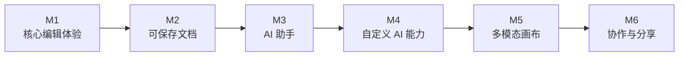

<div align="center">

# Proteus Editor

**面向 AI 集成的编辑器核心，公开构建中**

*An AI-ready editor core, built in public*

[English](./README.en.md) · [在线体验](https://proteus.gezilinll.com/) · [路线图](./plans/phase-step-overview.md) · [Spec 工作流](./specs/README.md) · [技术文章](./articles/)

[](LICENSE)

</div>

---

## 当前定位

| 项 | 说明 |
|---|---|
| 项目形态 | 一个公开构建的编辑器核心项目，当前以 Web demo 验证核心能力 |
| 产品路径 | `可保存文档 -> AI 助手 -> 自定义 AI 能力 -> 多模态画布` |
| AI-ready 含义 | 可被 Agent / LLM / MCP / Skill 安全驱动，而不是先堆很多 AI 功能 |
| 长期目标 | 演进成支持用户自定义 LLM、MCP、Skill、Plugin 的编辑器平台 |
| 仓库内容 | Web demo、技术文档、spec、实现代码与技术文章并行演进 |

Proteus 优先收敛 editor core、document model 和 execution boundaries，再逐步接入 AI 执行能力与扩展接口。

## 工程重点

| 方向 | 当前结论 |
|---|---|
| 编辑器核心 | 基础画布、渲染、交互、工具、图层、复制粘贴等 Phase 1 能力已完成 |
| AI 集成 | 当前正在定义统一动作协议、审批 hook、查询 API、持久化边界 |
| 可扩展性 | Provider / MCP / Skill / Plugin 先统一契约，再扩运行时 |
| 工程交付 | Demo、文档、spec 与实现保持同步更新 |

## 产品里程碑



| 里程碑 | 用户可感知的能力 | 当前状态 |
|---|---|---|
| M1 核心编辑体验 | 创建和编辑基础图形、文本、图片，完成主要画布交互 | 已可体验 |
| M2 可保存文档 | 保存、重新打开、导出、复用文档内容 | 当前主线 |
| M3 AI 助手 | 用自然语言选择、移动、对齐、重排画布内容 | 下一阶段 |
| M4 自定义 AI 能力 | 接入自己的 LLM、MCP、Skill、Agent 或插件能力 | 规划中 |
| M5 多模态画布 | 在画布中处理视频、音频、网页等内容 | 规划中 |
| M6 协作与分享 | 分享、评论、多人协作与后续工作流 | 长期方向 |

完整说明见 [plans/phase-step-overview.md](./plans/phase-step-overview.md)。

## 当前能力

| 类别 | 已完成 |
|---|---|
| 元素 | 矩形、圆形、文本、图片 |
| 交互 | 选择、框选、拖拽、缩放、旋转、视口缩放/平移 |
| 编辑 | 图层调整、重命名、对齐、分布、复制、剪切、粘贴、撤销、重做 |
| 工程 | Monorepo、框架无关 core、React 绑定、Vitest 测试 |
| Demo | 在线体验可直接验证基础链路 |

## 当前正在补的底层能力

| 底层能力 | 直接支撑的里程碑 |
|---|---|
| 公共 API、序列化与快照能力 | M2 可保存文档 |
| 动作协议、审批 hook、只读查询接口 | M3 AI 助手 |
| Provider、MCP、Skill、Plugin 契约 | M4 自定义 AI 能力 |
| 多模态内容模型与渲染边界 | M5 多模态画布 |

## 快速开始

```bash
# 克隆项目
git clone https://github.com/gezilinll/Proteus.git
cd Proteus

# 安装依赖
pnpm install

# 启动开发服务器
pnpm dev
```

访问 `http://localhost:3000` 开始体验。

## 文档入口

| 你想了解 | 查看 |
|---|---|
| 最新产品路线 | [plans/phase-step-overview.md](./plans/phase-step-overview.md) |
| AI-ready 架构与扩展边界 | [docs/ARCHITECTURE.md](./docs/ARCHITECTURE.md) |
| 开发规范与 spec 工作流 | [docs/CONVENTIONS.md](./docs/CONVENTIONS.md) |
| 测试体系与验收规则 | [docs/TESTING.md](./docs/TESTING.md) |
| Spec / SDD 工作流 | [specs/README.md](./specs/README.md) |

## 相关文章

1. [架构设计与技术选型](./articles/01-architecture-and-tech-stack.md)
2. [文本编辑设计](./articles/02-text-editing-design.md)
3. [渲染引擎实现](./articles/03-rendering-engine-implementation.md)
4. [交互系统设计](./articles/04-interaction-system-design.md)

---

<div align="center">

**MIT License**

</div>
