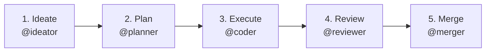
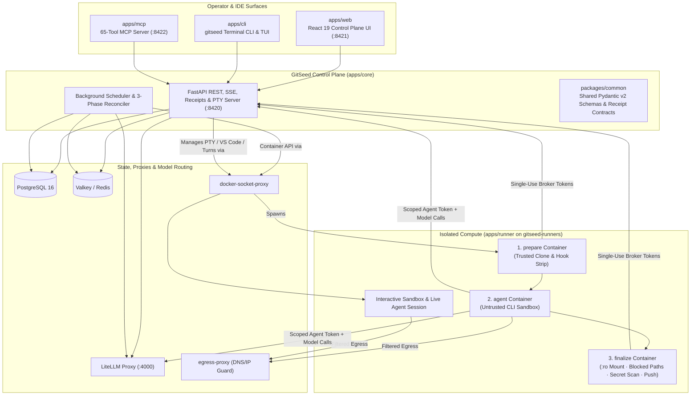

<div align="center">


# GitSeed

<h3>Your agents write the code. They never get your keys.</h3>

GitSeed is a self-hosted, open-source control plane for AI coding agents. It runs **Claude Code**, **Codex**, **Gemini CLI**, **Antigravity**, and **OpenCode** in sandboxed containers that hold no Git credentials. A separate read-only broker scans each diff for secrets and blocked paths, then opens the PR after you approve. Every PR carries an Ed25519-signed receipt.

Apache 2.0 · zero telemetry · Docker, Kubernetes, or fully air-gapped with Ollama/vLLM

[](https://github.com/gitseed-dev/gitseed/actions/workflows/ci.yml)
[](https://github.com/gitseed-dev/gitseed/releases)
[](./LICENSE)
[](./pyproject.toml)

[**Quickstart**](#quickstart) · [**Why GitSeed?**](#why-gitseed) · [**How It Works**](#how-it-works-the-5-stage-sdlc) · [**Models & Personal Mode**](#frontier-models-personal-mode--local-open-weight-llms) · [**Security & Receipts**](#broker-enforced-security--signed-governance-receipts) · [**CLI & TUI**](#developer-cli-gitseed) · [**MCP Server**](#mcp-server-gitseed-mcp) · [**Architecture**](#architecture--monorepo-layout) · [**Concepts**](./docs/concepts.md)

</div>

https://github.com/user-attachments/assets/9d0242be-21e1-4ae0-8b82-43e528eb3c2a

---

## Quickstart

**Prerequisites:** Docker 24+ with Compose v2, ~4 GB RAM, and ~6 GB free disk space (first build compiles the control plane and runner image with 5 agent CLIs in ~2–3 minutes; no cloud account or external Git host required).

```bash
git clone https://github.com/gitseed-dev/gitseed.git && cd gitseed
./scripts/init.sh             # or `make init` (Windows PowerShell: .\scripts\init.ps1)
docker compose up -d --build  # starts Web UI (:8421), API (:8420), MCP (:8422), LiteLLM & Postgres
```

### First 60 Seconds in the UI

1. **Sign in at [`http://localhost:8421`](http://localhost:8421)** using the `admin@gitseed.local` credentials printed by `./scripts/init.sh` / `make init` (or set `GITSEED_ADMIN_PASSWORD` in `.env` beforehand).
2. **Connect a Model & Repo (1-Click Wizard)**:
   - Pick an API key (Anthropic, OpenAI, Gemini, xAI), local **Ollama / vLLM**, or single-user **Personal Mode CLI OAuth** (`Claude Code`, `Codex`, `Gemini`, `Antigravity`). This automatically provisions all 5 stage agents (`@ideator`, `@planner`, `@coder`, `@reviewer`, `@merger`) plus `@coordinator`.
   - Connect Git via **1-Click GitHub App**, GitLab/Bitbucket token, or point directly at a **Local Folder** on disk.
3. **Plant Your First Seed**: Create a project and submit a prompt (full 5-stage pipeline, **⚡ Fast-Track** straight to code, or **2–3 parallel model opinions**), or click **`+ New ▾`** to open a live Coding Agent chat, Browser PTY terminal, or embedded VS Code Web session.

| Area | Status |
| :--- | :--- |
| **Docker Compose, Web UI, 3-phase broker, receipts** | Stable |
| **5 CLI runtimes (`opencode`, `claude-code`, `codex`, `antigravity`, `gemini`)** | Stable (built into local runner image) |
| **`grok-build` runtime** | Adapter only (bring your own binary) |
| **Helm chart (`charts/gitseed`)** | Beta |
| **Pre-built registry images** | Not yet published (builds locally via Compose) |

<details>
<summary><strong>Kubernetes (Helm) Deployment &amp; Service Port Map</strong></summary>

<br />

Pre-built images are not published to GHCR yet. Build and push the two images to your cluster registry first, then install the included Helm chart (see [`charts/gitseed/README.md`](./charts/gitseed/README.md)):

```bash
docker build -t <your-registry>/gitseed:0.1.0 .
docker build --build-arg INCLUDE_PROPRIETARY_CLIS=false -t <your-registry>/gitseed-runner:0.1.0 ./apps/runner
docker push <your-registry>/gitseed:0.1.0 && docker push <your-registry>/gitseed-runner:0.1.0

helm upgrade --install gitseed ./charts/gitseed \
  --namespace gitseed \
  --create-namespace \
  --set image.repository=<your-registry>/gitseed \
  --set image.tag=0.1.0 \
  --set runnerImage.repository=<your-registry>/gitseed-runner \
  --set runnerImage.tag=0.1.0
```

| Service | Default URL / Port | Description |
| :--- | :--- | :--- |
| **Web UI** | `http://localhost:8421` | React 19 control plane dashboard, live run logs, diff viewer, `SessionDock`, and `⌘K` `@coordinator` |
| **VS Code Sandbox Origin** | `http://127.0.0.1:8423` | Dedicated cookie-less `SANDBOX_ORIGIN` listener serving `/api/v1/vscode/*` isolated from Web UI cookies |
| **Control Plane API** | `http://localhost:8420` | FastAPI REST service (`/api/v1/*`), short-lived SSE streams, WebSocket PTY, and OpenAPI docs (`/docs`) |
| **MCP Server** | `http://127.0.0.1:8422/mcp` | Loopback-bound Streamable HTTP & SSE MCP endpoint (65 annotated tools; `Bearer` + `Origin` protected) |
| **LiteLLM Gateway** | `http://localhost:4000` | Unified OpenAI-compatible proxy for cloud and local LLM backends with enforced per-run virtual keys |
| **PostgreSQL 16** | `localhost:5432` | Primary relational store for control plane & LiteLLM |
| **Valkey** | `localhost:6379` | High-performance in-memory store for rate limits and pub/sub state |

</details>

---

## Why GitSeed?

**Why not just run `claude`, `codex`, or `opencode` on your laptop?** Local CLIs are great for interactive work, but they run on your host OS with your SSH keys, cloud credentials, and Git push access, and they leave no verifiable record of what ran or who approved it. GitSeed runs those same CLIs in isolated containers where agents never see your Git credentials:

- **Untrusted Agent, Trusted Broker (`prepare` → `agent` → `finalize`)**: Coding agents run with zero Git credentials behind an SSRF-hardened `egress-proxy`; a separate read-only `finalize` container enforces `blocked_paths` and added-line secret scanning before pushing.
- **Don't trust us, try to break it**: The threat model and [Known Residual Risks](./SECURITY.md#4-known-residual-risks) are documented up front in [`SECURITY.md`](./SECURITY.md), and the adversarial "evil agent" red-team suite runs with `uv run python -m pytest apps/core/tests/test_evil_agent_redteam.py`.
- **Ed25519-Signed PR Governance Receipts**: Every Pull Request receives a cryptographically signed receipt (`gitseed.receipt.v1`) attesting to the locked spec, models, spend mode, security scans, and human approvals, verifiable offline via `gitseed receipt verify`.
- **Parallel 3-Model "Second Opinions"**: Dispatch up to **3 agents in parallel** during `Ideate`, `Plan`, or `Review` to compare competing specs, task plans, or code reviews side-by-side before approving.
- **Cloud BYOK, Local GPUs & Single-User "Personal Mode"**: Enforce hard per-run USD caps via **LiteLLM** (cloud APIs or local **Ollama / vLLM / LM Studio**), or sign in with your personal **Claude Pro/Max**, **ChatGPT Plus/Pro**, or **Gemini** subscription inside an isolated container.
- **Autonomous Pipelines + Live Sandbox Rescue**: Drop into any workspace from the persistent **`SessionDock`** (side-by-side browser PTY terminal + code/diff editor, or isolated **VS Code Web**), leave inline diff comments, or `@coder`-steer an active run without losing progress.
- **5-Stage SDLC or ⚡ Fast-Track + Self-Healing CI**: Lock specs across `Ideate → Plan → Execute → Review → Merge` for complex features, **⚡ Fast-Track** (`Execute → Review → Merge`) for quick fixes, auto-remediate failing PR CI checks, or sync against a zero-remote **Local Folder**.

### How GitSeed Compares

| Capability | Agent CLIs on your laptop | Hosted cloud agents | **GitSeed** |
| :--- | :--- | :--- | :--- |
| **Trust boundary** | Runs on host with your keys | Code leaves your network | **3-phase containers; agent holds zero keys** |
| **Runtimes & models** | Local CLI binaries on host | Locked to vendor models | **5 bundled CLIs (+ `grok-build` adapter), LiteLLM, Ollama** |
| **Workflow & review** | Ad-hoc prompts & manual diffs | Single-model agent loop | **5-stage gates, ⚡ Fast-Track, 3 parallel opinions** |
| **PR provenance** | Local terminal scrollback | Opaque vendor logs | **Ed25519-signed receipt on every PR** |
| **Spend limits** | Passive token counter | Vendor seat & credit tiers | **Hard LiteLLM USD caps or Personal Mode timeouts** |
| **Git & CI** | Single local checkout | Cloud repos only | **Multi-repo PRs, Local Folder sync, CI auto-fix** |
| **Access** | Local terminal only | Web ticket portal | **Web UI, split terminal+diff dock, CLI/TUI, MCP** |

---

## How It Works: The 5-Stage SDLC



| Stage | Default Agent | What the Agent & Broker Do | Human Gate & Output Contract |
| :--- | :--- | :--- | :--- |
| **1. Ideate** | `@ideator` | Analyzes the seed prompt and repository structure to refine scope, edge cases, and testable acceptance criteria. | Validates `IdeateStageOutput` (`specification`, `acceptance_criteria`). Locks spec upon approval. |
| **2. Plan** | `@planner` | Decomposes the locked specification into ordered implementation tasks and identifies target repositories/files. | Validates `PlanStageOutput` (`plan`, ordered `tasks`, `target_repositories`). |
| **3. Execute** | `@coder` | `prepare` clones repos; `agent` writes code and runs tests in an isolated sandbox; `finalize` mounts `/workspace:ro`, enforces `blocked_paths` & secret scanning, pushes `gitseed/<project>/seed-<N>`, and posts a signed Governance Receipt to the PR. | Validates `ExecuteStageOutput` + `run.output["trusted"]` and opens/updates PRs on GitHub, GitLab, or Bitbucket. |
| **4. Review** | `@reviewer` | Audits branch diffs against the locked spec, plan, acceptance criteria, policy rules, and test results. | Validates `ReviewStageOutput` (`approved`, `findings`). Supports **Approve** or **Request Changes** re-entry. |
| **5. Merge** | `@merger` | Confirms upstream gates and branch readiness, then merges the pull request into the target branch. | Final human sign-off (`MergeStageOutput`), refreshed signed Governance Receipt, and automated remote PR merge. |

Need to ship a straightforward bugfix? Toggle **⚡ Fast-Track** to jump straight into `Execute → Review → Merge` while keeping clean-room `finalize` checks, signed Governance Receipts, and review gates intact. Read [**`docs/concepts.md`**](./docs/concepts.md) for a concise tour of **Project**, **Seed**, **Run**, **Policy**, and **Agent**.

---

## Frontier Models, Personal Mode & Local Open-Weight LLMs

Every stage agent (`@ideator`, `@planner`, `@coder`, `@reviewer`, `@merger`, `@coordinator`, or custom agents) can be independently bound to a different CLI runtime and model backend, with transparent labeling of **enforced** vs. **estimated** spend controls:

| Tier | Supported Providers & Engines | Agent Runtimes (`AgentRuntime`) | Spend Control & Governance Mode |
| :--- | :--- | :--- | :--- |
| **Team & Enterprise Cloud APIs (BYOK / LiteLLM)** | **Anthropic** (Claude), **OpenAI**, **Google Gemini**, **xAI (Grok)**, **LiteLLM**, **Custom OpenAI Gateways** | `opencode`, `claude-code`, `codex`, `antigravity`, `gemini`, `grok-build` | **Enforced (`enforced`)**: Per-run LiteLLM virtual keys hard-capped at `min(monthly_remaining, seed_cap_remaining, checkpoint_remaining)`. |
| **Personal Mode (Single-User Subscription OAuth)** | **Claude Pro / Max**, **ChatGPT Plus / Pro**, **Gemini Code Assist**, **Google Antigravity**, **xAI Grok** | `claude-code`, `codex`, `antigravity`, `gemini`, `grok-build` | **Estimated (`estimated`)**: Owner-bound (`owner_user_id`) single-user OAuth bundle encrypted at rest. Spend is estimated from CLI token telemetry and bounded by broker-enforced container timeouts (`timeout_minutes`) and turn limits (`--max-turns` where supported by the CLI). |
| **Local & Open-Weight LLMs (Air-Gapped / On-Prem)** | **Ollama** (`:11434`), **vLLM** (`:8000/v1`), **LM Studio** (`:1234/v1`) running open-weight models (*Qwen3-Coder*, *DeepSeek-V3 / R1*, *Llama 4*, *Codestral*, *Gemma 3*) | `opencode` (universal open-source agent runtime) | **Enforced (`enforced`)** via LiteLLM gateway with zero marginal cloud token cost and full air-gapped data sovereignty. |

> [!IMPORTANT]
> **Personal Mode (`cli_oauth`) is strictly single-user and owner-bound.** Consumer subscriptions (Claude Pro/Max, ChatGPT Plus/Pro, personal Google accounts) are licensed to one individual. GitSeed binds each Personal Mode backend to `owner_user_id` so other users cannot attach, run, or inspect it, and administrators can disable Personal Mode instance-wide with `GITSEED_ALLOW_PERSONAL_CLI_OAUTH=false`. For shared team projects or scheduled CI pipelines, use **API keys** via LiteLLM or local open-weight models.

> **Runtime availability**: `opencode`, `claude-code`, `codex`, `antigravity` (`agy`), and `gemini` are pre-installed out of the box when building `gitseed/runner` locally (`docker compose up -d --build`, where `INCLUDE_PROPRIETARY_CLIS=true` by default; pass `--build-arg INCLUDE_PROPRIETARY_CLIS=false` when building strictly FOSS-only or redistributed images). `grok-build` (`grok`) ships with a built-in runtime adapter in `gitseed_runner` ready for custom layered binaries or `GROK_CLI_INSTALL_URL` image builds. See [`apps/runner/README.md`](./apps/runner/README.md#third-party-agent-clis).

---

## Broker-Enforced Security & Signed Governance Receipts

GitSeed is architected around the principle that **coding agents are untrusted** ([`SECURITY.md`](./SECURITY.md)):

- **3-Phase Container Split (`prepare` → `agent` → `finalize`)**: The `agent` container runs with `CapDrop: ALL`, `no-new-privileges`, non-root UID `1000`, no Docker socket, and zero Git credentials. All repository commits, `blocked_paths` checks, and secret scans on added lines happen inside the separate `finalize` container, which mounts `/workspace` read-only (`:ro`) and commits via a clean `.git` directory outside the workspace.
- **Socket & Egress Proxies**: Control-plane services communicate with Docker through a restricted `docker-socket-proxy` (never mounting raw `/var/run/docker.sock` into `api` or `scheduler`), and runner containers reach external APIs only through an SSRF-hardened `egress-proxy` that blocks RFC1918 private networks, loopback, and cloud metadata (`169.254.169.254`) after DNS resolution.
- **Ed25519 Governance Receipts (`gitseed.receipt.v1`)**: Verify any Seed's provenance directly from the CLI (online or completely offline against a pinned PEM key):
  ```bash
  gitseed receipt get my-project#1 -f receipt.json
  gitseed receipt verify receipt.json --public-key-file pubkey.pem
  ```

See [**`SECURITY.md`**](./SECURITY.md) for the complete Threat Model, Enforced vs. Estimated Controls table, Known Residual Risks, and the [`test_evil_agent_redteam.py`](./apps/core/tests/test_evil_agent_redteam.py) adversarial verification suite.

---

## Developer CLI (`gitseed`)

Install the CLI & interactive split-pane TUI (`gitseed tui`) via `uv` or `pip` (or invoke via `docker compose exec api gitseed`):

```bash
gitseed login http://localhost:8420
gitseed create seed "Fix OAuth callback timeout" -p my-project --fast-track
gitseed logs my-project#1 -f
gitseed receipt verify receipt.json --public-key-file pubkey.pem
gitseed tui
```

<details>
<summary><strong>More CLI Commands (<code>get</code>, <code>steer</code>, <code>approve</code>, <code>session</code>, <code>sandbox</code>, <code>ask</code>)</strong></summary>

<br />

```bash
# Inspect projects, seeds, runs, and governance policies
gitseed get projects
gitseed get seeds -p my-project
gitseed describe seed my-project#1

# Create or sync seeds from declarative Markdown manifests
gitseed create seed -f seed.md
gitseed apply -f .gitseed/manifests/

# Inspect diffs, steer an active run, fast-track, or approve stages
gitseed diff my-project#1
gitseed steer my-project#1 "Also add rate-limit headers to the response" -a @coder
gitseed advance my-project#1 --fast-track
gitseed approve my-project#1 -m "LGTM, spec and task plan look solid"

# Fetch and cryptographically verify a Seed's Ed25519-signed Governance Receipt (online or offline)
gitseed receipt get my-project#1 -f receipt.json
gitseed receipt verify receipt.json --public-key-file pubkey.pem

# Spin up an interactive sandbox or live coding agent session
gitseed sandbox start -p my-project --seed my-project#1 -c "pytest -q"
gitseed session start -p my-project --agent @coder -m "Investigate flaky auth test"

# Ask @coordinator to triage blocked seeds or summarize spend
gitseed ask "Which seeds are awaiting review and what is our spend this week?"
```

All inspection commands support `-o table` (default), `-o wide`, `-o json`, and `-o md` (GitHub-Flavored Markdown for CI summaries). See [`apps/cli/README.md`](./apps/cli/README.md) for the complete command reference.

</details>

---

## MCP Server (`gitseed-mcp`)

Connect **Claude Code**, **Cursor**, **Windsurf**, or **Antigravity** directly to GitSeed so your IDE agent can inspect seeds, read run logs, manage live agent sessions, and approve stage gates:

```bash
# stdio transport (local CLI binary)
claude mcp add gitseed \
  -e GITSEED_API_URL=http://localhost:8420 \
  -e GITSEED_TOKEN=gsp_your_pat_token \
  -- gitseed-mcp

# Or connect to the running Docker Compose loopback HTTP endpoint:
# URL: http://127.0.0.1:8422/mcp (Header: Authorization: Bearer gsp_...)
```

Every MCP tool includes explicit `ToolAnnotations` (`readOnlyHint`, `destructiveHint`, `idempotentHint`, `openWorldHint`), plus optional `--toolsets` and `--read-only` scoping so MCP clients can automatically allow read-only queries while prompting before state mutations. See [`apps/mcp/README.md`](./apps/mcp/README.md) for all 65 available MCP tools, resources, and prompts.

---

## Webhooks, Self-Healing CI & Local Folder Auto-Sync

- **Inbound GitHub, GitLab & Bitbucket Webhooks ([`services/webhooks.py`](./apps/core/src/gitseed_core/services/webhooks.py))**:
  - **Issue-to-Seed Trigger**: Labeling or opening an issue with the configured trigger label (default `gitseed`) automatically creates and queues a Seed linked back to the source issue.
  - **PR Comment Steering**: Commenting `@coder`, `@planner`, or `@reviewer` on a GitHub Pull Request or GitLab Merge Request syncs the comment into the Seed timeline and either steers the active container run in place or queues a remediation pass.
  - **Self-Healing CI Remediation**: When a GitHub Actions workflow or GitLab CI pipeline fails on a Seed branch (`check_run` / `workflow_run` / `pipeline`), GitSeed automatically creates a remediation task with the failure details and dispatches `@coder` back to `Execute` to fix the build.
- **Zero-Remote Local Folder Git Sync ([`services/local_git.py`](./apps/core/src/gitseed_core/services/local_git.py))**:
  - Create projects backed by a local directory on disk with no GitHub, GitLab, or Bitbucket account required.
  - GitSeed manages a refname-hardened bare Git repository exposed over internal Git Smart HTTP (`/api/v1/local-git/<slug>.git`) for container runners and installs a sanitized `post-receive` hook that auto-stashes uncommitted local IDE changes, fast-forwards your working tree when a Seed merges, and restores your stash.

---

## Architecture & Monorepo Layout



| Workspace Path | Package | Description |
| :--- | :--- | :--- |
| [`apps/core`](./apps/core/README.md) | `gitseed-core` | FastAPI control plane API, 3-phase stage scheduler, Ed25519 governance receipts, Docker/K8s runtime supervisor, live agent sessions, PTY/VS Code proxy, and Alembic migrations. |
| [`apps/runner`](./apps/runner/README.md) | `gitseed-runner` | 3-phase container supervisor (`prepare`, `agent`, `finalize`) executing `opencode`, `claude-code`, `codex`, `antigravity`, `gemini`, and `grok-build` with clean-room git finalization. |
| [`apps/web`](./apps/web/README.md) | `web` | React 19 + TypeScript + Vite + Tailwind CSS v4 frontend with Kanban & table views, live stage timelines, diff review, governance receipts, and persistent `SessionDock`. |
| [`apps/cli`](./apps/cli/README.md) | `gitseed-cli` | `gitseed` terminal CLI and split-pane `gitseed tui` for managing seeds, verifying signed receipts (`gitseed receipt verify`), streaming logs, approving gates, and running sessions. |
| [`apps/mcp`](./apps/mcp/README.md) | `gitseed-mcp` | `gitseed-mcp` server exposing 65 annotated tools (`readOnlyHint`, `destructiveHint`, `--toolsets`, `--read-only`), 5 resources, 2 resource templates, and 4 workflow prompts over `stdio`, Streamable HTTP, and SSE. |
| [`packages/common`](./packages/common/README.md) | `gitseed-common` | Shared Pydantic v2 schemas, stage output contracts (`STAGE_OUTPUT_SCHEMAS`), `GovernanceReceipt` (`gitseed.receipt.v1`), and domain enums. |
| [`charts/gitseed`](./charts/gitseed/README.md) | Helm Chart | Production Kubernetes Helm chart with dedicated sandbox namespace isolation, RBAC, and NetworkPolicies. |

See [**`docs/architecture.md`**](./docs/architecture.md) and [**`docs/concepts.md`**](./docs/concepts.md) for deeper architectural documentation.

---

## Single-Image Entrypoint Modes & Local Development

<details>
<summary><strong>Contributor Setup, Entrypoint Modes &amp; Verification Commands</strong></summary>

<br />

The root [`Dockerfile`](./Dockerfile) packages the entire control plane into `gitseed/gitseed`, selectable via container command (`api | web | scheduler | egress-proxy | mcp | cli | migrate | help`):

```bash
docker build -t gitseed/gitseed:dev .
docker build -t gitseed/runner:dev ./apps/runner
docker run --rm gitseed/gitseed:dev help
```

For local workspace development (**Python 3.12+** with [`uv`](https://docs.astral.sh/uv/) and **Node.js 22+** with `pnpm`):

```bash
# 1. Install all Python & Web workspace dependencies
uv sync --all-packages
pnpm --filter web install

# 2. Run Python tests, linting & typechecking
uv run python -m pytest
uv run ruff check .
uv run mypy packages/common apps/core apps/cli apps/mcp apps/runner

# 3. Run Web UI lint, unit tests & production build
pnpm --filter web lint
pnpm --filter web test
pnpm --filter web build
```

</details>

---

## License & Trademarks

- **License**: Copyright 2026 Trent Seed. The **GitSeed Control Plane, Runner, Web UI, CLI/TUI, MCP Server, Shared Schemas, and Helm Chart** in this repository are 100% open source under the [**Apache License, Version 2.0**](./LICENSE) (see [`NOTICE`](./NOTICE)), free to self-host, modify, and deploy for personal or commercial use.
- **Trademarks**: "GitSeed" and the GitSeed logo are trademarks of Trent Seed. The Apache License, Version 2.0 does not grant permission to use the GitSeed name, brand, or logo for derivative products or hosted services. See [`TRADEMARKS.md`](./TRADEMARKS.md) for what's allowed.
- **Privacy**: Self-hosted GitSeed sends zero telemetry; your code, prompts, and credentials stay on your infrastructure. See [`PRIVACY.md`](./PRIVACY.md).
- **Contributions**: External pull requests require accepting the [GitSeed Contributor License Agreement](./CLA.md) (one PR comment, handled by a bot). See [`CONTRIBUTING.md`](./CONTRIBUTING.md) and the [Code of Conduct](./CODE_OF_CONDUCT.md).
- **Third-party agent CLIs & model providers**: GitSeed orchestrates third-party tools (e.g., Claude Code, Codex, Gemini CLI) and model APIs that have their own licenses and terms of service. Claude Code is proprietary (installed locally at image build time unless `INCLUDE_PROPRIETARY_CLIS=false`) and is not part of GitSeed's Apache-2.0 source distribution; redistributed container images must omit proprietary vendor CLIs. You are responsible for complying with each provider's terms, including any restrictions on using consumer subscriptions with third-party tools.

---

Early project. Feedback, bug reports, and stars all help — open a thread in [**GitHub Discussions**](https://github.com/gitseed-dev/gitseed/discussions) or check out [**good first issues**](https://github.com/gitseed-dev/gitseed/labels/good%20first%20issue).
