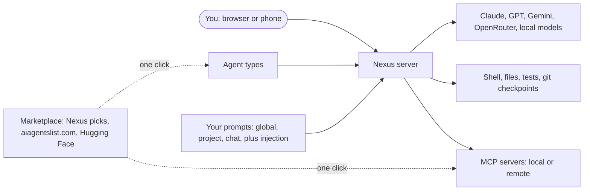

<p align="center">
  
</p>

<p align="center">
  <b>Nexus is an AI coding agent you run on your own machine and use from any browser, including your phone.</b><br>
  It reads your code, edits files, runs commands and tests, and asks before anything risky.<br>
  <sub>If Nexus is useful to you, a ⭐ on GitHub helps other people find it.</sub>
</p>

<p align="center">
  <a href="https://github.com/glsoo/nexus/actions/workflows/test.yml"></a>
  <a href="LICENSE"></a>
  
  
  
  
</p>

<p align="center">
  <a href="#-quick-start">Quick start</a> ·
  <a href="#-why-nexus">Why Nexus</a> ·
  <a href="#-whats-inside">What's inside</a> ·
  <a href="#-models">Models</a> ·
  <a href="#-agents-prompts-and-the-marketplace">Agents and marketplace</a> ·
  <a href="#-windows">Windows</a> ·
  <a href="#-configuration">Configuration</a>
</p>

<p align="center">
  
</p>

## 💡 Why Nexus

- **It works while you're away.** Turn on autopilot with a dollar budget, walk off, and your phone buzzes when the chat finishes or needs you. Or schedule it: `/schedule 0 9 * * 1-5 /review` reviews the project every weekday morning.
- **It's yours.** It runs on your computer, with your files, your shell and your keys, and your chats are stored there too, not in someone else's cloud.
- **Any model, with the cost in plain sight.** Claude, GPT, Gemini, Groq, DeepSeek, Mistral, xAI, hundreds more through OpenRouter, or a free local model in Ollama or LM Studio. Each chat shows its cost in dollars, estimated from list prices.
- **Several agents at once without collisions.** Agents can work in their own git worktrees and hand back a branch each, so you merge the one you like.
- **Any screen.** The same agent on your desktop, a laptop or an installed phone app, with voice input.
- **Bring your setup.** Your `AGENTS.md`, `CLAUDE.md` or `.cursorrules`, the skills and commands you made for Claude Code, Codex or VS Code, and your MCP servers all work as they are. Open a folder you already have, or start from any GitHub repo with one paste.

## ✨ What's inside

| | |
| --- | --- |
| 🤖 **A real coding agent** | Reads, searches and edits your code, runs shell commands and tests, spins up subagents for side quests, and keeps a task list. Plan mode researches first and proposes a plan before touching anything. |
| 🛒 **Agent marketplace** | 120+ hand-picked agents ship with Nexus, from security reviewers and vulnerability patchers to test writers, DevOps and frontend specialists. You can also browse [aiagentslist.com](https://aiagentslist.com/agents) and [Hugging Face](https://huggingface.co/datasets/tiny-agents/tiny-agents). Install any of them in one click. |
| 🧰 **Skills** | The marketplace's **Skills** tab installs Agent Skills, the `SKILL.md` folders Claude Code, Codex and VS Code use, from [Anthropic's collection](https://github.com/anthropics/skills), popular collections such as Superpowers, Vercel, OpenAI, Hugging Face and Trail of Bits, [skills.sh](https://skills.sh), or any GitHub link you paste. Read, update, turn off or remove what you have from **Installed**, and `/create-skill` has the AI write a new one. Skills you already set up for those tools (`.claude/skills`, `.agents/skills`, `.github/skills`) work as they are. Nexus reads a skill when a task fits, and every skill is also a `/command`. |
| 🔌 **MCP marketplace** | One-click [MCP](https://modelcontextprotocol.io) servers: Hugging Face, GitHub, Playwright, Context7, Brave Search and more, plus hundreds of community servers and Hugging Face Spaces. Both local (stdio) and remote (streamable HTTP) servers work. |
| ✈️ **Autopilot** | One click and the agent stops asking: it approves its own tool calls, answers its own questions, approves its own plan, and keeps going. A request cap (150 requests per message you send, subagents included; change it in **Settings**) and your budget keep it from running away. |
| 💵 **Cost and budgets** | The meter shows each chat's cost in dollars, from the provider's list prices. Set a budget in the Tokens panel or with `/budget 5`, and the agent stops when it's reached. **Settings** adds up every chat. |
| 🌿 **Parallel agents on branches** | Tick **Own branch** on the Agents page, or let the agent launch subagents with worktree isolation. Each one works in its own git worktree, and its changes come back committed on a branch to review and merge. |
| 🧪 **Tests that fix themselves** | `/check npm test` runs your command after every turn that changed files. When it fails, the agent gets the output and fixes it, up to three rounds. |
| ✍️ **Works with your editor** | `/watch on`, then write a comment like `// handle empty input AI!` in VS Code, Vim or anything else and save. Nexus does it and removes the comment. |
| 📥 **Clone and go** | Paste a GitHub (or any git) URL into the clone button next to **New project**, and the repo becomes a chat. |
| 📂 **Open any folder** | The folder button next to **New project** opens a folder you already have, anywhere on the computer, as a project. On a Windows PC it uses Windows' own Select Folder dialog; from a phone or another computer, a folder browser in the page. Nexus works in it where it is, and removing the project leaves the folder alone. **Folders** in a project's menu adds more folders to the same chat, like a backend next to a frontend: the AI reads and edits them like the project, and rewinding a prompt rewinds them too. |
| 🔎 **Search every chat** | The box above your chats searches what was said in all of them and jumps to the message. |
| 📜 **Bring your rules** | Nexus reads `AGENTS.md` and `NEXUS.md`, and in a repo without `AGENTS.md` it follows `CLAUDE.md`, `GEMINI.md`, `.cursorrules`, `.windsurfrules`, Copilot instructions or Aider's `CONVENTIONS.md`. |
| ⏰ **Schedules** | `/schedule <cron> <prompt>` runs a prompt on a timer in that chat: a morning review, a nightly dependency audit, a weekly cleanup. |
| 🔔 **Push notifications** | Your phone hears when a chat finishes or waits for an approval, even with Nexus closed. This is standard Web Push, sent straight from your server. |
| 🙋 **Questions and alerts** | The agent asks when a decision is yours, with options to tap, instead of guessing. When another chat finishes or needs an answer, you get a toast that opens it, a mark in the sidebar and a count in the tab title, or a system notification while Nexus is in the background. The computer Nexus runs on notifies you too, even with no browser open: a Windows toast you can click to open the chat, macOS Notification Center, or notify-send on a Linux desktop. Your phone gets Web Push. |
| 🐙 **GitHub flow** | `/review` reviews your branch or a pull request, `/issue 42` fixes an issue with a test, and `/pr` commits, pushes and opens the pull request. All three use the GitHub CLI. |
| 👀 **It can see** | A Screenshot tool lets the agent look at the page it just built in headless Edge or Chrome, at desktop or phone width. |
| 🗂️ **Workspace viewer** | The Files tab shows every folder in the chat, and opens code with syntax colors and line numbers for the usual languages, big files included. You can still edit and save it there. It follows changes the AI or another app makes, and asks before replacing edits you haven't saved. |
| 📎 **Point at code** | Type `@` to pick a file from any folder in the chat, or select lines in the Files tab and press **Ask Nexus**. |
| 🎭 **Swap agents per chat** | The **Agent** button next to the model turns a chat into any agent type, with its own instructions, tools and model. |
| ✍️ **Create agents with AI** | Type `/create-agent reviews my PRs for security holes` and the AI writes a new agent type for you, tailored to your project. |
| 🧠 **Your own prompts** | Edit the system prompt for everywhere, one project or one chat. Prompt injection adds standing instructions to every message you send, where models weigh them most. |
| 🧑‍🦰 **Ponytail mode** | The [ponytail](https://github.com/DietrichGebert) "lazy senior dev" agents ship in the catalog: the smallest change that fully solves the task, plus review, audit and debt ledger agents. |
| 📱 **Phone app and voice** | Install it from the browser's **Add to Home Screen** for a full-screen app. It has a layout built for small screens, a keyboard-aware composer, 44pt touch targets, and a mic button that turns speech into your message. |
| ⏪ **Safe by default** | Permission modes, approval prompts, a checkpoint before every prompt so you can rewind files and conversation, an **Undo file** button for each file in the Changes tab, and a server that listens on localhost only. |
| 🛡️ **Risk check** | Before a risky command or edit runs (deleting folders, force-pushing, git resets, admin rights, deploys, database deletes, secrets or CI files), the chat's model rates its risk. If it is high, the agent stops to look for a safer way first. If there isn't one, you're asked; on autopilot or in bypass it goes ahead. Turn it off in Settings. |
| ✅ **Keep or undo each edit** | After a turn, the files it changed wait above the message box, like in VS Code: open a file to see its diff, then **Keep** or **Undo** it, or **Keep all** and **Undo all** at once. |
| 🔁 **Self-improving** | Ask the built-in self-improvement bot for a feature and it edits Nexus itself and runs the tests. As a Linux service it also restarts, and rolls back if the server doesn't come back. |

<table>
  <tr>
    <td width="62%"></td>
    <td width="19%"></td>
    <td width="19%"></td>
  </tr>
</table>

## 🚀 Quick start

You need **Node.js 24+**, **Git** and **ripgrep**, plus `make`, `g++` and `python3` in case `node-pty` has to compile for your platform. You also need a model: an API key for **OpenAI, Anthropic, OpenRouter, Gemini, Groq, DeepSeek, Mistral or xAI**, or a local model in **Ollama** or **LM Studio**.

```sh
git clone https://github.com/glsoo/nexus.git
cd nexus
npm install
cp .env.example .env
npm run set-password -- <user> <password>   # writes the login to .env
```

Add your API keys to `.env`, or skip this and paste them into **Settings → Models** once Nexus is running:

```sh
OPENAI_API_KEY=sk-...
ANTHROPIC_API_KEY=sk-ant-...
# any of these work too; see Models below
OPENROUTER_API_KEY=sk-or-...
GEMINI_API_KEY=...
```

Then start it and open **http://127.0.0.1:7711**:

```sh
npm start
```

There is no build step. Never commit `.env`; it is already in `.gitignore`.

> [!IMPORTANT]
> The server listens on `127.0.0.1` only. To use it from your phone or another computer, put an HTTPS tunnel or reverse proxy in front of it. Anyone who logs in gets shell access to the machine, so use a strong password. Push notifications, voice input and installing the app need that HTTPS address too, because browsers only allow them on secure origins. On iPhone, add Nexus to the Home Screen before turning on notifications.

## 🧠 Models

The model picker lists every model your keys unlock, grouped by provider, with prices and a **Free** tag. Paste a key into **Settings → Models**, and Nexus checks it and shows how many models it unlocks. Pasted keys are saved in `~/.nexus/keys.json`, readable only by you; a key in the environment wins over one pasted there.

| Provider | How to turn it on |
| --- | --- |
| OpenAI, Anthropic | `OPENAI_API_KEY`, `ANTHROPIC_API_KEY` |
| OpenRouter (hundreds of models, some free) | `OPENROUTER_API_KEY` |
| Google Gemini, Groq, DeepSeek, Mistral, xAI | `GEMINI_API_KEY`, `GROQ_API_KEY`, `DEEPSEEK_API_KEY`, `MISTRAL_API_KEY`, `XAI_API_KEY` |
| Alibaba Qwen (DashScope / Model Studio) | `DASHSCOPE_API_KEY`. A key from any region works: Nexus finds the region that issued it. |
| Ollama, LM Studio | Nothing: their models appear while they run on this computer |
| Any OpenAI-compatible server | A `providers` entry in `~/.nexus/settings.json` |

```json
{
  "providers": {
    "work": { "name": "Work gateway", "baseURL": "https://llm.example.com/v1", "apiKey": "..." }
  }
}
```

A `providers` entry can also hold the key for a built-in provider, as in `"gemini": { "apiKey": "..." }`. Model ids look like `ollama:qwen3-coder:30b` or `openrouter:anthropic/claude-haiku-4.5`. The agent needs a model that can call tools, and Ollama's default context is small for agent work, so start Ollama with a larger `OLLAMA_CONTEXT_LENGTH`. Keys never reach the shell commands the agent runs.

## 🧩 Agents, prompts and the marketplace



- **Agent button** (next to the model): switch this chat to any agent type, go back to the default **Nexus**, create a new one with AI, or open the marketplace.
- **Prompts button** (the sliders): three tabs.
  - **This chat** adds to the system prompt for this conversation only.
  - **Project** adds to it for every chat in this folder.
  - **Everywhere** rewrites Nexus's base instructions, and you can reset to default at any time.

  Each tab also has an **injected** box: text added to every message you send. Preview shows the exact system prompt the model gets.
- **Marketplace** (`/marketplace`, the Agents page, or **Add MCP server** in Settings): agents and MCP servers from three sources, and skills from Anthropic, well-known collections, skills.sh or a GitHub link. A skill shows the files it brings before you install it. Installing an MCP server always shows the exact command or URL first, because it runs third-party code or sends data to a remote service.
- **`/create-agent <what it should do>`**: the AI looks at your project and writes the agent file. You approve the write like any other edit.

| Command | What it does |
| --- | --- |
| `/create-agent <task>` | Have the AI write a new agent type |
| `/create-skill <task>` | Have the AI write a new skill |
| `/agent` · `/prompts` · `/marketplace` | Open the agent picker, the prompts editor, or the marketplace |
| `/plan` · `/mode <mode>` | Research-only plan mode, or `default`, `acceptEdits`, `plan` or `bypass` |
| `/model <id>` · `/effort <level>` | Change the model or the reasoning effort |
| `/compact` · `/autocompact` | Summarize the chat to free context, now or automatically |
| `/autopilot [on\|off]` | Keep working without stopping to ask |
| `/cost` · `/budget <dollars>\|off` | Show tokens and cost, or stop once the chat has cost that much |
| `/review [PR]` · `/issue <n>` · `/pr [notes]` | Review a branch or pull request, fix a GitHub issue, open a pull request |
| `/schedule <cron> <prompt>` | Run a prompt on a timer; `/schedule` lists them and `/schedule remove <id>` drops one |
| `/check <command>\|off` | Run a command after each change and have the agent fix failures |
| `/watch [on\|off]` | Act on `AI!` comments you save in any editor |
| `/export` | Download the chat as Markdown |
| `/init` · `#note` | Write a `NEXUS.md` for the project, or save a note to it |
| `!cmd` · `@path` | Run a shell command yourself, or mention a file |

Custom commands live in `.nexus/commands/*.md` or `~/.nexus/commands/*.md`: the file is the prompt, `$ARGUMENTS` is replaced by what you type after the command, and a `description:` line in the frontmatter shows in the `/` menu. Claude Code's `.claude/commands/` and VS Code's prompt files (`.github/prompts/*.prompt.md`, where `${input:…}` takes the arguments) work too. Agent types live in `.nexus/agents/` or `~/.nexus/agents/`.

## 🪟 Windows

Nexus runs natively on Windows with a small themed launcher. It starts the server, opens your browser, and saves your login encrypted with Windows DPAPI. You need Node.js 24+, [Git for Windows](https://git-scm.com/download/win) (which provides Git Bash) and ripgrep, all available through `winget`.

```powershell
git clone https://github.com/glsoo/nexus.git
cd nexus
powershell -ExecutionPolicy Bypass -File windows\install.ps1 -Launch
```

This builds `windows\Nexus.exe` and adds a **Nexus** shortcut to your desktop. The launcher's Settings set the login, API keys and port. To update, run `git pull`, then rerun `install.ps1` while the launcher is closed.

## 🔧 Configuration

Optional settings, in `.env` (or `windows\.env` on Windows):

| Variable | Default | Purpose |
| --- | --- | --- |
| `NEXUS_PORT` | `7711` | Port to listen on |
| `NEXUS_PROJECTS` | `~/projects` | Where conversations are stored |
| `NEXUS_HOME` | `~/.nexus` | User-level settings, prompts, agents, skills and commands |
| `NEXUS_MODEL` | `gpt-6.1-sol` | Default model for new chats |
| `NEXUS_URL` | `http://127.0.0.1:<port>` | Public address used in `present` links |
| `NEXUS_AUTO_UPDATE` | on | Set to `0` to turn off automatic updates |
| `NEXUS_COMPAT` | unset | Name of another tool whose `.name/` folders and `NAME.md` should also be read |

Hooks, MCP servers, providers and the auto-compact size live in `~/.nexus/settings.json`, which you can edit on the Settings page. Hooks run on `PreToolUse`, `PostToolUse`, `UserPromptSubmit`, `Stop`, `SubagentStop`, `PreCompact` and `Notification`, and a hook that exits with 2 blocks the tool call or prompt. The global system prompt lives in `~/.nexus/prompts.json`.

## 🔄 Updates

Every 6 hours, when nothing is running, Nexus fetches `origin/main` and merges it into your local branch, so your own commits stay. It then runs the tests and restarts. If the merge conflicts or the tests fail, your code stays as it was, and that update is skipped until a newer one appears. Settings shows the version, your local change count and the last result, and has an **Update now** button.

Automatic restarts need the systemd service below. Automatic updates are Linux-only.

## 🧪 Test

```sh
npm test
```

## 🧰 Run as a service

`~/.config/systemd/user/nexus.service`:

```ini
[Unit]
Description=Nexus

[Service]
WorkingDirectory=/path/to/nexus
ExecStart=/usr/bin/node --env-file=.env server/index.js
Restart=on-failure
RestartSec=5

[Install]
WantedBy=default.target
```

```sh
systemctl --user daemon-reload
systemctl --user enable --now nexus
journalctl --user -u nexus -f
```

## 🤝 Contributing

Issues and pull requests are welcome. `npm test` runs the whole suite in a few seconds, and GitHub Actions runs it on Linux, macOS and Windows for every push.

## 🙏 Credits

The Ponytail agents are adapted from [ponytail](https://github.com/DietrichGebert) by Dietrich Gebert, under the MIT license (see `catalog/LICENSE-ponytail`). Marketplace listings come live from [aiagentslist.com](https://aiagentslist.com) and [Hugging Face](https://huggingface.co). Treat third-party agents and servers like any code you install: read what they do first.

## 📄 License

MIT. See [LICENSE](LICENSE).
