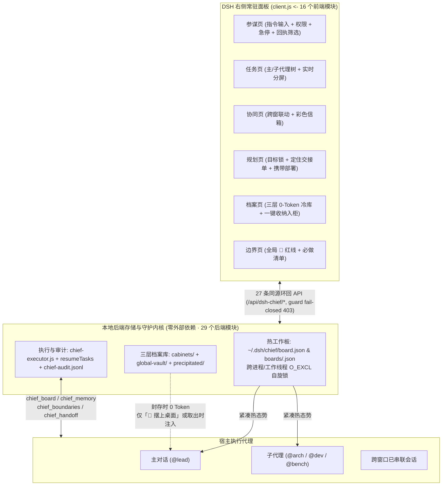

<div align="center">

**给 DeepSeek Harness（DSH）用的右侧栏任务看护、防压缩忘事与权限管控面板**  
<sub>长对话 `/compact` 前先存参数再压缩，子代理进度一屏看完，改文件跑命令前逐项弹窗问你。</sub>


<sub>默认只读起手 · 越权操作前先确认 · `dsh plugin --profile web add dsh-chief`</sub>

<br />


<br />

# DSH 参谋长 (`dsh-chief`)
### DeepSeek Harness 右侧常驻多代理看护、0-Token 本地档案柜与安全审批面板

[](https://dsh.deepseek.com)
[](https://www.npmjs.com/package/dsh-chief)
[](https://awesome-dsh-plugin.com/p/gluztm/dsh-chief/)
[](https://www.bilibili.com/video/BV1DqsV6QEGi)
[](https://github.com/deepseek-ai/dsh-superagent-prototype)
[](https://nodejs.org)
[](#)
[](LICENSE)

> **当前版本 `v1.3.0`**：把盯流程、防死循环和压缩前抢救细节收进右侧面板。  
> 协同结构参考官方 **[SuperAgent (`dsh-superagent-prototype`)](https://github.com/deepseek-ai/dsh-superagent-prototype)** 的 Router + Workers 分工思路，但多代理彼此隔离且不强行抢主对话上下文。

**简体中文** · [English (`README.en.md`)](README.en.md) · [更新日志 (`CHANGELOG.md`)](CHANGELOG.md)

</div>

---

## 主要解决哪些日常麻烦

写代码和跑长会话时最常踩的几个坑，这个面板逐个给了工程上的硬兜底。

### 1. 上下文一压缩（`/compact`）就忘了前面查出来的路径和命令
- 常见状况：对话一长触发压缩，刚找到的配置路径、端口、报错行号和回滚命令全被摘要吃掉，模型回头重读文件、重新踩坑。
- `dsh-chief` 的做法：支持 `✦ 智选压缩`、自定义 `10%–95%` 或 `>= 8,000` Token 触发线，也支持直接在右侧输入「压缩吧」。
- 压缩顺序固定为「先抢救细节并校验写入本会话档案柜 → 再静默调用宿主 `/compact`」。如果没产生历史消息或压缩报错，计数绝不虚增。

### 2. 长任务跑到一半停下，或者丢下一句“改好了你自己测”
- 常见状况：无人值守或挂机跑多步改动时，模型跑完一半就汇报完成，漏掉测试和构建验证。
- `dsh-chief` 的做法：用核心目标锁死最终验收标准，可开启 `⚡ 主动强介入`（支持 `0 = ♾️` 无限轮自动续推，同时带无进展熔断），必须核验完 `allowed` 必做清单并由你点击 `✅ 批准结项` 才会停表。
- 想立刻收回控制权时，点击输入栏红色 `⏹ 急停` 直接打断后台驱动。

### 3. 常驻记忆插件每轮塞几千字进提示词，烧 Token 还把模型带偏
- 常见状况：普通记忆插件每次发消息都把几十条过时笔记硬塞进 System Prompt，主模型被无关旧账带偏，费用还高。
- `dsh-chief` 的做法：把工程档案放进三层本地冷库（本会话柜 / 全局柜 / 沉淀柜），**封存时向主对话注入 0 字节、0 Token**。
- 平时不进上下文，需要参考哪几份卷宗时再点 `📌 摆上桌面` 或 `📤 取出`，用完点 `放回` 就从提示词撤下。

### 4. 权限全放开怕误删文件、误推仓库，全锁死又只剩嘴上聊天
- 常见状况：一直让人确认太繁琐，一口气给了完全权限，模型又可能擅自 `git push --force`、删目录或读写 `.env`。
- `dsh-chief` 的做法：内置 `advisor`（只读 · 默认）/ `assistant` / `strategist`（逐项授权）/ `chief`（高自主）四档。
  - **新对话默认只读**：只看代码、出方案、写看板，不碰工作区文件，也不插话打断主对话。
  - **逐项弹窗审批**：改文件、跑命令、调子代理都会弹出授权确认框（写明操作内容、目标文件、原因），批一次只执行这一个动作，后端通过 SHA-256 `payloadHash` 校验防篡改与重放。
  - **红线全档位硬拦截**：删系统盘、强制推送、`git reset --hard`、读取 `.env` 与私钥等操作（含引号反斜杠、拼接、NTFS ADS 流与 `-EncodedCommand` 变形）在任何档位都会拦截，并独立追加写入 `~/.dsh/chief/chief-audit.jsonl`。

### 5. 子代理开了一堆，不知道谁卡住、谁在空转
- 常见状况：多个子代理并行干活时分散在不同标签页里，挨个点开看推理流很费劲，口头叮嘱的规矩聊几轮就忘。
- `dsh-chief` 的做法：任务页按主代理与子代理展开树状卡片，支持原地改状态、白话追问某一步、以及点击 `分屏` 直接拉起实时推理流；边界页支持点亮 `📌` 图钉把全局红线跨任务固定下来。

### 6. 对话聊太长变慢变贵，换新窗口又得从头交代背景
- 常见状况：开了 100 轮想重开新窗口，却怕丢失背景、模型配置和刚梳理完的任务分工，或者后台总结插件偷偷走高价按量渠道。
- `dsh-chief` 的做法：默认 `⏸ 按需`（后台 0 自动调用），严格对齐主会话当前的 Provider 和模型；通过 `📌 定住防改` 锁定人工核对过的交接单，一键新建窗口接力时可选带入哪一层工作档案。

---

## 界面与功能说明

### 01 · 参谋主面板（`参谋` 页签）
- 底部输入框可指派参谋查看代码、改文件、跑测试或整理档案，左上角汇总当前状态胶囊（`⚡ 强介入`、`✦ 智选压缩`、`🛡 红线哨兵`、权限档位与 `⏹ 急停`）。
- 对话区支持 `全部 / 💬 问答 / 📋 回执` 筛选；如果当轮生成了多条可执行建议，统一收拢在顶部 `▶ 执行建议` 按钮，避免卡片按钮误触。


---

### 02 · 主代理与子代理任务树（`任务` 页签）
- 按根会话与子代理纵队展开卡片，直接在卡片上调整状态、让人话解释某一步在干嘛、派发任务或点 `分屏` 看实时输出流。

<div align="center">
  
</div>

---

### 03 · 三层本地冷档案柜（`档案` 页签）
- 分为三层：**💬 本会话档案柜**（按 `rootSessionId` 严格隔离，支持分柜与「一键收纳入柜」清空临时便签）、**🌐 全局档案柜**（跨会话对比差异，标记仅本地 / 已同步 / 本地已改）、**🏛️ 沉淀档案柜**（跨项目长期经验，默认双盲封存）。
- 卷宗按目录和金/银/铜曲别针分层收纳，只在点击 `📌 摆上桌面` 时临时放入主对话上下文。

<div align="center">
  
</div>

---

### 04 · 目标锁定与步骤白话追问（`规划` 页签上方）
- 点击 `🎯 设为目标` 开启目标督导；任意计划步骤都可以点开直接问参谋「为什么有这一步、跳过会有什么影响」，不打断主对话正在跑的流程。

<div align="center">
  
</div>

---

### 05 · 跨窗口协同串联与信箱（`协同` 页签）
- 可把多个独立 DSH 窗口连在一起互通进度；断开协同立即清掉缓存、外部记忆与离线信箱残留。
- 粘贴进输入框的截图原图会存进 `<cwd>/.dsh-chief/uploads/`，避免纯文本模型看图靠猜。

<div align="center">
  
</div>

---

### 06 · 边界、必做项与 `📌` 全局红线（`边界` 页签）
- 规则分两档：点亮左侧 `📌` 图钉写入全局红线（所有新会话自动继承），不点图钉则只作用于当前会话。
- 分 `必做事项 (allowed)`、`禁止红线 (forbidden)`、`注意事项 (notes)` 三栏管理，也接收子代理撞墙后的呈批提议。

<div align="center">
  
</div>

---

### 07 · 跨会话交接单与携带参谋新开窗口（`规划` 页签底部）
- 交接单支持手改，点 `📌 定住防改` 后锁定当前快照，不会被后续自动摘要覆盖。
- 支持一键新开窗口并继承当前工作区 `workspaceId` 与参谋配置（高自主强介入默认安全置关），搭配 `idle-guard` 避免长任务空转停机。

<div align="center">
  
</div>

---

## 使用前建议了解的两件事

> [!NOTE]
> 开启实权工具、`⚡ 主动强介入` 或 `✦ 智选压缩` 前，下面两点直接决定使用体感：
>
> 1. **工程护栏决定下限，底层模型决定上限**  
>    插件负责保证 0-Token 冷隔离、四档权限审批、压缩前落盘复核、死循环熔断和 `⏹ 急停` 这些安全下限。但拆任务准不准、找 Bug 稳不稳，完全取决于你给参谋长选了哪个模型。处理复杂工程建议选推理能力强的主力旗舰模型，别用太轻的小模型。
> 2. **少叠互相冲突的外部常驻注入**  
>    不要一边用本插件，一边在项目里叠加上百条互相对着干的全局 Rules 或每轮强灌大段旧账的记忆插件。无关上下文太多会稀释当前注意力，还容易和参谋的纠偏指令打架。低频资料放进本插件的 **0-Token 档案柜**，要查的时候再取出来用，主对话才干净。

---

## 模块结构与数据流 (`v1.3.0`)

`v1.3.0` 把原先 4 个大文件按职责拆成了 **29 个后端模块 + 16 个前端模块**（无环依赖、无 `export let` 可变导出），方便审查与长期维护。详情见 [ARCHITECTURE.md](ARCHITECTURE.md)。



---

## 安装与宿主版本兼容

在已装好 [dshmarket](https://github.com/dsh-market/dsh-market) 的 DSH 里直接搜 **`dsh-chief`** 或 **`DSH 参谋长`** 就能点安装，也可以用命令行（网页版把 `desktop` 换成 `web`）：

```bash
# 方式 1：通过 npm 安装最新版（v1.3.0）
dsh plugin --profile desktop add dsh-chief

# 方式 2：从 GitHub 仓库直接安装（与 main 最新代码同步）
dsh plugin --profile desktop add github:gluztm/dsh-chief

# 方式 3：安装 GitHub Release 预构建包（v1.3.0）
dsh plugin --profile desktop add https://github.com/gluztm/dsh-chief/releases/download/v1.3.0/dsh-chief-1.3.0.tgz
```

装好后重启或刷新 DSH 客户端，点工作区右上角 **✦ `DSH 参谋长`** 图标打开面板。

### 宿主版本兼容表

| DeepSeek Harness (DSH) 版本 | 面板 / 看板 / 三层档案柜 / 工具执行 | 命名子代理树 (`task.dispatch` / `team.*`) | 说明 |
| :--- | :---: | :---: | :--- |
| **`>= 0.2.2-rc.2`（推荐 `rc.3+`）** | 完整可用 | 完整可用 | 宿主原生提供 `subagents.resolveName` / `rootOf` / `namesOf` |
| `0.2.0 ~ 0.2.2-rc.1` | 正常挂载 | 提示升级 | 旧版无命名子代理 API，面板会自动拦截高风险调用并提示升级 |

---

## 注册给模型的 4 个工具

插件只读注册 4 个结构化工具，动作参数同时兼容严格 JSON 与常见文本写法：

| 工具名 | 用途 | 常用动作 (`action`) |
| :--- | :--- | :--- |
| **`chief_board`** | 驱动任务板、检索冷档案、跨代理发信、申请提权、触发压缩 | `graph.plan`、`task.add`、`task.update`、`plan.set`、`cursor.set`、`mail.send`、`archive.save`、`archive.search`、`bounds.propose`、`permission.request`、`context.compact` |
| **`chief_memory`** | 读写会话级热记忆（决策 / 进展 / 验证 / 风险） | `list`、`get`、`add`、`update`、`remove` |
| **`chief_boundaries`** | 读写全局 `📌` 红线、必做项（`allowed`）与注意事项 | `get`、`set`、`add`、`pin`、`remove` |
| **`chief_handoff`** | 预览并生成独立自包含的跨会话 Markdown 交接单 | `preview` / 会话接力 |

---

## 本地存储与安全边界

- **跨进程与多线程文件锁**：`board-store.js`、`chief-state.js`、`archive-core.js` 对每次落盘使用带 `O_EXCL` 和随机抖动重试的文件锁（包含 Windows NTFS 瞬态 `EPERM/EACCES/EBUSY` 重试）以及 `threadId` 唯一临时文件原子替换，并发写入不丢单。
- **27 条接口同源环回校验**：全部 `/api/dsh-chief/*` 接口先校验 Loopback 来源与 `Origin/Host`，连接守卫异常时 fail-closed 返回 `403`。
- **凭据防误存与零遥测**：禁止写入 `sk-*`、`ghp_*`、Bearer Token、`AIza*`、`AKIA*` 与私钥片段；一键收纳含疑似密钥的便签会自动脱敏为 `[REDACTED]`。所有状态、档案与审计日志完全留在本地 `~/.dsh/chief/`，零外部依赖，零遥测上报。

---

## 贡献者

| 贡献者 | 主要工作 |
| --- | --- |
| [gluztm](https://github.com/gluztm) | 项目发起人、产品定义与长期维护 |
| [Gemini](https://github.com/gemini-code-assist) | 功能研发、`v1.3.0` 模块化拆分、安全执行器与自动化门禁实现 |
| [Codex](https://github.com/codex) | 模块化架构设计、高并发压测与红队边界审查 |
| [deepseek-ai](https://github.com/deepseek-ai) | DeepSeek Harness 宿主运行时与 SuperAgent 协同机制支持 |

---

## 开源协议

基于 **[GNU Affero General Public License v3.0 (`AGPL-3.0-only`)](LICENSE)** 开源。
