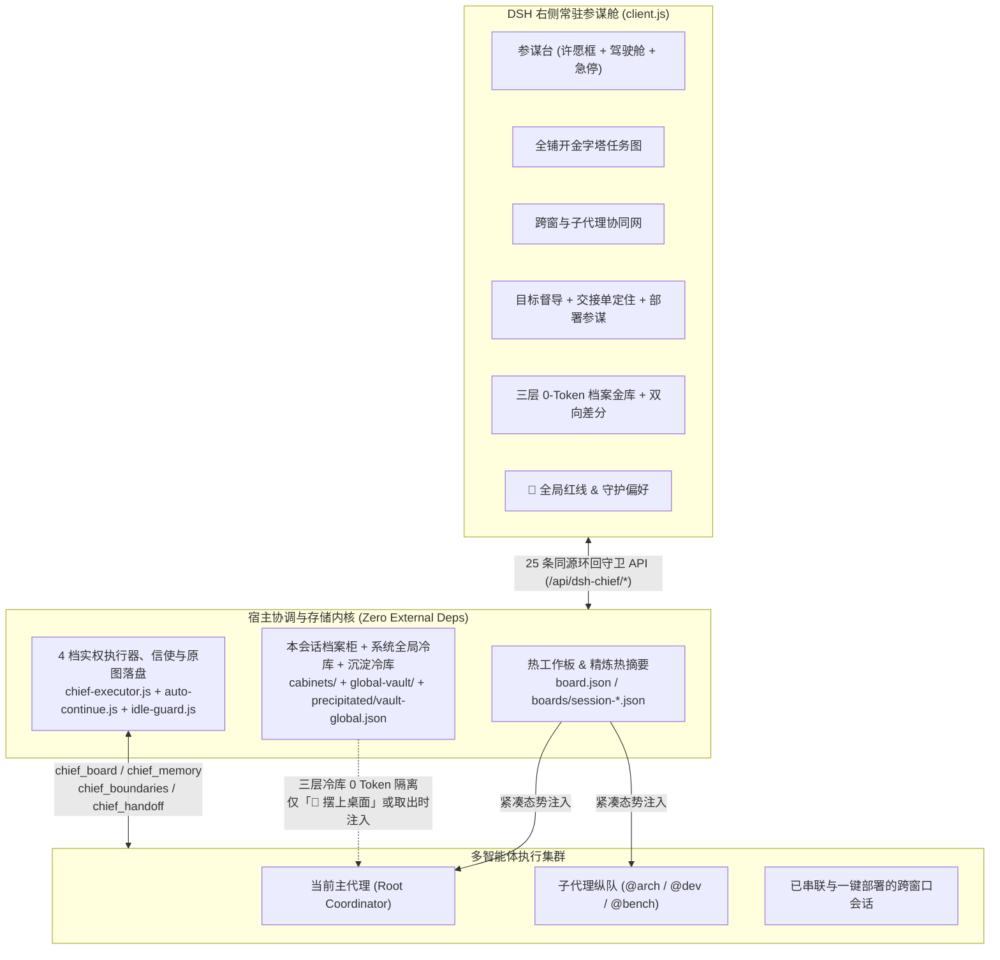

<div align="center">

**AI 管 AI，你当甩手掌柜 —— 你不在的时候，它也替你盯着。**  
<sub>它自己派活、自己盯子代理、自己收口；跑偏了先熔断，不用你守着屏幕。</sub>


<sub>默认只读起手 · 越权改工作区会先问你 · `dsh plugin --profile web add dsh-chief`</sub>

<br />


<br />

# ✦ DSH 参谋长 (`dsh-chief`)
### DeepSeek Harness 多智能体指挥舱 · ✦ 许愿框一站式办理 · 三层 0-Token 档案金库 · `✦ 智选压缩`

[](https://dsh.deepseek.com)
[](https://www.npmjs.com/package/dsh-chief)
[](https://awesome-dsh-plugin.com/p/gluztm/dsh-chief/)
[](https://www.bilibili.com/video/BV1DqsV6QEGi)
[](https://github.com/deepseek-ai/dsh-superagent-prototype)
[](https://nodejs.org)
[](#)
[](LICENSE)

> **不盯着也不出事：向右侧「✦ 许愿框」许下意图，它自己把流程跑完，跑歪了先拦住（`v1.2.1`）**  
> 做法对齐 DeepSeek 官方 **[SuperAgent (`dsh-superagent-prototype`)](https://github.com/deepseek-ai/dsh-superagent-prototype)** 的「Router 统筹 + Workers 隔离执行」：把散装聊天窗收成一张常驻指挥台。

**简体中文** · [English (`README.en.md`)](README.en.md) · [更新日志 (`CHANGELOG.md`)](CHANGELOG.md)

</div>

---

## 🔗 与 SuperAgent 及 DSH 原生能力深度联动

- **常驻指挥中枢**：把主对话、子代理和跨窗独立会话收拢到同一张**全铺开金字塔拓扑图**，不再在十几个黑盒标签页间来回切换。
- **原生分屏盯流 (`subagentchat`)**：任意子代理卡片点击「`分屏`」，直连 `sidebarRight.openResource` 拉开实时推理流。
- **默认只读，先看后动 (`chief-executor`)**：新开与接力的会话都从只读起手 —— 先观察、先出方案；要改工作区、跑命令、调度子代理，得逐项拿到你的允许，敏感动作弹窗确认并留审计日志。
- **空白新对话即开即用**：主对话尚未发送第一条消息时，自动定位当前工作区开工，或预埋待领包给即将开启的 `@lead`。
- **目标锁死 + 人类拍板结项**：强介入锁定核心目标（支持 `0 = ♾️` 无限轮），达标后核验 `allowed` 必做清单并等待人类点击「`✅ 批准结项`」。
- **✦ 智选压缩 + 灵活安全阈值**：支持 `✦ 智选压缩` 在阶段收口等主代理空闲后触发，也支持 `10%–95%` / `>= 8k` Token 阈值或直说「压缩吧」。
- **跨隔离真 `/compact`**：自动跨过 Cordis 服务隔离调用官方 `/compact` 通道，先抢救工程细节入柜并复核落盘，再静默压缩留回执。
- **三层 0-Token 档案金库**：💬 本会话柜（1:1 隔离）、🌐 系统全局冷库（双向差分）、🏛️ 沉淀冷库（默认双盲 0 字节），支持一键「`📌 摆上桌面`」与「`组合递话`」。
- **跨窗协同与定住防改交接单**：入网前提示污染风险、断联立即净化防串味，支持手改与一键「`📌 定住防改`」冻结交接快照。

---

## 💡 为什么需要「DSH 参谋长」？（6 大日常痛点 × 独家破局机制）

普通待办只是多了一块手写备忘录，常驻记忆只是每轮往提示词里硬塞几千字旧账；**`dsh-chief` 把「人盯 AI 干活」反转为「许愿式一站式跑通」**。

### 1. AI 半途偷懒交差（“改好了你自己测吧”）
- **普通插件**：只有静态文字清单，模型自说自话就能宣布完成。
- **`dsh-chief` 解法**：用「🎯 目标督导」+「⚡ 强介入（`0 = ♾️` 无限轮）」锁死终点，未核验 `allowed` 必做清单且未获你点击「`✅ 批准结项`」绝不放行。
- **可控急停**：触发高危动作前先弹窗确认，随时点击红色 **「⏹ 急停」** 秒切人工接管。

### 2. 上下文一压缩就“脑叶切除”式失忆
- **普通插件**：压缩一触发，刚查出来的路径、命令和结论全被抹光。
- **`dsh-chief` 解法**：支持「`✦ 智选压缩`」、`10%–95%` / `>= 8k` Token 阈值，以及一句「压缩吧」确定性办理。
- **原子保底**：强制先抢救细节入本会话档案柜并核验落盘，再跨隔离静默 `/compact`；失败或免压绝不虚增计数。

### 3. 传统记忆插件把对话模型“脑子”搅浑、Token 越用越多
- **普通插件**：每轮把几十篇过时笔记硬灌进 System Prompt，烧 Token 还干扰当下推理。
- **`dsh-chief` 解法**：三层冷库平时 **0 字节 / 0 Token 物理隔离**，沉淀库默认双盲不可见。
- **精准按需**：只有你点击「`📌 摆上桌面`」或「`📤 取出`」时才临时注入，点回封存即刻归零。

### 4. 只敢嘴上聊天的“吉祥物副驾”，一放权就裸奔
- **普通插件**：要么只能看不能动，要么一放权就全盘裸奔，改坏了你的文件你也不知道。
- **`dsh-chief` 解法**：默认只读，越权一项项问你 —— 你不管的时候它也不会乱来：
  - **新会话一律只读**：只观察、只分析、只给方案，不碰工作区，也不接管主/子工作流。
  - **动手前先申请**：改文件、跑命令、调度子代理这类操作，会弹 **「🛡️ 操作授权请求」**（做什么 / 对谁 / 为什么 / 影响），你点「允许本次操作」才执行。
  - **高危档位二次确认**：给更高自主权之前，要先读 **「⚠️ 高权限模式风险告知」** 并勾选，后端再校验一次。
  - **随时能收回**：红色 **「⏹ 急停」** 一按就切回人工接管，全程留下审计日志。

### 5. 多子代理黑盒迷宫 & 口头红线聊十轮就忘
- **普通插件**：窄视口列表反复拖拽，聊天里交代的红线随上下文滚出窗口。
- **`dsh-chief` 解法**：全铺开金字塔 DAG + 原生分屏看流 + **「`📌` 图钉全局红线」**跨任务永久生效，子代理撞墙主动呈批。

### 6. 换窗口就断档 & 后台偷偷按量计费
- **普通插件**：切窗口前情全丢；后台每轮乱跑总结，还常把订阅模型错配到高价按量渠道。
- **`dsh-chief` 解法**：默认 **`⏸ 按需`（0 后台自动调用）**，严格对齐主会话 `Provider · 模型`；支持跨窗互联、断联净化与一键携参谋部署接力。

---

## 📸 全景实机导览（`v1.2.0` 7 大核心视窗）

### 01 · 许愿式参谋指挥舱（`参谋` 页签）
- **实权许愿框**：输入栏居左收拢 `+` 战术驾驶舱，上方直显 `⚡ 强介入 0/♾️`、`✦ 智选压缩`、`🛡 红线哨兵`、`🔵 完全权限` 与红色 `⏹ 急停`。
- **可见工作回执**：结构化战场摘要、边界请示卡、以及 `✦ 智选压缩` 真实压完后写回的可见回执一目了然。
- **同步交接单开关**：右上角可直接切换「提炼摘要后同步更新交接单」。


---

### 02 · 全铺开金字塔子代理拓扑（`任务` 页签）
- **纵队全铺开**：`👑 主代理 · 总指挥` 居中统帅，下辖子代理横向分列纵队，不再在小视口里来回拖拽。
- **原地闭环操作**：每张节点卡直接集成「状态切换、白话解释、派发执行、对话拆解、`分屏` 实时盯流」。

<div align="center">
  
</div>

---

### 03 · 三层 0-Token 档案金库与双向差分（`档案` 页签）
- **三库严格隔离**：顶部一键切换 **💬 本会话档案柜**（1:1 隔离）、**🌐 全局档案柜**（系统冷库不跟会话）与 **🏛️ 沉淀档案柜**（跨会话双盲冷封存）。
- **四层曲别针收纳**：**多档案柜 → 抽屉 → 金/银/暗铜曲别针卷宗 → 分条记忆点 → 小点记忆**。
- **摆上桌面与双向差分**：全局与本地实时标记「已同步全局 / 本地已改 / 仅本地」；点击「`📌 摆上桌面`」才向主对话与参谋强调，并支持复选多卷「组合递话」。

<div align="center">
  
</div>

---

### 04 · 目标督导、步骤白话追问与结项门禁（`规划` 页签上方）
- **核心目标锁定**：点击「`🎯 设为目标`」开启持久目标督导；开启强介入时自动锁定核心目标为唯一终局。
- **点击任意步骤追问**：小任务板每一行都支持菜单弹窗——当场让参谋长白话解读「为什么有这步」，绝不打断主对话。

<div align="center">
  
</div>

---

### 05 · 跨窗口独立会话串联与彩色抽屉信箱（`协同` 页签）
- **跨窗协同集群**：一键串联多个独立 DSH 主窗口互享实时进度；断开链接立即净化外部记忆与缓存防串味。
- **彩色抽屉信箱**：按全网广播（`@all` 自动去重）、多方协作与各窗口会话内部信箱分色归档。
- **原图防幻觉机制**：输入栏粘贴/上传的截图原图落盘至 `<cwd>/.dsh-chief/uploads/`，纯文本参谋自动携带绝对路径降级交由主对话查看。

<div align="center">
  
</div>

---

### 06 · `📌` 图钉全局红线盖章与浓缩（`边界` 页签）
- **双作用域严格区分**：点亮左侧 **`📌` 小图钉** 升格为跨所有任务生效的「全局共享铁律」；未钉住规则仅限当前会话有效。
- **必做清单与撞墙呈批**：支持「必做事项 (`allowed`)」「禁止红线 (`forbidden`)」「注意事项 (`notes`)」，支持子代理撞墙呈批与一键浓缩合并多条旧规则。

<div align="center">
  
</div>

---

### 07 · 跨会话接力、📌 定住防改与一键部署参谋（`规划` 页签底部）
- **可手改与 `📌 定住防改`**：交接单支持手工微调；点亮 **`📌 定住防改`** 自动冻结 `[自动渲染]` 快照并锁死「同步交接单」，防止参谋后续摘要误覆盖。
- **4 档档案跟随策略**：新建或接力至已有会话时，自由选择「不带工作档案 / 仅挂桌面备查 / 带整个抽屉 / 全柜工作档案」，沉淀冷库保持绝对隔离。
- **一键携参谋上任**：无缝继承参谋长专职模型与纪律配置（强介入默认安全置关），搭配 `idle-guard` 防任务半途空转停机。

<div align="center">
  
</div>

---

## ⚠️ 使用须知与两条硬核免责声明

> [!IMPORTANT]
> 启用「✦ 许愿框实权执行」「⚡ 主动强介入」「✦ 智选压缩」前，请务必牢记以下两条客观规律：
>
> 1. **能力下限靠本插件工程护栏兜底，能力上限完全取决于底层大模型**
>    - 本插件通过 0-Token 冷隔离、默认只读越权先问、先落盘复核再压缩、轮数熔断与 `⏹ 急停` 守住安全下限。
>    - 但多步工具规划、复杂代码洞察、强介入纠偏与重点提炼的上限，**完全看你为参谋长搭配的模型智商**。
>    - 重度工程强烈建议给参谋长选配推理过硬的主力旗舰模型，勿对超轻量小模型抱有超出其推理上限的期待。
> 2. **切忌同时挂载过多“破坏对话模型脑子”的外部注入**
>    - 请勿在主对话或项目里叠加上百行互殴的全局 System Prompt / Rules，或会每轮硬塞几千字旧账的传统常驻记忆插件。
>    - **过多冗余注入会把模型的“脑子”搅浑、稀释当下注意力**，还极易与参谋长强介入指令冲突，引发死循环或提前熔断。
>    - 保持外部提示词干净克制，低频资料交由本插件 **0-Token 冷库** 按需取出，才能发挥最大战力。

---

## 🏗️ 冷热记忆分舱与多代理协同架构



---

## ⚡ 快速安装（零外部依赖）

在 DSH 已安装 [dshmarket](https://github.com/dsh-market/dsh-market) 后可直接搜索 **`dsh-chief`**（或 **`DSH 参谋长`**）点击安装，也可使用 CLI 一键装入（`web` 环境把 `desktop` 改为 `web`）：

```bash
# 方式 1：通过 npm 官方源安装（国内自动走镜像加速，支持后续检测升级）
dsh plugin --profile desktop add dsh-chief

# 方式 2：直接安装最新已发布 GitHub Release 预构建包（v1.2.1）
dsh plugin --profile desktop add https://github.com/gluztm/dsh-chief/releases/download/v1.2.1/dsh-chief-1.2.1.tgz

# 方式 3：通过 GitHub 仓库源码直接安装
dsh plugin --profile desktop add github:gluztm/dsh-chief
```

安装后刷新 DSH 界面（或重启客户端），点击工作区右上侧栏 **✦ `DSH 参谋长`** 图标即可展开指挥舱。

### 宿主版本兼容性矩阵

| DeepSeek Harness (DSH) 版本 | 面板 / 看板 / 三层冷库 / 许愿框 | 命名子代理树 (`task.dispatch` / `team.*`) | 说明 |
| :--- | :---: | :---: | :--- |
| **`>= 0.2.2-rc.2`（推荐 `rc.3+`）** | ✅ 完整支持 | ✅ 完整支持 | 原生提供 `subagents.resolveName` / `rootOf` / `namesOf` |
| `0.2.0 ~ 0.2.2-rc.1` | ✅ 正常挂载 | ⚠️ 提示升级 | 旧版子代理 API；面板自动给出升级引导并拦截风险调用 |

---

## 🛠️ 模型工具矩阵（4 Tools）

装入后向模型注册 4 个结构化工具（动作层兼容原生 JSON 数组与宽容文本传参）：

| 工具名 | 核心职责 | 典型高频动作 (`action`) |
| :--- | :--- | :--- |
| **`chief_board`** | 驱动任务图、小任务板、冷档案检索、跨代理信箱、提权请示与协同压缩 | `graph.plan`、`task.add`、`task.update`、`plan.set`、`cursor.set`、`mail.send`、`archive.save`、`archive.search`、`bounds.propose`、`permission.request`、`context.compact` |
| **`chief_memory`** | 读写会话级高密度热记忆（决策 / 进展 / 验证 / 风险） | `list`、`get`、`add`、`update`、`remove` |
| **`chief_boundaries`** | 维护图钉全局红线（`📌`）、必做事项（`allowed`）与注意事项 | `get`、`set`、`add`、`pin`、`remove` |
| **`chief_handoff`** | 预览与生成自包含跨会话 Markdown 交接单 | `preview` / 新会话接力包 |

---

## 🛡️ 工程指标与纯本地安全

- **原子写锁零丢失**：`board.json` 与三库档案文件均受基于 `wx` 排他文件锁 + 陈旧锁自动回收保护，并发写锁零损坏。
- **三层冷库零泄漏**：冷封存卷宗平时 **0 字节**注入主对话，仅在显式「摆上桌面」或「取出」时按需加载。
- **25 条同源环回守卫**：全部 `/api/dsh-chief/*` 接口强制验证 Loopback 地址与同源 `Origin/Host`，防跨站诱导。
- **敏感凭据正则硬拦截**：自动拒存 `sk-*`、`ghp_*`、Bearer Token 与 OpenSSH 私钥，所有数据 100% 存放在本机 `~/.dsh/chief/`，零遥测、零云端上报。

---

## 📄 开源许可 (License)

基于 **[GNU Affero General Public License v3.0 (`AGPL-3.0-only`)](LICENSE)** 开源发布。欢迎使用、审计与提交 PR。
