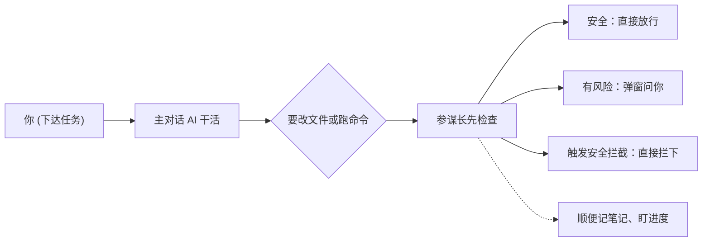
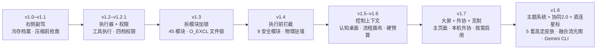
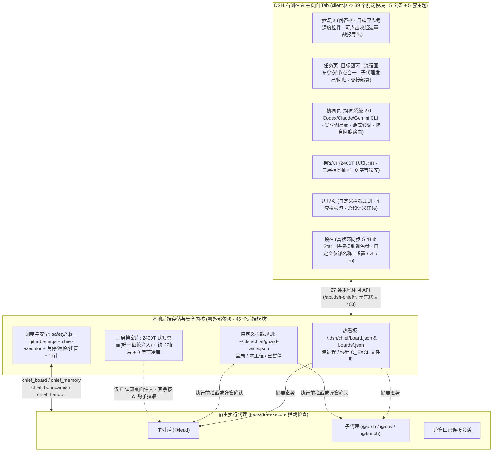

<div align="center">

# DSH 参谋长 (`dsh-chief`)
**DeepSeek Harness（DSH）参谋长插件：支持右侧栏和对话主页面大屏，普通窗口默认不介入，管任务进度、分级档案、本机外协与执行前安全拦截。**

[](https://dsh.deepseek.com)
[](https://github.com/gluztm/dsh-chief/releases)
[](https://www.npmjs.com/package/dsh-chief)
[](https://github.com/gluztm/dsh-chief/actions/workflows/ci.yml)
[](https://awesome-dsh-plugin.com/p/gluztm/dsh-chief/)
[](https://www.bilibili.com/video/BV1Fksq6iEw8)
[](https://github.com/deepseek-ai/dsh-superagent-prototype)
[](https://nodejs.org)
[](#)
[](LICENSE)


<sub>新对话默认只读 · 改文件前先问你 · 一条命令安装</sub>

**简体中文** · [English (`README.en.md`)](README.en.md) · [演进之路 (`EVOLUTION.md`)](EVOLUTION.md) · [更新日志 (`CHANGELOG.md`)](CHANGELOG.md) · [架构设计 (`ARCHITECTURE.md`)](ARCHITECTURE.md)

[这是什么](#这是什么) · [3 分钟上手](#3-分钟上手) · [选哪个预设](#我该选哪个预设) · [界面](#界面长什么样) · [名词小词典](#名词小词典) · [常见问题](#常见问题) · [进阶](#进阶给想深入了解的人)

</div>

---

## 这是什么？

在 DeepSeek Harness（DSH）里，中间主对话窗口的 AI 负责给你看代码、改文件、跑命令。`DSH 参谋长` 是挂在右边栏的一位「助理兼安全员」：平时不抢主对话的活，只在旁边帮你记路径笔记、把长任务拆成步骤盯着推进，在 AI 动你的文件或跑终端命令之前先检查一道。

新对话里它默认只看不改，不会自己动手修改工程。

**适合谁用**：在 DSH 里跑长任务、怕 AI 失手删改文件，或者聊太长一压缩就把前面查到的路径和报错忘光的人。



---

## 一句话看懂

- **普通窗口默认不打扰**：新开的普通聊天窗和子代理默认不加载参谋提示词、不触发安全拦截、不写多余看板文件；要用到时点一下「在本会话启用」，也可以在设置里改回自动开启。
- **压缩前先存档**：上下文快满时，先把路径、命令和报错记进本地档案，再调 `/compact`。
- **不让长任务跑半截停掉**：锁住目标后，模型中途停下会被催接着做；同一个错连续 3 次就停下来等人工介入。
- **改文件、跑命令前先过检查**：已启用会话里只看 **`🛡️ 安全拦截`**（内置「自动防误操作」防删盘/越界/读密钥 + 你自己写的「自定义拦截规则」），程序执行前直接拦住；控制面板和设置页均支持一键开关安全拦截（需弹窗确认）与一键暂停自定义规则。
- **普通对话只用两套概念**：**`🛡️ 安全拦截`**（程序硬拦截，AI 绕不过）和 **`📝 给 AI 的规矩`**（每轮提醒 AI 照着做：必须做 / 不要做 / 注意），再也不用分清好几种重复开关。
- **默认只读**：哪怕启用了参谋，新对话也只看不改，权限需要你自己手动调高（`L0`–`L3`）。
- **记忆少占上下文**：只有放上「认知桌面」的资料（最多 `2,400 Tokens / 6 份`）每轮发给模型，其余平时放抽屉里按需翻出来。
- **主页面 + 右侧栏双布局 + 协同系统 2.0**：对话顶部一键切进大屏 `参谋长` 页面（自动藏起下方重复主框）；顶栏左上角实时显示真实 GitHub Star 数，已装 `gh` CLI 时点一下面板内直连点星，未装时一键跳转仓库；协同页直连本机 `Codex` / `Claude Code` / `Gemini CLI`，带实时输出流、完工自动接力，以及严格的子代理/跨窗防自回旋投递校验。
- **参谋专属取名（主对话 0 字节隔离）**：可在设置页为参谋长起专属名字（如「哈基米」「贾维斯」），自动附带密钥硬拦截且全局跨工程同步、绝不写入 `@lead` 主对话提示词；原内置私有脑已按「外挂记忆插件优先 + 参谋专脑接口」规划彻底剥离，避免锁定用户记忆数据格式。

---

## 3 分钟上手

1. **安装插件**（网页版把下面命令里的 `desktop` 换成 `web`；也可以直接在 DSH 插件市场搜 `dsh-chief`）：
   ```bash
   dsh plugin --profile desktop add dsh-chief
   ```
2. **打开面板**：重启或刷新 DSH，点工作区右上角的 `✦ DSH 参谋长` 图标。
3. **选一个预设**：点顶栏的 `⚙️` 图标，新手建议先用 **🤝 日常协作**（不选也行，新对话默认就是只看不改）。
4. **正常对话**：主窗口里照常让 AI 干活；想让参谋专门查东西、起草拦截规则或整理笔记，就在右侧面板底部输入框用大白话吩咐。
5. **随时叫停**：发现不对劲，直接点输入栏最右侧红色的 `⏹ 急停` 按钮。

---

## 我该选哪个预设？

点顶栏 `⚙️` 设置图标就能直接切换这三档预设：

| 你的情况 | 选这个 | 它会做什么 | 会不会花额外的钱 |
| :--- | :--- | :--- | :--- |
| 只想先看看，不想它碰任何东西 | `👁 只读旁观`（`L0 · 关停`） | 只看不改，你问它才回答 | 不会主动调用后台模型 |
| 平时写代码、做日常任务（推荐） | `🤝 日常协作`（`L2 · 巡检`） | 平时不动不花钱；报错、断线或被安全拦截时才出来帮忙，改前先问你 | 空闲时不调用后台模型 |
| 要离开电脑，让它自己跑完 | `🚀 离桌托管`（`L3 · 托管`） | 持续盯进度，80% 自动压缩，关键节点发通知（切换时需双重确认） | 会调用，默认 30 次或 300K Token 后自动停 |

---

## 界面长什么样


右侧栏收成 5 个页签加 1 个顶栏设置页，各自管一块：

| 位置 | 在这里做什么 |
| :--- | :--- |
| `参谋` 页签 | 用大白话给参谋发指令，调权限/托管挡位，看复盘战报和点 `⏹ 急停`。 |
| `任务` 页签 | 锁定核心目标，在「任务流光图」看主线推进与子代理发出/回归连线，点步骤「解释」，导出交接单。 |
| `协同` 页签 | 用「协同系统」连线编队主/子代理、跨窗口与本机 `Codex` / `Claude Code`，支持刷新扫休眠窗与跨窗信箱。 |
| `档案` 页签 | 管理置顶「认知桌面」和三层档案抽屉，控制哪些背景资料发给主对话。 |
| `边界` 页签 | 顶部管理 **`🛡️ 安全拦截`**（自动防误操作 + `🚧 自定义拦截规则`，执行前直接拦），下方管理 **`📝 给 AI 的规矩`**（`✅ 必须做` / `🚫 不要做` / `💡 注意`）。 |
| 顶栏 `⚙️ 设置` | 选 3 档预设、切换主页面/右侧栏、设本会话与新会话启用开关、配置告警预算与中英文。 |

### 01 · 参谋主面板（`参谋` 页签）
**一句话**：在这里用大白话给参谋发指令、调权限与托管挡位，急了直接点红色急停。

- 底部输入框用来委派探路、让参谋生成自定义拦截规则或整理档案；左下控制条放了 `+` 控制面板（含 `🛡️ 安全拦截` 一键开关、`⚡ 强介入`、`✦ 智选压缩`、`✓ 完工前核实证据`、`📄 极简汇报模式`）、`L0–L3` 权限和红色 `⏹ 急停`；顶栏管 `⏸ 关停 / 🛡 巡检 / 🤖 托管`（悬停即可看懂大白话说明）与模型/扇形思考强度。
- 后台运行「🌙 梦境漫游」或自动审查时，面板会出现彩色外框和半透明毛玻璃遮罩。**点一下遮罩任意位置就能收起模糊遮罩恢复操作，外框继续亮着提示后台还在跑**。


### 02 · Bento 目标圆环卡与任务流光图（`任务` 页签）
**一句话**：顶部 **Apple Bento 目标圆环全景卡**实时显示推进百分比与目标锁定状态，下方直接以统一的**「任务流光图」（流程画布与流光节点合一）**呈现主线进度与子代理发出/回归连线。

- 顶部左卡直接展现可读目标正文（点文字即改）及 `战报 / 设为目标 / 拆成步骤`，右卡显示动态 SVG 进度圆环与当前步骤焦点提示；下方去除了繁杂的组织树与多视图切换，主画布以 1/2/3 列平滑蛇形贝塞尔流光光束连接主线步骤、在步骤节点正下方直接挂接子代理卫星卡并绘制 `发出 → 回归` 连线，点击任意节点即在画布正下方就地展开完整详情抽屉与子任务操作。

<div align="center">
  
</div>

### 03 · 认知桌面与三层档案柜（`档案` 页签）
**一句话**：只把最常用的几份放上「认知桌面」，其余分三层收进抽屉按钩子按需取用。

- 顶部是置顶 `📌 认知桌面` 和 `2,400 Tokens / 6 份` 实时进度条（这是唯一每轮随对话注入主模型的地方，超出按优先级自动退入观察队列）；下面是 **💬 本局档案柜**、**🌐 全局档案柜**、**🏛️ 冷藏档案柜**。
- 三层抽屉采用叠放卡片样式：平时只露标题和 `🪝` 关键词钩子，点开后显示详情、操作栏以及已被哪些代理拉阅。

<div align="center">
  
</div>

### 04 · 目标锁定与步骤「解释」（`任务` 页签）
**一句话**：先点 `🎯 设为目标` 锁住方向，碰到看不懂的步骤点「解释」让参谋翻成大白话。

- 顶部点 `🎯 设为目标` 开启目标督导（开强介入前必须锁定），下面接可折叠拓扑图和推进任务板；任意步骤都能点「解释」，让参谋用通俗语言说清这步在做什么、跳过有什么影响，不会打断主对话正在跑的流程。

<div align="center">
  
</div>

### 05 · 协同系统与本机外协直连（`协同` 页签）
**一句话**：在同一张画布上编队主对话、子代理、跨窗口与本机 `Codex` / `Claude Code`，干活时自动锁编，空闲保持静止。

- **本机外部代理直连**：免 `ccSwitch` 自动探测本机安装的 `Codex` / `Claude Code`（兼容 Windows `.cmd` shim），点选入编后一键派单并自动附带「给 AI 的规矩」与「自定义拦截规则」；工作时画布节点/连线高亮流动并自动锁编防拆（HTTP 409），随时可点 `⏹ 急停解体`。
- **跨窗协同与待命池清理**：待命池支持「刷新扫描」免切窗发现工作区内的休眠 DSH 会话（已过滤后台维护任务与空白空壳）；外协往来与多窗消息统一收在「跨窗」信箱流，断开即清空缓存，粘贴进输入框的截图原图存入 `<cwd>/.dsh-chief/uploads/`。

<div align="center">
  
</div>

### 06 · 安全拦截与给 AI 的规矩（`边界` 页签）
**一句话**：顶部是 **`🛡️ 安全拦截 · 程序直接拦住，AI 绕不过`**（自动防误操作 + `🚧 自定义拦截规则`），下面是 **`📝 给 AI 的规矩 · 每轮提醒 AI 照着做`**。

- **安全拦截区**：置顶显示内置「自动防误操作」当前是开还是关（可点「点此去开关」），紧接着是 `🚧 自定义拦截规则`（支持 `⏸ 全部暂停 / ▶ 全部启用`、`+ 加规则` 或 `✨ 让参谋长写规则`，可切 `🌐 全局`、`📁 本工程`、`⏸ 暂挂`，同类可一键合并）。
- **给 AI 的规矩区**：分为 `✅ 必须做 (allowed)`、`🚫 不要做 (forbidden)`、`💡 注意 (notes)` 三栏；只要开着「安全拦截」，`🚫 不要做` 里的条款也会顺带拦截匹配命令，`L0–L3` 模型都无权私自删改锁定的规矩。

<div align="center">
  
</div>

### 07 · 顶栏设置页：预设、显示位置、开关与预算（`⚙️` 设置页）
**一句话**：点顶栏齿轮 `⚙️` 打开设置页，选协作挡位、调界面显示位置、按需开关或设置提醒与预算上限。

- **场景预设与显示位置**：内置 `只读旁观 / 日常协作 / 离桌托管` 三档预设；可切 `右侧栏 + 主页面 / 仅主页面 / 仅右侧栏`、独立隐藏输入框旁或右下角浮钮、切换子代理 `现有栏加页签 / 新开分屏`，以及「本会话启用参谋长 / 新会话默认自动启用」。
- **安全拦截开关与提醒预算**：支持在控制面板或设置页一键开关「本会话 / 全局安全拦截」（关闭需弹窗确认，用大白话说明影响范围并可选同时暂停自定义拦截规则），配置 7 类关键节点桌面通知与提示音、查看 `chat / review / dream` 分类用量和预算上限，以及实时切换 `zh / en`。
- **跨会话交接部署**：跨会话交接单（`📌 定住防改`）与脱敏 `.md` 复盘报告在 `任务` 页底部；支持一键新开窗口并继承当前工作区 `workspaceId` 与选定范围的档案，搭配 `idle-guard` 防卡死。

<div align="center">
  
</div>

---

## 名词小词典

| 词 | 大白话解释 |
| :--- | :--- |
| `主对话 (@lead)` | DSH 中间主窗口里负责读代码、改文件、跑命令的 AI。 |
| `参谋长 / 参谋` | 本插件右侧栏里的督导 AI，负责记任务、存档案和做执行前检查。 |
| `子代理` | 主对话分派出去并行干活的小助手（如 `@arch`、`@dev`、`@bench`）。 |
| `L0–L3 权限` | 四档授权等级：L0 只读（默认）、L1 助手、L2 改前逐项问你、L3 参谋长托管。 |
| `关停 / 巡检 / 托管` | 顶栏三种工作方式：关停 = 完全不插手；巡检 = 平时不动不花钱，只在出错、断线或被安全拦截时出来帮忙；托管 = 一直盯到做完并自动存档案。 |
| `🛡️ 安全拦截` | 程序在执行工具前直接拦住（AI 绕不过），含内置「自动防误操作」（防删库、防越界、防偷读密钥）与你添加的「自定义拦截规则」。 |
| `🚧 自定义拦截规则` | 你自己写或让参谋长生成的执行前硬拦截规则，支持一键全停/全启或单条暂挂。 |
| `📝 给 AI 的规矩` | 「边界」页下方的三栏提醒清单（`✅ 必须做 / 🚫 不要做 / 💡 注意`），每轮发给 AI 照着做；开启安全拦截时「不要做」也会顺带拦命令。 |
| `认知桌面` | 档案页最顶部的置顶区，最多放 6 份（2,400 Tokens），只有它会每轮发给主对话。 |
| `档案柜` | 放长期笔记的地方，分本会话、全局、冷藏三层，未置顶时平时不占主对话 Token。 |
| `🪝 钩子` | 档案上的关键词标签，AI 需要时靠它按需拉出对应笔记。 |
| `/compact 压缩` | DSH 对话快满时把前文缩成摘要的内置操作，参谋长会先存档再触发它。 |
| `✦ 智选压缩` | 开启后到空闲节点或阈值时，自动先存档再做 `/compact`。 |
| `⚡ 强介入` | 锁定目标后开启，模型半途停下会被接着推动，同错 3 次自动停下。 |
| `⏹ 急停` | 输入栏的红色按钮，一点立刻打断所有后台继续和督导动作。 |
| `交接单` | 对话太长换新窗口时生成的背景摘要卡片，点 `📌 定住防改` 可带去新窗口。 |
| `梦境漫游` | 托管时在后台整理档案卷宗与关键词钩子的动作，会计入 `dream` 账本。 |
| `Token` | 模型读写文本的计费与上下文长度单位，大约相当于半个到一个中文字或英文词。 |

---

## 常见问题

**会不会偷偷花钱？**
不会。在 `⏸ 关停` 和 `🛡 巡检` 模式下，空闲时不会在后台额外调用模型。只有在 `🤖 托管` 模式下才会自动巡检和整理档案，而且默认设了 `30 次调用 / 300K Token` 上限，到达就自动停下；顶栏 `⚙️ 设置` 里的账本能按问答、巡检、梦境漫游分项查看实际用量。

**不想每个普通聊天都挂着参谋长 / 怕被误拦工作区外读写怎么办？**
新会话从 `v1.7.0` 起**默认就是未启用状态**：你不点击「在本会话启用」或调用参谋能力前，普通聊天窗不会注入参谋提示词，也不会被安全拦截打断，更不会留下空白看板文件；如果你习惯所有新会话一上来就受安全拦截保护，去顶栏 `⚙️ 设置 -> 面板显示位置` 打开「**新会话默认自动启用参谋长**」即可。

**会不会乱改我的文件？**
不会。新对话默认是 `L0 只读`，只看不改；切换到 `L2` 时，重要写改会逐项弹窗等你点允许。删盘、强推、`git reset --hard` 等高危动作在所有启用「安全拦截」的会话都会直接拦住；就算开到 `L3`，AI 也关不掉你锁定的自定义拦截规则和安全拦截开关（只有人类能在控制面板或设置里弹窗确认关闭）。

**怎么马上让它停？**
点输入栏最右侧红色的 `⏹ 急停` 按钮，就能立刻打断正在跑的后台驱动；想让它平时不再自动介入，把顶栏运行模式切到 `⏸ 关停` 就行。

**我的数据存哪？会上传吗？**
所有状态、档案、自定义拦截规则与审计日志都只存在本机 `~/.dsh/chief/` 目录下，没有外部依赖包，也不向外部发送遥测数据。粘贴进对话的疑似密钥或私钥片段在写入档案前会自动替换成 `[REDACTED]`。

**需要什么版本？**
需要 DSH `>= 0.2.2-rc.2`（推荐 `>= 0.2.2-rc.5`）和 Node.js `>= 22.13.0`。更早的 `0.2.0 ~ 0.2.2-rc.1` 面板本身可以挂载，但会自动限制子代理派发并提示升级。具体对照见下方「进阶」里的兼容表。

**效果不好怎么办？**
排查两件事：第一，插件本身只兜住安全边界与流程护栏，拆解任务准不准、找 Bug 稳不稳还是取决于你给参谋长选了哪个模型，跑复杂工程建议选推理能力强的主力模型；第二，不要一边用本插件，一边在项目里叠加上百条互相冲突的全局 Rules 或其他每轮塞大段旧账的记忆插件，低频资料放进档案柜按需拉取即可。

**不写代码也能用吗？**
可以。底部输入框、预设切换和让参谋起草拦截规则都支持大白话；在「任务」页碰到看不懂的步骤时，直接点步骤上的「解释」，参谋长会用通俗语言告诉你这步在干什么、跳过有什么影响。

---

## 进阶：给想深入了解的人

<details>
<summary>架构演进路线：从右侧记事本到多代理管理中心（v1.0 → v1.8）</summary>

从最初共享一份 JSON 的右侧记事本（`dnb-`），到如今 45 个后端模块 + 39 个前端模块、0 外部依赖的管理中心，每一步都是遇到实际问题后再改出来的：

<div align="center">
  
</div>



想看完整的前因后果和取舍，直接读 👉 **[架构演进 (`EVOLUTION.md`)](EVOLUTION.md)**。

</details>

<details>
<summary>v1.8.0 改了什么</summary>

- **内置 5 套高定主题系统与全插件视觉重构**：默认启用「**晨雾琉璃**」，随时在顶栏调色盘或设置页一键秒切「**温润纸感 / 静谧森系 / 星夜幻想 / 原生简约**」（全部双模适配深/浅色宿主）；洗去工控红绿黄粗框与多余 Emoji，并将思考深度控件升级为随主题同步变形的柔雾轨道弧、书签刻度、苔绿步进条与星轨器。
- **参谋长全局自定义取名（主对话 0 字节隔离）与私有脑剥离**：支持在设置页直接为参谋长起专属名字（如「哈基米」「贾维斯」），经密钥硬拦截并写入全局状态、对主对话 `@lead` 严格 0 字节隔离；同时彻底剥离内置私有脑存储与视图，为后续开放仅作用于参谋模型的外部记忆插件接口留出清晰边界。
- **真状态同步 GitHub Star 按钮与安全模板包**：顶栏左上角接入公开 Star 实时计数；本机已装并登录官方 `gh` CLI 时可直接在面板内点击点亮并同步状态，未装时优雅打开仓库页并自动回刷计数，且绝不激活普通聊天窗。边界页新增 4 套一键防翻车模板包。
- **「协同系统 2.0」与防自回旋路由修复**：新增本机 `Gemini CLI` 自动探测与官方图标、脱敏外协实时输出终端流、`Codex → Claude Code / Gemini CLI` 2 棒链式自动转交；并根治无实例任务 `owner` 误绑主对话会话 ID、Path B 自回旋弹回 `@lead`、`readBy` 假吞信与同名 `peer-session` 冲突问题。

</details>

<details>
<summary>v1.7.0 改了什么</summary>

- **「协同系统」与本机 `Codex` / `Claude Code` 直连**：
  - 做出可视化的「协同系统」编队画布：主对话、子代理、跨窗口与外部代理同屏连线，待命时静止、干活时对应图标和连线泛光流动，工作中自动锁编防误拆（HTTP 409）并支持 `⏹ 急停解体`。
  - 免 `ccSwitch` 跨平台探测本机 `Codex` / `Claude Code`（含 Windows `.cmd` shim）并一键派单，派单自动带当前红线与物理驻墙；待命池支持「刷新扫描」免切窗发现休眠会话并过滤 `Mnemon` 后台任务与空白空壳，外部代理消息统一归入「跨窗」，同时让 `@lead` 看清编队视野并支持 L2/L3 桌面取档。
- **主页面大屏 (`conversation.view`) 与子代理加页签**：对话顶部新增 `参谋长 / Chief` 主页面页签，切过去后自动隐藏宿主重复主框（兼容 `rc.3` 贴底高度与快捷键独立开关）；协同页点子代理默认改为在现有右侧栏加页签并去重，可在设置切回新开分屏。
- **会话级按需启用（普通窗口不打扰）**：新开的普通聊天窗及其子代理默认不启用参谋长，后端全 8 处钩子直接放行（不注提示词、不拦工具、不写空白看板）；面板顶部带「在本会话启用」提示条，设置页可按单会话或全局开关，老会话自动兼容。
- **内置安全卫兵开关与误报收敛**：设置页新增人类专控的「🛡️ 本会话 / 全局内置安全卫兵」开关（关闭需弹窗确认并写审计，与红线哨兵和手工物理驻墙互相独立）；修掉 `destructive_command` 对非可执行 heredoc 和只读查询（`grep`/`rg`/`git log --format=`/`git commit`）的误判，同时自动过滤 `cursor.blocked` 里的「无 / 已获批准 / 用户已接受…」非阻塞文案，不再误亮红色受阻条。
- **浅色主题适配、代码拆分与演进路线图**：5 页签统一卡片样式并适配 DSH 桌面浅色主题，把超长文件拆细为 **44 个后端模块 + 39 个前端模块**，并新增双语 [架构演进 (`EVOLUTION.md`)](EVOLUTION.md)。

</details>

<details>
<summary>v1.6.0 改了什么</summary>


- **流程画布与 5 页签合一**：把原来的「规划」并进「任务」页，顶部精简为 **参谋 / 任务 / 协同 / 档案 / 边界** 5 个页签。「流程画布」用 SVG 画出顺序步骤、嵌套子代理和跨步回指线；「组织树」默认收起，点击 `👑 主代理` 整张卡片即可展开或折叠下属详情。
- **离桌托管配套提醒与预算上限**：待审批、提权、被拦截、断流续跑、自动休眠、触达预算、急停等 7 个节点会发桌面通知，可选开启提示音（新会话静默建基线，不重放旧通知）。`llmLedger` 按问答、巡检、梦境漫游分账，托管模式下默认达到 `30 次 / 300K tokens` 就停机（你在输入框主动提问不受此限），并可一键导出或复制脱敏后的 `.md` 复盘报告。
- **顶栏设置页、3 档预设与中英切换**：点顶栏标题旁的 `⚙️` 图标打开设置页，提供 **只读旁观 / 日常协作 / 离桌托管** 三档预设（切到离桌托管有双重风险确认），支持 `自动 / 简体中文 / English` 实时切换。
- **命令检查与空转拦截补强**：区分 `--format` 参数和真正的磁盘格式化命令（`format C:` 仍直接拦下）；增加回合中途重复报错空转检测，防止后台超时或触发上限后继续发送请求。

> 协同分工参考了 **[SuperAgent (`dsh-superagent-prototype`)](https://github.com/deepseek-ai/dsh-superagent-prototype)** 的 Router + Workers 模型，侧边栏状态和主对话上下文互相隔离。

</details>

<details>
<summary>它具体解决哪些日常问题（6 个真实场景）</summary>

### 1. 上下文一压缩（`/compact`）就忘了前面查出来的路径和命令
**一句话**：压缩前先把关键路径、端口和报错存进本会话档案，再让宿主执行压缩。

- **常见状况**：对话长了触发压缩，刚找到的配置路径、端口号、报错行号和回滚命令被摘要删掉，模型回头又重新读文件。
- **做法**：支持 `✦ 智选压缩`、自定义 `10%–95%` 或 `>= 8,000` Token 触发线，也能直接在右侧输入「压缩吧」。执行顺序固定为「先提取细节写入本会话档案柜并核验落盘 → 再静默调用宿主 `/compact`」。没有历史消息或压缩报错时，计数不会增加。

### 2. 长任务跑到一半停下，或者丢下一句“改好了你自己测”
**一句话**：锁好目标后，模型没跑完检查就被督导接着推，同错 3 次停下，随时可点红钮急停。

- **常见状况**：无人值守跑多步改动时，模型往往改完一处就汇报完成，漏掉测试和构建验证。
- **做法**：必须先填并锁定核心目标，再开 `⚡ 主动强介入`（`0 = ♾️` 表示不限轮数，同一个错连续 3 轮就触发停止）。在 `🛡 巡检` / `🤖 托管` 下断流会自动唤醒续跑，`L3 + 强介入` 可以把安全步骤跑完后汇总成 `🏁 一站式战报`，但未通过必做检查或未经你点 `✅ 批准结项` 不会标记完工。想立刻收回控制权，点输入栏红色 `⏹ 急停` 打断后台驱动即可。

### 3. 常驻记忆插件每轮塞几千字进提示词，烧 Token 还带偏模型
**一句话**：只有放上「认知桌面」的少数档案每轮带进提示词，其余档案平时 0 Token 放抽屉里按关键词拉取。

- **常见状况**：普通记忆插件每轮把几十条旧笔记塞进 System Prompt，主模型被无关旧账干扰，Token 消耗也高。
- **做法**：档案分放进 **本会话柜 / 全局柜 / 沉淀冷藏柜**，平时像一沓纸收在抽屉里。只有摆上置顶 `📌 认知桌面`（上限 `2,400 Tokens / 6 份`）的卷宗才会每轮直接发给主对话；其余资料挂好 `🪝` 关键词钩子，AI 需要时自己调 `archive.pull` 按标签拉取，未翻牌的资料对 AI 保持 `0` 字节隔离。

### 4. 权限全放开怕误删误推，全锁死又什么都做不了
**一句话**：新对话默认只读，靠四档权限和执行前物理拦截两道关来管，AI 自己关不掉你设的拦截规则。

- **常见状况**：次次手动确认很烦，全放开又怕模型跑出 `git push --force`、删目录或读 `.env`；或者参谋权限高了以后抢着自己改代码，把主对话晾在一边。
- **做法**：底部四档权限（`L0` 只读顾问 · 默认 / `L1` 助手 / `L2` 参谋逐项授权 / `L3` 参谋长）与顶栏三态模式（`⏸ 关停 / 🛡 巡检 / 🤖 托管`）分开控制，工具落地前还有事前拦截：
  - **新对话默认只读**：只看代码、出方案、记看板，不碰工作区文件，也不插话打断主对话。
  - **工具执行前的「自定义拦截规则」**：主对话、子代理和参谋只要调用终端命令或读写文件，执行前都要先过内置安全防护检查和你的自定义拦截规则。每条规则都能切成 `🌐 全局`、`📁 本工程` 或 `⏸ 暂停`（支持一键全停/全启），同类规则可一键合并；不会写正则可以让参谋起草草案，你点确认后才生效。即使在 `L3` 档位下，AI 也无权私自删除或停用已锁定的规则。
  - **优先让主对话干活**：没指定让参谋亲自改文件时，它只给主对话派发任务，不会冒充你在主框发消息；新开的空白窗口里，它会先让主模型只读看代码、排计划；半途缺情报时在后台顺口问主对话一句，不打断当前动作。
  - **批准后自动续跑 & 固定红线**：`TaskLedger` 会记下卡住的步骤，你点允许或提权后接着跑完。几条硬红线（删盘、强推、`git reset --hard`、复合管道、内联 `node -e`/`python -c`、`".\\"env` 变形、NTFS ADS 流与 `-EncodedCommand`）在任何档位都会直接拦下并写进 `~/.dsh/chief/chief-audit.jsonl`，也支持挂载只紧不松的 JSON 策略插件进一步限缩工具或目录。

### 5. 子代理开了一堆，不知道谁卡住、谁在空转
**一句话**：主代理和子代理在同一个树状视图里看进度，点 `@递话` 单独纠偏，重要规矩可以用图钉跨任务固定。

- **常见状况**：多个子代理并行干活时散在不同标签页里，挨个点进去看输出很费劲，对话里交代的规矩聊几轮就被冲掉。
- **做法**：任务页把主代理和子代理画在一张图里，支持原地改状态、点 `💬 分屏` 直接看实时修改流、点底栏代理图标发 `@递话` 纠偏；边界页点亮 `📌` 图钉就能把全局红线跨任务固定下来。

### 6. 对话聊太长变慢变贵，换新窗口又得从头交代背景
**一句话**：平时巡检和关停状态不额外调后台模型，想换窗口时定住交接单就能带去新窗口接着干。

- **常见状况**：聊过 100 轮想重开干净窗口，怕丢背景、模型配置和刚梳理完的任务分工；也怕后台总结插件一直走按量付费通道。
- **做法**：顶栏模型选择器支持「跟随主对话」，旁边是 `180°` 扇形思考强度表盘（`关停` 和 `巡检` 空闲时没有任何后台调用）。任务页里看不懂的步骤点「解释」会给出大白话解读；点交接卡 `📌 定住防改` 锁住核对过的交接单后，可以一键新开窗口并自选要带过去的档案层级，还能导出脱敏 `.md` 复盘报告。

</details>

<details>
<summary>完整安装方式与宿主版本兼容表</summary>

在已装好 [dshmarket](https://github.com/dsh-market/dsh-market) 的 DSH 里直接搜 **`dsh-chief`** 或 **`DSH 参谋长`** 就能点安装，也可以用命令行（网页版把 `desktop` 换成 `web`）：

```bash
# 方式 1：通过 npm 安装最新版（v1.7.1）
dsh plugin --profile desktop add dsh-chief

# 方式 2：从 GitHub 仓库直接安装（与 main 最新代码同步）
dsh plugin --profile desktop add github:gluztm/dsh-chief

# 方式 3：安装 GitHub Release 预构建包（v1.7.1）
dsh plugin --profile desktop add https://github.com/gluztm/dsh-chief/releases/download/v1.7.1/dsh-chief-1.7.1.tgz
```

装好后重启或刷新 DSH 客户端，点工作区右上角 **✦ `DSH 参谋长`** 图标打开面板。

| DeepSeek Harness (DSH) 版本 | 面板 / 看板 / 三层档案柜 / 事前物理墙 | 命名子代理树 (`task.dispatch` / `team.*`) | 说明 |
| :--- | :---: | :---: | :--- |
| **`>= 0.2.2-rc.5`（含 `0.2.3-alpha.2`）** | 完整可用 | 完整可用 | 已适配 `0.2.3-alpha.2`（Cordis 4.2 与隔离预设）、`dsh-tool-fs`（`read`/`read_image`/`write`/`edit`/`apply_patch`）、`str_replace_editor`、热调 `reasoningEffort` 及原生 `{ kind: 'ask' }` 弹窗 |
| `0.2.2-rc.2 ~ 0.2.2-rc.4` | 完整可用 | 完整可用 | 宿主原生提供 `subagents.resolveName` / `rootOf` / `namesOf` 与 `tools/pre-execute` 物理拦截 |
| `0.2.0 ~ 0.2.2-rc.1` | 正常挂载 | 提示升级 | 旧版无命名子代理 API，面板会自动拦截高风险调用并提示升级 |

</details>

<details>
<summary>模块结构与数据流 (v1.8.0)</summary>

**一句话**：`45` 个后端模块加 `39` 个前端模块，本地数据全部留在 `~/.dsh/chief/`，未启用的普通会话零介入，已启用会话只有「认知桌面」会每轮注入主对话；参谋长自定义名称与 GitHub Star 状态严格对 `@lead` 主对话 0 字节隔离。

`v1.8.0` 包含 **45 个后端模块（含 `pkg/safety/` 下 9 个独立安全内核模块与 `github-star.js`）+ 39 个前端模块**（含内置 5 套主题引擎 `styles/skins.js`，无环依赖、无 `export let` 可变导出），方便审查与长期维护。详情见 [ARCHITECTURE.md](ARCHITECTURE.md)。



</details>

<details>
<summary>注册给模型的 4 个工具</summary>

插件向模型注册 4 个结构化工具，动作参数兼容严格 JSON 与常见文本写法：

| 工具名 | 用途 | 常用动作 (`action`) |
| :--- | :--- | :--- |
| **`chief_board`** | 驱动任务板、拉取与检索冷档案、跨代理与直呼参谋、回复问询、查询物理墙、调挡与提权、触发压缩 | `graph.plan`、`task.add`、`task.update`、`plan.set`、`cursor.set`、`mail.send`、`chief.request`、`inquiry.reply`、`wall.list`、`archive.save`、`archive.search`、`archive.pull`、`model.effort`、`bounds.propose`、`permission.request`、`context.compact` |
| **`chief_memory`** | 读写会话级热记忆（决策 / 进展 / 验证 / 风险） | `list`、`get`、`add`、`update`、`remove` |
| **`chief_boundaries`** | 读写全局 `📌` 红线、必做项（`allowed`）与注意事项 | `get`、`set`、`add`、`pin`、`remove` |
| **`chief_handoff`** | 预览并生成独立自包含的跨会话 Markdown 交接单 | `preview` / 会话接力 |

</details>

<details>
<summary>本地存储与安全边界</summary>

**一句话**：文件写入带锁且只存在本地 `~/.dsh/chief/`，接口只认本机回环来源，疑似密钥在入库前自动替换成 `[REDACTED]`。

- **跨进程与多线程文件锁**：`board-store.js`、`chief-state.js`、`archive-core.js`、`safety/guard-walls.js` 落盘使用 `O_EXCL` 加抖动重试的文件锁（涵盖 Windows NTFS 瞬态 `EPERM/EACCES/EBUSY`）以及带 `threadId` 的原子临时文件替换，并发写入不容易丢记录。
- **独立安全内核与反变形检测**：`pkg/safety/`（9 个模块）与 `chief-executor.js` 通过 MD5 校验守护，覆盖复合管道、内联脚本（`node -e` / `python -c` / `pwsh` / `iex` + Base64）、引号/反斜杠凭据变形、`bounds.*` / 自定义拦截规则人类确认令牌以及单次授权 `capabilityScope` 绑定，同时对正常的 `process.env.NODE_ENV` 与 `node .\env\setup.js` 放行。
- **27 条接口同源环回校验**：全部 `/api/dsh-chief/*` 接口先检查 Loopback 来源与 `Origin/Host`，连接检查异常时默认返回 `403`。
- **凭据防误存与本地运行**：不保存 `sk-*`、`ghp_*`、Bearer Token、`AIza*`、`AKIA*` 与私钥片段；收纳含疑似密钥的便签时会自动替换成 `[REDACTED]`。状态、档案、自定义拦截规则与审计日志都留在本地 `~/.dsh/chief/`，不依赖外部包，也不向外发送数据。

</details>

---

## 贡献者

| 贡献者 | 主要工作 |
| --- | --- |
| [gluztm](https://github.com/gluztm) | 项目发起、产品设计与长期维护 |
| [Claude](https://github.com/claude) | 文档与界面大白话文风重构、前端交互与提示文案整改 |
| [Gemini](https://github.com/gemini-code-assist) | 功能研发、`pkg/safety/` 安全内核、认知桌面、表盘与测试门禁 |
| [Codex](https://github.com/codex) | 模块化拆分、并发压测、红队测试与边界审查 |
| [deepseek-ai](https://github.com/deepseek-ai) | DeepSeek Harness 宿主运行时与 SuperAgent 机制支持 |

---

## 开源协议

基于 **[GNU Affero General Public License v3.0 (`AGPL-3.0-only`)](LICENSE)** 开源。
