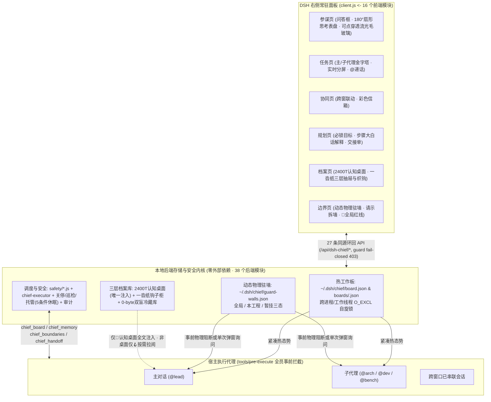

<div align="center">

**给 DeepSeek Harness（DSH）用的右侧栏任务看护、认知桌面、事前物理驻墙与多代理管控面板**  
<sub>长对话 `/compact` 前先存参数再压缩，子代理金字塔一屏看完，改文件跑命令前先过物理墙与逐项审批。</sub>


<sub>默认只读起手 · 越权操作前先确认 · `dsh plugin --profile desktop add dsh-chief`</sub>

<br />


<br />


<br />

# DSH 参谋长 (`dsh-chief`)
### DeepSeek Harness 右侧常驻多代理看护、0-Token 档案柜与安全审批面板

[](https://dsh.deepseek.com)
[](https://github.com/gluztm/dsh-chief/releases)
[](https://www.npmjs.com/package/dsh-chief)
[](https://github.com/gluztm/dsh-chief/actions/workflows/ci.yml)
[](https://awesome-dsh-plugin.com/p/gluztm/dsh-chief/)
[](https://www.bilibili.com/video/BV1Fksq6iEw8)
[](https://github.com/deepseek-ai/dsh-superagent-prototype)
[](https://nodejs.org)
[](#)
[](LICENSE)

> **当前版本 `v1.5.0`**：新增**认知桌面（`2,400 Tokens / 6 份` 唯一全文注入）与三层织钩隔离 + 俯视角一沓纸档案柜**、**正交三态运行总控（`⏸ 关停 | 🛡 巡检 | 🤖 托管`）**与托管后台「🌙 **梦境漫游**」（支持**鼠标单击毛玻璃立即恢复操作，同时保留流光外框提示后台仍在运作**）、5 条件自动休眠与 `L3` 一站式战报、**`180°` 扇形思考强度表盘**与「团队思考强度：自动 / 手动」一键切换，以及「💡 咨询」、强介入先锁目标、请示拆墙审批与 DSH 浅色主题完整适配，已适配 DSH `0.2.2-rc.5`。  
> 协同结构参考官方 **[SuperAgent (`dsh-superagent-prototype`)](https://github.com/deepseek-ai/dsh-superagent-prototype)** 的 Router + Workers 分工模型，保持侧边栏状态与主对话上下文相互隔离。

**简体中文** · [English (`README.en.md`)](README.en.md) · [更新日志 (`CHANGELOG.md`)](CHANGELOG.md) · [架构设计 (`ARCHITECTURE.md`)](ARCHITECTURE.md)

[v1.5.0 亮点](#v150-重点升级一览) · [核心痛点](#主要解决哪些日常麻烦) · [界面实机](#界面与功能说明) · [模块架构](#模块结构与数据流-v150) · [安装与兼容](#安装与宿主版本兼容) · [安全边界](#本地存储与安全边界) · [贡献者](#贡献者)

</div>

---

## `v1.5.0` 重点升级一览

- **🗂️ 认知桌面（唯一全文注入源）与俯视角「一沓纸」档案柜**：彻底肃清非桌面卷宗全文泄露，唯有置顶在 **📌 认知桌面（上限 `2,400 Tokens / 6 份`）** 的规范才会随轮注入主对话；本局 / 全局 / 冷藏三层抽屉采用折叠纸页 + 关键词钩子（`🪝`），平时折叠省空间、按需织钩拉阅，未翻牌冷藏资料对 AI 保持 `0-byte` 双盲隔离。
- **🤖 顶栏正交三态与托管「🌙 梦境漫游」**：`⏸ 关停`（完全 0 消耗）/ `🛡 巡检`（平时 0 耗电，仅在撞墙/报错/断流唤醒续跑）/ `🤖 托管`（持续看护并在空闲时悄悄整理档案抽屉）；点亮毛玻璃舞台后**鼠标单击遮罩任意处即可立即收起模糊恢复界面操作，同时保留四边流动彩色光线提示参谋长仍在后台运转**；忙完待办且满足 5 项清零条件后自动退回关停休眠。
- **🧠 `180°` 扇形思考强度表盘与团队调挡**：模型选择器与战术驾驶舱内置拖拽式 180° 彩虹扇形表盘（关 / 低 / 中 / 高 / 极高 + 点中心一键回「🪄 自动」），摘要与漫游自动降轻、排障与筑墙自动拉高；下方支持一键切换「团队思考强度（主/子代理）：自动 / 手动」，并在回复卡右上角显示实调挡位。
- **🛡️ 严守边界与工程细节打磨**：开启「⚡ 主动强介入」必须先填并锁定核心总目标；新增「💡 咨询」模式有建议直说、管不了坦诚告知；物理墙真撞死仅在独立复核无绕过方案后才允许提交人类审批拆墙单；补齐 DSH 浅色主题实底弹层、窄栏自适应隐藏版本号及子代理窗口自动隐藏参谋入口。

---

## 主要解决哪些日常麻烦

写代码和跑长会话时最常踩的几个坑，这个面板逐个给了工程上的硬兜底。

### 1. 上下文一压缩（`/compact`）就忘了前面查出来的路径和命令
- 常见状况：对话一长触发压缩，刚找到的配置路径、端口、报错行号和回滚命令全被摘要吃掉，模型回头重读文件、重新踩坑。
- `dsh-chief` 的做法：支持 `✦ 智选压缩`、自定义 `10%–95%` 或 `>= 8,000` Token 触发线，也支持直接在右侧输入「压缩吧」。
- 压缩顺序固定为「先抢救细节并校验写入本会话档案柜 → 再静默调用宿主 `/compact`」。如果没产生历史消息或压缩报错，计数绝不虚增。

### 2. 长任务跑到一半停下，或者丢下一句“改好了你自己测”
- 常见状况：无人值守或挂机跑多步改动时，模型跑完一半就汇报完成，漏掉测试和构建验证。
- `dsh-chief` 的做法：必须先填并锁定核心目标，再开启 `⚡ 主动强介入`（`0 = ♾️` 无限轮自动续推，自带同报错 3 轮防死循环熔断）；在 `🛡 巡检` / `🤖 托管` 下断流自动过墙唤醒续跑，`L3 + 强介入` 还可安全批量收口并产出「🏁 一站式战报」，未通过核验并经你 `✅ 批准结项` 绝不虚报完工。
- 想立刻收回控制权时，点击输入栏红色 `⏹ 急停` 直接打断后台驱动。

### 3. 常驻记忆插件每轮塞几千字进提示词，烧 Token 还把模型带偏
- 常见状况：普通记忆插件每次发消息都把几十条过时笔记硬塞进 System Prompt，主模型被无关旧账带偏，费用还高。
- `dsh-chief` 的做法：把工程档案分放进 **本会话柜 / 全局柜 / 沉淀冷藏柜**，平时以「一沓纸」折叠收在抽屉里。**只有摆上置顶「📌 认知桌面（上限 `2,400 Tokens / 6 份`）」的卷宗才直接发给主对话**；其余资料只需织好 `🪝` 关键词钩子，AI 需要时自己按标签 `archive.pull` 拉阅，未翻牌冷藏金库对 AI 保持 `0` 字节隔离。

### 4. 权限全放开怕误删误推，全锁死又只剩嘴上聊天
- 常见状况：次次确认太烦，给了完全权限又怕模型上头跑 `git push --force`、删目录或碰 `.env`；或者参谋长权限一高就爱自己抢着改代码，反而把主对话晾在一边。
- `dsh-chief` 的做法：底部四档权限（`L0` 只读顾问 · 默认 / `L1` 助手 / `L2` 参谋逐项授权 / `L3` 参谋长）与顶栏三态运行模式（`⏸ 关停 / 🛡 巡检 / 🤖 托管`）两根旋钮独立配合，外加事前物理防线。
  - **新对话默认只读**：只看代码、出方案、记看板，不碰工作区文件，也不插话打断主对话。
  - **工具落地前的事前物理驻墙**：主对话、子代理和参谋只要调用终端命令或读写文件，执行前都要先过宿主 `tools/pre-execute` 检查和你的「物理驻墙」。每堵墙都能切成 `🌐 全局`、`📁 本工程` 或 `⏸ 暂挂`，支持同类墙一键合并；不懂正则还能让参谋帮你手搓草案再点确认落锁。即使在 `L3` 最高权限下也**严禁 AI 私自拆墙**，真撞死仅能提交人类审批单。
  - **参谋懒介入与顺口问**：哪怕开到高权限，没指定让参谋亲自操刀时，它也会先把干活请求派给主对话，不会冒充你在主框里发消息；刚开空白新窗口找参谋，它会先让主模型只读看代码、排计划再回来汇报；半途缺情报就后台悄悄问主对话一句，不打断主对话手头动作。
  - **点完允许自动续跑 & 策略只紧不松**：通过 `TaskLedger` 记下未竟事务，逐项审批或提权通过后会接着往下跑完；内置硬红线（删盘、强推、`git reset --hard`、复合管道、内联 `node -e`/`python -c`、`".\\"env` 变形、NTFS ADS 流与 `-EncodedCommand`）在任何档位都直接拦下并写进 `~/.dsh/chief/chief-audit.jsonl`，也支持外挂只紧不松的 JSON 策略插件进一步限缩工具或目录。

### 5. 子代理开了一堆，不知道谁卡住、谁在空转
- 常见状况：多个子代理并行干活时分散在不同标签页里，挨个点开看推理流很费劲，口头叮嘱的规矩聊几轮就忘。
- `dsh-chief` 的做法：任务页按主代理与子代理展开直观金字塔树状卡片，支持原地改状态、点击 `💬 分屏` 直接看实时修改流、点底栏带图标代理发 `@递话` 精准纠偏；边界页支持点亮 `📌` 图钉把全局红线跨任务固定下来。

### 6. 对话聊太长变慢变贵，换新窗口又得从头交代背景
- 常见状况：开了 100 轮想重开新窗口，却怕丢失背景、模型配置和刚梳理完的任务分工，或者后台总结插件偷偷走高价按量渠道。
- `dsh-chief` 的做法：顶栏模型选择器支持「跟随主对话」与 `180°` 扇形思考强度表盘（日常 `关停` / `巡检` 平常均 0 后台消耗）；在「规划」页对看不懂的步骤点「解释」即可大白话解读，点 `📌 定住防改` 锁定人工核对过的交接单，一键新建窗口接力并可选随带工作档案层级。

---

## 界面与功能说明

### 01 · 参谋主面板与流光可穿透舞台（`参谋` 页签）
- 底部输入框支持一句大白话委派探路、手搓物理墙、整理档案或全自动执行；左下控制条汇聚 `⚡ 强介入`、`✦ 智选压缩`、`🛡 红线哨兵`、`L0–L3` 权限与红色 `⏹ 急停`；顶栏直观切换 `⏸ 关停 / 🛡 巡检 / 🤖 托管` 与模型/扇形思考强度。
- 参谋长后台运行「🌙 梦境漫游」或自动审查时，面板会亮起流动彩色光线外框与毛玻璃舞台，**鼠标单击毛玻璃任意处可立即收起模糊遮罩恢复操作，同时外框流光继续亮着提示后台仍在运作**。


---

### 02 · 主代理与子代理任务树（`任务` 页签）
- 按根会话与子代理纵队展开可视化金字塔卡片（配主/子代理前置矢量图标），直接在卡片上调整状态、派发任务或点 `分屏` 看实时输出流。

<div align="center">
  
</div>

---

### 03 · 认知桌面与俯视角「一沓纸」三层档案柜（`档案` 页签）
- 顶部划出置顶 **📌 认知桌面** 与实时 `2,400 Tokens / 6 份` 预算进度条（唯一随轮全文注入主对话，超额按铜/银/金自动退入观察队列）；下方分为 **💬 本局档案柜**、**🌐 全局档案柜**、**🏛️ 冷藏档案柜**。
- 三层抽屉采用俯视角「一沓纸」动态卡片：平时叠放仅露标题与关键词 `🪝` 钩子，点开才展开操作栏与详情，谁能看、谁已拉阅一目了然。

<div align="center">
  
</div>

---

### 04 · 目标锁定与步骤大白话「解释 / 咨询」（`规划` 页签上方）
- 点击 `🎯 设为目标` 开启目标督导（开强介入前必锁）；任意步骤都可点击「解释」让参谋长用通俗大白话解释这条在干嘛、跳过有何影响，全程零打断主对话流程。

<div align="center">
  
</div>

---

### 05 · 跨窗口协同串联与信箱（`协同` 页签）
- 可把多个独立 DSH 窗口连在一起互通进度（前端界面 + 后端接口联动）；断开协同立即清掉缓存、外部记忆与离线信箱残留。
- 粘贴进输入框的截图原图会存进 `<cwd>/.dsh-chief/uploads/`，避免纯文本模型看图靠猜。

<div align="center">
  
</div>

---

### 06 · 物理驻墙、必做项与 `📌` 全局红线（`边界` 页签）
- 顶部「🧱 物理驻墙 · 事前硬拦截」专区：可点 `+ 手动驻墙` 或让 `✨ 参谋手搓墙`，随时在 `🌐 全局`、`📁 本工程`、`⏸ 暂挂` 间切换，支持同类规则一键合并。
- 下方分 `必做事项 (allowed)`、`禁止红线 (forbidden)`、`注意事项 (notes)` 三栏管理；任何 `L0–L3` 权限都无权私拆物理墙与红线，真撞死仅能提交人类审批单。

<div align="center">
  
</div>

---

### 07 · 跨会话交接单与携带参谋新开窗口（`规划` 页签底部）
- 交接单支持手改，点 `📌 定住防改` 后锁定当前快照，不会被后续自动摘要覆盖。
- 支持一键新开窗口并继承当前工作区 `workspaceId`、参谋配置与指定档案范围（高自主强介入默认安全置关），搭配 `idle-guard` 避免长任务空转停机。

<div align="center">
  
</div>

---

## 使用前建议了解的两件事

> [!NOTE]
> 开启实权工具、`⚡ 主动强介入` 或 `✦ 智选压缩` 前，下面两点直接决定使用体感：
>
> 1. **工程护栏决定下限，底层模型决定上限**  
>    插件负责保证 0-Token 档案隔离、四档权限审批、压缩前落盘复核、死循环熔断、物理驻墙和 `⏹ 急停` 这些安全下限。但拆任务准不准、找 Bug 稳不稳，完全取决于你给参谋长选了哪个模型。处理复杂工程建议选推理能力强的主力旗舰模型，别用太轻的小模型。
> 2. **少叠互相冲突的外部常驻注入**  
>    不要一边用本插件，一边在项目里叠加上百条互相对着干的全局 Rules 或每轮强灌大段旧账的记忆插件。无关上下文太多会稀释当前注意力，还容易和参谋的纠偏指令打架。低频资料放进本插件的 **0-Token 档案柜**，仅最常用的摆上 **认知桌面**，主对话才干净。

---

## 模块结构与数据流 (`v1.5.0`)

`v1.5.0` 包含 **38 个后端模块（含 `pkg/safety/` 下 9 个零业务依赖的安全内核模块）+ 16 个前端模块**（无环依赖、无 `export let` 可变导出），方便审查与长期维护。详情见 [ARCHITECTURE.md](ARCHITECTURE.md)。



---

## 安装与宿主版本兼容

在已装好 [dshmarket](https://github.com/dsh-market/dsh-market) 的 DSH 里直接搜 **`dsh-chief`** 或 **`DSH 参谋长`** 就能点安装，也可以用命令行（网页版把 `desktop` 换成 `web`）：

```bash
# 方式 1：通过 npm 安装最新版（v1.5.0）
dsh plugin --profile desktop add dsh-chief

# 方式 2：从 GitHub 仓库直接安装（与 main 最新代码同步）
dsh plugin --profile desktop add github:gluztm/dsh-chief

# 方式 3：安装 GitHub Release 预构建包（v1.5.0）
dsh plugin --profile desktop add https://github.com/gluztm/dsh-chief/releases/download/v1.5.0/dsh-chief-1.5.0.tgz
```

装好后重启或刷新 DSH 客户端，点工作区右上角 **✦ `DSH 参谋长`** 图标打开面板。

### 宿主版本兼容表

| DeepSeek Harness (DSH) 版本 | 面板 / 看板 / 三层档案柜 / 事前物理墙 | 命名子代理树 (`task.dispatch` / `team.*`) | 说明 |
| :--- | :---: | :---: | :--- |
| **`>= 0.2.2-rc.5`（当前桌面主力版）** | 完整可用 | 完整可用 | 已适配 `dsh-tool-fs`（`read`/`read_image`/`write`/`edit`/`apply_patch`）、`str_replace_editor`、热调 `reasoningEffort` 及原生 `{ kind: 'ask' }` 弹窗 |
| `0.2.2-rc.2 ~ 0.2.2-rc.4` | 完整可用 | 完整可用 | 宿主原生提供 `subagents.resolveName` / `rootOf` / `namesOf` 与 `tools/pre-execute` 物理拦截 |
| `0.2.0 ~ 0.2.2-rc.1` | 正常挂载 | 提示升级 | 旧版无命名子代理 API，面板会自动拦截高风险调用并提示升级 |

---

## 注册给模型的 4 个工具

插件只读注册 4 个结构化工具，动作参数一并兼容严格 JSON 与常见文本写法：

| 工具名 | 用途 | 常用动作 (`action`) |
| :--- | :--- | :--- |
| **`chief_board`** | 驱动任务板、拉取与检索冷档案、跨代理与直呼参谋、回复问询、查询物理墙、调挡与提权、触发压缩 | `graph.plan`、`task.add`、`task.update`、`plan.set`、`cursor.set`、`mail.send`、`chief.request`、`inquiry.reply`、`wall.list`、`archive.save`、`archive.search`、`archive.pull`、`model.effort`、`bounds.propose`、`permission.request`、`context.compact` |
| **`chief_memory`** | 读写会话级热记忆（决策 / 进展 / 验证 / 风险） | `list`、`get`、`add`、`update`、`remove` |
| **`chief_boundaries`** | 读写全局 `📌` 红线、必做项（`allowed`）与注意事项 | `get`、`set`、`add`、`pin`、`remove` |
| **`chief_handoff`** | 预览并生成独立自包含的跨会话 Markdown 交接单 | `preview` / 会话接力 |

---

## 本地存储与安全边界

- **跨进程与多线程文件锁**：`board-store.js`、`chief-state.js`、`archive-core.js`、`safety/guard-walls.js` 对每次落盘使用带 `O_EXCL` 和随机抖动重试的文件锁（包含 Windows NTFS 瞬态 `EPERM/EACCES/EBUSY` 重试）以及 `threadId` 唯一临时文件原子替换，高并发写入不丢单。
- **独立安全内核与反变形检测**：`pkg/safety/`（9 模块）与 `chief-executor.js` 全集通过 MD5 校验守护，覆盖复合管道、内联脚本（`node -e` / `python -c` / `pwsh` / `iex` + Base64）、引号多反斜杠与点号反斜杠凭据变形、`bounds.*` / 物理驻墙人类确认令牌以及单次授权 `capabilityScope` 绑定，正常 `process.env.NODE_ENV` 与 `node .\env\setup.js` 零误杀。
- **27 条接口同源环回校验**：全部 `/api/dsh-chief/*` 接口先校验 Loopback 来源与 `Origin/Host`，连接守卫异常时 fail-closed 返回 `403`。
- **凭据防误存与零遥测**：禁止写入 `sk-*`、`ghp_*`、Bearer Token、`AIza*`、`AKIA*` 与私钥片段；一键收纳含疑似密钥的便签会自动脱敏为 `[REDACTED]`。所有状态、档案、物理驻墙与审计日志完全留在本地 `~/.dsh/chief/`，零外部依赖，零遥测上报。

---

## 贡献者

| 贡献者 | 主要工作 |
| --- | --- |
| [gluztm](https://github.com/gluztm) | 项目发起人、产品定义与长期维护 |
| [Gemini](https://github.com/gemini-code-assist) | 功能研发、`pkg/safety/` 独立安全内核、认知桌面与三态总控、180° 扇形思考表盘及自动化门禁 |
| [Codex](https://github.com/codex) | 模块化架构设计、高并发压测、红队穿透测试与边界审查 |
| [deepseek-ai](https://github.com/deepseek-ai) | DeepSeek Harness 宿主运行时与 SuperAgent 协同机制支持 |

---

## 开源协议

基于 **[GNU Affero General Public License v3.0 (`AGPL-3.0-only`)](LICENSE)** 开源。
