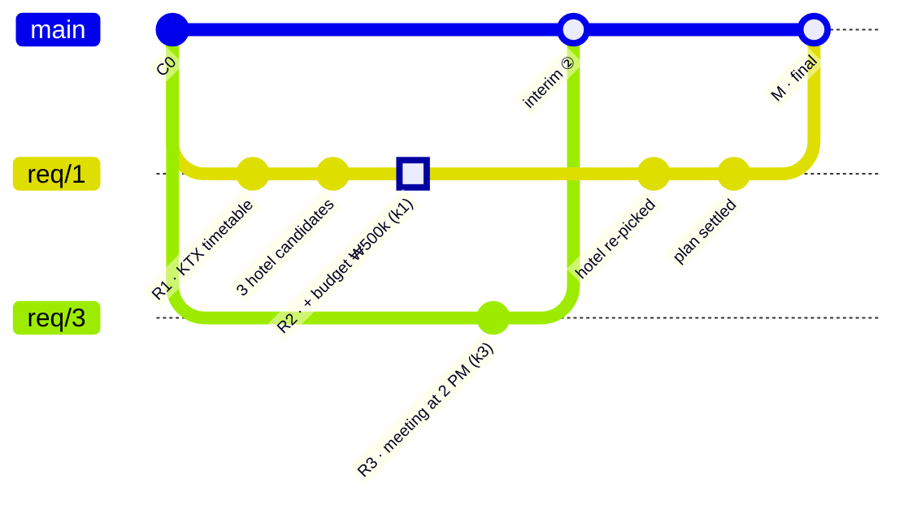
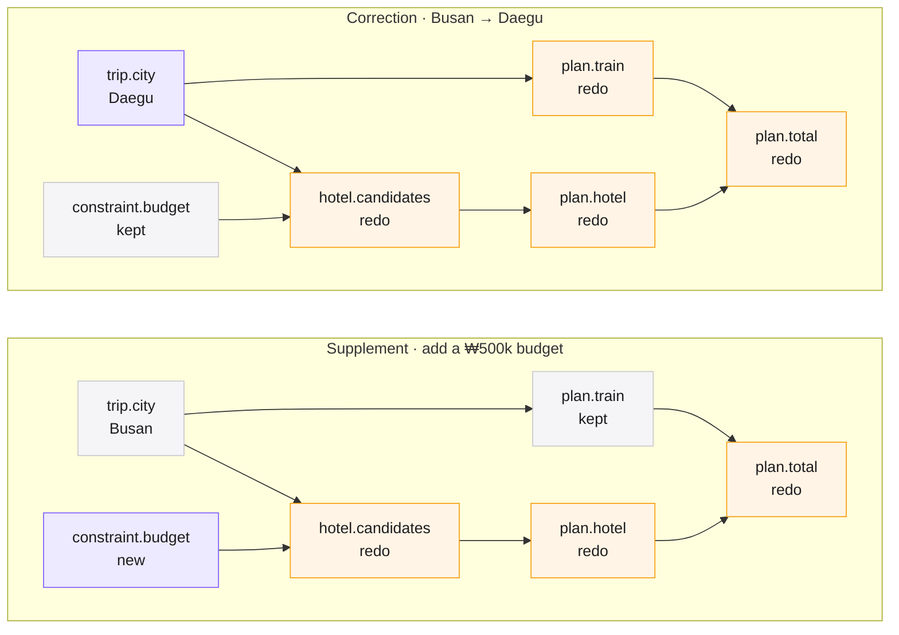

<div align="center">


<p>
  <a href="https://github.com/gogoymh/git-ontology-agent/stargazers"></a>
  <a href="https://github.com/gogoymh/git-ontology-agent/actions/workflows/ci.yml"></a>
  <a href="LICENSE"></a>
  
  
</p>

<p>
  <a href="#what-it-is">What it is</a> ·
  <a href="#timeline">Timeline</a> ·
  <a href="#what-the-ontology-does">Ontology</a> ·
  <a href="#how-it-works">How it works</a> ·
  <a href="#examples">Examples</a> ·
  <a href="#quick-start">Quick start</a> ·
  <a href="#terminal-ui">Terminal UI</a> ·
  <a href="#providers">Connect a model</a>
</p>

</div>

**Why use Git and an ontology for an agent?**

Git lets the agent keep working on one branch while it handles a separate request on another. The ontology tracks dependencies so a follow-up only reopens the work it affects. When the branches merge, it tells the agent which results to keep.

## What it is

- 💬 **Interim answers.** Get a reply from the latest commit, or a separate answer as soon as that task finishes.
- ✅ **Final answer.** Get the completed result after the work merges into `main`.
- 🧾 **Provenance.** Trace each result back to the request that produced it.

**An example.** You ask for a trip plan, add a budget while it works, then ask something unrelated.

| | | |
| --- | --- | --- |
| **R1** | "Plan my Busan business trip next week" | `req/1` starts: checks the KTX timetable, commits 3 hotel candidates |
| ↳ | *Started* | "Got it, I've started on “Busan trip plan”. I'll keep you posted as it goes." (instant, before any LLM call) |
| **R2** | "Oh, keep the budget under ₩500,000" | judged **k1 supplement** → commits `constraint.budget` to `req/1` and redoes only the hotel step |
| ↳ | *Interim ①* | "KTX is set for Tuesday morning. Applying your ₩500,000 budget, I'm picking the hotel again." |
| **R3** | "By the way, what time is tomorrow's meeting?" | judged **k3 independent** → a separate `req/3` from `main`, merged when done; `req/1` keeps going |
| ↳ | *Started* | "Got it. I'll check “tomorrow's meeting” separately and keep working on “Busan trip plan”." |
| ↳ | *Interim ②* | "Tomorrow's meeting is at 2 PM. Still working on the trip plan." |
| | `req/1` | re-picks the hotel → settles the plan → merges into `main` |
| ↳ | **Final** | "Here is your plan: Tue 08:00 KTX → Hotel A (2 nights, ₩180,000) → … total ₩460,000, within budget. The budget came from your second request." |

| Term | Meaning |
| --- | --- |
| `main` | The conversation state already confirmed to the user |
| Request branch | One branch per request: `req/<n>` |
| Base | The `main` commit a request branch started from: what that request knew when it began |
| Claim | One fact of the work state, such as `trip.city` or `constraint.budget` |
| Relation | How a new request relates to the one in progress, judged by a decision model: supplement, correction, independent, cancel or progress |

## Timeline

The example above, drawn as branches.



- **Interim ①.** When R2 arrives, the LLM writes the interim answer from what `req/1` holds *at that moment*: the KTX that is settled, the budget just added, the hotel being re-picked. The 3 hotel candidates the budget invalidated are left out.
- **Interim ②.** R3 has nothing to do with R1, so it runs on its own `req/3` from `main`. When it is done, `req/3` is merged and its result becomes the interim answer.
- **Final.** Once `req/1` is merged too, the LLM writes the final answer from merge commit `M`. The claims changed from base `C0` to `M` (the plan, the budget applied, and which request each came from) are its material.

## What the ontology does

The work state is not prose. It is a list of typed **claims**, each tagged with the request it came from (`from`), what it depends on (`depends_on`) and where it stands (`status`).

| Claim type | Meaning | Example |
| --- | --- | --- |
| Request | the user's message and its number | `req.2` "keep the budget under ₩500,000" |
| Constraint | a condition to keep | `constraint.budget` = ₩500,000 |
| Assumption | a premise of the work | `trip.city` = Busan |
| Finding | a fact that was checked | `hotel.candidates` = 3 hotels |
| Decision | a chosen result | `plan.hotel` = Hotel A |
| Progress | step-by-step status | `step.hotel` = re-picking |

```yaml
# state.yaml on req/1, right after R2
- {"id": "trip.city", "type": "Assumption", "value": "Busan", "from": "req.1", "status": "confirmed"}
- {"id": "constraint.budget", "type": "Constraint", "value": "₩500,000", "from": "req.2", "status": "confirmed"}
- {"id": "plan.train", "type": "Decision", "value": "Tue 08:00 KTX", "from": "req.1", "status": "confirmed", "depends_on": ["trip.city"]}
- {"id": "hotel.candidates", "type": "Finding", "value": "3 hotels", "from": "req.1", "status": "invalid", "depends_on": ["trip.city", "constraint.*"]}
- {"id": "plan.hotel", "type": "Decision", "from": "req.1", "status": "in_progress", "depends_on": ["hotel.candidates", "constraint.*"]}
```

### ① What to redo: the dependency graph

When a request changes a claim, only the claims that depend on it are redone, following the arrows. Nothing starts over.



<sub>Violet: changed by the request · amber: redone · grey: kept · arrows: `depends_on`</sub>

- **Supplement (budget).** Only the hotel candidates, the hotel and the total depend on the budget. The KTX does not, so it stays, and the interim answer can say "KTX is set".
- **Correction (Daegu).** Everything that depends on the city is redone. The budget does not depend on the city, so it is kept.

### ② How to merge: rules by type

Git only says "both sides changed this line". The ontology knows how each type combines, so most conflicts settle by rule.

| Type | Rule | Example |
| --- | --- | --- |
| Constraint | stack: every condition holds | budget ₩500k **and** a morning departure |
| Assumption | one value; the correction wins | Busan → Daegu |
| Decision | recompute before merging if a dependency changed | Hotel A → re-pick |
| Finding | the later check wins | seats available → sold out |
| Progress | never merged; branch-local | "picking a hotel" |
| Request | keep all | req.1, req.2, req.3 |

### ③ How to say it: wording by status

The LLM picks its wording from each claim's `status`, so an interim answer never states unsettled work as fact.

| Status | In the answer | Example |
| --- | --- | --- |
| `confirmed` | said plainly | "KTX is set for Tuesday morning" |
| `in_progress` | said as ongoing | "I'm picking the hotel again" |
| `invalid` | never said | (the 3 old hotel candidates) |
| `superseded` | what changed, and which request changed it | "the city changed to Daegu in your second request" |

### ④ Without an ontology

| Situation | git alone | git + ontology |
| --- | --- | --- |
| A budget is added | doesn't know what to redo: redoes everything, or guesses | redoes only the hotel candidates, hotel and total |
| The city is corrected | Busan results linger and mix with Daegu results | marks everything that depends on the city invalid |
| Merge conflict | line-level text conflict with no meaning | settled by type rules; only the rest is judged |
| Interim answer | can't tell settled from in progress | the status says which is which |
| Final answer | can't say which request each part came from | `from` says exactly |
| Relation judgment | reads the message text only | the claim type a message touches is a clue too (Constraint → likely supplement, Assumption → likely correction) |

## How it works

Every message goes through the same six steps.

| # | Step | Engine | What happens |
| --- | --- | --- | --- |
| 1 | Open request? | git | No `req/*` branch open → branch from `main`, go to 4 |
| 2 | Relation | decision model | supplement, correction, independent, cancel or progress ([below](#relation-judgment)) |
| 3 | Interim answer | LLM | written from what the branch holds at this moment, plus the judgment; for an independent request, from its result |
| 4 | Process | LLM + ontology | one claim commit per step, any working style (ReAct or other); only dependents of a change are redone (①) |
| 5 | Merge | git + decision model | claim-level merge into `main`; type rules first (②), anything left is asked in the final answer |
| 6 | Final answer | LLM | once every open request is merged, written from what changed between the base and the merge commit |

## Relation judgment

How does a new message relate to the request in progress? One typed `choice` decides.

| Key | Relation | Example (R1: Busan trip) | In git | Answer |
| --- | --- | --- | --- | --- |
| `k1` | supplement | "keep it under ₩500,000" | commit a Constraint to the open branch; redo only the affected steps | interim, then reflected in the final |
| `k2` | correction | "not Busan, Daegu" | retract the old claim, commit the new one, mark its dependents invalid and redo them | interim, then reflected in the final |
| `k3` | independent | "what time is the meeting?" | a new branch from `main`, run in parallel, merged when done | answered right away as an interim |
| `k4` | cancel | "stop, it's off" | close the branch unmerged; its history is kept | interim (confirms the stop) |
| `k5` | progress | "how far along?" | change nothing | interim (current state) |

```jsonc
// what the agent sends the decision model (Typesafe Jev)
{ "model": "typesafe/jev-1.14",
  "state": { "in_progress": "R1: Plan my Busan business trip (current claims ...)",
             "new": "Oh, keep the budget under 500,000 won" },
  "questions": { "relation": { "type": "choice",
      "instructions": "How does the new request relate to the request in progress?",
      "criteria": { "k1": "It adds a condition or information to the work in progress",
                    "k2": "It changes a premise of the work in progress",
                    "k3": "It is a separate request unrelated to the work in progress",
                    "k4": "It asks to stop the work in progress",
                    "k5": "It asks how far the work has progressed" } } } }
```

- Keys are neutral (`k1`, not `supplement`) and the meaning lives only in the definitions, because decision models have been reported to follow option names over their definitions.
- If `relation.confidence` is below `0.8`, the agent asks briefly instead: *"Should I apply this to the trip plan in progress, or handle it separately?"*
- With several requests open, a second `choice` picks which one the message is about.

## Answer rules

Interim answers look at the branch. Final answers look at the merge.

| | Interim answer | Final answer |
| --- | --- | --- |
| When | right when a new message arrives (a new request gets an instant "started"); for an independent request, again when it is done | after every open request branch is merged |
| Source | the latest commit of the branch in progress (not yet merged) | the merge commit: the claims changed from the base to the merge |
| Content | what is settled, how the new message is applied, what is left | the full answer to the first request, noting what later requests changed |
| Tone | says clearly that work is in progress; never states what may still change as settled | if a conflict is left, shows both values and asks |
| Independent request | its answer *is* the interim answer | not repeated, unless it changed the final result |

## Merging and conflicts

A three-way merge, claim by claim, between the base, `main` and the request branch.

1. A claim changed on one side only, or to the same value on both sides, is taken as is.
2. A claim changed differently on both sides is settled by the type rules (②).
3. Only one case has no rule: two independent requests change the same Assumption or Decision differently. A `noul` then asks *"does the later request change the intent of the earlier one?"* At `≥ 0.7` the later value wins; otherwise both are kept and the final answer asks you.

A branch is not merged while any of its claims is still `invalid` (it waits for the redo), and a cancelled branch is never merged. Thresholds live in `policy.yaml`, versioned in the same repository.

## Commit convention

Each commit records what changed, because of which request, and by what judgment. Commits are made with git plumbing only (no checkout, no working tree), so they are safe alongside other work.

```text
constraint.budget: add (₩500,000)

Request: req.2
Relation: k1 supplement (confidence 0.94)
Branch: req/1
Base: 8948a40
Invalidates: hotel.candidates
Decision-Model: typesafe/jev-1.14
```

Answers are commits too, on the `answers` branch. `Answer: interim` records which branch commit an interim answer was written from; `Answer: final` records which merge commit. So "why did it say that back then?" can be replayed exactly: `git show <sha>:state.yaml`.

## Examples

Real output of `goa demo` (offline, no API key). The same trip request, with the relations the first example didn't cover.

**Correction: the premise changes** · `goa demo --scenario correction --lang en`

```text
User (R1)          Plan my Busan business trip next week
  Agent (interim)  Got it, I've started on “Busan trip plan”. I'll keep you posted as it goes.
                   ↳ from req/1@3d2aaef

User (R2)          Actually, not Busan but Daegu
  Agent (interim)  Changed the trip city to Daegu. Dropping the KTX and hotel candidates found for Busan and redoing them for Daegu.
                   ↳ from req/1@0502e86 k2 correction
  Agent (final)    Here is your plan: Tue 08:30 KTX (Seoul→Dongdaegu) → Hotel B (2 nights, ₩160,000) → total ₩390,000. The trip city was changed to Daegu in your second request.
                   ↳ from main@7cf5561
```

**Progress and cancel** · `goa demo --scenario cancel --lang en`

```text
User (R1)          Plan my Busan business trip next week
  Agent (interim)  Got it, I've started on “Busan trip plan”. I'll keep you posted as it goes.
                   ↳ from req/1@3f1215b

User (R2)          How far along are you?
  Agent (interim)  KTX is set: Tue 08:00 KTX (Seoul→Busan). Found hotel candidates: Hotel C, Hotel B, Hotel A. Now working on the hotel and total.
                   ↳ from req/1@323b99a k5 progress

User (R3)          The trip got cancelled, you can stop
  Agent (interim)  Stopped the Busan trip plan. What I found so far (KTX and hotel candidates) stays in history only.
                   ↳ from cancelled/req/1@3a39837 k4 cancel
```

With nothing left to merge, there is no final answer: the second interim is the last word, and `cancelled/req/1` keeps what was found.

## Quick start

```bash
git clone https://github.com/gogoymh/git-ontology-agent && cd git-ontology-agent && pip install -e .
goa demo                                      # the budget example above, offline
goa demo --mock                               # same, through simulated Anthropic + Typesafe APIs
goa demo --delay 0                            # no pauses between turns (default 0.8s on a terminal)
goa login claude                              # sign in with your Claude plan (or: goa login codex)
goa                                           # the terminal UI: talk to it while it works
goa ask "Plan my Busan business trip next week"   # one shot for scripts; --json for JSON lines
goa log                                       # the conversation as a git graph
```

The engine is Python 3.9+ with zero dependencies, standard library only. Answers follow your system language (`--lang ko`, `--lang en`, ...). As a library: `Agent(".goa", llm=..., decision=...)` with `submit()`, `tick()` and `run()`; add skills by subclassing `goa.skills.Skill`.

## Terminal UI

`goa` on a terminal opens a React UI built with [Ink](https://github.com/vadimdemedes/ink), the approach Claude Code takes. It runs the engine as a child process and draws what the engine reports.

```text
╭──────────────────────────────────────────────────────────────╮
│ ●━╮  Git Ontology Agent v0.1.0                               │
│ ┃ ◆  every request is a branch, every answer is a merge      │
│ ●━╯  claude-code · sonnet · judge llm/claude-code · you/.goa │
╰──────────────────────────────────────────────────────────────╯

R1 › Plan my Busan business trip next week
   ◐ Got it, I've started on “Busan trip plan”. I'll keep you posted as it goes.
     interim · req/1@5f6e368

R2 › Oh, keep the budget under 500,000 won
   ◐ KTX is set: Tue 08:00 KTX (Seoul→Busan). Applying your ₩500,000 budget, I'm picking the hotel
     again.
     interim · req/1@0cbc2c6 · k1 supplement

 ⠼ req/1 Busan trip plan · hotel.candidates: redo (Hotel A, Hotel B)
╭──────────────────────────────────────────────────────────────────────────────────────────────────╮
│ ›  Talk any time, even while it works                                                            │
╰──────────────────────────────────────────────────────────────────────────────────────────────────╯
 enter send · /connect · /log · /help · ctrl+c quit                    claude-code · 1 open request
```

- **The prompt never locks.** A message sent mid-task gets in between two work steps, and every open `req/<n>` shows its latest commit live.
- **It reads like a chat.** Interim answers are amber `◐`, final answers green `●`, and each names the commit it was written from.
- **Connect once.** The first run lists your sign-ins and API keys; pick one with ↑↓ and enter and it is remembered. `/connect` switches later, `/log` shows the git graph.
- **No surprises.** Without Node.js 22+ or a built UI, `goa` falls back to the plain-text `goa chat`. From a clone, `goa ui` builds it once (`npm --prefix ui install`). The UI logs to `GOA_UI_LOG` (default `<tmp>/goa-ui.log`).

Other front ends can drive the same engine: `goa serve` reads `{"type": "submit", "text": "..."}` lines on stdin and writes `ready`, `user`, `answer`, `step`, `tasks` and `error` events as JSON lines, with logs on stderr.

## Providers

Two ways in: sign in with the plan you already pay for, or bring an API key. Any LLM does the work and writes the answers, any decision model judges. Mix freely: `--llm codex --decision openrouter`.

| Sign in `--llm` | Runs on | Sign in with |
| --- | --- | --- |
| `claude-code` | your Claude subscription, through Claude Code (`claude -p`) | `goa login claude` |
| `codex` | your ChatGPT plan, through the Codex CLI (`codex exec`) | `goa login codex` |

goa never reads or stores an OAuth token. The official CLI signs in and keeps its own credentials, and goa only hands it a prompt on stdin. It runs with no tools, no saved session and an empty working folder, and it withholds `ANTHROPIC_API_KEY` / `OPENAI_API_KEY` so the subscription is billed rather than a key in `.env`. `goa auth` lists every sign-in and key with what `auto` would pick; `goa auth --use codex` saves the default.

With `--llm auto` (the default for `goa`, `ask`, `chat` and `serve`) the order is: `GOA_LLM`, then the default you saved, then a ready sign-in (Claude, then Codex), then the first API key, then offline. The judge follows the model you connected (`llm:claude-code`), uses Jev on OpenRouter for `openrouter`, and stays `local` offline.

| LLM `--llm` | Key | Default model |
| --- | --- | --- |
| `openai` | `OPENAI_API_KEY` | `gpt-5.1` |
| `anthropic` | `ANTHROPIC_API_KEY` | `claude-sonnet-5-5` |
| `gemini` | `GEMINI_API_KEY` | `gemini-2.5-flash` |
| `xai` | `XAI_API_KEY` | `grok-4` |
| `meta` | `LLAMA_API_KEY` | `Llama-4-Maverick-17B-128E-Instruct-FP8` |
| `openrouter` | `OPENROUTER_API_KEY` | `openrouter/auto` |
| `offline` | none | built-in demo skills and templates |

No key yet? `--mock` answers every provider's real request shape locally, so the online path (`LLMSkill`, answer prompts, decision parsing) runs with no key and no network: `goa demo --mock --llm gemini --decision openai`.

| Decision model `--decision` | Key | How |
| --- | --- | --- |
| `typesafe` | `TYPESAFE_API_KEY` | native Jev API, `typesafe/jev-1.14` |
| `openai` | `OPENAI_API_KEY` | OpenAI Decisions API (`predicate` / `choice`), `gpt-6-luna` |
| `gemini` | `GEMINI_API_KEY` | structured output with an enum schema, temperature 0 |
| `cloudflare` | `CLOUDFLARE_ACCOUNT_ID`, `CLOUDFLARE_API_TOKEN` | Workers AI JSON-schema mode |
| `openrouter`, `openrouter:cloudflare/clef`, `openrouter:typesafe/...` | `OPENROUTER_API_KEY` | OpenRouter Decisions API (default `typesafe/jev-1.14`) |
| `openrouter:google/gemini-2.5-flash`, ... | `OPENROUTER_API_KEY` | any OpenRouter chat model that supports strict JSON schema, temperature 0 |
| `aimlapi` | `AIMLAPI_API_KEY` | Jev-shape gateway |
| `llm:anthropic`, `llm:xai`, ... | that LLM's key | JSON-schema judgment |
| `local` | none | deterministic keyword + ontology heuristic |

Every backend returns the same typed answer (`choice` + `confidence` + `probabilities`, or `noul` in [0, 1]); a refusal becomes confidence 0, which makes the agent ask. Keys and defaults can live in `./.env` (see [`.env.example`](.env.example)); shell variables win. Override models with `GOA_<PROVIDER>_MODEL` (`GOA_CLAUDE_CODE_MODEL`, default `sonnet`; `GOA_CODEX_MODEL`, default your Codex config; `GOA_OPENROUTER_DECISION_MODEL` for the judge) and endpoints with `TYPESAFE_URL`, `OPENAI_DECISIONS_URL`, `OPENROUTER_DECISIONS_URL`. `--mock` simulates `claude -p` and `codex exec` too, so the sign-in path runs with neither installed.

## Development

```bash
python -m unittest discover -s tests -t . -q    # no network
npm --prefix ui install && npm --prefix ui test # the UI, against a scripted and a real engine
GOA_LOG=debug goa demo                          # English logs for every step
```

The UI ships only permissively licensed packages (MIT, ISC); `node ui/scripts/license-check.mjs` fails the build otherwise.

The banner is built by `scripts/make_banner.py` from Codex-generated art; candidates live in [`docs/assets/candidates`](docs/assets/candidates).

## Out of scope (for now)

- Long-term memory after a session ends (`main` can grow into a memory store later)
- Several agents working together (swarms, group routing)
- Data in external files or databases

## License

[MIT](LICENSE)
