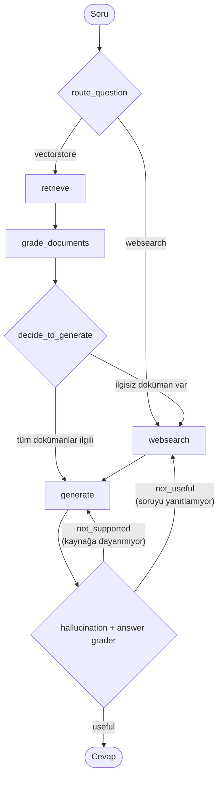

# Corrective RAG Project

LangGraph ile inşa edilmiş bir **Corrective RAG (CRAG)** sistemi. Klasik RAG akışının üzerine, getirilen dokümanların ilgililiğini denetleyen, gerektiğinde web aramasına başvuran ve üretilen cevabı hem kaynaklara sadakat (hallucination) hem de soruyu gerçekten yanıtlayıp yanıtlamadığı (usefulness) açısından değerlendiren bir state graph ekler.

## İçindekiler

- [Mimariye Genel Bakış](#mimariye-genel-bakış)
- [Akış Diyagramı](#akış-diyagramı)
- [Proje Yapısı](#proje-yapısı)
- [Gereksinimler](#gereksinimler)
- [Kurulum](#kurulum)
- [Ortam Değişkenleri](#ortam-değişkenleri)
- [Kullanım](#kullanım)
- [Graph Bileşenlerinin Detayları](#graph-bileşenlerinin-detayları)

## Mimariye Genel Bakış

Sistem üç ana katmandan oluşuyor:

1. **Ingestion (`ingestion.py`)** — Belirli web sayfalarını (Lilian Weng'in agent, prompt engineering ve LLM'lere yönelik adversarial saldırılar hakkındaki blog yazıları) yükler, parçalara (chunk) böler, OpenAI embedding'leri ile vektörleştirir ve Chroma'da (`./.chroma`) kalıcı olarak saklar. Aynı dosya, sorgulama sırasında kullanılacak `retriever` nesnesini de dışa aktarır.

2. **Graph (`graph/`)** — LangGraph `StateGraph` ile kurulmuş, koşullu geçişlere sahip bir iş akışı. Tüm düğümler ortak bir `GraphState` (TypedDict) üzerinden veri paylaşır.

3. **Chains (`graph/chains/`)** — Her biri bir LLM çağrısını (yönlendirme, doküman skorlama, cevap üretme, halüsinasyon/kalite kontrolü) kapsülleyen, LangChain "Runnable" zincirleri (prompt | llm | parser şeklinde).

Giriş noktası `main.py`, derlenmiş `app` (graph) nesnesini bir soru ile `invoke` eder ve nihai `generation` alanını ekrana basar.

## Akış Diyagramı



**Yönlendirme mantığı (`route_question`):** LLM tabanlı bir router (`RouteQuery`), sorunun agent/prompt engineering/adversarial LLM saldırıları konularıyla mı ilgili olduğuna (→ `vectorstore`) yoksa güncel/genel bir konu mu olduğuna (→ `websearch`) karar verir.

**Doküman değerlendirme (`grade_documents` → `decide_to_generate`):** Vektör mağazasından dönen her doküman, soruyla ilgili olup olmadığına dair ikili (yes/no) bir skorla değerlendirilir. İlgisiz bulunan en az bir doküman varsa `web_search` bayrağı `True` olur ve akış web aramasına yönlenir.

**Üretim sonrası kontrol (`grade_generation_grounded_in_documents_and_question`):**
- Önce **halüsinasyon kontrolü**: Üretilen cevap, getirilen dokümanlara dayanıyor mu? Dayanmıyorsa (`not_supported`) `generate` düğümü tekrar çalıştırılır.
- Dayanıyorsa **cevap yeterlilik kontrolü**: Cevap, sorulan soruyu gerçekten yanıtlıyor mu? Yanıtlamıyorsa (`not_useful`) akış `websearch`'e döner; yanıtlıyorsa (`useful`) akış sona erer.

Bu döngüler sayesinde sistem, hem alakasız/yetersiz bağlamı hem de kaynağa dayanmayan veya soruyu karşılamayan üretimleri kendiliğinden "düzeltmeye" çalışır (Corrective RAG).

## Proje Yapısı

```
CorrectiveRagProject/
├── main.py                          # Giriş noktası: graph'ı bir soruyla çalıştırır
├── ingestion.py                     # Web içeriklerini indirir, chunk'lar, Chroma'ya embed eder; retriever'ı üretir
├── requirements.txt                 # Python bağımlılıkları
├── graph.png                        # Derlenmiş graph'ın mermaid görselleştirmesi (graph.py çalıştırıldığında üretilir)
├── .env                             # Gerçek API anahtarları (git'e dahil edilmez, bkz. .gitignore)
├── .env.example                     # .env için doldurulacak alan adlarını gösteren şablon
├── .gitignore                       # .env, .venv/, .chroma/, __pycache__/ gibi yerel/gizli dosyaları hariç tutar
├── .chroma/                         # Kalıcı Chroma vektör veritabanı — ingestion.py çalıştırıldığında oluşur, git'e dahil edilmez
└── graph/
    ├── state.py                     # GraphState (question, generation, web_search, documents)
    ├── node_constants.py            # Düğüm adları için sabitler (RETRIEVE, GRADE_DOCUMENTS, GENERATE, WEBSEARCH)
    ├── graph.py                     # StateGraph tanımı: düğümler, koşullu kenarlar, derleme
    ├── nodes/
    │   ├── retrieve.py              # Chroma retriever'dan doküman getirir
    │   ├── grade_documents.py       # Dokümanların soruyla ilgililiğini filtreler
    │   ├── generate.py              # Bağlam + soru ile cevap üretir
    │   └── web_search.py            # Tavily ile web araması yapıp sonucu tek bir Document'a çevirir
    └── chains/
        ├── router.py                # Soruyu vectorstore/websearch olarak sınıflandırır
        ├── retrieval_grader.py      # Doküman-soru ilgililik skoru (yes/no)
        ├── generation.py            # LangSmith Hub'dan çekilen "rlm/rag-prompt" ile cevap üretim zinciri
        ├── hallucination_grader.py  # Cevabın dokümanlara dayanıp dayanmadığını skorlar
        └── answer_grader.py         # Cevabın soruyu yanıtlayıp yanıtlamadığını skorlar
```

## Gereksinimler

`requirements.txt` içeriğine göre başlıca bağımlılıklar:

- `langchain`, `langchain-community`, `langchain-openai`, `langchain-chroma`, `langchainhub`
- `langgraph` — durum makinesi / graph orkestrasyonu
- `langchain-tavily`, `tavily-python` — web arama aracı
- `beautifulsoup4` — `WebBaseLoader` için HTML ayrıştırma
- `python-dotenv` — `.env` dosyasından ortam değişkeni yükleme
- `pytest` — test altyapısı (proje içinde şu an test dosyası bulunmuyor)

Ayrıca `graph/chains/generation.py` içinde kullanılan `langsmith` paketi de gereklidir (LangSmith Hub'dan prompt çekmek için).

## Kurulum

```powershell
# Sanal ortamı oluştur ve etkinleştir (proje zaten .venv içeriyor)
python -m venv .venv
.venv\Scripts\Activate.ps1

# Bağımlılıkları kur
pip install -r requirements.txt
```

## Ortam Değişkenleri

Proje kökünde bir `.env` dosyası bulunmalı ve gerekli değişkenleri içermelidir. `.env`, `.gitignore` içinde tanımlı olduğu için repoya dahil edilmez; bunun yerine değerleri boş bırakılmış bir **`.env.example`** şablonu sağlanmıştır:

```
OPENAI_API_KEY=
TAVILY_API_KEY=
LANGCHAIN_API_KEY=
LANGSMITH_ENDPOINT=
LANGSMITH_PROJECT=
LANGCHAIN_TRACING_V2=
```

Kurulumdan sonra şu şekilde kopyalanıp doldurulabilir:

```powershell
Copy-Item .env.example .env
```

Ardından `.env` dosyasındaki her anahtarın değeri kendi hesabınıza ait gerçek API anahtarları/ayarlarıyla doldurulmalıdır.

- `OPENAI_API_KEY` — `ChatOpenAI` ve `OpenAIEmbeddings` çağrıları için gerekli.
- `TAVILY_API_KEY` — `web_search.py` içindeki `TavilySearch` aracı için gerekli.
- `LANGCHAIN_API_KEY`, `LANGSMITH_ENDPOINT`, `LANGSMITH_PROJECT`, `LANGCHAIN_TRACING_V2` — LangSmith izleme (tracing) ve `generation.py` içinde `client.pull_prompt(...)` ile genel bir prompt'un Hub'dan çekilebilmesi için kullanılır.

## Kullanım

### 1) Vektör veritabanını oluşturma (ingestion)

Vektör mağazası (`./.chroma`) henüz yoksa veya kaynak içerik güncellenmek isteniyorsa önce ingestion adımı çalıştırılmalı:

```powershell
python ingestion.py
```

Bu betik, 3 sabit URL'den içerik çeker, `RecursiveCharacterTextSplitter` ile 250 token'lık parçalara böler ve `rag-chroma` koleksiyonu altında `./.chroma` dizinine kalıcı olarak kaydeder.

### 2) Sorguyu çalıştırma

```powershell
python main.py
```

`main.py` içinde örnek olarak sabit kodlanmış bir soru (`"What are the main types of prompt injection attacks?"`) kullanılır; farklı bir soru sormak için bu satırdaki `question` değeri değiştirilebilir.

### 3) Graph görselini yeniden üretme

`graph/graph.py` doğrudan import edildiğinde (veya modül olarak ilk kez yüklendiğinde) dosyanın sonundaki

```python
app.get_graph().draw_mermaid_png(output_file_path="graph.png")
```

satırı çalışarak güncel akışın görselini `graph.png` olarak üretir.

## Graph Bileşenlerinin Detayları

### State (`graph/state.py`)

```python
class GraphState(TypedDict):
    question: str        # Kullanıcı sorusu
    generation: str       # LLM tarafından üretilen cevap
    web_search: bool      # Web aramasına gidilip gidilmeyeceği bayrağı
    documents: List[str]  # Bağlam olarak kullanılan dokümanlar
```

### Düğümler (`graph/nodes/`)

| Düğüm | Sorumluluk |
|---|---|
| `retrieve` | `ingestion.py`'daki `retriever` ile Chroma'dan soruya en yakın dokümanları getirir. |
| `grade_documents` | Her dokümanı `retrieval_grader` zinciriyle skorlar, ilgisizleri eler, en az bir ilgisiz doküman varsa `web_search=True` yapar. |
| `generate` | Filtrelenmiş dokümanları bağlam olarak kullanıp `generation_chain` ile cevap üretir. |
| `web_search` | Tavily üzerinden arama yapar, sonuçları tek bir `Document` içinde birleştirip mevcut doküman listesine ekler. |

### Zincirler (`graph/chains/`)

| Zincir | Model çıktısı (Pydantic) | Amaç |
|---|---|---|
| `router.py` | `RouteQuery.data_source: "vectorstore" \| "websearch"` | Soruyu doğru veri kaynağına yönlendirir. |
| `retrieval_grader.py` | `GradeDocuments.binary_score: str` | Doküman–soru ilgililiğini "yes"/"no" olarak skorlar. |
| `generation.py` | (düz metin, `StrOutputParser`) | LangSmith Hub'daki `rlm/rag-prompt` şablonuyla nihai cevabı üretir. |
| `hallucination_grader.py` | `GradeHallucination.binary_score: bool` | Cevabın dokümanlara dayanıp dayanmadığını değerlendirir. |
| `answer_grader.py` | `GradeAnswers.binary_score: bool` | Cevabın soruyu gerçekten yanıtlayıp yanıtlamadığını değerlendirir. |

Tüm LLM çağrılarında `ChatOpenAI(temperature=0)` kullanılır ve `with_structured_output(...)` ile Pydantic modellerine bağlanarak deterministik, yapılandırılmış çıktı alınır.

## Notlar

- `graph/chains/__init__.py` ve `graph/__init__.py` şu an boş dosyalardır; modüller doğrudan tam yol (`graph.chains.router` gibi) ile import edilir.
- `web_search.py` içindeki `TavilySearch(k=3)` parametresi arama sonucu sayısını sınırlar.
- `ingestion.py` içindeki kaynak URL listesi ve chunk boyutu (`chunk_size=250`) sabit kodludur; farklı bir bilgi tabanı için bu dosyanın düzenlenmesi gerekir.
- `graph/graph.py` içindeki `generate ⇄ generate` (not_supported) ve `websearch ⇄ generate` (not_useful) döngüleri için bir maksimum deneme (retry) sınırı tanımlı değildir; halüsinasyon veya yeterlilik kontrolü sürekli olumsuz sonuç verirse graph teorik olarak sonsuz döngüye girebilir.
