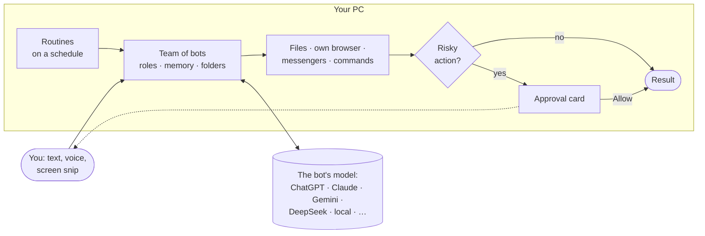

<div align="center">


# Deloist Bots

**A team of AI bots on your own computer**

A secretary, an analyst, a researcher and a store assistant in one window.<br>
They sort your email, check stock and answer customers, and ask you before any important step.

[](https://github.com/gordidima-rgb/deloist-agent/releases/latest)
[](https://github.com/gordidima-rgb/deloist-agent/releases/latest)
[](LICENSE)
[](#what-it-costs)
[](#build-from-source)
[](https://t.me/deloist_app)

**[⬇ Download for Windows](https://github.com/gordidima-rgb/deloist-agent/releases/latest/download/Deloist-Setup.exe)** ·
[Website](https://deloist.com) ·
[What's new](https://github.com/gordidima-rgb/deloist-agent/releases) ·
[Report a bug](../../issues/new?template=bug.yml) ·
[Русский](README.ru.md)

</div>

<br>

<picture>
  <source media="(prefers-color-scheme: dark)" srcset="docs/images/hero-en-dark.webp">
  
</picture>

## What it is

Deloist is a Windows app that hosts a **team of bots**, not a single assistant. Every bot has its own role,
model, folder and memory. Bots work in a browser of their own and in your messengers, run on a schedule and
hand tasks to each other. Anything that can do harm — sending to people, paying, deleting, publishing — waits
for your "Allow".

The app, the bots and their memory live on your PC. The model you choose receives only what you send it.

## What it does

- **A team of bots.** Roles, groups of bots in one chat, `@`-mention the one you need. Ready-made bots and skills install from the catalog in one click.
- **Any models on one team.** ChatGPT, Claude, Gemini, DeepSeek, GigaChat, local Ollama and LM Studio, free tiers. One bot on one model, its neighbour on another.
- **The subscriptions you already pay for.** ChatGPT, Claude or Gemini on your own plan, with what is left for 5 hours and for the week. When a model hits its limit, the bot switches to a backup.
- **Approval cards.** Before a risky action the bot stops and shows exactly what it is about to do: the command, the site or the file as it is.
- **Rules for 51 messengers.** Telegram, WhatsApp, MAX, VK and more: for each action you choose never, ask me, or allowed.
- **A browser of its own.** You see the bot's screen and can take control at any moment. Banks and government services are always closed to it.
- **Routines.** Tasks, reminders and habits on a schedule. Write a task as a phrase: "take out the trash every Wednesday".
- **Voice.** Speech recognised on your PC with no internet, hands-free conversation, "show on screen".
- **Memory in Markdown.** Plain files in your folder that open in Obsidian.
- **A bot dock** at the edge of the screen and living avatars — glass orbs that show what each bot is busy with.

## A team where everyone has a role

Put bots in one conversation. `@`-mention the one you need and it picks up where the previous one left off.
In development: a bot will notice a task outside its field and offer to bring in a specialist, only with your approval.

<picture>
  <source media="(prefers-color-scheme: dark)" srcset="docs/images/team-en-dark.webp">
  
</picture>

## Different AIs on one team

Every bot runs on its own model. Bots message each other, hand over tasks and files and check each other's
results — all in one window, with no switching between services.

<picture>
  <source media="(prefers-color-scheme: dark)" srcset="docs/images/models-en-dark.webp">
  
</picture>

<details>
<summary><b>Providers and agents the app works with</b></summary>

<br>

| Kind | Providers and agents |
|---|---|
| Cloud models | ChatGPT, Claude, Gemini, Grok, DeepSeek, Mistral, Qwen, Kimi, YandexGPT, GigaChat, Z.ai, Perplexity, Cohere |
| Aggregators and fast APIs | OpenRouter, Groq, Cerebras, NVIDIA, Together, Fireworks, Hugging Face |
| On your PC | Ollama, LM Studio |
| Coding agents | Codex, Claude Code, OpenCode, Cursor, GitHub Copilot, Cline, Kilo Code, Goose, Amp, Qoder |
| Your own endpoint | any OpenAI-compatible URL |

</details>

## Routines: repeating tasks run by themselves

Describe a task once and say when to do it. The bots start on schedule, split the work between them and come to
you only for permission. The same Routines hold your personal tasks, reminders and habits: dates, times and
repeats in a phrase are parsed by the app itself, at no model cost.

<picture>
  <source media="(prefers-color-scheme: dark)" srcset="docs/images/routines-en-dark.webp">
  
</picture>

## It asks before it acts

A bot will not delete, pay or send an email on its own. It stops and shows exactly what it is about to do.

- **You see what will happen** — the command, the site or the file as it is, not a retelling.
- **Risky answers are remembered separately** — a plain "always allow" never unlocks payments, sending to people, deleting or publishing.
- **A decision log** — what the bot did by a rule or by your answer, in plain words, in the bot's profile.
- **At night, rules only** — in routines the permissions given in a chat do not apply.

<picture>
  <source media="(prefers-color-scheme: dark)" srcset="docs/images/approvals-en-dark.webp">
  
</picture>

## Rules for every messenger

The bot opens messengers in its own browser. Six actions — read, join groups, post in groups, message people,
send files, delete messages — each with your choice. The app enforces the rules, not the bot: wording cannot
talk its way around them.

<picture>
  <source media="(prefers-color-scheme: dark)" srcset="docs/images/messengers-en-dark.webp">
  
</picture>

## The bot has a browser of its own, and you see its screen

The bot visits websites in a window of its own. If a login or a captcha is needed, it calls you. Optionally the
bot works in your Chrome, only on the sites you choose.

<picture>
  <source media="(prefers-color-scheme: dark)" srcset="docs/images/browser-en-dark.webp">
  
</picture>

## It searches where people actually write


The bot searches open Telegram channels by keyword, without a browser, and brings back posts with dates and links.
It reads chats and groups on Telegram Web, looks up places on maps and follows discussions on X, all in its own browser.
Sending, liking or joining a chat waits for your approval.

<br clear="right">

## Use the subscriptions you already pay for

Connect ChatGPT, Claude or Gemini on your own plan and see what is left for 5 hours and for the week. When one
model hits its limit, the bot switches to a backup.

<picture>
  <source media="(prefers-color-scheme: dark)" srcset="docs/images/limits-en-dark.webp">
  
</picture>

## Talk to a bot without touching the keyboard

- Hold a hotkey to talk: speech is recognised on your own PC, with no internet and no payment.
- Hands-free conversation: the bot answers aloud and you can interrupt it.
- "Show on screen": outline an area and the snip goes to the bot with your question.
- Fix selected text with a shortcut, in any program.

<picture>
  <source media="(prefers-color-scheme: dark)" srcset="docs/images/voice-en-dark.webp">
  
</picture>

## And also

<picture>
  <source media="(prefers-color-scheme: dark)" srcset="docs/images/also-en-dark.webp">
  
</picture>

### Living avatars

Every bot is a glass orb with glowing eyes. There are twenty of them, from Crystal and Wave to Lava, Cosmos and
Mercury. The eyes show what is going on: a spinner while the bot works, a question mark while it waits for you,
stars when it is done, crosses on an error. They follow the cursor, and after two quiet minutes the bot falls asleep.

<p align="center">
  
</p>

## How it works



- Every bot gets its own folder. Inside it the bot works freely; everything outside goes through rules and cards.
- The model is chosen per bot. The text of a request goes only to that model's provider, and each provider's key goes only to it.
- Keys are stored encrypted with Windows' own data protection.
- Close the window and the app moves to the tray: bots and routines keep working.

## Install

1. Download [Deloist-Setup.exe](https://github.com/gordidima-rgb/deloist-agent/releases/latest/download/Deloist-Setup.exe) from the latest release.
2. Run it. Windows 10 or 11 is required; WebView2, which the window runs on, ships with Windows 11.
3. Connect a model: a free one, your own subscription or key, or a Deloist balance.
4. Pick a ready-made bot in the catalog and give it a first task in words or by voice.

The app finds new versions itself and installs them in one click. Every version is checked against a digital
signature. For local speech recognition a model is downloaded once, about 0.6 GB.

## What it costs

The app is free, with no trial period and no time limit. You pay only for models, and only if you pick paid ones.

| Option | Price | What it is |
|---|---|---|
| Free models | Free | Free tiers from NVIDIA, Groq, Google AI Studio, OpenRouter and Z.ai, and on your own PC Ollama and LM Studio |
| Your own key or subscription | Provider's rate | ChatGPT, Claude, Gemini, DeepSeek, GigaChat, Alice and more. You pay the provider directly |
| Deloist Subscription | Prepaid balance | Top it up on our website and each request is deducted from it. No monthly fee. A welcome credit on your first sign-in |

<picture>
  <source media="(prefers-color-scheme: dark)" srcset="docs/images/pricing-en-dark.webp">
  
</picture>

## Coming soon

An honest list of what does not exist yet. Dates may move.

| Status | What |
|---|---|
| In development | **Specialist catalog** — narrow-field bots: programming languages, game engines, online stores, design |
| Planned | **Community bots** — share your bots and skills; after review they appear in the catalog with ratings |
| Planned | **Always-on cloud** — bots run on our server while your PC is off |

## Questions and answers

<details>
<summary><b>Where does my data go?</b></summary>

Bots, memory and settings are stored in a folder on your PC. Only the provider of the model you picked for a
bot receives the text of a request. Each provider's key is stored separately and goes only to that provider.
</details>

<details>
<summary><b>Can a bot break something?</b></summary>

Inside its own folder a bot works freely. Changing anything outside it, deleting, paying, sending to people or
publishing needs your permission first. The Stop button halts a turn at any moment.
</details>

<details>
<summary><b>Do I need to code?</b></summary>

No. Ready-made bots and skills install from the catalog in one click, and you give tasks in words or by voice.
</details>

<details>
<summary><b>What about Mac or Linux?</b></summary>

Windows only for now.
</details>

## Build from source

Deloist is written in Rust; the window runs on WebView2 and the interface is plain JS plus Svelte 5.

You only need [rustup](https://rustup.rs). The exact toolchain (`stable-x86_64-pc-windows-gnullvm`) is pinned in
`rust-toolchain.toml` and ships its own linker, so Visual Studio, MSYS2 and a C compiler are not required.

```bash
git clone https://github.com/gordidima-rgb/deloist-agent.git
cd deloist-agent
cargo build --release        # target/release/deloist.exe
cargo build --examples       # test helpers (fake agents) the suite needs
cargo test                   # the full test suite
```

The built Svelte interface is committed in `web/ui/`, so `cargo build` is enough. To change the interface itself:

```bash
cd ui
npm ci
npm run build                # rebuilds web/ui/ and checks it is up to date
npm test
```

A debug build needs no Deloist account and has a demo mode that runs the whole loop — tools, approvals,
workspaces, threads — without a real model. Data lives in `data/` next to the repository or the exe; set `CREW_DATA_DIR`
to use another folder.

| Folder | What is there |
|---|---|
| `src/` | the app: server, bots, model drivers, tools, approvals, browser, routines |
| `web/`, `ui/` | the interface: plain JS screens and Svelte 5 components |
| `catalog/` | ready-made bots and skills shown in the catalog |
| `tests/` | integration tests, including the security suite |
| `extension/` | the Chrome extension for working in your own browser |
| `THIRD_PARTY/` | licences of code and assets taken from other projects |

> [!NOTE]
> **Open core.** A few parts of the official build are not in this repository: the Deloist account and
> Deloist Subscription, the full catalog (the repository ships a handful of example bots and skills) and the
> glass-orb avatars. Without them the app uses built-in stubs — bots get a coloured circle with an initial —
> and works fully with your own models and keys.

## Contributing

Bug reports, ideas and pull requests are welcome.

- [Report a bug](../../issues/new?template=bug.yml)
- [Suggest an improvement](../../issues/new?template=idea.yml)
- Questions and discussion — [Telegram](https://t.me/deloist_app) or support@deloist.com

Before a pull request, run `cargo test` (and `npm test` in `ui/` if you touched the interface). Any new API
route that changes commands, addresses, keys or consents must stay human-only and get a test in
`tests/security.rs`. By submitting a contribution you grant the copyright holder a perpetual, worldwide, royalty-free licence to
use, modify and distribute it under PolyForm Noncommercial 1.0.0 and under any other licence, including the
terms of the official builds.

> [!IMPORTANT]
> Issues here are public. Remove keys, passwords and personal data from text and screenshots before you post.
> Report security problems privately to support@deloist.com, not in a public issue.

## License

The source code is **source-available** under the [PolyForm Noncommercial License 1.0.0](LICENSE): you may read
it, run it, change it and share changes for any noncommercial purpose — personal use, study, research, hobby
projects, and use by charities, schools and public bodies. Building a commercial product or service on this
code, or selling it, is not allowed without a separate licence. For commercial licensing write to
support@deloist.com.

**The official builds in [Releases](https://github.com/gordidima-rgb/deloist-agent/releases) are free for any
use, including your business**, under the [Deloist terms of use](https://deloist.ru/legal/offer). The
noncommercial limit applies to the source code and to builds you make from it.

Code and assets taken from other projects keep their own licences; see [NOTICE](NOTICE) and
[`THIRD_PARTY/`](THIRD_PARTY). "Deloist" and the Deloist logo are trademarks of their owner and are not
licensed for use in other products. The screenshots and images in `docs/images/` are not covered by the licence.

<br>

<div align="center">
<sub>© 2026 Deloist · <a href="https://deloist.com">deloist.com</a> · Provider logos belong to their owners and are shown only to name the provider</sub>
</div>
