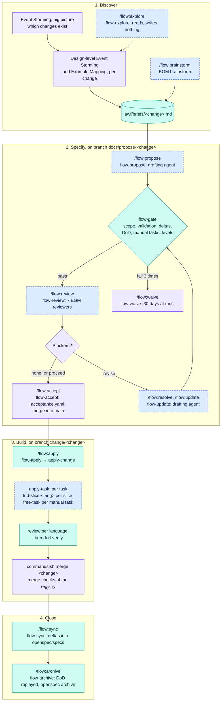
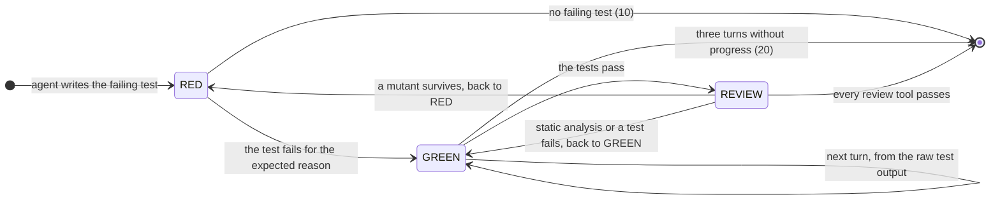

# openspec-tdd

openspec-tdd makes your coding agents work test first, and moves a change forward only when your own tools pass.

![Two columns titled "Who checks the code of your agents?". On the left, "Agent alone": a task and a prompt with its
skills feed a coding agent, which re-reads its prompt and picks the next step. It starts three subagents for the code,
the tests and the run, then the same agent writes the summary and announces "All tests pass", marked "not verified".
On the right, "Agent + openspec-tdd": a task, a prompt with its skills and an OpenSpec spec reviewed before the code
feed a coding agent that works test first, slice by slice. Three tools check its work: tests, analysis, mutation. On
failure, the agent tries again. The Definition of Done gives the verdict: a verified change, ready to ship, with the
proofs the Definition of Done produces. A dashed frame, "AWF workflow", surrounds the whole run, from the agent to the
proofs.](docs/animations/comparison.gif)


To try it on your repository, [install the pack](#install) and the [Claude Code plugin](#drive-the-workflows-from-claude-code),
[configure your project](#configure-your-project), then run `/flow:propose <change>` in Claude Code.

## What the pack does

openspec-tdd is an [AWF](https://github.com/awf-project/cli) workflow pack that applies [OpenSpec](https://github.com/Fission-AI/OpenSpec)
changes test first. Each code slice of a change's `tasks.md` goes through RED, GREEN and a review whose tools come from
your project's language registry. The change is then reviewed as a whole and checked against its Definition of Done,
and the merge checks of the registry guard its merge into main. Drafting, spec sync, acceptance and archiving of changes are part of the pack.

Moving from one phase to the next depends on the exit codes of your tools (test runner, static analysis, mutation
testing), never on what the agent reports.

## How the commands fit together

A change goes from an idea to the archive in four stages. In the diagrams, violet marks what your team decides, blue
with a dashed border what an agent writes, and teal what your tools and the pack's scripts check. Each box names the
Claude Code command and, below it, the awf workflow it runs.



The agents write, and the exit codes decide. A failed gate sends the raw output of your tools back to a fix agent,
three times at most; after that, the workflow fails and you either fix the change or waive the gate with
`/flow:waive`. `/flow:accept` and the merges are your decisions: no agent step triggers them. Stage 4 has a known
limitation, see [Known limitations](#known-limitations).

Inside stage 3, each slice of `tasks.md` goes through this loop. The status codes are those of `tdd-slice-php`; the
other `tdd-slice-*` workflows follow the same pattern.



## Prepare a change with Event Storming and Example Mapping

`/flow:propose` drafts a change from a brief, a Markdown file at `.awf/briefs/<change>.md` in the main worktree.
`/flow:brainstorm` writes that brief with EGM reviewers, but a brief written by your team after a workshop works the
same way. The two workshops come before `/flow:propose`, at two scales.

**Big-picture Event Storming** covers a whole domain, before any change exists. Keep its result as a versioned domain
document in your repository (events, commands, aggregates, bounded contexts, glossary), shared by every change. Its
bounded contexts give the capabilities under `openspec/specs/`, and its slices of the timeline give the list of changes
to propose, one change each. Run `/flow:explore` beside it to read the existing specs and code without writing
anything.

**Design-level Event Storming and Example Mapping** cover one change. Each sticky note or card has a place in the
OpenSpec artifacts:

| Workshop card | Goes to |
|---|---|
| Story (Example Mapping, yellow) | the change: its name and the "Why" of `proposal.md` |
| Rule (Example Mapping, blue) | a `### Requirement:` of a capability's `spec.md` |
| Example (Example Mapping, green) | a `#### Scenario:` under that requirement, its Given, When and Then becoming the scenario's steps, with its test level in the test strategy of `design.md`, then a `[lang] [level]` slice in `tasks.md`, whose RED step writes the failing test |
| Question (Example Mapping, red) and hot spot (Event Storming) | an open question of the brief, marked `[blocking]` when the change cannot be accepted while it stays open; one left unanswered becomes a finding of `/flow:review` |
| Command and domain event (Event Storming) | the WHEN and THEN of a scenario |
| Aggregate (Event Storming) | the module of `design.md` that holds the rules |
| Policy (Event Storming) | a requirement of the form "when this event occurs, this command runs" |
| Read model (Event Storming) | a requirement on what a person sees |

Write the brief with one section per card type, so that the drafting agent finds each one, and so that a board can
export it without parsing free sentences:

```markdown
# <change>

## Story
## Domain context
Domain document: <path>
- <only the events, commands, aggregates, policies, read models and bounded contexts this change touches>
## Rules
### <rule>
- Example: <title>
  - Given <state>
  - When <command or event>
  - Then <outcome>
## Open questions
- [blocking] <question that must be answered before acceptance>
- [non-blocking] <question that can wait>
```

Mark every question: by convention, an unmarked question counts as `[blocking]`.

Then draft the change from it:

```text
/flow:propose <change>
```

`/flow:brainstorm` writes to the same file: after a workshop, skip it, or it replaces your brief.

## Requirements

- awf 0.11.9 or later
- git, bash, jq, and `flock` (util-linux) for parallel tasks
- Node.js 24 or later (the task parser is TypeScript run by Node)
- the `openspec` CLI
- an agent CLI that awf can drive, Claude Code by default
- for `flow-review`, the [EGM](https://github.com/google/elephant-goldfish-model) plugin installed in Claude Code, or
  `EGM_ROOT` pointing to a copy of its repository

## Install

From a GitHub release, at the root of your repository:

```bash
awf init    # once per project: creates .awf/, which awf workflow install requires
awf workflow install gplanchat/awf-workflow-openspec-tdd
```

Add `--global` to install it for every project, or `@0.10.5` to pin a version. Then check the installation:

```bash
awf workflow info openspec-tdd
```

## Configure your project

The pack calls no project tool directly. It reads two files at the root of your repository.

| File | Required | Content |
|---|---|---|
| `.awf/languages.yaml` | yes | The language registry: for each language key, the slice workflow, the test file patterns, and the commands for RED, GREEN, each review tool and the merge checks. |
| `.awf/commands.yaml` | no | The command contract: replaces the git defaults for worktrees, merges and parallel tasks. |

Start from the examples:

- [`examples/languages.yaml`](examples/languages.yaml): PHP, TypeScript, Three.js and Go entries
- [`examples/languages-rust.yaml`](examples/languages-rust.yaml): Rust entries, one key per RED level, plus performance slices
- [`examples/commands.yaml`](examples/commands.yaml): a project driven by its own stack script

The operations of the command contract and their git defaults are listed at the top of
[`scripts/commands.sh`](scripts/commands.sh).

### Generate the configuration with an agent

To write both files for an existing project, run this prompt in your agent from the root of the repository. It asks
the agent to derive the commands from your project's own files and to ask you about anything it cannot find there.

```text
Configure the openspec-tdd AWF workflow pack for this repository by writing .awf/languages.yaml and, if needed,
.awf/commands.yaml.

Reference material, from the installed pack or from https://github.com/gplanchat/awf-workflow-openspec-tdd:
- examples/languages.yaml: the meaning of every registry key, in the header comments, and PHP, TypeScript, Three.js
  and Go entries;
- examples/languages-rust.yaml: Rust entries;
- examples/commands.yaml and the header of scripts/commands.sh: the command contract and its git defaults.

Steps:
1. Inventory the languages of this repository and the directory of each one. For each, find the real commands in the
   project's files (composer.json, package.json, Makefile, go.mod, Cargo.toml, CI configuration, compose files,
   wrapper scripts): test runner, a command that runs only the given test files with a JUnit report, static analysis,
   linters, mutation testing, architecture checks.
2. Write one registry entry per language: workflow, dir, tests and mutation patterns, test, red, report, strip,
   checks, review_steps, last, merge_checks, and the keywords that classify tasks. Use only commands that exist in
   this repository. Leave out a key whose tool the project does not have, and list it in your report.
   Derive the keywords from stable parts of the project (directory names, layers, frameworks, tools), not from the
   names of today's functions, classes or business terms, which change from one change to the next.
3. Write .awf/commands.yaml only if the project already drives its worktrees, services or end-to-end tests through
   its own script. Otherwise, keep the git defaults and do not create the file.
4. Run every command you put in a registry entry once, and report which ones pass, which fail and why.
5. Ask me before you install a tool, add a dependency, or change any file outside .awf/.

End with a short report: the languages found, the keys left out and why, and the commands that failed.
```

To run the same merge checks when you merge by hand, install the git hook:

```bash
bash <pack>/scripts/merge-gate.sh install
```

## Write tasks the pack can apply

A code task in `tasks.md` is declared in slices. The tag in brackets is a key of `.awf/languages.yaml`:

```markdown
## 2. Order total

- [ ] 2.1 Compute the order total
  - [ ] 2.1.1 [php] [unit] The total sums the lines, taxes included
  - [ ] 2.1.2 [ts] [functional] The cart page shows the total
```

- A slice tagged `[critical]` next to its language gets the extra review tools of `critical_steps`.
- A slice declares its test level next to its language, `[php] [unit]`, `[functional]` or `[integration]`, when the
  language's entry in `.awf/languages.yaml` has `levels` (one path pattern per level). The `levels` gate of
  `flow-propose` and `flow-update` fails on a slice without one, and RED fails (code 14) on a test file at another
  level. `design.md` ends with a test strategy that gives each scenario its level, and `apply-change.json` counts the
  test files per level in the project and in the change (`pyramid`).
- A group whose title ends with `(parallel)` runs its tasks at the same time, each in its own sub-worktree, when
  `max_tasks` is above 1.
- A task without slices is a manual task: an agent carries it out, and its `Verified by:` command decides whether its
  box gets checked. Write `Verified by: Manual` when no command exists: the gates of `flow-propose` and `flow-update`
  fail on a manual task with neither, and `flow-apply` lists such a task under `skipped` in its report.
- Each criterion of the Definition of Done carries its check command, or `Manual`.

## Workflows

Run a workflow with `awf run openspec-tdd/<workflow>`. The usual entry points:

| Workflow | Purpose |
|---|---|
| `flow-propose` | Drafts a new change (proposal, specs, design, tasks) in `.worktrees/propose-<change>`. |
| `flow-update` | Revises the artifacts of an existing change. |
| `flow-review` | Reviews a drafted change with the EGM reviewers (see below). |
| `flow-accept` | Accepts a change: writes `acceptance.yaml` and merges the proposal. |
| `flow-apply` | Applies a change in `.worktrees/<change>` through `apply-change`. The change stays on its branch `change/<change>`, unmerged. |
| `flow-sync` | Carries the deltas of a change into the main specs, fails when a requirement of a delta is not in them, and deletes a spec left without a requirement. |
| `flow-archive` | Replays the Definition of Done and archives the change. |
| `flow-waive` | Records your waiver of a failed gate for a change, 30 days at most. Run it from your terminal. |
| `flow-explore` | Prints the repository context (`step=start`) and checks that an exploration session wrote nothing under `openspec/` (`step=finish`). |

To merge a change that `flow-apply` applied, run the merge operation of the command contract from the root of main.
It runs the merge checks of the registry, and aborts the merge when one fails:

```bash
bash <pack>/scripts/commands.sh merge <change>
```

### Review a change with EGM

`flow-review` reviews a drafted change with the [Elephant-Goldfish Model](https://github.com/google/elephant-goldfish-model)
(EGM): seven reviewers of the EGM plugin (zoom-out, comprehension, design, structural, style, implementation readiness,
codebase details) each run as a fresh agent with read-only tools and no earlier context. `proposal.md`, `design.md`
and `specs/` form the feature part, `tasks.md` the implementation plan. Run it where the change is drafted:

```bash
awf run openspec-tdd/flow-review --input change=<change>
```

The findings go to `.awf/status/egm/review.md`, and the status to `.awf/status/flow-review.json`. Without a Blocker,
the workflow succeeds. With one, the `ask` operation of the command contract puts the question to a person, and the
run stops in its terminal state `waiting`. The default `ask` prints the question and the line that answers it:

```bash
AWF_WORKFLOWS_PATH=<pack>/workflows awf resume <run> --from check --input egm_decision=proceed
```

`proceed` accepts the change with its Blockers; `revise` and `abandon` end the run in the state `declined`. To file the
question elsewhere, a dashboard for example, declare `ask` in `.awf/commands.yaml`.

Building blocks, called by the workflows above:

| Workflow | Purpose |
|---|---|
| `apply-change` | Applies the open tasks of a change in order, then runs the final reviews and `dod-verify`. |
| `apply-task` | Applies one task, slice by slice. |
| `tdd-slice-php`, `tdd-slice-ts`, `tdd-slice-threejs`, `tdd-slice-go`, `tdd-slice-rust` | One TDD slice: RED, GREEN, review. |
| `tdd-slice-rust-perf` | One performance slice, measured against a benchmark target. |
| `free-task` | One manual task. |
| `review` | The review tools of one language, in order. |
| `dod-verify` | The Definition of Done criteria, one command each. |
| `flow-gate`, `flow-commit` | Gates and commit shared by the drafting workflows. |

Each workflow writes its report under `.awf/status/`. Each one describes its inputs and exit codes in its
`description` field; `awf workflow info openspec-tdd` lists them.

### Give an agent of your project its own worktree

`agent-worktree` creates or reuses `.worktrees/<name>-<task>` on branch `agent/<name>-<task>`, for a workflow of your
project whose agent must not work in the main worktree. Call it as the first step, then read the path from its report,
since a `call_workflow` step does not pass on the output of the workflow it calls:

```yaml
states:
  initial: worktree
  worktree:
    type: call_workflow
    workflow: openspec-tdd/agent-worktree
    timeout: 600
    inputs:
      name: reviewer
      task: "{{.inputs.task}}"
    on_success: work
  work:
    type: step
    command: |
      tree=$(jq -r .worktree .awf/status/agent-worktree/reviewer-{{.inputs.task}}.json)
      cd "$tree" && ...
```

Give the `call_workflow` step an explicit `timeout`: without one, awf stops the called workflow after 5 minutes.

The name and the task are in kebab-case. A worktree that exists with uncommitted changes, untracked files included,
stops the workflow with code 2; set `AGENT_REPRISE=1` to resume the work it holds. A new worktree starts from
`BASE_BRANCH` (`main` by default), or from the branch `agent/<name>-<task>` when it already exists.

## Run the workflows in a Susan run

A Susan run is a fresh clone of the project with all its branches, positioned on `main`, discarded at the end, like a
CI job. Susan sets `NEXUS_AGENT_RUN_ID` in the environment, and pushes the current branch at the end of the run, fast
forward only, never `main`. When `NEXUS_AGENT_RUN_ID` is set, the workflows change as follows:

| Workflow | In a run |
|---|---|
| `flow-propose`, `flow-update`, `flow-sync`, `flow-archive`, `flow-accept` | No worktree: the clone switches to `docs/propose-<change>` (from the origin when it exists there, else created from `main`) and the workflow goes on. |
| `flow-accept` | Writes and commits `acceptance.yaml`, but does not merge into `main`: the run pushes the branch, and you merge it through a pull request or with `flow-accept` outside a run. |
| `flow-apply` | The clone switches to `change/<change>`, `commands.sh deps .` installs the dependencies, and the change is applied in place. A `(parallel)` group runs one task at a time. |

No workflow ends by asking you to run a command again from another folder. A failed step prints what failed and why
on its output, which Susan shows in the run's log.

## Drive the workflows from Claude Code

The repository is also a Claude Code marketplace. Its `flow` plugin adds one command per entry point, each running the
matching workflow and reading its report: `/flow:propose`, `/flow:update`, `/flow:accept`, `/flow:apply`,
`/flow:sync`, `/flow:archive`, `/flow:waive` and `/flow:explore`, plus `/flow:setup`, which installs
what these commands need. It also adds a hook that blocks
any write to the waiver registry outside `/flow:waive`.

Three commands bring the EGM design phases into the session, where reviewers can run as subagents:

- `/flow:brainstorm <change> <idea>` follows `egm-brainstorm` and writes a concepts brief to `.awf/briefs/<change>.md`,
  which `/flow:propose <change>` drafts the change from;
- `/flow:review <change>` runs `flow-review` and, on Blockers, asks you whether to proceed, revise or abandon;
- `/flow:resolve <change>` follows `egm-resolve` on the findings with you, applies the approved fixes through
  `flow-update`, then reviews the change again.

`/flow:propose` and `/flow:update` end with `/flow:review`, and `/flow:accept` stops while the review waits for a
decision or asked for a revision.

```text
/plugin install flow --marketplace gplanchat/awf-workflow-openspec-tdd
```

The commands run `awf run openspec-tdd/<workflow>`. At the start of a session in a repository that holds an
`openspec/` folder, the plugin checks that awf is 0.11.9 or later, that the project has an `.awf/` folder and that the
pack is installed. When `.awf/languages.yaml` lists pass proofs (a non-empty `proofs` key), it also checks for zpm 0.4.4.
If an item is missing, Claude Code shows a message. Run `/flow:setup` to install what is missing: it shows each command
(`awf upgrade`, `awf init`, `awf workflow install`, `zpm upgrade`, or a download of the awf or zpm release into
`~/.local/bin` after checking its SHA-256) and runs it once you approve it.

## Add a language

1. Add an entry to `.awf/languages.yaml` with the commands of your toolchain.
2. Point its `workflow` at an existing `tdd-slice-*` workflow, or add one to the pack with its prompts in `prompts/`
   and its skill in `skills/`.

## Known limitations

- After `flow-accept` merges `docs/propose-<change>` into main, the branch and its worktree stay. `flow-sync` and
  `flow-archive` run on that branch again, which holds neither the code nor the checked boxes of `tasks.md` that
  `change/<change>` brought to main, and no workflow merges their commits into main. Until a fix lands, delete the
  branch and its worktree after the acceptance, so that `flow-sync` creates a new one from main, then merge the
  result by hand.

- The pack needs awf 0.11.9 or later: with 0.11.8 and earlier, `call_workflow` to a workflow of a pack fails
  ([awf-project/cli#426](https://github.com/awf-project/cli/issues/426)).
- The `[critical]` tag is honoured by the PHP, TypeScript, Go and Rust slice workflows, not by `tdd-slice-threejs`.
- `max_total` caps only the tasks of `(parallel)` groups; sequential tasks are not counted.
- awf 0.11.9 resumes a workflow of a pack without its pack prefix, and does not find it: resume `flow-review` with
  `AWF_WORKFLOWS_PATH` set to the pack's `workflows/` folder, as the default `ask` prints.

## Contributing

The animations of this README come from [`docs/animations/`](docs/animations/):
`node docs/animations/capture.mjs <cycle|comparison>` renders one again with Chromium and ffmpeg.

See [CONTRIBUTING.md](CONTRIBUTING.md).

## License

Apache License 2.0. See [LICENSE](LICENSE).
