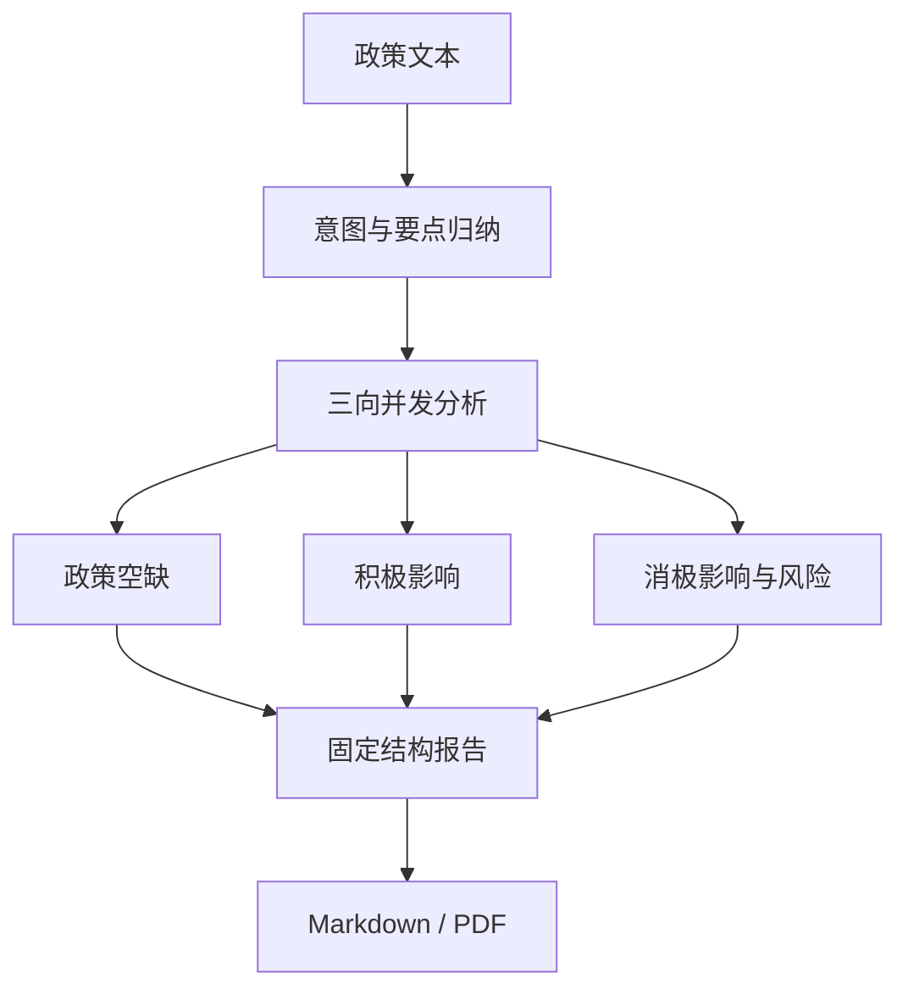

# PolicyAgents 政策智能分析系统

基于 LangGraph、LangChain 和可选 MCP 工具的政策文本分析原型。
输入政策文本，分别生成意图与要点、政策空缺、积极影响、消极影响与风险四部分报告。

项目面向公开政策的研究、信息整理和多 Agent 开发演示，当前没有在线体验站。
对外介绍与入驻字段见 [项目说明](docs/project-profile.md)。

## 能力

- Streamlit 界面：粘贴文本或上传 UTF-8 TXT/Markdown，选择模型，查看实际运行阶段和日志。
- 三个分析 Agent 并发执行，汇总为固定结构的 Markdown 报告。
- 支持 OpenAI 兼容接口及 Anthropic 接口。DeepSeek 等兼容服务使用 `provider: openai`，配合自己的模型名、密钥和地址。
- 按需加载 stdio 或 Streamable HTTP MCP 服务；默认不启用工具。
- 导出 Markdown、PDF；运行记录单独保存为 JSON，不混入报告正文。
- CLI 与网页共用分析函数。网页历史保留当前会话最近 10 条，不是持久化账户历史。

## 快速开始

本轮使用 Python 3.13 验证。建议使用独立虚拟环境。

```bash
git clone https://github.com/guangxiangdebizi/PolicyAgents.git
cd PolicyAgents
python -m venv .venv
# Windows PowerShell: .venv\Scripts\Activate.ps1
# macOS / Linux: source .venv/bin/activate
python -m pip install -r requirements.txt
```

复制 `.env.example` 为 `.env`，填写需要使用的 API 密钥。
PowerShell 使用 `Copy-Item .env.example .env`，macOS/Linux 使用 `cp .env.example .env`。
示例默认选择 DeepSeek Chat；可更改 `DEFAULT_MODEL` 和 `MODEL_CONFIG`。
模型是否可用取决于实际服务与账户权限，示例不保证服务长期提供该模型。

```bash
python run_app.py
```

启动脚本仅监听 `localhost:8501`。本项目没有多用户身份认证，不应直接作为公网服务开放。

### 命令行

```bash
python main.py --policy_file policy.txt --model deepseek_chat --output report.md
python main.py --policy_text "待分析的公开政策文本" --no-pdf
```

两个输入参数二选一。可用 `--run-dir` 指定运行目录、`--mcp-config` 指定 MCP 配置，
或用 `--no-pdf` 跳过 PDF。成功退出码为 0，分析或主报告写入失败为非零。
PDF 导出失败时保留 Markdown，并返回明确警告。

## 模型配置

程序读取 `MODEL_CONFIG`，不是 `AVAILABLE_MODELS`。
它是以模型 ID 为键的 JSON 对象，支持示例中的多行格式。

| 字段 | 含义 |
| --- | --- |
| `display_name` | 界面显示名称 |
| `provider` | API 适配器：`openai` 或 `anthropic` |
| `model_name` | 服务端模型名称 |
| `api_key_env` | 存放密钥的环境变量名称 |
| `base_url_env` | 存放服务地址的环境变量名称 |
| `max_tokens` | 单次模型输出预算，程序最多使用 4000 |
| `supports_tools` | 是否允许该配置与 MCP 工具一起使用 |

已存在的环境变量优先于 `.env`。生成温度为 0.1。
输出 token 上限不等于输入上下文长度，程序不会按 4000 tokens 截断政策输入；
超出模型上下文窗口的文本仍需由使用者分段处理。
兼容服务需实现聊天接口，使用 MCP 时还需支持工具调用。代码不捆绑或运行本地模型权重。

## MCP 配置

`mcp.json` 缺失或为 `{}` 时不加载工具。无效 JSON 会明确报错，不会静默降级。
同时接受服务映射，以及外层包裹 `{"mcpServers": {...}}` 的格式：

```json
{
  "filesystem": {
    "transport": "stdio",
    "command": "npx",
    "args": ["-y", "@modelcontextprotocol/server-filesystem", "/path/to/allowed/files"]
  }
}
```

HTTP 服务使用 `{"transport": "streamable_http", "url": "http://localhost:8000/mcp/"}`。
MCP 配置是可信启动配置：stdio 服务会启动本机进程，工具具有所配置的访问权限。
只接入自己审查过的服务，并限制可访问的目录。

## 工作流与产物



LangGraph 有 `intent`、`analysis`、`report` 三个业务节点。
分析节点通过 `asyncio.gather` 调度三个 LangChain Agent；报告节点拼接结果，不额外调用模型。
新运行默认写入独立的 `runs/<时间>_<随机标识>/`：

- `report.md`、`report.pdf`：供阅读和下载的报告。
- `session_*.json`：输入、输入哈希、模型配置摘要、阶段、Agent 结果和错误信息。
- `run.log`：网页入口保存的运行日志。

JSON 记录阶段和最终输出，不提供模型隐藏推理，也不宣称记录了每次 MCP 调用。
失败运行保留失败状态；并发分支失败时取消其余未完成分支。
新产物、虚拟环境和密钥默认被 Git 忽略，已提交的历史示例保持原样。

## 验证范围

仓库保留一次 **2025-08-22** 的历史运行：
输入为《关于明确快递服务等增值税政策的公告》示例文本，使用 `deepseek-chat` 的
OpenAI 兼容接口，MCP 工具数量为 0；留有四部分报告、PDF 和 JSON。
这证明一次功能链路演示，不是当前版本的模型效果评测。
参见 [历史运行目录](runs/20250822_110209_deepseek_chat/)。

历史输出中的统计数字、引用和政策判断未经逐项核验，不应直接作为事实引用。
当前没有标准化评测集、人工评分或第三方效果评测，不能据此报告准确率、效率提升比例或稳定耗时。

```bash
python -m pip install -r requirements-dev.txt
python -m pytest
```

离线测试使用模拟模型或本机 API 桩，覆盖配置、CLI、并发流程、失败处理和报告导出，
不调用付费模型，不评估政策解读质量，也不证明所有模型或 MCP 服务都兼容。
复现本轮依赖可改用 `python -m pip install -r requirements-dev.lock`；锁文件也用于 CI。

## 数据处理与使用边界

- 界面、报告和运行记录保存在运行应用的电脑上。
- 政策文本会发送至用户配置的模型 API；MCP 工具还可能访问其他服务。
- 运行记录含原始输入与模型输出，分享前检查内容，不要提交密钥或非公开业务数据。
- 当前不具备用户权限隔离、合规认证或政策结论自动核验能力。
- 提示词要求区分事实与推测、不得编造来源，但不能保证模型不会产生错误。
- 使用公开且有权处理的资料；正式政策、法律或合规判断需人工核对原文和依据。

信息安全合规等级：**未评定，暂无可提供的等保测评或安全认证材料**。
行业标准符合性：**未开展专项验证，不宣称符合某一特定行业标准**。
这不表示部署时没有适用要求，应按实际数据、业务和部署场景另行评估。

## 许可证

MIT，见 [LICENSE](LICENSE)。第三方依赖和模型服务适用各自的许可与条款。
