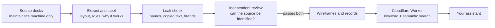

<p align="center">
  <picture>
    <source media="(prefers-color-scheme: dark)" srcset="assets/logo-dark.png">
    
  </picture>
</p>

<p align="center">
  <em>A case-competition playbook and 900 slide layouts, inside your AI assistant.</em>
</p>

<p align="center">
  
  
  
  
  <a href="https://claude.ai/directory/connectors/eightytwenty"></a>
</p>

<p align="center">
  <a href="https://claude.ai/directory/connectors/eightytwenty"><strong>Add to Claude</strong></a>
  &middot; <a href="#chatgpt">Add to ChatGPT</a>
  &middot; <a href="#other-clients">Other clients</a>
  &middot; <a href="https://mcp.eightytwenty.tech/docs">Docs</a>
  &middot; <a href="https://www.eightytwenty.tech/"> Website </a>
</p>

---

eightytwenty gives your assistant the method strong case-competition teams use to build decks. It asks the right questions
first, writes the storyline and a plan for every slide, waits for your approval, then builds and checks the deck. While it
plans, it searches a library of more than 900 slide layouts and 39 whole-deck flows taken from strong case-competition
and investment-banking decks, so each slide starts from a layout that has already worked.

The library holds no original slides. Every entry is an abstract wireframe with its layout, why it works and when to use it.
Your assistant rebuilds the idea in your own style.

## Install

The server address is the same everywhere:

```
https://mcp.eightytwenty.tech/mcp
```

No account, no API key, no sign-in.

### Claude

**claude.ai and Claude Desktop:** eightytwenty is in Claude's connector directory. Open
[its listing](https://claude.ai/directory/connectors/eightytwenty) and add it, or search for eightytwenty when browsing connectors in Claude.
On Team and Enterprise plans an owner adds it under **Organization settings > Connectors**.

You can also add it by hand: [prefilled custom connector](https://claude.ai/customize/connectors?modal=add-custom-connector&connectorName=eightytwenty&connectorUrl=https%3A%2F%2Fmcp.eightytwenty.tech%2Fmcp),
or **Customize > Connectors > Add custom connector**, paste the address, and choose **No sign-in**.

**Claude Code:**

```bash
claude mcp add --transport http eightytwenty https://mcp.eightytwenty.tech/mcp
```

Add `--scope user` to have it in every project.

### ChatGPT

Turn on developer mode in ChatGPT's settings, then create a custom app with the address above and **No authentication**.
A directory listing is on the way.

### Other clients

Cursor, VS Code, Windsurf and other MCP clients take a remote server entry like this:

```json
{
  "mcpServers": {
    "eightytwenty": { "type": "http", "url": "https://mcp.eightytwenty.tech/mcp" }
  }
}
```

## Try it

- "Help me build a 12-slide deck for this case: a regional grocer is losing share to discount chains. Start with your questions."
- "Find me a reference layout for an implementation roadmap with three phases and KPIs."
- "I'm pitching a take-private of a mid-cap software company. What deck flow should I follow?"
- "Find a truck icon and a photo of a busy warehouse floor for slide 4."

In Claude you can also start from the connector's `start` prompt.

## Tools

| Tool | What it does |
|---|---|
| `get_playbook` | The method: workflow and intake questions, storyline and impact slides, slide types, taglines, writing conventions, design options, QA and the completion audit |
| `find_references` | Search slide layouts by what the slide needs to do, filtered by slide type, industry, data type, impact kind or deck style |
| `find_deck_flows` | Search whole-deck flows: section order, pacing and arc, by industry, length or style |
| `get_reference` | One result in full: its layout record, component layout and wireframe, or one deck flow |
| `find_images` | A logo, icon or photo for a slide: public-domain logos, permissive icons and openly licensed photos, with a credit line only when the licence needs one |

Every tool is read-only. Nothing can list, export or upload to the library.

## How it works



- **The library** is built on the maintainer's machine. A record reaches the server only after an automated leak check
  (names, copied phrases, brand colours and marks) and an independent review that tries to work out where each slide
  came from. Anything identifiable is withheld.
- **The server** is a Cloudflare Worker. Search combines SQLite full-text search with `bge-m3` embeddings, and the
  playbook is served as plain markdown.
- **Your assistant** reads a reference as inspiration and builds the slide with its own tools, in your deck's style.

| Folder | Holds |
|---|---|
| `playbook/` | The method, as markdown chapters served by `get_playbook` |
| `server/` | The Worker: MCP tools, search, rate limits, the docs, privacy and terms pages |
| `pipeline/` | Extraction, labelling worksheets, the leak check, packaging and the one-command release |

## What's new

**November 10, 2026**
- Listed in Claude's connector directory, and served at `mcp.eightytwenty.tech`.

**November 9, 2026**
- Investment-banking decks: 354 new layouts and 10 deck flows in a `finance-pitch` style, with valuation, comps, LBO
  returns and transaction overview slide types, and a thesis-to-returns deck arc.
- Writing conventions for every kind of slide text, with before and after examples and a list of phrasings that read
  as AI-made. QA now includes a writing pass.
- A run sheet at the start and a completion audit at the end, so every client follows the same steps.
- Question 1 now asks whether the deck is presented live or read on its own, and slide density follows from the answer.

**November 8, 2026**
- `find_images`: the assistant sources its own logos, icons and photos.

**November 6, 2026**
- A guided flow: questions one at a time, a text plan, then the build after you approve. Style notes on every layout.

**November 5, 2026**
- First release: the playbook, slide and deck-flow search, and the first library.

## Privacy

A request sends only the tool arguments your assistant passes, such as the search text and filters. For `find_images`
the image search terms go to Openverse, Wikimedia Commons and Iconify. Your IP address is used only for rate limiting.
There is no account, queries are not logged, and cached results are keyed by a one-way hash of the search. Each tool
call sends one anonymous usage record to PostHog (US cloud): the tool name, outcome, duration, result count, the options
picked from fixed lists, a library id only when it exists in the library, the name and version of your AI app, and the
server's name and version. It never includes search text, context, results, your IP address or anything that identifies
you; records are not linked to each other, and nothing is sent if your client sends Do Not Track or Global Privacy
Control. Full policy: [Privacy](https://mcp.eightytwenty.tech/privacy) and [Terms](https://mcp.eightytwenty.tech/terms).

Self-hosting: usage statistics are off unless the `POSTHOG_PROJECT_TOKEN` secret is set (`wrangler secret put`). The
optional `POSTHOG_HOST` var picks the PostHog host and defaults to `https://us.i.posthog.com`.

## FAQ

**How is this different from the Claude skill on eightytwenty.tech?**
The skill is a download for Claude that carries the method. The connector serves the same method to any MCP client, adds
the layout and deck-flow library and image search, and stays up to date without a re-download. In Claude, the connector
alone is enough.

**Will it copy someone else's slides?**
No. References are abstract wireframes with placeholder text, and the playbook tells the assistant to rebuild a layout
in your own style, never to reproduce one wholesale.

**Does it see my deck or my files?**
No. It receives only what your assistant sends to its tools, such as search text. Your files stay in your chat.

**Is it free? Are there limits?**
Free. Each client gets a per-minute rate limit, and searches share a daily budget. Over the limit it answers with a short
wait time instead of failing.

**Can I run my own?**
The code is MIT licensed. The library is not in the repo; the pipeline builds one from your own decks.

## Support

Email [eightytwenty.tech@gmail.com](mailto:eightytwenty.tech@gmail.com).

## License

[MIT](LICENSE). Copyright (c) 2026 Jason Huang and Asareal321.
