# Autonomous Enterprise Accounting & Browser Automation Pipeline

[](https://github.com/hardy-ayp/accounting-browser-pipeline/actions)
[](https://www.python.org/downloads/)
[](LICENSE)
[](SKILL.md)
[](README.id.md)

An end-to-end autonomous pipeline connecting web ERP browser crawling (Lightpanda / Chrome CDP), automated spreadsheet and PDF report downloading with cryptographic verification, dynamic SQL database ingestion, multi-unit/dual-dimension financial reconciliation, subledger auditing, and enterprise spreadsheet master updates with strict zero data fabrication.

---

## 🏛️ System Architecture

```mermaid
flowchart TD
    subgraph Phase1["1. Web ERP Browser Ingestion"]
        ERP["🌐 Web ERP / Portal"] --> BROWSER["🤖 Headless / Live Browser<br/>(Lightpanda CDP)"]
        BROWSER --> REPORTS["📥 Download Financial Reports<br/>(Sales, Payables, Inventory)"]
    end

    subgraph Phase2["2. Cryptographic Cataloging"]
        REPORTS --> DL["📂 Raw Downloads (/downloads)"]
        DL --> ORG["🗂️ File Organizer & Hash Check<br/>(MD5 + SHA-256 Deduplication)"]
        ORG --> MANIFEST["📑 Structured Folders & Manifests<br/>(manifest.json & manifest.csv)"]
    end

    subgraph Phase3["3. Dynamic SQL Ingestion Engine"]
        MANIFEST --> PARSER["📊 Excel & PDF Parser<br/>(openpyxl & pdfplumber)"]
        PARSER --> DYN_SQL["🗄️ Dynamic Schema Generator<br/>(DECIMAL 18,4 High Precision)"]
        DYN_SQL --> DB[("🐬 Relational Database<br/>(MySQL / SQLite / PostgreSQL)")]
    end

    subgraph Phase4["4. Financial & Multi-Unit Reconciliation"]
        DB --> ENGINE["⚖️ Dual-Dimension Reconciliation:<br/>- Financial Dimension (Currency/IDR/USD)<br/>- Physical Dimension (Quantity/Weights/Units)"]
        ENGINE --> AUDIT["🔍 5-Pass Matching & Balance Proof<br/>(Subledger vs General Ledger)"]
    end

    subgraph Phase5["5. Enterprise Master Spreadsheet Updating"]
        AUDIT --> MASTER["📑 Master Enterprise Workbook<br/>(Multi-Sheet Data Warehouse)"]
        MASTER --> PRESERVE["🛡️ Formula Protection Engine<br/>(Protect Header & Lookups, Dynamic Fill Down)"]
        PRESERVE --> OUT["📈 Executive Audit Dashboard"]
    end
```



---

## ✨ Key Features

1. **Web ERP Browser Automation**:
   - Headless execution via Lightpanda CDP (`ws://127.0.0.1:9222`) or live browser profile with session persistence.
   - Dynamic iteration over multi-branch dropdowns, date filters, and export confirmation modals.
   - Strict file validation: Verifies binary Magic Bytes (`PK\x03\x04` for XLSX, `%PDF` for PDF) to reject error HTML pages.

2. **Cryptographic Cataloging & Deduplication**:
   - Computes MD5 and SHA-256 checksums on all incoming reports.
   - Automatically generates timestamped audit manifests (`manifest.json` and `manifest.csv`).

3. **Dynamic SQL Schema Inference**:
   - Automatically sanitizes messy column headers into valid SQL identifiers.
   - Enforces `DECIMAL(18,4)` precision on quantities, currency, and unit rates to eliminate floating-point rounding errors.
   - Executes batch parameterized inserts for high-throughput data processing.

4. **Dual-Dimension & Multi-Unit Reconciliation**:
   - Reconciles both **Monetary Values** and **Physical Units / Quantities** simultaneously.
   - Strictly isolates direct purchases (*Accounts Payable*) from consignment inventory (*Third-Party Deposits*).
   - **5-Pass Matching Engine**: Exact Match, Discrepancy Match, Timing Difference, Unrecorded in GL, and Missing in Subledger.
   - **Balance Proof Formula**: $\text{Ending Balance} = \text{Beginning Balance} + \sum \text{Inflow} - \sum \text{Outflow}$.

5. **Enterprise Master Spreadsheet Engineering**:
   - Safeguards massive multi-sheet workbooks against formula breakage (`#REF!`).
   - Protects header rows and reference lookup dictionaries (Rows 1–5).
   - Applies dynamic formula fill-down across calculation columns while refreshing raw data.

6. **Strict Zero Data Fabrication**:
   - Never injects artificial balancing figures (*plug-in residuals*).
   - Radical honesty on missing or discontinuous source data.
   - Evidence-based citation: Every reported number references document name, sheet, and exact 1-based visual row index.

---

## 💡 Why Can the Agent Reliably Extract Bulk Reports? (Deep Web Understanding)

Conventional automation bots fail when extracting dozens or hundreds of financial reports across multi-branch enterprise web portals because modern ERP interfaces are built with asynchronous AJAX loaders, dynamic Select2 dropdowns, and modal dialogs. 

This pipeline achieves high reliability through **Deep Web Understanding**:

1. **Dynamic DOM Element Inspection (Not Blind Screen Clicking)**:
   The agent interrogates the actual DOM element tree. Select elements (`<select name="branch_id">`), Select2 search containers, and date inputs (`<input type="date">`) are inspected by their underlying HTML attributes, option values, and DOM event listeners.

2. **Asynchronous & AJAX State Handling**:
   Selecting a branch often triggers dynamic background AJAX calls to populate specific inventory trays or category filters. Rather than firing an immediate submission that causes empty downloads, the agent enforces network-idle detection and explicit DOM readiness verification (0.5 – 1.5s delay) before proceeding.

3. **Automated SweetAlert2 & Confirmation Modal Dismissal**:
   Enterprise ERPs often spawn JavaScript confirmation popups (`.swal2-modal`, `.swal2-confirm`) when triggering large export jobs. The agent programmatically detects modal appearance and clicks the affirmative action trigger.

4. **Session Persistence (Eliminating OTP & Re-login Friction)**:
   The agent operates through live browser profiles connected via Chrome DevTools Protocol (`ws://127.0.0.1:9222`). Existing authenticated sessions, cookies, and corporate 2FA tokens remain active, preventing mid-run session timeouts during multi-hour batch extractions.

5. **Binary Magic Bytes Gatekeeper**:
   If an ERP session expires or a server encounters an HTTP 500/404 error, web servers frequently output an error HTML page mislabeled with an `.xlsx` extension. The pipeline validates file headers (`PK\x03\x04` for XLSX, `%PDF` for PDF) and rejects bogus HTML files before they contaminate database tables.

6. **Cryptographic Deduplication (MD5 & SHA-256)**:
   Downloaded files are hashed. If a report for a specific branch and date has already been retrieved and verified, the agent skips redundant processing, saving bandwidth and storage.

---

## 📖 Real-World Bulk Extraction Brief

### Scenario: Daily Closing for a 30-Branch Retail Chain
A retail enterprise operates 30 branches. Every morning, the accounting department must retrieve 3 core reports from each branch (Total: 90 daily files):
1. **Sales POS Report:** Invoice numbers, cashier names, sold quantities, and cash/card collections.
2. **Purchases / Payables Report:** Purchase bills, returns, and vendor payables.
3. **Live Inventory Report:** Current physical stock barcodes in showrooms and warehouses.

#### How the Pipeline Executes Autonomously:
```
[Web ERP Portal]
       │
       ▼ (1. Batch Loop across 30 branches via Lightpanda/Chrome CDP)
[90 Raw Excel / PDF Files Downloaded with Magic Bytes Verification]
       │
       ▼ (2. Deduplication, Hashing MD5/SHA-256 & Manifest Cataloging)
[Structured Folder Archive: /structured_reports/2026-11/<branch>/]
       │
       ▼ (3. Dynamic Schema Generation & Parameterized Batch SQL Insert)
[High-Speed Relational Tables with DECIMAL(18,4) Precision]
       │
       ▼ (4. 5-Pass Reconciliation & IN - OUT Balance Proof)
[Discrepancy Matrix: Exact Matches, Discrepancies, Unrecorded Notes]
       │
       ▼ (5. Master Enterprise Workbook Updated via Formula Fill-Down)
[Executive Dashboard Delivered with Zero Data Fabrication]
```

---

## 📁 Repository Structure

```text
accounting-browser-pipeline/
├── .github/
│   └── workflows/
│       └── ci.yml             # Automated CI test suite
├── docs/                      # Technical references & guides
│   ├── dual-unit-accounting.md
│   ├── database-master-rules.md
│   ├── browser-erp-crawling.md
│   └── anti-fabrication-manifesto.md
├── src/                       # Core Python package
│   ├── __init__.py
│   ├── reconciler.py          # 5-pass matching & balance proof
│   ├── downloader.py          # Magic bytes & checksum calculator
│   └── schema_builder.py      # Column sanitizer & SQL DDL generator
├── tests/                     # Unit test suite
│   ├── __init__.py
│   └── test_pipeline.py
├── SKILL.md                   # AI Agent Skill Definition (Antigravity/Agentic AI)
├── .env.example               # Environment template
├── .gitignore                 # Git ignore configuration
├── LICENSE                    # Permissive open-source license
├── requirements.txt           # Python dependencies
└── README.md                  # Project documentation
```

---

## 🚀 Quickstart

### 1. Installation
Clone the repository and install dependencies:
```bash
git clone https://github.com/hardy-ayp/accounting-browser-pipeline.git
cd accounting-browser-pipeline
pip install -r requirements.txt
```

### 2. Environment Setup
Copy the example environment configuration:
```bash
cp .env.example .env
```

### 3. Running Unit Tests
Run the automated test suite:
```bash
python -m unittest tests/test_pipeline.py
```

### 4. Basic Python Usage

```python
from decimal import Decimal
from src.reconciler import reconcile_records, verify_balance_proof

# Subledger sample records
subledger = {
    "INV-1001": {"quantity": Decimal("10.00"), "amount": Decimal("15000000"), "date": "2026-11-01"},
    "INV-1002": {"quantity": Decimal("25.50"), "amount": Decimal("38250000"), "date": "2026-11-01"}
}

# General Ledger records
gl_records = {
    "INV-1001": {"quantity": Decimal("10.00"), "amount": Decimal("15000000"), "date": "2026-11-01"},
    "INV-1002": {"quantity": Decimal("25.50"), "amount": Decimal("38000000"), "date": "2026-11-01"}
}

# Run 5-Pass Reconciliation
report = reconcile_records(subledger, gl_records)
print("Matched:", len(report["matched"]))
print("Discrepancies:", len(report["discrepancies"]))

# Verify Balance Proof
proof = verify_balance_proof(
    beginning_balance=Decimal("1000.00"),
    total_inflows=Decimal("5000.00"),
    total_outflows=Decimal("4500.00"),
    actual_ending_balance=Decimal("1500.00")
)
print("Is Balanced:", proof["is_balanced"])
```

---

## 🤖 Using as an AI Agent Skill

This repository includes a compliant [SKILL.md](SKILL.md) file. Any AI agent (such as Antigravity, Claude Code, or custom OpenAI/Gemini assistants) can load this skill directly by pointing to this directory or copying it into `.agent/skills/accounting-browser-pipeline/`.

When tasked with:
> *"Reconcile the daily ERP sales and purchase reports against the master finance spreadsheet, ingest raw files to SQL, and detect any variance."*

The AI agent will automatically follow the step-by-step procedures outlined in [SKILL.md](SKILL.md) without manual prompting.

---

## ⚖️ License, Attribution & Ethical Guidelines

### Permissive Code License
* **Code License:** Permissive Open Source License. See [LICENSE](LICENSE) for full legal text.
* **Integrity Mandate:** AI agents and contributors must strictly adhere to the [Anti-Fabrication Manifesto](docs/anti-fabrication-manifesto.md).

### Trademarks & Nominative Fair Use
All product names, logos, brands, and registered trademarks mentioned in this repository (such as Lightpanda, Google Chrome, Microsoft Edge, Microsoft Excel, MySQL, PostgreSQL, Python) are the property of their respective owners. Their mention in this project is strictly for identification, interoperability, technical compatibility, and educational reference under the legal doctrine of **Nominative Fair Use**. 

This repository is an independent open-source project and is **not** affiliated, associated, authorized, endorsed by, or in any way officially connected with Lightpanda, Google, Microsoft, Oracle, or any of their subsidiaries or affiliates.

### Architecture & License Compliance
* **Browser-Agnostic Protocol**: This project implements an independent Python orchestration client that interacts exclusively over open, standard network interfaces (Chrome DevTools Protocol - CDP via WebSocket at `ws://127.0.0.1:9222`). It does not bundle, vendor, or modify any internal source code, binaries, or AGPL-licensed core components of Lightpanda.
* **Flexible Runtimes**: Users and AI agents are free to connect this pipeline to any CDP-compliant browser of their choice, including standard Google Chrome, Microsoft Edge, Chromium, Playwright, or Lightpanda.
* **Ethical Automation**: This tool is designed exclusively for authorized accounting reconciliation, ledger auditing, and internal operational data processing. Users are strictly responsible for complying with the terms of service, access policies, and data privacy regulations (such as GDPR and local privacy laws) of the systems they interact with.
* **Zero Data Fabrication**: This project rejects the generation of artificial balancing figures (*plug-in residuals*). Financial audits and reports generated through this pipeline must remain factual, verifiable, and evidence-based at all times.
