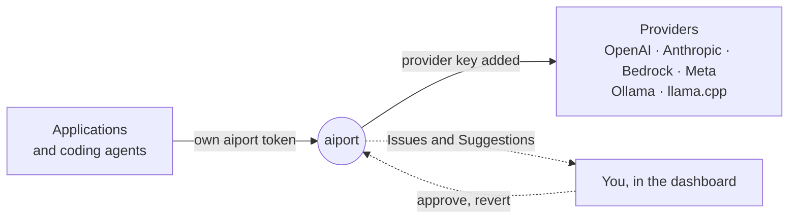

<div align="center">


<h1>aiport</h1>

<p><strong>A self-improving local LLM gateway for the erratic vibe coder.</strong></p>

<p>
  <a href="https://github.com/harelix/aiport/actions/workflows/ci.yml"></a>
  <a href="LICENSE"></a>
  
  
</p>

<p>
  <a href="https://harelix.github.io/aiport/">Documentation</a> ·
  <a href="docs/getting-started.md">Getting started</a> ·
  <a href="docs/manual.md">Manual</a> ·
  <a href="docs/connect.md">Connect an application</a> ·
  <a href="docs/configuration.md">Configuration</a> ·
  <a href="CONTRIBUTING.md">Contributing</a>
</p>


</div>

## Who it is for

If you're an erratic vibe coder, you know the day: Claude Code in one repo, Codex in another, a model on Ollama or llama.cpp, and credits on Bedrock, Anthropic, OpenAI and Meta. You switch models by task, sometimes mid-task, and jump between projects several times an hour. The apps you build call those models too, so each one ends up re-wiring the same providers. You can't see which app called what, and you find out about failures when something breaks.

aiport is a Go program that runs on your machine (loopback only) and sits between your apps, your coding agents and the providers.

## The basics

Each app gets one OpenAI-style or Anthropic-style client pointed at aiport, instead of setup code for every provider. It can name a model, or ask for `fast`, `balanced` or `best` and let you decide what those mean, optionally with a task name and an effort.

Provider keys stay with aiport, in a private env file (mode 0600, plain text, never in the YAML config). Apps and agents get their own tokens, which you can revoke one at a time. To connect an app you hand its coding agent one instruction and approve the short pairing code it shows you. Coding agents can go through aiport too: `aiport agent claude` or `aiport agent codex` starts one with its own token, so it never sees your keys.

## The part that improves over time

aiport watches how your apps use models and proposes changes. Nothing is applied without your approval unless you turn that on, and every change can be reverted.

When the same failure keeps happening, aiport groups it into an Issue with a fix on both sides: a change to aiport for you to approve, and instructions for the app's coding agent. **Fix it** goes a step further and runs a coding agent in a separate git worktree. You review the diff, and if you keep it, aiport commits it on a new branch (it never commits to your branch, merges or pushes).

If your app shows thumbs up and down next to its answers, those votes turn into suggestions about which model should handle which requests. Apps can also opt in to smaller prompts, and aiport tracks answer quality for each compression method, so you can see whether it does harm, looks fine, or hasn't seen enough data yet.

All of this runs on metadata. Each call is logged with the app, model, effort, latency, status and failure reason, and that's it: prompts and responses are never stored.

## Design choices and limits

Requests pass through in each provider's own format, with no translation, because converting tool calls and streaming between formats loses things. The trade-off is that a client only reaches providers that speak its protocol.

aiport is single-user by design. There are no teams or budgets, and LiteLLM, Portkey or Bifrost fit those needs better.

## How it works



Applications call aiport with their own token. aiport routes each call to the provider you chose, keeps the metadata, and turns repeated failures into Issues you can fix from the dashboard, or hand to the application's coding agent.

## Quickstart

New to aiport? [Getting started](docs/getting-started.md) walks you through it in about ten minutes.

You need **Go 1.27+** (`brew install go`, or [go.dev/dl](https://go.dev/dl)). Dependencies are vendored and the dashboard is pre-built, so nothing else is downloaded.

```sh
git clone https://github.com/harelix/aiport && cd aiport
make build              # bin/aiport, dashboard included
./bin/aiport init       # choose providers and coding agents; writes aiport.yaml
./bin/aiport serve      # prints the dashboard address and management token
```

Or install the binary without cloning: `go install github.com/harelix/aiport/cmd/aiport@latest` (it lands in `$(go env GOPATH)/bin`; run `aiport init` and `aiport serve`).

Open the dashboard address `serve` prints (**http://127.0.0.1:8787/** by default; `init --listen` picks another, and you can [use `aiport.localhost` instead](docs/manual.md#use-a-name-instead-of-127001)), paste the management token and set a password. Paste your provider keys on **Providers**, then **Check connection** on each card: it makes one free `GET /models` call and generates nothing. Start any local provider (Ollama, llama.cpp) yourself.

## Using it

- **Connect an application.** On **Integrate**, open **Instructions** at the top and copy them to the coding agent working on the application. It switches the application's SDK to `http://127.0.0.1:8787` and pairs it; you approve the short code it shows. The application's token goes in a gitignored `.aiport` file at its repository root, read by both the application and its coding agent; **New token** replaces a lost one and the trash icon removes an application. See [Connect](docs/connect.md).
- **Launch a coding agent through aiport.** `./bin/aiport agent claude --model MODEL` or `./bin/aiport agent codex --model MODEL` (add `--dry-run` to inspect). The agent gets its own token, never your provider keys.
- **Decide on Changes.** Issues, Suggestions and Change requests wait on **Changes**, with a badge only when one needs you. Every Change can be reverted.

The [manual](docs/manual.md) covers every page. Read it on the [documentation site](https://harelix.github.io/aiport/), or in the dashboard: press the help button, or the ⓘ next to any section.

## Configuration

`init` writes `aiport.yaml` and a private `aiport.yaml.env` (mode 0600) for local tokens and the keys you paste in the dashboard. It never overwrites a file, and provider keys never go into YAML.

```sh
./bin/aiport init --provider openai,anthropic --agent codex,claude   # without prompts
./bin/aiport check                                                    # validate the configuration
./bin/aiport auth token                                               # print the management token again
```

Provider presets: `openai`, `anthropic`, `bedrock`, `meta`, `ollama`, `llamacpp`. See the [configuration reference](docs/configuration.md) and [`aiport.example.yaml`](aiport.example.yaml).

## Security and data

- Calls go only to the providers you configured, with that provider's key. aiport stores request metadata (time, application, model, status, latency), never prompts or responses.
- **Agent runs** start a coding agent you installed (Claude Code, Codex or Gemini CLI) in a separate git worktree, only when you click. Commands ask you first, and aiport never commits to your branch, merges or pushes. An agent's own settings can allow more than aiport sees: read [what aiport cannot see](docs/manual.md#explain-by-a-coding-agent) first.
- [Extensions](docs/extensions.md) you add take part in decisions about Change requests.
- Found a vulnerability? Report it privately as [SECURITY.md](SECURITY.md) describes, not in a public issue.

## Limitations

aiport is experimental. No provider and coding-agent combination has passed the live [compatibility](docs/compatibility.md) gate yet. Token counts and cost are not measured. A provider must speak the protocol of the client calling it, since aiport does not translate. Gemini runs' model calls do not go through aiport, and Codex runs use Codex's own login. There are no release downloads yet; build from source.

## Contributing

aiport is maintained by one person in their spare time: issues and pull requests are read, but replies are best effort and may take a while. See [CONTRIBUTING.md](CONTRIBUTING.md) and the [code of conduct](CODE_OF_CONDUCT.md). CI runs on every push; locally, run `make test`, `make check` and `make check-offline`, and sign off every commit (DCO). Larger changes start from [the design](docs/design.md); the vocabulary is in the [glossary](GLOSSARY.md), and dependency licenses are in [THIRD_PARTY.md](THIRD_PARTY.md).

## License

[Apache-2.0](LICENSE). The aiport name and logo are covered by [TRADEMARKS.md](TRADEMARKS.md).
