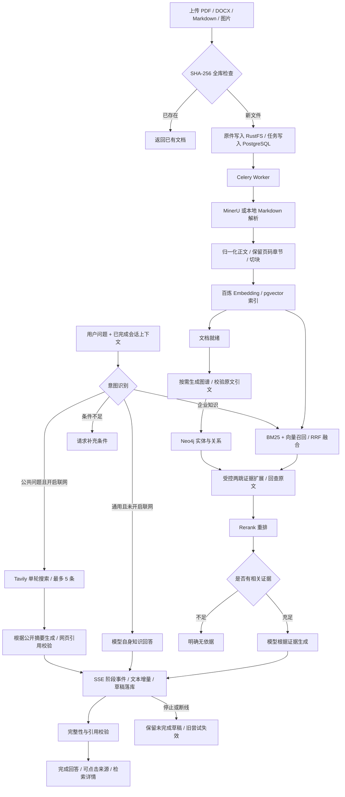

# 企业知识助理

基于 RAG 与知识图谱的企业知识库应用。上传制度文档后，可以用自然语言提问、核对原文、查看检索分数和跨文档证据路径；通用问题直接由模型回答，企业制度缺少依据时明确拒答。

已打通 **知识入库 → 混合检索 → 流式回答 → 引用溯源**，支持 PDF、Word、Markdown 和制度图片。前端面向电脑端使用。

[快速启动](#快速启动) · [系统界面](#系统界面) · [完整流程](#完整流程) · [验证与开发](#验证与开发)

## 功能一览

| 能力 | 当前实现 |
| --- | --- |
| 文档入库 | PDF / DOCX / UTF-8 Markdown / PNG / JPG / JPEG；最大 20 MB；全库 SHA-256 文件指纹检查，同一文件改名上传也能识别 |
| 文档解析 | MinerU 解析 PDF、Word 和图片，Markdown 本地解析；后台自动完成正文归一化、切块和向量索引 |
| 文档查看 | 正文、原件、实际索引切块；PDF 分页预览，DOCX 使用 docx-preview，图片支持缩放 |
| 文档删除 | 确认后从后续检索和图谱中排除；历史回答的固定引用继续可读，处理中禁止删除 |
| 混合检索 | BM25 关键词召回 + pgvector 向量召回，经 RRF 融合、Rerank 重排后提供回答证据 |
| 意图识别 | 通用对话 / 企业知识问答 / 条件澄清；结合已完成的历史回答理解追问 |
| 回答与会话 | 真实流式输出、阶段提示、停止生成、草稿保留、刷新后从历史恢复；支持会话删除与有界重试 |
| 引用与拒答 | 完整答案和引用校验后展示来源；点击定位正文或切块；无依据时拒答，模型故障单独提示 |
| 检索详情 | 真实 BM25、向量、RRF、重排分数，排名变化、最终引用、降级说明和阶段耗时 |
| 知识图谱 | 从原文异步抽取规则、角色、材料与制度关联，校验引文后写入 Neo4j；支持筛选、搜索、展开与来源核对 |
| 联网查询 | Tavily 单轮公共搜索、显式开关、流式回答和网页引用；企业内部制度继续走知识库 |
| 链路追踪 | LangSmith 父子链路、模型 Token 用量、工具耗时和停止/失败状态；支持元数据或开启后的脱敏输入/输出 |
| 两跳证据扩展 | 沿已验证的制度引用补充跨文档证据，回查原文并重排；展示实际路径及是否被答案引用 |

新建会话采用首次发送后保存，反复点击不会堆积空会话。文档管理按单文件使用，界面保留上传、查看、删除和失败重试等必要操作。

## 系统界面

以下截图来自本地运行系统和真实模型调用，文档及图谱由上传的制度语料生成。

**知识库问答与原文溯源**


**意图、检索分数与证据路径**


**文档管理与 Word 原件预览**


**知识图谱与条款依据**


**流式回答与停止生成**


停止或连接中断后，已收到的文本会保留为未完成草稿，可以重新生成。知识库草稿的引用尚未校验，不提供有效来源按钮。

<details>
<summary>查看更多：文档列表、原文定位与停止后的草稿</summary>


</details>

**联网查询与工具详情**


<details>
<summary>查看工具结果、查询时间与 LangSmith Trace ID</summary>


</details>

## 技术栈

| 层次 | 技术 | 作用 |
| --- | --- | --- |
| 前端 | React 19、TypeScript 7、Vite 8 | 工作台、文档管理、浏览器流式读取与状态展示 |
| 可视化与预览 | ECharts 6、React Markdown、react-pdf、docx-preview | 图谱交互、安全 Markdown、PDF / Word 原件查看 |
| API | Python 3.12、FastAPI、Pydantic | 上传、查询、会话、SSE 事件与参数校验 |
| 数据访问 | SQLAlchemy 2、Alembic、psycopg | 事务、消息状态、任务租约与数据库迁移 |
| 检索存储 | PostgreSQL 16、pgvector、rank-bm25、jieba | 元数据与会话持久化、向量检索、中文关键词检索 |
| 异步任务 | Celery、Redis 7、Celery Beat | 解析、索引、图谱抽取和任务恢复 |
| 文件存储 | RustFS（S3 兼容）、boto3 | 原件、解析结果和图片资源 |
| 图数据库 | Neo4j 5 | 有原文依据的实体关系与两跳路径查询 |
| 搜索与可观测性 | Tavily Search API、LangSmith REST API | 公共网页查询、脱敏链路与 Token 统计 |
| 文档解析 | MinerU 官方 v4 API | PDF / DOCX 解析和 PNG / JPEG OCR |
| 模型调用 | HTTPX、千问 / OpenAI 兼容接口 | 向量化、重排、意图识别、生成与真实模型流 |
| 工程与部署 | uv、pnpm、Docker Compose、pytest、Ruff | 依赖锁定、基础设施、测试和构建 |

向量与重排模型使用阿里云百炼中国内地接口。回答模型支持千问直连或已配置的第三方 OpenAI 兼容接口；模型选择由配置明确指定。

## 完整流程



- PostgreSQL 是文档状态、任务、会话和引用的持久化来源；Redis 用于任务调度。
- 聊天使用 `POST /api/chat/stream`，按 `start → phase / delta → done` 返回 SSE；停止使用 `POST /api/chat/stop`。文本分批落库后才发送，刷新读取已保存内容，不自动重复请求模型。
- 知识库答案的来源编号、原文关联和完整结构通过校验后才发布。停止、断线或生成失败时，草稿不会被标记为完整答案。
- 图谱抽取按需触发，失败不阻断基础 RAG。两跳仅扩展有依据的制度关联，缺失的审批岗位、金额和条件仍不能补编。

## 快速启动

### Windows 测试说明

Windows 下 API 和前端在 PowerShell 中运行，Celery Worker / Beat 在容器中运行，无需在 Windows 原生启动 Celery。

确认 Git、uv、Node.js 22.21+ 和 pnpm 10 已可用。已有 Node.js 时可用 `npm install --global pnpm@10.7.0` 安装本项目对应的 pnpm。若 PowerShell 提示不允许运行 `pnpm.ps1`，将下方命令中的 `pnpm` 改成 `pnpm.cmd`。

首次获取项目：

```powershell
git clone https://github.com/heiye-vn/enterprise-knowledge-assistant.git
cd enterprise-knowledge-assistant
uv python install 3.12
```

下方启动命令均可在 PowerShell 中逐行执行，无需激活虚拟环境；API、前端使用两个终端，均先进入项目根目录。建议在运行 Python 的终端设置 `$env:PYTHONUTF8 = "1"`；编辑 `.env` 时保存为 UTF-8。

**新电脑只会获得源码和测试资料**：私有 `.env`、本机数据库、上传原件、索引、会话和图谱不会随 Git 同步。需要按以下步骤初始化，重新填写模型密钥、上传制度并生成图谱。本文命令已在 macOS + Linux 容器环境验证；Windows 原生实机测试由本次跨机验收确认。

### 1. 准备环境与依赖

需要 **Docker / Docker Compose v2、Python 3.12、uv、Node.js 22.21+、pnpm 10**。Docker 服务需先启动；首次安装依赖、拉取镜像和云模型调用需要可用网络。

以下命令均在项目根目录执行：

```sh
uv sync --project backend --frozen
uv run --project backend python backend/scripts/init_env.py
pnpm --dir frontend install --frozen-lockfile
```

初始化脚本从 [.env.example](.env.example) 创建私有 `.env`，已有 `.env` 会原样保留。

### 2. 配置模型

编辑根目录 `.env`，填写自己的 MinerU Token 和百炼 API Key。以下为主要配置示例；模型名称需在自己的账号和区域中可用。

```dotenv
KH_MINERU_API_TOKEN=your-mineru-token

QWEN_API_KEY=your-dashscope-key
QWEN_BASE_URL=https://dashscope.aliyuncs.com/compatible-mode/v1
QWEN_LLM_MODEL=qwen3.8-max-0902
QWEN_EMBEDDING_MODEL=qwen3.7-text-embedding-flash
QWEN_EMBEDDING_DIMENSION=1024
QWEN_RERANK_MODEL=qwen3.7-text-rerank
KH_LLM_PROVIDER=qwen
```

使用第三方回答模型时，设置 `KH_LLM_PROVIDER=monkey`，同时填写 `MONKEY_BASE_URL`、`MONKEY_API_KEY`、`MONKEY_LLM_MODEL`。向量化与重排仍使用 `QWEN_*`。`MONKEY_*` 是当前代码中的第三方提供方配置名。

千问与 MinerU 默认 `KH_MODEL_TRUST_ENV=false`，直接连接；第三方可通过 `KH_MONKEY_MODEL_TRUST_ENV` 独立决定是否继承环境代理。修改配置后重启 API；涉及解析、索引或图谱任务时同时更新 Worker / Beat。详见[模型配置](docs/dev-notes/model-clients.md)与[网络说明](docs/dev-notes/model-network.md)。

联网查询和链路追踪为可选项，可继续使用普通问答而不配置这两项：

```dotenv
TAVILY_API_KEY=your-tavily-key
KH_TAVILY_TRUST_ENV=true
KH_TAVILY_TIMEOUT_SECONDS=20

LANGSMITH_TRACING=true
LANGSMITH_API_KEY=your-langsmith-key
LANGSMITH_PROJECT=enterprise-knowledge-assistant
LANGSMITH_ENDPOINT=https://api.smith.langchain.com
KH_LANGSMITH_TRUST_ENV=true
# 调试时记录正文；默认 false，可按需开启
KH_LANGSMITH_RECORD_CONTENT=false
```

联网开关默认关闭。开启后，公共问题调用一次 Tavily basic 搜索（最多 5 条、默认 20 秒超时），只发送独立搜索问题；完整会话和知识库原文不会传给搜索工具。搜索失败或没有依据会明确说明，企业制度问题即使开启联网仍只依据知识库。

LangSmith 追踪每次聊天尝试的意图、检索、工具和模型父子链路，包含 Token 数、结果数与状态。默认仅上传元数据；将 `KH_LANGSMITH_RECORD_CONTENT=true` 后，可查看用户问题、路由输出、检索片段与分数、模型 messages、工具结果和生成回答。配置密钥持续脱敏，内容按 span / trace 限长。追踪异步发送，平台故障不阻断回答。展开问答过程可查看 Trace ID，在自己的 LangSmith 项目中核对 Input / Output；配置变更需重启 API，仅影响新请求。自动测试关闭真实追踪，避免模拟链路混入展示项目。网络选项与模型代理相互独立；本机实测 Tavily / LangSmith 需继承环境代理，其他环境可按实际网络调整。

### 3. 初始化基础设施

```sh
docker compose up -d --wait postgres redis rustfs neo4j
uv run --project backend alembic -c backend/alembic.ini upgrade head
uv run --directory backend python -m app.bootstrap
docker compose build worker
docker compose up -d --no-deps worker beat
```

迁移创建数据库结构，bootstrap 创建 S3 Bucket，Worker 负责后台处理。Compose 共运行 PostgreSQL、Redis、RustFS、Neo4j、Worker、Beat 六个容器；API 和前端由下一步的两个本机终端启动。只启动前端和 API 无法完成上传后的解析与索引。

### 4. 启动 API 与前端

终端一：

```sh
uv run --project backend uvicorn app.main:app --app-dir backend --host 127.0.0.1 --port 8014
```

终端二：

```sh
pnpm --dir frontend dev
```

打开 **[http://127.0.0.1:5174/](http://127.0.0.1:5174/)**。Vite 将 `/api` 转发到本机 API 8014；端口被占用时会明确退出。

### 5. 检查与首次体验

```sh
curl --fail http://127.0.0.1:8014/api/health/ready
docker compose ps
docker compose exec -T worker celery -A app.tasks.celery_app:celery_app inspect ping --timeout 5
```

Windows PowerShell 使用 `curl.exe --fail http://127.0.0.1:8014/api/health/ready`，避免 Windows PowerShell 5 中 `curl` 别名的参数差异。

健康检查应返回 `ready`，Worker 应返回 `pong`。健康检查验证本地依赖和迁移；模型连通需单独检查：

```sh
uv run --project backend python backend/scripts/check_models.py
```

检查脚本会实际调用当前配置的模型。之后可按以下顺序体验：

1. 不上传文档也可直接提问，例如“请简要解释 RAG”，观察增量回答和停止按钮。
2. 从 `test-data/version_chatgpt/知识库语料/` 上传四份制度，每份选 PDF 或 DOCX 之一，等待状态变为可检索；再次上传同一文件验证去重。可另上传 `制度 01.png` 验证图片 OCR；先用 `test-data/demo/演示会议预约说明.md` 可快速验证本地解析和向量入库。
3. 提问“员工请半天事假由谁审批？”，展开检索详情，点击引用核对原文与切块。
4. 提问资料未规定的住房补贴问题，观察无依据提示。
5. 开启“联网查询”，提问公开资料问题，例如“Python 3.14.0 正式版何时发布？”，核对网页来源和工具详情；若配置追踪，可在 LangSmith 查看同轮链路。
6. 在知识图谱页为就绪文档生成图谱，查看关系原文，再问员工手册关联考勤制度的跨文档问题。

## 服务地址与日常操作

| 服务 | 本机地址 | 默认本地账号 |
| --- | --- | --- |
| 前端 | http://127.0.0.1:5174 | 无登录页 |
| API / Swagger | http://127.0.0.1:8014/docs | 无登录页 |
| PostgreSQL / pgvector | `127.0.0.1:5544` / 数据库 `knowledge_assistant` | `postgres / 12345678` |
| Redis | `127.0.0.1:6384` | 无密码 |
| RustFS S3 / 控制台 | http://127.0.0.1:9014 / http://127.0.0.1:9015 | `admin / 12345678` |
| Neo4j 浏览器 / Bolt | http://127.0.0.1:7484 / `bolt://127.0.0.1:7694` | `neo4j / 12345678` |

以上为仅监听本机的开发配置。容器内使用 Compose 服务名访问依赖，由 `compose.yaml` 自动覆盖地址。已有数据卷的登录密码不会随 `.env` 自动变化，保留数据时应同步实际凭证。

```sh
# 查看任务日志
docker compose logs --tail=50 worker beat

# 后端任务代码变更后更新镜像和两个进程
docker compose build worker
docker compose up -d --no-deps worker beat

# 停止 / 恢复基础设施和后台任务（前端、API 在各自终端结束）
docker compose stop
docker compose up -d
```

普通 `docker compose down` 保留命名数据卷，`down -v` 会删除数据。原件和解析对象仅在数据库已无引用且保留超过 24 小时后由定期任务清理。

日常重新启动时，先运行 `docker compose up -d`，再分别运行上面的 API 与前端命令。修改 `.env` 后重启 API；后台模型或解析配置变更时执行 `docker compose up -d --no-deps --force-recreate worker beat`，仅 `restart` 不会重新加载 Compose 的 `env_file`。

Windows 遇到端口占用，可用 `Get-NetTCPConnection -LocalPort 5174,8014,5544,6384,9014,9015,7484,7694 -ErrorAction SilentlyContinue` 查看占用进程。宿主机代理地址 `127.0.0.1` 在容器中指向容器自己；需要代理的服务应按实际网络单独配置，容器访问宿主机可使用 `host.docker.internal`。不要直接复制另一台电脑的代理端口。

常见问题：上传后一直等待时检查 Worker / Beat；模型报错时检查对应提供方、区域、额度和代理；首次构建镜像失败时检查容器拉取镜像及访问 Python 包源的网络；反向代理需关闭 SSE 缓冲。具体诊断见[开发文档](docs/dev-notes/README.md)。

## 验证与开发

```sh
# 后端单元测试：不需要基础设施或真实模型
uv run --project backend pytest backend/tests -q

# 集成测试：需要上面的基础设施，使用独立测试库和模拟模型
uv run --project backend pytest backend/tests -m integration -q

uv run --project backend ruff check backend
uv run --project backend alembic -c backend/alembic.ini check
pnpm --dir frontend test
pnpm --dir frontend build
```

集成测试会初始化独立的 `knowledge_assistant_test` 数据库；首次运行需要本地账号具备建库权限。流式测试覆盖增量持久化、引用校验、停止、重新生成、旧尝试隔离、过期恢复和阻塞 TLS 读取的取消。流式事件、停止和恢复规则见[流式说明](docs/dev-notes/streaming-readme.md)。

交付前已运行 20 个真实问答案例，覆盖制度数值边界、拒答、追问、多跳、图片和联网；仅向 API 发送问题，标准答案保持离线。修复后整轮基本检查为 **19/20**，剩余一题修复数字引用格式兼容后单独复验通过。逐题核对由开发助手完成，不等同于独立人工测评或完整 50 题准确率。报告、完整回答和重跑说明见 [问答验收](eval/README.md)。

```sh
# 使用真实模型、已有知识库重跑交付验收（会产生云服务调用）
uv run --project backend python backend/scripts/evaluate_delivery.py --output eval/reports/my-run
```

录屏可直接使用 [15～20 分钟演示脚本](docs/deliver/企业知识助理系统演示脚本.md)，附有上传样例、讲解顺序、问题与预期依据。文档删除与历史来源规则见 [整体设计](docs/design.md)，网络排查见 [网络说明](docs/dev-notes/model-network.md)。

```text
backend/app/
  api/          上传、文档、检索、会话与图谱接口
  importing/    原件存储、解析、切块与入库
  retrieval/    混合检索、融合、重排与检索轨迹
  chat/         意图路由、有据回答、流式与停止
  graph/        图谱抽取、校验、存储与两跳扩展
  tools/        Tavily 公共搜索与网页回答校验
  observability.py   LangSmith 链路、可选正文与后台导出
  tasks/        Celery 任务、分发和恢复
backend/migrations/   Alembic 数据库迁移
frontend/src/         工作台、来源面板、图谱与浏览器事件读取
docs/                 架构、开发说明、测试资料与演示脚本
test-data/            制度语料、独立评测集与录屏上传样例
eval/                 交付选题、真实运行报告与逐题核对
```

## 边界与后续计划

- 文件去重按原始字节指纹执行；同内容重新导出、改变排版或不同文件格式不属于语义去重。
- 支持上述六类扩展名，旧版 `.doc`、Excel、PPT 等暂未接入。DOCX 采用浏览器重排，布局与 Word 可能略有差异。
- 图谱面向当前企业制度规则，受原文质量和模型抽取覆盖率影响；两跳证据扩展有明确关系与条件约束。
- 停止会使本地生成失效并关闭可取消的上游流；意图识别或检索中已发出的非流式请求可能到超时才结束。停止后重新生成会重新调用模型，不从中断 Token 续写。
- 联网搜索和 LangSmith 追踪已接入；20 题首轮验收、最小评测运行器和 15～20 分钟演示脚本已提供。后续只跟踪尚未完成的事项：

  - [ ] 完整 50 题评测及独立人工复核，分别检查检索、事实、引用和拒答；不以基本检查结果宣称整体准确率。
  - [ ] 完整意图路由评测；当前固定案例只用于小规模回归。
  - [ ] MCP 只读工具可行性验证；Tavily 直接 API 已满足当前联网需求，MCP 暂缓。
  - [ ] 前端限定文档问答范围、复制回答；保持单文件文档管理。
  - [ ] 按演示脚本彩排、检查云服务网络并录制最终视频。
  - [ ] PDF/图谱大分包体积优化，当前保留按需加载。

测试语料保留在四套独立目录中：`version_chatgpt`、`version_deepseek`、`version_gemini`、`version_qwen`。选一套制度导入即可；**评测问题、标准答案和审查报告不要上传到知识库**，避免评测泄漏。详见[测试资料说明](docs/test-data.md)。

联网与追踪的配置及边界见 [Tavily / LangSmith 说明](docs/dev-notes/web-search-langsmith.md)，真实联网案例见 [问答验收](eval/README.md)。当前采用直接搜索 API，不将其称作 MCP 接入。

更多资料：[整体设计](docs/design.md) · [数据库设计](docs/superpowers/specs/2026-11-14-database-design.md) · [开发文档索引](docs/dev-notes/README.md) · [问答验收](eval/README.md)。
