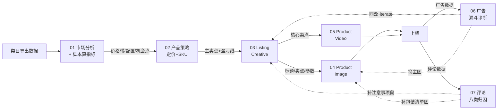

# AI Cross Border Ecommerce Agent Toolkit

**AI 跨境电商运营智能体工具箱** · *Turn cross-border ecommerce SOPs into reusable AI Agent workflows.*

[](./LICENSE)
[](./CHANGELOG.md)
[](#-agent-全景)

---

## 这是什么

把**跨境运营 SOP 里沉淀的经验**，翻译成**可复制的 AI Agent 工作流**：一个标准 Prompt + 一份输入模板 + 一个真实案例，任何人都能拿去直接跑出可发布的商品素材。

不是软件，不是 SaaS，只做四件事：

| 交付物 | 说明 |
|---|---|
| 📘 运营方法论 | SOP 章节 → Agent 模块的完整拆解表 |
| 🧠 AI Prompt | 角色 / 任务 / 输入契约 / 输出契约 / 自检 |
| 🔁 工作流程 | 什么顺序跑、什么条件进入下一步、什么条件回流重改 |
| 📄 模板 + 案例 | 标准输入格式 + 真实产品的完整跑通记录（含复测数据） |

**为什么做这个**：跨境运营的难点不是"不知道要做什么"，而是"知道但做不出稳定下限的产出"。同一个类目，老手写标题一次到位，新人写十遍还是堆词。这套工具箱的目标是把老手的**判断规则**结构化，让 AI 的产出稳定在老手水平线上。

---

## 📎 原始资料来源

本仓库的方法论拆解自一份 38 页的内部运营手册，原文已随仓库提供：

📄 **[《Shopee 巴西站运营 SOP 总框架》（PDF · 38 页 · 29.7 MB）](./docs/电商运营SOP总框架.pdf)**

SOP 章节与 Agent 模块的逐条对应关系见 [`docs/00_Architecture_SOP_to_Agent.md`](./docs/00_Architecture_SOP_to_Agent.md)。

> ⚠️ **请注意**：这份 PDF 是**未经删改的原始内部手册**，其中包含平台明确禁止的做法（如刷单、诱导评价、虚假举报、参数虚标等）。
>
> **本仓库的 7 个 Agent 模块均未实现这些做法**：已识别项及其合规替代方案见 [`docs/03_Compliance_Guard.md`](./docs/03_Compliance_Guard.md)，未实现项逐条登记见 [`docs/05_SOP_Gap_Register.md`](./docs/05_SOP_Gap_Register.md)。
>
> 换句话说 —— **这份 PDF 是「原料」，不是「产品」。** 本仓库的产出物只包含合规路径。

---

## 🗂 Agent 全景

7 个模块，**全部已完成**。

| # | Agent | 中文 | 一句话职责 | 版本 |
|---|---|---|---|---|
| **01** | [Market Research Agent](./Agents/01_Market_Research_Agent/) | 市场分析 | 前置判断 / 容量 / 集中度 / 价格带（波谷检测）/ 配置组合 · **带计算脚本** | ✅ v0.4 |
| **02** | [Product Strategy Agent](./Agents/02_Product_Strategy_Agent/) | 产品策略 | 定位 / 配置 / 主推卖点收敛 / 定价模型 / SKU 四角色 · **净利率/盈亏价/券余量矩阵** · Skill 化 | ✅ v0.4 |
| 03 | [Listing Creative Agent](./Agents/03_Listing_Creative_Agent/) | 商品内容生成 | 关键词分类 → 标题 → 详情页 → 卖点/参数 · **字符实测/参数溯源校验** · Skill 化 | ✅ v0.4 |
| 04 | [Product Image Agent](./Agents/04_Product_Image_Agent/) | 主图与详情图 | 9 图规划 → 出图 Prompt → **像素级合规校验** · Skill 化 | ✅ v0.4 |
| 05 | [Product Video Agent](./Agents/05_Product_Video_Agent/) | 短视频生成 | 脚本 → 分镜 → AI 视频 Prompt → 配音字幕 | ✅ v0.4 |
| 06 | [Advertising Optimization Agent](./Agents/06_Advertising_Optimization_Agent/) | 广告优化 | 四类漏斗诊断 + 盈亏线核算 + **P0/P1/P2 分级动作** · Skill 化 | ✅ v0.4 |
| 07 | [Review Analysis Agent](./Agents/07_Review_Analysis_Agent/) | 评论分析 | 八类归因 + 误解型识别 → 详情页修补建议 | ✅ v0.4 |

> **这七个模块构成一条完整链路，而且是闭环的**：
>
> ```text
> 01 市场分析 ──► 02 产品策略 ──► 03/04/05 素材产出 ──► 上架
> （做什么）      （做成什么样）    （怎么表达）
>                                                      │
>                          ┌───────────────────────────┘
>                          ▼
>              06 广告诊断 ─┐
>              07 评论诊断 ─┴──► 回流 03/04 修正 ──► 复测 ──► 达标放量 / 未达标回诊断
> ```
>
> **为什么按这个顺序编号**：`01-02` 分析簇（前置链路）→ `03-04-05` 创意簇（素材产出）→ `06-07` 运营簇（数据回流）。
>
> ✅ 编号方案已确认。原始规划为 `03` Listing / `04` Advertising / `05` Review / `06` Video（且无 Market Research 与 Product Strategy 的独立编号），本仓库按工作簇重排，变更记录见 [CHANGELOG](./CHANGELOG.md)。

---

## 🚀 快速开始

不需要 API key，不需要装环境。**三个文件就能跑。**

```text
Step 1  复制 Agents/<模块>/templates/ 下的输入模板
Step 2  填上你的产品信息（10 分钟）
Step 3  把「系统 Prompt」+「任务 Prompt」+「填好的模板」丢给任意 LLM
Step 4  用 docs/04_Result_Checklist.md 逐条自检，通过即发布
```

**第一次跑，建议按这个顺序**（以 Patinete Elétrico 为例，见 [`Examples/`](./Examples/)）：



三个关键点：

1. **01 带脚本**。指标（集中度、价格带、配置交叉表）由 `scripts/` 计算，**Agent 只负责解读**——能算的别让模型猜。
2. **02 决定卖点，03/04/05 才能开工**。主卖点必须收敛成**唯一一句**，否则主图打两行字、视频开头讲两件事，两个都记不住。
3. **06 和 07 会把结论回流到 03/04**。这一步是整套工具箱和"一次性生成工具"的分界线——产出的 Listing 会随着真实数据变准。见 [`Examples/03_Closed_Loop/`](./Examples/03_Closed_Loop/)。

---

## 📁 目录结构

```text
AI-Cross-Border-Ecommerce-Agent-Toolkit/
├── SKILL.md                      # 伞形 Skill 总入口 ⭐（整个文件夹可整体安装为 Skill）
├── README.md                     # 你在这里
├── LICENSE  CONTRIBUTING.md  ROADMAP.md  CHANGELOG.md
│
├── docs/                         # 方法论
│   ├── 00_Architecture_SOP_to_Agent.md   # SOP 章节 → Agent 拆解总表 ⭐
│   ├── 01_Prompt_Design_Guide.md         # Prompt 五要素规范
│   ├── 02_Platform_Output_Spec.md        # 各平台字段/字数硬指标
│   ├── 03_Compliance_Guard.md            # 合规红线 + 灰产动作的合规改写 ⭐
│   ├── 04_Result_Checklist.md            # 交付自检清单
│   ├── 05_SOP_Gap_Register.md            # SOP 未实现项登记表（透明化）
│   └── 电商运营SOP总框架.pdf              # 原始内部手册全文（38 页，未删改）
│
├── Agents/                       # AI 智能体模块
│   ├── README.md                 # 模块索引 + 交接契约
│   ├── 01_Market_Research_Agent/              ✅ v0.4 Skill 化
│   │   ├── SKILL.md    Agent 直接调用入口 ⭐
│   │   ├── scripts/    shaduola_parser · market_metrics · make_sample ⭐
│   │   ├── samples/    样本数据（含预期结果，可复现）
│   │   ├── prompts/    00_system · 01_category_precheck · 02_market_analysis
│   │   ├── templates/  input_category_research · output_market_analysis
│   │   └── examples/   patinete_eletrico_market.md
│   ├── 02_Product_Strategy_Agent/             ✅ v0.4 Skill 化
│   │   ├── SKILL.md    Agent 直接调用入口 ⭐
│   │   ├── references/ pricing-rules（公式与口径）⭐
│   │   ├── scripts/    sku_pricing（净利率/盈亏价/目标价/券余量矩阵）+ platform_fees.json（5 平台费率预设）⭐
│   │   ├── prompts/    00_system · 01_product_decision · 02_pricing_and_sku
│   │   ├── templates/  input_strategy_brief · output_product_requirement
│   │   └── examples/   patinete_eletrico_strategy.md · sample-skus.csv
│   ├── 03_Listing_Creative_Agent/             ✅ v0.4 Skill 化
│   │   ├── SKILL.md    Agent 直接调用入口 ⭐
│   │   ├── references/ platform-title-rules（标题规则卡）⭐
│   │   ├── scripts/    title_lint（字符实测/禁用词/堆砌）· spec_consistency（参数溯源）⭐
│   │   ├── prompts/    00_system · 01_keyword_to_title · 02_description_builder · 03_compliance_guard
│   │   ├── templates/  input_product_brief · output_listing_pack
│   │   └── examples/   powerbank_20000mah.md · spec_table.csv
│   ├── 04_Product_Image_Agent/                ✅ v0.4 Skill 化
│   │   ├── SKILL.md    Agent 直接调用入口 ⭐
│   │   ├── references/ platform-shopee · platform-mercadolivre · platform-amazon · scenarios-9grid
│   │   ├── scripts/    check_main_image（像素级合规校验 + --fix）⭐
│   │   ├── prompts/    00_system · 01_image_plan_9grid · 02_image_prompt_generator
│   │   ├── templates/  input_image_brief · output_image_prompt_pack
│   │   └── examples/   pet_carrier.md
│   ├── 05_Product_Video_Agent/                ✅
│   │   ├── SKILL.md + references/video-specs.md（平台视频规范卡）
│   │   ├── scripts/    video_timing.py        # 时长/字幕确定性校验
│   │   ├── prompts/    00_system · 01_script_and_storyboard · 02_ai_video_and_voice
│   │   ├── templates/  input_video_brief · output_video_pack
│   │   └── examples/   air_fryer.md + narration_airfryer.txt
│   ├── 06_Advertising_Optimization_Agent/     ✅ v0.4 Skill 化
│   │   ├── SKILL.md    Agent 直接调用入口 ⭐
│   │   ├── references/ metrics · diagnosis · playbooks · actions ⭐
│   │   ├── scripts/    ad_metrics（盈亏线/可承受CPC/P0-P2分级，纯标准库）⭐
│   │   ├── prompts/    00_system · 01_funnel_diagnosis · 02_budget_roi_model
│   │   ├── templates/  input_ad_data · output_ad_action_plan
│   │   └── examples/   powerbank_20000mah_ads.md · sample-ad-report.csv
│   └── 07_Review_Analysis_Agent/              ✅
│       ├── SKILL.md（分类交给模型、计数交给脚本）
│       ├── scripts/    review_stats.py        # 归因聚合/可修复率/卖点排行
│       ├── prompts/    00_system · 01_classify_and_attribute · 02_misunderstanding_detector
│       ├── templates/  input_review_batch · output_review_insights
│       └── examples/   electric_scooter_reviews.md + sample-reviews.csv
│
├── Templates/                    # 跨模块通用模板库
│   ├── product_brief_template.md         # 模块间通信契约 ⭐
│   ├── keyword_analysis_template.md      # 关键词三榜底稿
│   ├── cost_pricing_template.md          # 定价模型（可验算）
│   └── output_qa_checklist.md            # 可打印版自检清单
│
└── Examples/                     # 真实产品端到端案例库
    ├── 01_Patinete_Eletrico_500W/        # 旗舰：03→04→05 全链路
    ├── 02_Thermal_Bag/                   # iterate 模式：广告诊断→回改
    └── 03_Closed_Loop/                   # 闭环：诊断→回流→复测 ⭐
```

案例产品覆盖（制作说明指定的五款）：Electric Scooter · Power Bank · Pet Carrier · Air Fryer · Thermal Bag ✅

每个 Agent 模块固定四个子目录：`prompts/` + `templates/` + `examples/` + `README.md`。

---

## 📱 平台支持

| 平台 | 状态 | 标题上限 | 主图规范 | 输出语言 |
|---|---|---|---|---|
| **Shopee** | ✅ 一等支持 | 120 字符（前 30 字符权重最高） | 白底，最多 9 图 | PT-BR / EN / 本地语 |
| **Mercado Livre** | ✅ 一等支持 | 60 字符 | 背景干净（白/纯色/实景按类目），主体 85–95%，≥1200×1200 | PT-BR / ES |
| Amazon | 📄 字段已适配 | 200 字符（建议 80） | 纯白底，≥1000×1000 | EN |
| TikTok Shop | 📄 字段已适配 | 按站点 | 竖版 9:16 优先 | 本地语 |
| Shopify | 📄 字段已适配 | 建议 70 | 无硬限制 | EN / 本地语 |

详细字段规范见 [`docs/02_Platform_Output_Spec.md`](./docs/02_Platform_Output_Spec.md)。**所有硬指标以平台后台实时规则为准，发布前请复核。**

---

## 🧭 设计原则

1. **母语输出优先**——巴西站的标题必须像巴西人写的。直译英文 Listing 的 CTR 结构性偏低，所以 Prompt 强制要求原生 PT-BR 表达，而不是"翻译腔"。
2. **输入契约化**——每个 Prompt 都声明"缺什么字段就不许输出什么内容"。宁可报错，不许编参数。
3. **合规优先于转化**——涉及参数虚标、品牌词、夸大宣传的动作，Prompt 里一律做**硬拦截**，不是"建议"。详见 [`docs/03_Compliance_Guard.md`](./docs/03_Compliance_Guard.md)。
4. **可验证**——每个模块交付时给一份自检清单，逐条打勾才算完成。产出对不对，不靠感觉。

---

## ⚠️ 合规声明

本工具箱只做**合法合规的运营提效**。原始 SOP 中存在少数平台明确禁止的灰产动作（如虚假交易/刷单、组织虚假举报、参数虚标与夸大宣传）。这些内容**已在本仓库中被识别并改写为合规替代方案**：

- 改写对照表 → [`docs/03_Compliance_Guard.md`](./docs/03_Compliance_Guard.md)
- 未实现项逐条登记（说明为什么不做、替代方案在哪）→ [`docs/05_SOP_Gap_Register.md`](./docs/05_SOP_Gap_Register.md)

使用本工具箱产生的内容，**发布前请自行核对平台最新规则**。作者不对因违规使用导致的账号处罚承担责任。

---

## 🗺 路线图

| 版本 | 内容 |
|---|---|
| **v0.1** | 3 个创意 Agent（03/04/05）+ 方法论文档 + 案例库 |
| **v0.2** | 2 个运营 Agent（06 广告 / 07 评论）+ 闭环案例 |
| **v0.3** | 2 个分析 Agent（01 市场 / 02 策略）+ **数据解析与指标计算脚本**（当前） |
| **v1.0** | 打通完整工作流，输出一键上架用的素材包 |
| V2 | 接入平台 API（Shopee / Mercado Livre）自动拉取数据 |
| V3 | 网页应用，可视化跑工作流 |
| V4 | 升级为自动化 Agent 系统（定时执行 + 闭环优化） |

详见 [`ROADMAP.md`](./ROADMAP.md)。

---

## 🤝 贡献

欢迎补充新类目的配置维度表、新市场的平台规则、以及真实案例。请先读 [`CONTRIBUTING.md`](./CONTRIBUTING.md)。
**提交案例必须脱敏**：不含真实店铺名、账号、买家信息、未授权品牌词。

## 📄 License

[MIT](./LICENSE)
