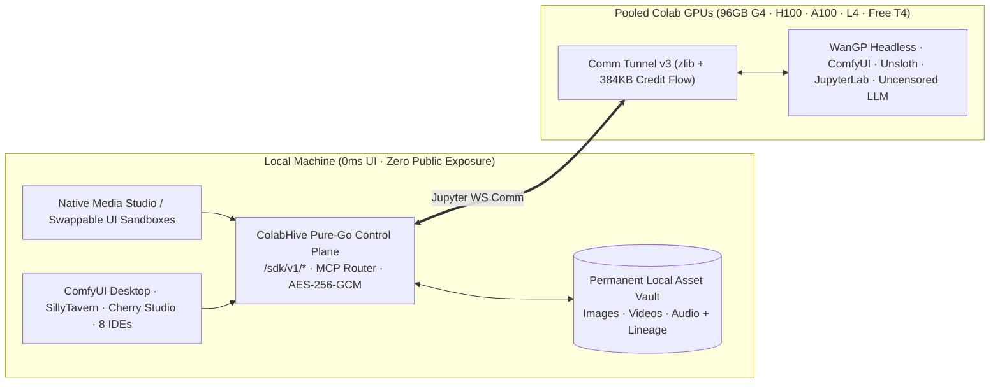

<div align="center">


# ColabHive

**Pool your multi-account Google Colab GPUs (`96GB Blackwell G4`, `H100`, `A100`, `L4` & Free `T4`) into one seamless local AI supercomputer: ML experiments & simulations, 8-IDE MCP Router, 0ms Native Video/Image Studio, ComfyUI Desktop Cloud Bridge & 1-Click Uncensored LLM `/v1`.**

<p>
  <a href="https://hexwander.github.io/colabhive/"><b>🎮 Live Interactive Demo (No Install)</b></a>
  &nbsp;·&nbsp;
  <a href="https://github.com/hexwander/colabhive/releases/latest"><b>🖥 Download Desktop (Win / macOS)</b></a>
  &nbsp;·&nbsp;
  <a href="#30-second-quickstart"><b>⚡ Quickstart</b></a>
  &nbsp;·&nbsp;
  <a href="./docs/PLUGIN_PLATFORM_V2.md"><b>🧩 Plugin Platform v2</b></a>
  &nbsp;·&nbsp;
  <a href="./README.zh-CN.md"><b>简体中文</b></a>
</p>

<p>
  <a href="https://github.com/hexwander/colabhive/releases/latest"></a>
  <a href="./LICENSE"></a>
  <a href="./go.mod"></a>
  <a href="#native-desktop--system-tray"></a>
  <a href="#connect-any-ai-coding-agent-mcp--clisdk"></a>
</p>

<br />

<a href="https://hexwander.github.io/colabhive/">
  
</a>

<sub>
  Open Ecosystem: <a href="https://github.com/deepbeepmeep/Wan2GP"><b>WanGP (DeepBeepMeep)</b></a> · <a href="https://github.com/comfyanonymous/ComfyUI"><b>ComfyUI</b></a> · <a href="https://github.com/unslothai/unsloth"><b>Unsloth</b></a> · <a href="https://jupyter.org/"><b>JupyterLab</b></a> · Inspired by <code>sub2api</code> / <code>magpie</code> / <code>cc-switch</code>
</sub>

</div>

---

## ✨ Why ColabHive?

**ColabHive** began as a research compute aggregator — pooling every Google Colab account with remaining Compute Units (`2,500 CU` AI Ultra, `500 CU` Pro+, expiring 90-day balances & `$0` Free `T4`) so local scripts and AI coding agents seamlessly tap cloud GPUs for **ML experiments and simulations**, while powering a complete local-first AI workstation on the exact same GPU pool:

- **🔬 Pooled Research Compute & 4× Parallel Sharding**: `4× G4 (96GB)` for 1h burns the **exact same CUs** as `1× G4` for 4h — **4× faster** with 8-IDE headless MCP and `8s` `/proc/stat` Linux zombie (`Z`) reaping.
- **🎬 0ms Native Multimodal Media Studio + Local Asset Vault**: Replaces 23 MB remote Gradio with a 0ms local React studio (`T2I 7.2s`, `I2I`, `T2V`, `I2V 17.2s hot VRAM`, `Qwen3-TTS`). Release the cloud GPU immediately — every artwork stays forever on local disk.
- **🎨 Official ComfyUI Desktop Cloud Bridge & Uncensored LLM `/v1`**: Custom `Comm Tunnel v3` (`zlib` 5–10× faster) maps private isolated `127.x.y.z` ports — zero ngrok, zero local VRAM, zero `$960/yr` Comfy Cloud subscription; plus Unsloth zero-code fine-tuning & 1-click JupyterLab.
- **🎯 Safe GPU Waitlist & Anti-Waste Protection**: Polite `15–45s` anti-ban backoff retries against Colab `503/412` shortages (`0ms` cancel, `0 CU` burn) + `30/45/60m` idle auto-stop.

---

## 🖼️ Feature Showcase (Full-Width)

### 1. 8-IDE Headless MCP Router & 4× 96GB G4 Sharded Research Workbench

1-click `cc-switch` config sync for **Claude Code, Codex, Antigravity, Cursor, Gemini CLI, Windsurf, OpenCode & Claude Desktop**; run parallel 4-account GPU shards for experiments & simulations with warm 60GB weight caches, live VRAM/temp telemetry, and `8s` zombie reaping.

<p align="center">
  
</p>

<p align="center">
  
</p>

<br />

### 2. Multi-Account Cloud GPU Pool (`/pool` · Free-First · Waste-Zero Scheduling)

Pool your **Google AI Ultra (`2,500 CU`), Pro+ (`500 CU`), Pro & Free `T4`** accounts in one private cluster with 1-click local discovery, AES-256-GCM `.chvault` portability, per-account SOCKS5/HTTP proxy pinning, and automatic expiring-CU / free-tier priority.

<p align="center">
  
</p>

<br />

### 3. 1-Click Uncensored Open-Weight LLM Deployer (`/apps/llm` · Private Local `/v1`)

Launch top 2026 community uncensored (Heretic / Abliterated) models — **Qwen3, Gemma 4, DeepSeek, GLM** — or paste **any `hf.co/...` GGUF URL**. Exposes native **OpenAI `/v1`**, **Anthropic `/v1/messages`**, and **Ollama `/api/chat`** on `127.0.0.1:7860` for **SillyTavern, Cherry Studio, Cursor & Claude Code**.

<p align="center">
  
</p>

<br />

### 4. Cloud GPU App Store, ComfyUI 3-Piece Plugin & Safe GPU Waitlist (Beat Colab 503/412)

Configure **ComfyUI (complete 3-piece Z-Image Turbo / Qwen-Image FP8 / FLUX.2 Dev FP8 bundles bridged via isolated `127.x.y.z:8188` to official ComfyUI Desktop & Krita), Unsloth Studio Zero-Code Fine-Tuning, 1-Click JupyterLab** & 1-file `colabhive-app.json` plugins in one consistent UI — with **🎯 Safe GPU Waitlist** (`15–45s` anti-ban backoff, `0ms` cancel with `0 CU` burned) and **🔀 Explicit Auto-Fallback (`H100→G4→A100→L4→T4`)**.

<p align="center">
  
</p>

<br />

### 5. 2× Retina Compute Savings Poster Studio (`/savings` · 100% Zero-PII)

Tracks verified GPU runtime, idle auto-shutdown savings, and cross-account checkpoints — exporting lossless 2× Retina PNG posters with zero personal emails or tokens.

<p align="center">
  
</p>

<br />

### 6. 0ms Native Multimodal Media Studio (Powered by WanGP) + Local Asset Vault

Opens locally in `0ms` while streaming live denoising previews from a headless cloud GPU engine (`media.v1` + serial job queue). Verified on 96GB Blackwell G4 across **T2I (7.2s) · I2I · T2V · I2V (17.2s hot VRAM) · TTS Audio**, with permanent local lineage tracking and **swappable community UI plugins** ([`PLUGIN_PLATFORM_V2.md`](./docs/PLUGIN_PLATFORM_V2.md)).

<p align="center">
  
</p>

<details>
<summary><b>📸 View More Screens (Compute Observatory <code>/</code> · AI App Store · High-Res Media Studio)</b></summary>

<br />

**Precision Compute Observatory (`/`)**
<p align="center"></p>

**5-App Cloud GPU Store (`/apps` · Unsloth Zero-Code Fine-Tuning & 1-Click JupyterLab)**
<p align="center"></p>

**Native Multimodal Media Studio — Static High-Res (`/studio/media`)**
<p align="center"></p>

</details>

---

## 🐝 Native Desktop & System Tray

<table>
  <tr>
    <td width="58%" valign="middle">
      <h3>Always One Click Away — Zero Console Clutter</h3>
      <p>
        Inspired by <b>Magpie</b> and <b>cc-switch</b>, ColabHive ships as a native frameless desktop app on Windows (<code>colabhive-desktop.exe</code>) and macOS (<code>ColabHive.app</code>) with a 4-tab system tray. Closing the window parks quietly in the tray without dropping active GPU tunnels or studios.
      </p>
      <ul>
        <li><b><code>Agent · 8 IDEs</code></b>: 1-click config injection with automatic <code>.bak</code> backups — keyless on localhost.</li>
        <li><b><code>Quota</code></b>: Pooled CUs converted into calibrated G4 (96GB), H100, A100 &amp; L4 runtime hours.</li>
        <li><b><code>VMs</code></b>: Live VRAM/SM% load meters and 1-click attach in Colab Web.</li>
        <li><b><code>Router</code></b>: Live MCP trace feed + Launch at Login.</li>
      </ul>
      <p>👉 <a href="https://hexwander.github.io/colabhive/"><b>Try the 4-tab tray interactive sandbox in your browser →</b></a></p>
    </td>
    <td width="42%" align="center" valign="middle">
      
    </td>
  </tr>
</table>

---

## ⚡ 30-Second Quickstart

### Windows Native Desktop + System Tray (1-Liner)
```powershell
irm https://raw.githubusercontent.com/hexwander/colabhive/main/scripts/install.ps1 | iex
```
> Or download the Windows zip directly from [**GitHub Releases**](https://github.com/hexwander/colabhive/releases/latest) and run `colabhive-desktop.exe`.

### macOS (`ColabHive.app` Menu Bar + CLI) & Linux
```bash
curl -fsSL https://raw.githubusercontent.com/hexwander/colabhive/main/scripts/install.sh | sh
```

### Hardened Team Cloud Server (Docker + Auto-HTTPS)
```bash
cp .env.cloud.example .env.cloud && chmod 600 .env.cloud
docker compose -f docker-compose.cloud.yml --env-file .env.cloud --profile caddy up -d
```

---

## 📊 Verified Hardware Benchmarks & Architecture

| Pipeline / Feature | Hardware | Measured Result | Highlight |
| :--- | :---: | :---: | :--- |
| **Native Media Studio Cold Open** | Local React (`40 KB` gzip) | **`0 ms`** | Replaces `23.3 MB` Gradio; offline Local Asset Vault |
| **Text-to-Image (`Z-Image NitroFusion2`)** | 96GB Blackwell `G4` | **`7.2 s`** | Serial GPU queue + live preview + permanent vault |
| **Image-to-Video (`LTX-2 Distilled 19B`)** | 96GB Blackwell `G4` | **`17.2 s`** *(hot VRAM)* | Direct gallery → MP4 with `8k+1` exact frame mapping |
| **Speech Synthesis (`Qwen3-TTS`)** | 96GB Blackwell `G4` | **`40.6 s`** *(4s infer)* | Local WAV artifact + inline audio player |
| **Comm Tunnel v3 (`zlib` + Credit Flow)** | `A100` / `L4` / `T4` | **5.4× – 9.6× faster** | `/gradio_api/info`: `35.8s → 3.7s`; eliminates HoL stalls |
| **ComfyUI Desktop + WebSocket `/ws`** | Free `T4` / `L4` | **77s boot · `255 ms` API** | Auto 3-piece bundles + WS `101` + isolated `127.x.y.z:8188` |
| **Unsloth Studio / JupyterLab** | Free `T4` | **`2.28s` SPA / `41s` boot** | Zero-code GGUF export · 1-click JupyterLab token login |



---

## 🔌 Connect Any AI Coding Agent (MCP) & CLI/SDK

<details open>
<summary><b>Antigravity / Cursor / Windsurf / Claude Code / Codex / Gemini CLI</b></summary>

```json
{
  "mcpServers": {
    "colabhive": {
      "url": "http://127.0.0.1:7860/mcp"
    }
  }
}
```
*(Claude Code: `claude mcp add --transport http colabhive http://127.0.0.1:7860/mcp` — keyless on localhost; scoped `ch_sk_live_...` Bearer keys in `--mode cloud`.)*
</details>

<details>
<summary><b>Drop-In CLI & Zero-Dependency Python SDK (Parallel Sharded Experiments)</b></summary>

```bash
# View pooled Compute Units & calibrated GPU hours
colabhive usage --gpu-hours

# Shard an experiment/simulation across 4 pooled accounts (4x faster, identical CU cost!)
colabhive run --gpu G4 --shards 4 --strategy waste-zero --experiment eval_4x eval_shard.py
```

```python
from colabhive import ColabHiveClient

client = ColabHiveClient(base_url="http://127.0.0.1:7860")
with client.session(gpu="G4") as sess:
    sess.upload("./sim_config.yaml", "/content/sim_config.yaml")
    print(sess.exec("import torch; print(torch.cuda.get_device_name(0))").stdout)
```
</details>

---

## 📚 Docs, Roadmap & Acknowledgments

- **Docs**: [`docs/PLUGIN_PLATFORM_V2.md`](./docs/PLUGIN_PLATFORM_V2.md) · [`docs/PLUGIN_SDK.md`](./docs/PLUGIN_SDK.md) · [`docs/LAUNCH_PLAYBOOK.md`](./docs/LAUNCH_PLAYBOOK.md) · [`CHANGELOG.md`](./CHANGELOG.md) · [`SECURITY.md`](./SECURITY.md)
- **Build From Source**: Windows `.\scripts\build-release.ps1` ｜ macOS / Linux `./scripts/build-release.sh`
- **Roadmap**: `v1.2` plans 1-click Unsloth GGUF → Local LLM handoff, multi-language packs (**日本語 · 한국어 · 繁體中文**), and additional regional GPU adapters.
- **Acknowledgments**: [**WanGP (DeepBeepMeep)**](https://github.com/deepbeepmeep/Wan2GP) (*Powered by WanGP*), [**ComfyUI**](https://github.com/comfyanonymous/ComfyUI), [**Unsloth**](https://github.com/unslothai/unsloth), `google-colab-cli`, `sub2api`, `magpie`, and `cc-switch`.
- **Community & Friendly Links**: [**LINUX DO**](https://linux.do/) — Open-source & developer community.

<div align="center">
  <a href="https://star-history.com/#hexwander/colabhive&Date">
    <picture>
      <source media="(prefers-color-scheme: dark)" srcset="https://api.star-history.com/svg?repos=hexwander/colabhive&type=Date&theme=dark" />
      <source media="(prefers-color-scheme: light)" srcset="https://api.star-history.com/svg?repos=hexwander/colabhive&type=Date" />
      
    </picture>
  </a>
</div>

## License

Licensed under the [Apache License 2.0](./LICENSE).
