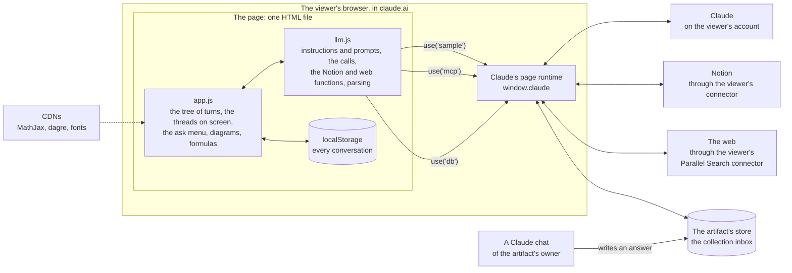
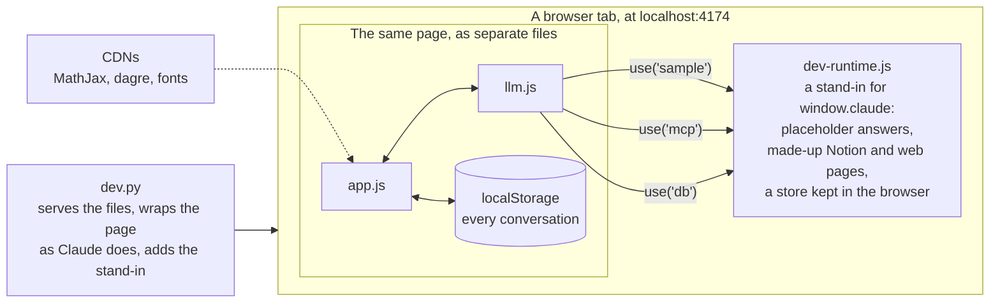
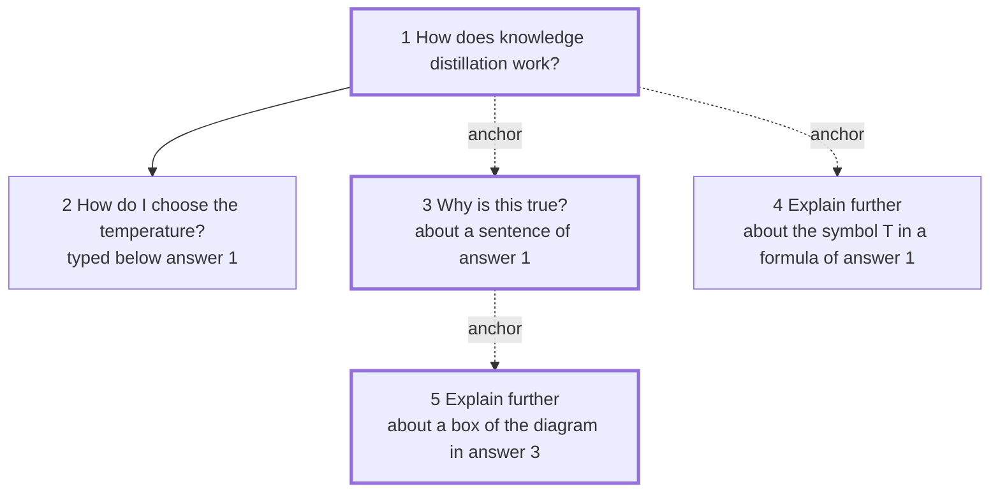
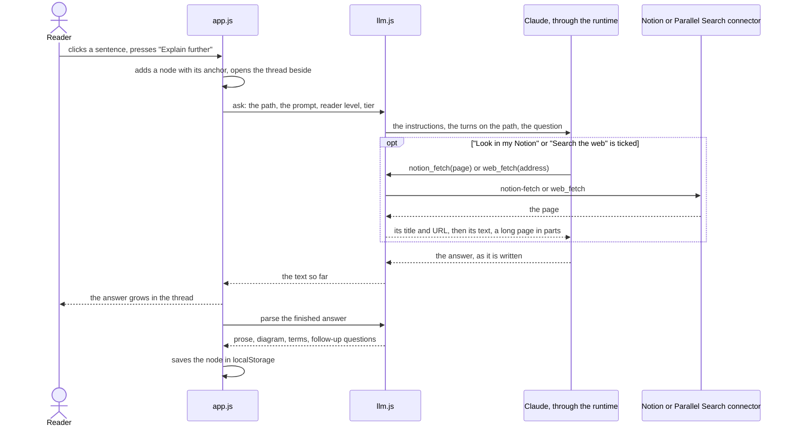

# Human Distillation

A prototype of an AI chat optimized for understanding hard ideas, in which any
part of an AI's answer can be asked about on its own: a sentence, a formula, one
symbol in it, a box of a diagram.

## The problem to solve

Learning and understanding things through conversation with an AI is
becoming the main way for a person to learn something new, and the most
efficient one.

That same step is also becoming the bottleneck of human-AI collaboration:
the two get only as far as the person can follow what the AI tells them.

This project is my pursuit of the ideal interface for a person to learn from
AI.

## Demo


*Recorded on the live artifact; the answers are Claude's own, with the waits
cut short. Also available as [MP4](docs/demo.mp4).*

**Try it now:** [open it in Claude](https://claude.ai/artifact/DT4Eotmtno3AZhJtxc7fA5). It opens
on a worked example. A question of your own is answered by Claude on your own
account, so it needs one and counts against your usage.

## What it is

A prototype of an AI chat for understanding complex ideas, implemented as a Claude Artifact.

It looks like an ordinary chat, and any part of an answer can be asked about
on its own: a sentence, a few highlighted words, a formula, one symbol in a
formula, a box or a link of a diagram. The side question opens beside the
answer it is about. So the conversation is a tree, and every branch is kept.


## The idea

An answer to a hard question usually raises several new ones. In a linear
chat you follow one of them and the answer you were reading scrolls away, or
you ask them all at once and the thread loses its line. Three ideas, added on
top of a chat that otherwise behaves as usual:

1. **A tree, not a chain.** A side question does not push the conversation
   on. It opens beside the passage it is about, and when it is settled you
   are back where you left off. No branch is the "main" one; all are kept.
2. **Point, don't type.** Click a sentence or highlight some words, then
   press "Explain further". Typing a question of your own is possible and
   never required.
3. **Terms explained in place.** Words the reader may not know get a dotted
   underline and a one-line definition on hover.

None of this costs anything when it is not used. It is there for the moment
an answer loses you, which happens a lot with hard material.

## What it does

- **Ask about a part.** A click on a sentence, or a selection of any words,
  opens a small menu: "Explain further", a box for your own question, and
  "Later", which asks in the background while you keep reading.
- **Side threads.** The answer opens in a thread beside the original, with
  the passage highlighted. A side thread can have side threads of its own.
  "Got it" closes one and leaves a one-line takeaway on the passage.
- **Branch anywhere.** "Continue from here" under an earlier answer starts a
  new branch there and folds what came after.
- **Diagrams.** Claude includes a diagram of relations when it judges one
  helpful, or when asked ("Show this as a diagram"). Every box and link can
  be clicked and asked about.
- **Formulas.** Typeset with MathJax. A click on a formula asks about the
  formula, and a click on one symbol in it asks about that symbol.
- **Definitions.** Each answer lists the terms it introduces. They carry over
  to later answers, and a term marked as known is not defined again.
- **Explain it back.** The message box changes over to take your own
  explanation, and Claude checks it: what is right, what is off or missing,
  and one question on the weakest point.
- **Your Notion.** With "Look in my Notion" ticked, Claude searches and reads
  your pages through the Notion connection you already have in Claude, and
  names the page each point comes from. Long pages are read in parts.
- **The web.** With "Search the web" ticked, Claude searches the web and
  reads web pages through the Parallel Search connector, for what is recent
  or what it is not sure of, and links the page each point comes from. Every
  question also tells Claude today's date, so that "the latest" means now.
- **Answers from another chat.** An answer you got in any Claude chat can be
  studied here. Ask Claude there to send it to your copy of the page, alone
  or with a summary of the chat so far. It opens as a new conversation, and
  every part of it can be asked about. See
  [Send an answer from another chat](#send-an-answer-from-another-chat).
- **A map.** The sidebar shows the tree, with what is open, queued and
  resolved, and a button to the next open question.
- **Write it up.** Turns the whole tree into one document.
- **Reader and model.** "New to this" or "Knows the basics" sets how much is
  assumed. "Fast", "Balanced" or "Deep" picks the model tier.


## Try it

The app runs as a Claude artifact, and that is the one way to use it for
real: the answers come from Claude, on your own account. The link under the
[demo](#demo) opens a shared copy. To have one of your own, publish it as
described below. Sending an answer in from another chat works only on a
copy of your own.

It has no server and no API key. It is one HTML file that Claude hosts
as an artifact, a page on claude.ai that is private until you share it. The
page uses the runtime Claude gives a page it hosts:

- `claude.use("sample")` asks Claude on the viewer's own account.
- `claude.use("mcp")` calls two of the viewer's connectors: Notion
  (`notion-search` and `notion-fetch`, both read-only) and, for the web,
  Parallel Search (`web_search` and `web_fetch`).
- `claude.use("db")` is a small store that Claude keeps for the artifact. The
  page uses one collection of it, `inbox`, where a Claude chat of the
  artifact's owner can leave an answer for the page to open.

So whoever opens the page uses their own Claude, their own Notion and their
own web search, and the app has no sign-in of its own.

### Publish your own copy

You need Claude Code, signed in to your Claude account. To read Notion or
search the web you also need that connector, Notion or Parallel Search, added
in Claude's settings under Connectors. Each is optional.

1. Get the code and build the file that is published:

   ```bash
   git clone https://github.com/hideaki/human-distillation.git
   cd human-distillation
   python3 live/build.py
   ```

   This writes `live/dist/human-distillation.html`, with the styles and
   scripts inside it.

2. In Claude Code, opened in this folder, ask for it to be published:

   > Publish `live/dist/human-distillation.html` as an artifact, with the
   > capabilities `sample`, `mcp` for the Notion connector's
   > `notion-search` and `notion-fetch` and the Parallel Search connector's
   > `web_search` and `web_fetch`, and `db` with a rule that only the owner
   > may read or write `inbox`.

   Those capabilities, as Claude declares them:

   ```json
   {
     "sample": {},
     "mcp": {
       "servers": [
         { "server": "Notion", "tools": ["notion-search", "notion-fetch"] },
         { "server": "Parallel Search", "tools": ["web_search", "web_fetch"] }
       ]
     },
     "db": {
       "rules": [{ "path": "inbox", "read": "owner", "write": "owner" }]
     }
   }
   ```

   Leave a connector out to publish without it, or leave `mcp` out to publish
   with neither. The page then does not offer that box under the message box,
   and everything else works. Leave `db` out and the page cannot be sent an
   answer from another chat; everything else works. Keep the rule if you
   keep `db`: without it, anyone you share the page with could read what was
   sent to it.

3. Claude answers with a link of the form `https://claude.ai/artifact/…`.
   Open it in Claude.

Which capabilities are on offer depends on the Claude account.

### The first questions

- **The first question.** Claude asks whether this page may use Claude on
  your account. Allow it. Answers count against your own usage.
- **The first question with "Look in my Notion" or "Search the web"
  ticked.** Claude asks again: for access to that connector, and for
  permission to run its two tools.

After that the page is not asked again. A page that was refused says so in a
bar under its header, and a reload asks once more.

A connector you have not added to Claude shows under the message box as "not
connected" in place of its tick box. A click on it says how to add it.

### Send an answer from another chat

A hard answer often turns up in an ordinary Claude chat, in the middle of
other work. It can be moved here to be studied, without asking the question
again.

This needs a copy of your own, published with `db` as above. In any Claude
chat, after the answer you want to study, say for example:

> Send that answer, with its question, to this artifact:
> `https://claude.ai/artifact/…` (the link of your copy)

Claude reads the page, finds the note at its top that says what to write,
and writes one document to the page's inbox. The page opens it as a new
conversation: at once if the page is open, and otherwise the next time it
is. Its row in the list of conversations is marked "Sent". From there it is
an ordinary conversation of the page. Any sentence, formula or table cell of
the sent answer can be asked about, and the thread can be carried on by
typing.


What can be sent, and how to ask for it:

| You ask for | What arrives |
| --- | --- |
| The answer | The answer, word for word, and the question it replied to |
| "…with a summary of our conversation so far" | The same, and a summary. It sits folded in one line above the conversation, "Summary of the earlier chat", and Claude is given it with every question asked there |
| "…with the turns before it" | The earlier questions and answers as turns of the conversation, each of which can be asked about. For a short chat |

A few things about it:

- **Formulas.** The note asks Claude to write formulas in LaTeX, since only
  those can be clicked. A chat sometimes writes a symbol in a sentence as a
  plain character all the same.
- **Tables and headings.** An answer from a chat often has them. The page
  draws a table as a table and a heading as a bold line. Its own answers
  have neither.
- **Not on the shared copy.** Only the owner of an artifact can write to its
  store, so nobody can send an answer to a copy they were only given a link
  to. This is why you need your own.
- **Where the document stays.** In the artifact's store on Claude's side,
  readable by you alone, until you delete the conversation in the page. Your
  other browsers and devices open it from there too. What you ask after that
  stays in the one browser, like any conversation of the page.
- **Without a browser.** The page does not have to be open when the answer
  is sent.

### Good to know

- **Where conversations live.** In the browser's `localStorage`, for that
  artifact, and nowhere else. They survive an update of the artifact. They do
  not follow you to another browser or device. "Write it up", then "Copy as
  Markdown", takes a conversation out. The one exception is the start of a
  conversation that was sent from another chat, which stays in the
  artifact's store as described above.
- **What Claude sees.** Each question is sent with the turns on the path that
  leads to it, and with nothing from other branches or other conversations.
- **Sharing.** Someone you share the artifact with asks on their own Claude
  account, reads their own Notion, searches through their own connector and
  keeps their own conversations. They see none of yours.
- **What a search sends out.** With "Search the web" ticked, the queries
  Claude writes go to Parallel Search, and a page is fetched through it.
  Claude may read only an address that you, a search result or a page it
  already read has named, so that it cannot make up an address that carries
  what it read in your Notion to another site.
- **Model.** "Fast", "Balanced" and "Deep" are tiers, not model names. A tier
  the account does not have is not shown.

### Update it

Build again and ask Claude Code to publish the file to the same link. When
the capabilities are not mentioned, the ones already declared are kept. To
add a connector later, state the whole set again: a stated set replaces the
one that was there. The same goes for a copy that was published before the
inbox existed: to give it one, state the whole set once, with `db` and its
rule. In a
new Claude Code conversation, give it the link, or it makes a second
artifact.

### Outside Claude

Opened as a plain file, or served from anywhere else, the page finds no
runtime. It says so in the bar under its header, and what is already stored
can be read but nothing new can be asked.

The repository also has
[a local preview](#the-local-preview-for-work-on-the-interface). It answers
with placeholder text and is for work on the interface, not for use.

To put another model behind the page, replace the runtime:
`live/dev-runtime.js` implements the same calls with placeholders, and
is the place to start.

## Architecture

The page is the same wherever it runs. What differs is what stands behind
`window.claude`: Claude's runtime when the page is an artifact, and a
stand-in in the local preview, which exists to build and test the interface.

### As an artifact



**One file and no server.** Everything the app is runs in the page.
`build.py` puts `styles.css`, `llm.js` and `app.js` inside `page.html`, and
that one file is what Claude hosts. The only things fetched from elsewhere
are MathJax, the layout library dagre and the fonts, from public CDNs.

**Two halves.** `app.js` is the interface: it holds the conversations, draws
the threads, finds what a click points at, lays out diagrams and typesets
formulas. `llm.js` is everything that talks to Claude: the instructions, the
prompt for each kind of question, the calls, the functions that read Notion
and the web, and the reading of what comes back. `app.js` never calls the runtime itself.

**One way out.** The page reaches the outside only through `window.claude`.
`use("sample")` gives a function that sends turns to Claude and streams the
answer back. `use("mcp")` gives a function that calls a tool of one of the
viewer's connectors. Both act as the viewer, and Claude asks the viewer
before the first call of each. `use("db")` gives the artifact's store, which
is the one way in: an answer sent from another chat arrives there.

### `window.claude` and `use("sample")`

`window.claude` is an object that Claude's viewer puts on a page it hosts,
before any of the page's own script runs. A copy of the page opened outside
Claude does not have it. It has one member, `use`:

```js
const sample = await window.claude.use("sample");
```

`use(name)` asks for one capability by name and gives a promise. The promise
resolves to the capability, or to `null` when this view cannot offer it: the
artifact did not declare it when it was published, or the viewer's account
or app does not have it. Asking costs nothing and shows the viewer nothing.
`llm.js` asks for `sample` and `mcp` once, when the page loads, and the page
shows a bar under its header if Claude is not there.

`sample` is a single function that asks Claude and gives a promise of the
answer. This is the call the app makes for a question about a sentence,
simplified:

```js
const { text, truncated } = await sample(
  [
    { role: "user", content: rules },   // the instructions, as the first turn
    { role: "user", content: "How does knowledge distillation work?" },
    { role: "assistant", content: "Knowledge distillation trains a small model…" },
    { role: "user", content: 'About this part of your answer:\n"This works because…"\n\nExplain this part further.' },
  ],
  {
    onText: ({ text }) => show(text),   // the whole answer so far, each time more is written
    signal: controller.signal,          // the Stop button
    modelTier: "complex",               // "Deep". "Fast" is "quick", and "Balanced" passes none
    cache: false,                       // a chat turn is asked afresh every time
    tools: [notionSearch, notionFetch], // with "Look in my Notion" ticked. The web has two more
  },
);
```

What follows from how `sample` works shapes most of `llm.js`:

- **It remembers nothing.** Claude sees only what this one call passes. That
  is why the page keeps the conversation, and sends the turns on the path
  with every question.
- **There is no system prompt.** The roles are `user` and `assistant` only,
  and the list starts and ends on a `user` turn. So the instructions travel
  as a leading `user` turn (`rules()`), and the format of an answer, with its
  `@@@` trailer, is asked for there.
- **There is a size limit.** All the turns together may be 256 KB of text.
  `turnsFor` trims from the oldest end when a thread outgrows it.
- **It runs on the viewer's account.** The first call asks the viewer to
  allow it, and waits for their answer. Every call spends
  their own Claude usage. No key is in the page, and the author of the page
  pays for nothing.
- **The answer streams.** `onText` is called with the whole text so far, so
  the page draws the answer again as it grows, and holds back a trailer that
  is still being written.
- **The model is a tier, not a name.** `sample.limits()` says which tiers
  this view accepts, and the result says which one answered.
- **Tools are functions of the page.** Each has a name, a description, a
  schema for its input and an `execute` function. Claude sees the first
  three and decides whether to call. `execute` runs in the page, and what it
  returns (32 KB at most) goes back to Claude, which then calls again or
  writes the answer. Every such round is another request that reads
  everything again, which is why what one answer may read is limited.
- **A failure is a rejected promise** with a `code`, and with the text that
  had been written, where it may be kept. `LLM.errorText` turns each code
  into words for the reader: not allowed, usage limit reached, declined,
  thread too long.

`use("mcp")` is smaller. It gives `callTool(server, tool, input)`, which
calls one tool of a connector the viewer has added to Claude, with the
viewer's own credentials. The page never sees a token. The page can call only
the tools the artifact declared when it was published, which here are
Notion's `notion-search` and `notion-fetch` and Parallel Search's
`web_search` and `web_fetch`, and the viewer is asked before the first call.
It also gives `listTools()`, which asks the viewer nothing: the page uses it
at load to see which of the two connectors the viewer has, and shows the
other as "not connected". The two capabilities meet inside a tool: Claude
calls the page's `notion_fetch`, and its `execute` calls the connector's
`notion-fetch`.

`use("db")` gives a store of JSON documents that Claude keeps for the
artifact, outside the page. Unlike `localStorage`, a Claude session of the
artifact's owner can write to it from outside, and that is all the page uses
it for. A chat's Claude writes one document to the collection `inbox`
(the comment at the top of `page.html` tells it the fields). `llm.js` listens
to that collection, `LLM.fromInbox` turns a document into turns, and
`app.js` makes a conversation of them whose answers are already there
(`given` on a turn). The artifact is published with a rule that lets only its
owner read or write `inbox`. The store's own rules already refuse a write
from anyone outside the owner's organization, so a visitor to a shared copy
can neither send to it nor see what was sent.

A document of the inbox has these fields. Only `answer` is required:

| Field | What it holds |
| --- | --- |
| `answer` | The answer to study, as Markdown with formulas in LaTeX |
| `question` | The question it answered |
| `earlier` | The turns before it, oldest first: a list of `{ "question", "answer" }` |
| `context` | In place of `earlier`, for a long chat: a summary of what was said before |
| `title` | A title for the conversation. Without one, the first question names it |
| `from` | Where it was sent from |

The sent turns reach Claude as its own earlier answers, on the path like any
other turn. The first of them carries a note from the app: that these
answers were written in another chat, and that what is asked after them is
to be answered in the page's own format. The summary travels in that same
turn. A document may be 256 KiB, and it stays in the store until its
conversation is deleted in the page, so that the owner's other browsers
open it too. Each browser keeps the ids it has opened, and opens a document
once.

This describes the runtime as it was in November 2026. It is Claude's, not
this project's, and it may change.

### In the local preview



`dev.py` serves `page.html` and its files as they are, inside the same small
document skeleton Claude puts around a published page, and adds one script:
`dev-runtime.js`. That script puts a stand-in where the runtime would be,
with the same calls. `use("sample")` writes a placeholder answer in the
format Claude is asked for, and `use("mcp")` plays the Notion and Parallel
Search connectors with made-up pages and search results. `use("db")` is a
store kept in the browser: `?send=sample` in the address has a sample answer
arrive in its inbox, and `claude.deliver({...})` in the console sends any
other. Nothing leaves the machine but the requests to the CDNs.

`app.js` and `llm.js` are the same files in both pictures and cannot tell
which one they are in. So what is seen working locally is the page that gets
published, short of Claude's own answers. The flow tests drive this local
setup, and `/built` serves the built single file with the same stand-in.

### The conversation is a tree



A conversation is a set of nodes, one per question and its answer. Each node
names its parent. A node that was asked by pointing also has an `anchor`: the
character offsets of the passage in the parent's rendered answer, and whether
it is a passage, a formula, a symbol or a part of a diagram. A node with an
anchor opens as a thread beside its parent; one without continues the thread
below it. Nothing else distinguishes them, and no branch is the main one.

Claude keeps nothing between calls. So a question is sent with exactly the
turns on its own path to the root: for question 5 above, that is 1, 3 and 5
(the thick boxes), and not 2 or 4. The instructions go first, as an ordinary
turn, because the runtime has no system prompt.

### One question, end to end



1. **The click.** `app.js` works out what was pointed at and its offsets in
   the answer's text, makes a node for the question and opens its thread.
2. **The request.** `llm.js` builds the turns: the instructions (`rules()`),
   then each question and answer on the path, then the new question, which
   quotes the passage. If that is more than Claude takes, the oldest turns
   are cut down first.
3. **Notion and the web, when asked for.** The page lends Claude functions
   for this one question: `notion_search` and `notion_fetch` with "Look in my
   Notion" ticked, `web_search` and `web_fetch` with "Search the web" ticked.
   When Claude calls one, the page makes the connector call itself and hands
   back the result. A result may be 32 KB at most, so a long page, of Notion
   or of the web, goes in numbered parts, and Claude asks for the parts it
   needs. One answer reads 180 KB of pages at most. A question asked by
   pointing gets these functions only if it was typed or its thread has
   already read something there.
4. **The answer.** It streams in as text: prose, then optionally one fenced
   `graph` block of relations (`A -> B : label`), then a line `@@@` and a
   trailer of `term:` and `next:` lines. `LLM.parse` separates them.
5. **Drawing.** The prose becomes sentences that can each be pointed at. The
   relations are laid out by dagre and drawn as SVG. Formulas are LaTeX,
   drawn by MathJax as SVG. Terms get their dotted underline, and the `next:`
   lines become the suggestions over the message box.
6. **Keeping.** The node keeps the answer as Claude wrote it, and which
   pages of Notion or the web it read and how much of each. The page is
   drawn again from that every time.

### Why some things are the way they are

- **Offsets, and shadow roots.** A side thread is tied to character offsets
  in the answer's rendered text. Diagrams and formulas are drawn inside
  shadow roots, so that the text of their drawing does not shift those
  offsets. A formula still counts, through its LaTeX source held as hidden
  text, so that it travels with a quoted sentence.
- **Formulas as SVG.** A hosted page may load scripts from a few CDNs only,
  and stylesheets only from Google Fonts. SVG output needs no font files and
  no stylesheet.
- **What Claude read is told again.** Claude does not remember a page from
  one question to the next. Each later question on the path is told every
  page the answers above it read and how much of each, with their text as far
  as 60 KB per answer goes. Of a web search, later questions get what it
  found, by title and address.
- **An address must have been named.** `web_fetch` reads only an address
  that the person, a search result or a page already read has named. Claude
  reads the person's Notion and the open web in the same answer, and an
  address it put together itself could carry the one out to the other.
- **Today's date goes with every question.** It comes from the viewer's
  clock. Without it Claude takes the year its knowledge ends for the
  present, and words a search for that year.
- **A missing connector is found without asking.** Listing the connectors
  prompts nobody, so the page does it at load. A lookup whose connector is
  not there is not lent to Claude at all.
- **Asking about a symbol.** MathJax's drawing and its MathML are walked side
  by side to find each symbol, and the symbol's LaTeX is rebuilt from the
  MathML, so that the question can name it.

`CLAUDE.md` is the fuller account: the data model, the limits on what is
read and carried over, and the things that have bitten. It is written for
Claude Code sessions and is also the best map of the code for a person.

## The local preview, for work on the interface

This is not a way to use the app. The local page never calls Claude: a
stand-in answers in its place, with placeholder text. It is there to build
and test the interface, every gesture and every awkward path, without
spending anything. So it needs no API key and no Claude account, only
Python 3, and nothing is installed.

```bash
python3 live/dev.py
```

Then open http://localhost:4174/.

The first view is a worked example with real content. Anything you ask after
that gets the stand-in's placeholder. The page fetches MathJax, the diagram
layout library and its fonts from CDNs, so it needs the network.

Words in a question steer the stand-in, for trying the awkward paths:

| In the question | The stand-in |
| --- | --- |
| `#math` | answers with formulas of every kind |
| `#long` | writes a much longer answer |
| `#slow` | thinks for five seconds first |
| `#error` | fails part-way |
| `#refuse` | declines to answer |
| `#deny` | behaves as if Claude had not been allowed |
| `notion` | uses the Notion functions (`#parts` or `#skim` with it: a long page, read whole or only its start) |
| `#web` | searches the web and reads the first result, both made up (a web address in the question is read instead) |

`?missing=web` or `?missing=notion` in the page's address plays a viewer who
has not added that connector.

The inbox has a stand-in too, a store kept in the browser:

| In the page's address | What it plays |
| --- | --- |
| `?send=sample` | a sample answer, with a summary, arrives a moment after the page loads |
| `?missing=db` | a copy published without the store: no inbox |
| `?visitor` | a viewer who is not the owner of the copy: the inbox reads empty |

`claude.deliver({ answer: "…" })` in the browser's console sends any other
document, as a Claude chat would.

## Tests

```bash
npm test
```

This runs the parsing tests, the Notion tests, the web tests, the inbox
tests and a static check (ESLint, if one is installed; skipped otherwise).
It needs Node and installs nothing.

The flow tests click through the real page against the stand-in. They run in
a browser: start the preview server and open http://localhost:4174/test. A
full run takes about three minutes. Every action a thread offers is run in
every kind of thread (main, passage, formula, symbol, diagram part).

[live/TESTING.md](live/TESTING.md) has the details.

## Layout

    live/                 the app
      page.html           the page, in the form Claude publishes
      styles.css
      llm.js              all that talks to Claude: instructions, prompts,
                          calls, the parsing of what comes back, and the
                          inbox
      app.js              the rest
      dev-runtime.js      the stand-in for Claude, for local work only
      dev.py              the local preview server
      build.py            writes the one file that is published
      test/, TESTING.md   the tests
    docs/                 the demo recording and the screenshots above
    index.html, app.js, content.js, styles.css
                          the first mock, with canned content and no model.
                          Superseded, and kept for the record.

No framework and no build step beyond `build.py`, which puts the files
together.

## Related work

Asking a side question about a highlighted passage, and keeping the branches
as a tree, is not new. Some of the closest work:

- [Sensecape](https://arxiv.org/abs/2305.11483) (UIST '23): exploring a topic
  with an LLM on a canvas with a hierarchy.
- [Graphologue](https://arxiv.org/abs/2305.11473) (UIST '23): LLM answers
  turned into interactive node-link diagrams.
- [ScholarPhi](https://arxiv.org/abs/2009.14237) (CHI '21): definitions of
  terms and symbols, in place, in scientific papers.
- [AI margin notes](https://arxiv.org/abs/2509.09840): notes anchored to
  selected text in a document reader.
- [Conversations in Space](https://arxiv.org/abs/2605.15848): a chat with a
  canvas of branches, studied in everyday use.

What this prototype tries is to have a passage, a formula, a single symbol
and a part of a diagram all askable in the same way, in generated answers,
while the page stays a plain chat. The list is from a short survey in
November 2026 and is not complete.

## Status

A prototype, built to find out whether this shape of conversation helps.
I have been using it on real questions and work on daily basis, which has
been helping me a lot, but it has had no user study.

## License

[MIT](LICENSE)
