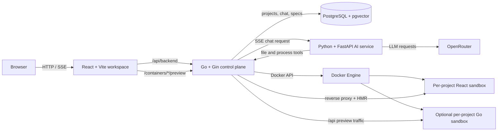

# GURU Mono

[](https://github.com/hoangnhat42/guru-mono/actions/workflows/ci.yml)
[](LICENSE)

GURU is a self-hosted AI full-stack development workspace. A user describes an
application in chat, reviews the generated specification, and works with the
result in an integrated editor, console, and live preview. Generated projects
use a React frontend, an optional Go API, and an isolated PostgreSQL schema.

The repository contains the complete runtime: the React workspace, the Go
control plane, the Python AI orchestration service, project templates, database
migrations, and Docker-based sandboxes.

## What GURU provides

- Authentication and per-user project management
- Streaming project creation and AI chat over Server-Sent Events (SSE)
- Structured delivery phases: analysis, frontend, backend, and validation
- Versioned project specifications with review, approval, and rollback
- Monaco code editing, dependency management, console output, and live preview
- React UI generation mode with full-file visual context
- Optional generated Go backend with a dedicated PostgreSQL schema
- Source-code and production-bundle exports
- Document upload and spreadsheet-aware project context
- Automatic build-error recovery and tiered AI model routing
- Docker recovery for previously running project sandboxes

## Architecture



The main wiring points are:

| Runtime | Entry point | Responsibility |
| --- | --- | --- |
| Web | [`frontend-react/src/main.tsx`](frontend-react/src/main.tsx) | Routes, authentication, project workspace, editor, preview, and SSE client |
| Control plane | [`backend-go/main.go`](backend-go/main.go) | API composition, auth, migrations, preview proxy, process lifecycle, and graceful shutdown |
| AI service | [`ai-python/src/main.py`](ai-python/src/main.py) | FastAPI lifecycle, chat routes, pipeline orchestration, tools, and knowledge store |
| Local stack | [`docker-compose.yml`](docker-compose.yml) | PostgreSQL, web, Go, and Python service wiring |

### Request flow

1. The browser authenticates with the Go API and sends a project request.
2. Go creates the project record and starts a React sandbox through Docker.
3. Chat requests are persisted, rate-limited, and forwarded to Python as SSE.
4. Python classifies the request, updates the project specification, plans the
   work, and invokes tools exposed by the Go control plane.
5. Go writes or executes changes inside the project sandbox, proxies its live
   preview, and streams progress back to the browser.

The default structured pipeline is phase-aware. A legacy direct-agent stream
is still available for compatibility.

## Technology

| Area | Main technology |
| --- | --- |
| Workspace | React 19, TypeScript, Vite 6, Tailwind CSS 4, Zustand, Monaco |
| Control plane | Go, Gin, pgx, JWT, Docker CLI/API |
| AI orchestration | Python 3.12+, FastAPI, LiteLLM/OpenRouter, asyncpg, pgvector |
| Generated apps | React/Vite and optional Go/Gin |
| Runtime | Docker Compose, PostgreSQL 15 with pgvector, Nginx |

## Quick start with Docker Compose

### Requirements

- Docker with Compose v2
- An OpenRouter API key
- Free host ports `3399`, `9933`, `8100`, and `5433`

Clone the repository and enter it:

```bash
git clone https://github.com/hoangnhat42/guru-mono.git
cd guru-mono
```

Create `.env` in the repository root:

```dotenv
OPENROUTER_API_KEY=replace-with-your-key
JWT_SECRET=replace-with-a-long-random-value
LOG_LEVEL=info
```

Build the four runtime images:

```bash
docker build -t guru-sandbox:latest backend-go/docker/guru-sandbox
docker build -t guru-ai-be:latest backend-go
docker build -t guru-ai-py:latest ai-python
docker build -t guru-ai-fe:latest frontend-react
```

Start the stack:

```bash
docker compose -p guru-ai up -d
docker compose -p guru-ai ps
```

Open [http://localhost:3399](http://localhost:3399), register an account, and
create a project. Database migrations run automatically when the Go service
starts.

> `-p guru-ai` is required. The process manager uses the `guru-ai_default`
> network and `guru-ai_guru_process_apps` volume when it creates project
> sandboxes.

Useful health checks:

```bash
curl http://localhost:8100/health
curl http://localhost:9933/health/ai
curl http://localhost:9933/health/memory
```

Follow logs or stop the stack:

```bash
docker compose -p guru-ai logs -f
docker compose -p guru-ai down
```

## Configuration

| Variable | Default | Used by |
| --- | --- | --- |
| `OPENROUTER_API_KEY` | empty | AI model access; required for generation |
| `OPENROUTER_BASE_URL` | `https://openrouter.ai/api/v1` | OpenRouter-compatible endpoint |
| `JWT_SECRET` | insecure development value | Go access and refresh tokens |
| `APP_HOST` | `localhost` | Host advertised to generated applications |
| `LOG_LEVEL` | `info` | Go and Python logging |
| `TAG` | `latest` | Runtime image tag selected by Compose |

The active AI router uses three model tiers and selects among them based on
task complexity and retry state:

- Fast: `google/gemini-2.0-flash-001`
- Default: `google/gemini-2.5-flash`
- Premium: `anthropic/claude-sonnet-4`

Override them with `MODEL_FAST`, `MODEL_DEFAULT`, and `MODEL_PREMIUM` in the
`ai-python` service environment when a different routing policy is needed.

## Repository map

```text
guru-mono/
├── frontend-react/              React workspace and Nginx image
├── backend-go/                  Go control plane
│   ├── internal/routes/         HTTP API composition
│   ├── internal/services/       Project, process, and proxy lifecycle
│   ├── migrations/              Automatically applied PostgreSQL migrations
│   ├── templates/react/         Generated frontend starter
│   ├── templates/go/            Generated backend starter
│   └── docker/guru-sandbox/     Project execution image
├── ai-python/                   AI service
│   ├── src/agent/               Direct agent, tools, prompts, and model routing
│   ├── src/pipeline/            Structured multi-phase generation pipeline
│   ├── src/knowledge/           pgvector-backed knowledge retrieval
│   └── instructions/            Prompt and phase guidance
├── docs/                        Design and implementation notes
└── docker-compose.yml           Local runtime topology
```

## API surface

The browser normally reaches the Go service through the frontend proxy at
`/api/backend`.

| Prefix | Purpose |
| --- | --- |
| `/auth` | Registration, login, token refresh, logout, and profile |
| `/containers` | Project lifecycle, files, dependencies, exports, phases, documents, and specs |
| `/chat/:containerId/messages` | Persisted, authenticated AI chat stream |
| `/containers/:id/preview/*` | Generated frontend, HMR, and backend API proxy |
| `/health/ai` | Go-to-Python health state |
| `/health/memory` | Go process-manager state |

The Python service owns `/api/chat/pipeline`, `/api/chat/stream`, template
metadata, `/health`, and its WebSocket endpoint. It is intended to be called by
the Go control plane rather than directly by the browser.

## Development checks

Run the native checks from the repository root:

```bash
(cd backend-go && go test ./...)
(cd frontend-react && bun install --frozen-lockfile && bun run build)
(cd ai-python && python -m pip install -e '.[dev]' && python -m pytest)
docker compose -p guru-ai config --quiet
```

Frontend development runs on port `3399`:

```bash
cd frontend-react
bun install --frozen-lockfile
bun run dev
```

## Operational boundaries

- The Go service mounts the Docker socket and executes AI-generated code. Run
  GURU only on an isolated, trusted host.
- Replace the default database credentials and `JWT_SECRET` before exposing the
  stack outside a development environment.
- The current control plane allows up to 20 active project processes, cleans up
  idle processes after three hours, and applies a process-local limit of 20 LLM
  requests per user per hour.

## Community

- Read [CONTRIBUTING.md](CONTRIBUTING.md) before opening a pull request.
- Report vulnerabilities privately through [SECURITY.md](SECURITY.md).
- Project decisions and maintainer roles are described in
  [GOVERNANCE.md](GOVERNANCE.md).
- Community support is best effort; see [SUPPORT.md](SUPPORT.md).

GURU Mono is available under the [MIT License](LICENSE).
