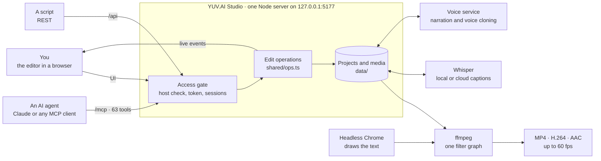

<div align="center">


# YUV.AI Studio

### The open-source video editor your AI agent can drive.

Edit in the browser on your own machine. Or tell Claude, Codex or Cursor what you want, and watch it cut, caption and export **live, inside the editor**.

[](LICENSE)
[](https://github.com/hoodini/yuv-studio/stargazers)
[](docs/MCP.md)
[](https://nodejs.org)
[](CONTRIBUTING.md)

[**Quick start**](#-quick-start) · [**Connect your agent**](#-connect-your-agent-in-one-line) · [What it does](#-what-it-does) · [How it works](#-how-it-works) · [Guides](#-guides) · [License](#-license)

</div>

<br />

<div align="center">


<sub>Real time, not sped up: an agent sends MCP tool calls and the open editor follows each one. <a href="docs/assets/demo.mp4">Watch the sharp MP4</a>.</sub>

</div>

<br />

## ✦ Why this exists

Video editors were built for hands on a mouse. AI agents can write code, but they can't open Premiere.

YUV.AI Studio makes **every edit an API call**. The same operations sit behind the editor, a REST API and 63 MCP tools, so an agent can do anything a person can do in the interface, and you see it happen on the timeline. When it's wrong, you undo it like any other edit.

- **Yours.** It runs on `127.0.0.1`. Your footage never leaves your computer unless you choose a cloud service.
- **Agent-native.** Not a chat bolted onto an editor: the editor *is* the API.
- **Free.** AGPL-3.0, no watermark, no account, no export limits.
- **Hebrew and English.** Right-to-left captions done right, word-by-word highlight, in both languages.

I released it on my birthday, 23 November 2026, as a gift to everyone who makes videos. If it saves you an evening, [a ⭐ helps other people find it](https://github.com/hoodini/yuv-studio/stargazers).

## ⚡ Quick start

You need [Node.js](https://nodejs.org) 22+, `ffmpeg` and `ffprobe` on your PATH, and Chrome or Edge (it draws the text layer during export).

```bash
git clone https://github.com/hoodini/yuv-studio.git
cd yuv-studio
npm install && npm run build
npm start
```

Open **http://127.0.0.1:5177** and drop a video on the window.

> **Let an agent install it for you.** Paste [docs/AI_INSTALL_PROMPT.md](docs/AI_INSTALL_PROMPT.md) into Claude Code, Codex, Cursor or Gemini CLI. It installs what is missing, builds and starts the studio, connects itself over MCP and checks that everything works, on Windows, macOS or Linux.

For captions: `pip install faster-whisper` to transcribe on your computer (add `opencv-python-headless` for the vertical reframe that follows the face, and `onnxruntime` or `onnxruntime-gpu` for background removal), or paste an OpenAI, Groq or ElevenLabs key in the Captions tab. For narration, paste a voice key in the Voice tab ([docs/VOICE.md](docs/VOICE.md)).

## 🔌 Connect your agent in one line

With the studio running:

```bash
# Claude Code
claude mcp add --transport http --scope user yuv-studio http://127.0.0.1:5177/mcp

# Codex
codex mcp add yuv-studio --url http://127.0.0.1:5177/mcp
```

Cursor, VS Code, Claude Desktop and Gemini CLI are in [docs/MCP.md](docs/MCP.md). Then ask for things like:

```text
Import ~/Videos/launch.mp4, cut the silences, add Hebrew captions with word highlight,
put a big title at the start, punch in on the demo at 0:42, and export for Reels.
```

No agent? The editor has its own AI chat: bring a key for Claude, OpenAI, Grok, Groq, OpenRouter or Together, or run a local model with Ollama or LM Studio. Big edits wait for your approval of the plan, and every change comes back as a review you can keep or take back one by one.

## 🎬 What it does

| | |
|---|---|
| ✂️ **Cut** | Trim, split, delete with the gap closed, mark a range with `I` / `O` and cut it from every track, remove silences automatically. |
| 📝 **Edit by text** | The transcript as words: select words, press Delete, and they are cut from the video. Captions follow. |
| 🧹 **Filler words** | Cut "um", "uh", "אה", "אממ" and stutters in one click, in Hebrew and English (a word-for-word transcription keeps the fillers Whisper usually hides). |
| 🎞️ **Shorts finder** | The AI reads a long video and picks the moments that stand alone as Reels, TikToks or Shorts, each with a title, hook and reason; one click makes a vertical project from it. |
| 📱 **Vertical, following the face** | Reframe 16:9 to 9:16, 4:5 or 1:1 with keyframes that follow the speaker like a camera operator, editable on the timeline. |
| 🧍 **Remove background** | No green screen: people separated from the background on your GPU, steady frame to frame. Blur it (portrait mode), put any video behind, or put **text behind the person**. |
| 🎙️ **Clean voice** | Noise and hum reduction, levelling and loudness in one step. |
| ✏️ **Draw it, say it** | Circle a spot on the frame or leave a voice note, and the AI agent changes exactly that moment. Standing rules ("never the same sound effect twice") hold in every edit. |
| 🎨 **Brand kits** | Your logo, colours and fonts once; every title, caption, intro and outro follows them, in every project. One kit per client. |
| 🧩 **Ready-made templates** | YouTube video, Reel · Short · TikTok, Podcast clip, Tutorial, Feed post: the canvas, layout, captions and titles in place, in your brand. |
| 🤖 **AI agent** | A chat inside the editor that edits while you watch. A glow around the frame and a guided cursor show each step. Plans to approve, changes to review. |
| 🔌 **MCP + REST** | 63 MCP tools and a REST API over the same operations. Claude Code, Claude Desktop, Codex, Cursor, VS Code, Gemini CLI. |
| 💬 **Captions** | Hebrew and English, transcribed locally (faster-whisper) or in the cloud. Word-by-word highlight, 9 styles, an editor to fix mistakes. Captions follow your cuts. |
| 🌍 **Translated captions** | Into Hebrew, English, Spanish, French, German, Italian, Portuguese or Russian, or two languages at once, timing kept. |
| 🎙️ **Voice** | Narration from text in Hebrew or English. A voice library, or clone your own from a clip you choose. |
| 📱 **On your phone** | Upload from the gallery (resumable, no 100 MB limit), caption, translate, ask the agent, export for Reels, TikTok, Shorts or YouTube. Installs to the home screen. |
| 🧱 **Layers + motion** | Video, B-roll, images, audio, titles. Drag, resize and rotate on the preview. Keyframes with easing, zooms and punch-ins, 0.1× to 8× speed. |
| 🎨 **Style** | 9 title styles, text animations, colour looks, 15 transitions, 26 sound effects, blend modes, any Google Font or your own. |
| 🖼️ **Free stock** | B-roll, photos, music and sound effects from Pexels, Pixabay and Openverse, with licences and credits kept. |
| 📤 **Export** | MP4 (H.264 + AAC) up to 60 fps. Presets for YouTube, Shorts, Reels, TikTok, Instagram, X and LinkedIn, with fit-or-fill reframing and safe zones. Preview and export draw text with the same code, so they match. |

<details>
<summary><b>📸 Screenshots</b></summary>
<br />


| Fix the transcription | Narration and voices |
|---|---|
|  |  |

| Titles and text styles | Sounds, looks and transitions |
|---|---|
|  |  |

</details>

## 🧠 How it works

One project model and one set of edit operations sit in the middle. The editor, the REST API and the MCP server are three doors to the same operations, which is why an agent can do anything a person can do, and why the open editor follows along live.



| Part | Where |
|---|---|
| Project model and every edit operation (shared by UI, API and MCP) | `shared/types.ts`, `shared/ops.ts` |
| Text and caption drawing (the same code in preview and export) | `shared/renderText.ts` |
| REST API, uploads, live events, access control | `server/index.ts` |
| Export: one ffmpeg filter graph, text pictures from headless Chrome | `server/export.ts` |
| Transcription, local and cloud | `server/transcribe.ts`, `server/transcribe.py` |
| Narration and voice cloning | `server/voice.ts` |
| MCP tools | `server/mcp.ts` |
| AI agent (providers, the tool loop, snapshots) | `server/agent.ts` |
| Editor UI (React) | `src/` |

Projects, uploads, exports and settings live in `data/`, which is not committed. Copy `.env.example` to `.env` to configure the port, the data folder, Whisper models, keys and remote access.

## 📚 Guides

| | |
|---|---|
| [What's new](CHANGELOG.md) | What changed in each version |
| [Using the editor](docs/USER_GUIDE.md) | Cutting, layers, captions, shortcuts |
| [Transcription](docs/TRANSCRIPTION.md) | Local Whisper, cloud providers, fixing captions |
| [Voice and AI clips](docs/VOICE.md) | Narration and voice cloning, importing generated clips by link |
| [AI agent](docs/AGENT.md) | The chat in the editor, providers and keys, plans, reviewing its changes |
| [MCP server](docs/MCP.md) | Connect an AI client; the 63 tools; example prompts |
| [REST API](docs/API.md) | Endpoints and edit operations |
| [Use it from anywhere](docs/REMOTE.md) | A private address on your own domain through a Cloudflare Tunnel |
| [Architecture](docs/ARCHITECTURE.md) | Diagrams of the logic and the infrastructure |
| [AI install prompt](docs/AI_INSTALL_PROMPT.md) | One prompt that makes an agent install everything |

## 🤝 Contributing

Bug reports, ideas and pull requests are welcome. Start with [CONTRIBUTING.md](CONTRIBUTING.md); a good first contribution is a new caption style, a title preset, a transition or an export preset. Contributors sign a [CLA](CLA.md) once, so the project can keep offering both the AGPL and a commercial license.

## 🔒 Security

The studio listens on `127.0.0.1` and refuses requests from other websites and host names. It can read any file path it is given on the local machine (that is how an agent imports footage from anywhere on the disk), so never expose it to a network without the access token or Cloudflare Access described in [docs/REMOTE.md](docs/REMOTE.md). Found a vulnerability? Report it privately, as described in [SECURITY.md](SECURITY.md).

## 📜 License

YUV.AI Studio is free and open-source software under the **[GNU Affero General Public License v3.0](LICENSE)**. Use it, study it, change it and share it. If you run a modified version as a service for other people, the AGPL requires you to offer them its source code.

- **Need other terms?** A commercial license is available for companies that want to embed the studio in a closed product or offer it as a service without the AGPL's obligations. Open an issue or contact YUV.AI.
- **Hosted version.** A hosted YUV.AI Studio, with rendering, transcription and the agent ready to use and nothing to install, is in the works.
- **Name and logo.** "YUV.AI" and "YUV.AI Studio" and the YUV.AI logos are trademarks, not covered by the AGPL; forks need their own name. See [TRADEMARK.md](TRADEMARK.md).

## ⭐ Star history

<a href="https://star-history.com/#hoodini/yuv-studio&Date">
  
</a>

## Credit

Background removal uses [Robust Video Matting](https://github.com/PeterL1n/RobustVideoMatting) by Shanchuan Lin et al. (GPL-3.0); the model is downloaded from its official release on first use.


Designed and built by **Yuval Avidani**: technologist and technical content creator, host of the AI segment on Channel 12 News, and founder of YUV.AI.

[yuv.ai](https://yuv.ai) · [YouTube](https://youtube.com/@yuv-ai) · [Instagram](https://instagram.com/yuval_770) · [LinkedIn](https://www.linkedin.com/in/yuval-avidani-87081474/) · [X](https://x.com/yuvalav) · [GitHub](https://github.com/hoodini)
