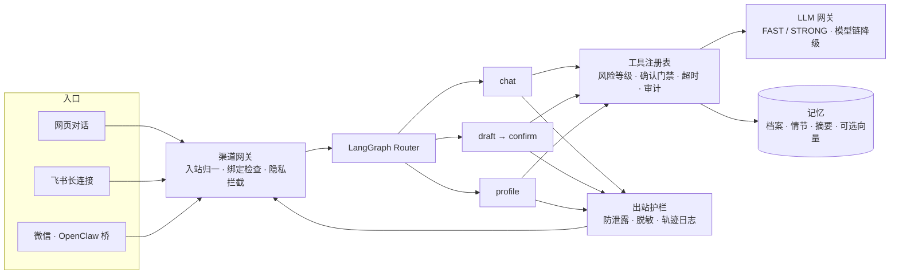

<div align="center">

# Personal Agent

**有长期记忆的个人助理底座**

陪你聊、记住你说过的事、替你起草、按时提醒。<br>
任何会产生后果的动作，都先给你一张确认卡。

LangGraph · FastAPI · 原生 JS 前端 · 可二次开发 · MIT

[](LICENSE)
[](Dockerfile)
[](VERSION)
[](https://render.com/deploy?repo=https://github.com/hubooooooo/Personal-Agent)

[快速开始](#快速开始) · [它能做什么](#它能做什么) · [工作原理](#工作原理) · [多渠道接入](#多渠道接入) · [安全与隐私](#安全与隐私) · [二次开发](#二次开发)

</div>

---

## 为什么是它

市面上的「个人助理」要么是一个聊天框，关掉就忘；要么能力很强，但你不敢把它接进飞书和微信。Personal Agent 想做的是中间那条路：

- **真的记得你。** 姓名、城市、职业、兴趣、偏好和你随口提过的事，会沉淀成一张可查看、可修改、可遗忘的记忆卡，而不是藏在某个向量库里。
- **先确认，再行动。** 写草稿、建定时任务、调用外部工具，统统先出确认卡。它不会替你发消息、发邮件、提交表单，也不会在聊天里收你的密码和手机号。
- **一个账号，多个入口。** 网页会话即账号；飞书、微信通过一次性链接绑定到同一份档案和记忆。
- **安全护栏是内置的，不是贴上去的。** 出站防泄露、隐私脱敏、危机识别、一次性确认凭证、全链路轨迹日志，都有金标回归测试守着。
- **拿来就能改。** 模型任意厂商可换，工具一个装饰器就能注册，渠道按接口加，[CONTRIBUTING.md](CONTRIBUTING.md) 按改动深度分五层带你入门。

## 它能做什么

```
你：我叫小胡，在上海做产品经理，最近在学 Rust。
助理：记住了。             → 记忆卡：姓名 小胡 · 城市 上海 · 职业 产品经理 · 兴趣 Rust

你：帮我给房东写条消息，说下周三交租要晚两天。
助理：这是草稿 ……           → 确认卡：确认 / 带修改意见确认 / 拒绝并说明原因（会自动重写）

你：每天早上八点提醒我看一眼 Hacker News 头条。
助理：要创建这个定时任务吗？ → 确认卡 → 到点结果进应用内收件箱，并推送到已绑定的飞书 / 微信

你：我的支付宝密码是……
助理：这里不收密码。        → 给你一个网页安全输入区链接，加密保存，从不回显明文
```

| 做 | 不做 |
|----|------|
| 带记忆的对话；记忆卡上随时查看、修改、遗忘 | 替你对外发消息、发邮件、提交表单 |
| 写作草稿（邮件 / 消息 / 文章 / 笔记）→ 确认卡 → 定稿 | 在聊天里收账号密码、手机号、身份证 |
| 一次性提醒、自定义只读定时任务 | 登录任何网站、无人值守操作 |
| 读公开网页 / RSS / 搜索 / Hacker News 作为**不可信**来源 | 把网页内容当成指令执行 |
| 危机识别与热线兜底、提示词泄露与隐私护栏 | 把你的数据交给第三方可观测平台（Langfuse 可选、自托管、脱敏后导出） |

## 快速开始

### 本地三分钟

需要 Python 3.12。

```bash
git clone https://github.com/hubooooooo/Personal-Agent.git && cd Personal-Agent
python3 -m venv .venv && source .venv/bin/activate
pip install -r requirements.txt -c requirements.lock
cp .env.example .env
```

打开 `.env`，至少填这两项：

```bash
AUTH_SECRET=     # 必填。生成：python -c "import secrets; print(secrets.token_hex(32))"
KIMI_API_KEY=    # Moonshot / Kimi Key。不填也能启动，聊天走离线占位（mock），方便先看流程
```

启动：

```bash
uvicorn app.main:app --host 0.0.0.0 --port 8787
```

| 页面 | 地址 |
|------|------|
| 对话 | http://127.0.0.1:8787/ |
| 健康检查 | http://127.0.0.1:8787/health |
| 管理后台（需管理员令牌） | http://127.0.0.1:8787/admin |

样例配置默认 FAST / STRONG 两档都走 Kimi（`kimi-k2.6` / `kimi-k3`）。换 DeepSeek、通义、OpenAI 或任何 OpenAI 兼容接口，只改 `.env`，见 [docs/llm-gateway.md](docs/llm-gateway.md)。

### Docker

```bash
docker build -t personal-agent .
docker run --rm -p 8787:8787 -e AUTH_SECRET=换成随机串 -e KIMI_API_KEY=你的key personal-agent
```

### Render 一键部署

点上方 **Deploy to Render** 按钮，或在 Render 新建 Blueprint 选本仓库。免费实例没有持久盘，重启会清空 SQLite 数据，正式使用请挂盘。详见 [docs/deploy.md](docs/deploy.md)。

## 工作原理



| 层 | 实现 | 说明 |
|----|------|------|
| 编排 | LangGraph，`app/graph.py` → `app/agent/router.py` → `app/agent/subgraphs/` | 三个子图：chat / draft+confirm / profile。`run_action` 是唯一入口 |
| 工具 | `app/agent/tool_registry.py` | 一个装饰器注册；风险等级决定是否需要确认，`external` 一律需要。清单见 [docs/tools.md](docs/tools.md) |
| 记忆 | `app/agent/memory/` | 工作记忆 = LangGraph checkpoint；档案 = SQLite 事实；情节 = `episodic_events`（关键词 / 标签）；后台对话摘要；向量检索可选 |
| 模型 | `app/gateway/` | task → FAST / STRONG → 有序模型链；失败、超时、429、空内容自动降级；OpenAI 兼容 + Anthropic |
| 渠道 | `app/channels/` | Web / 飞书 / OpenClaw 统一走 `gateway.py`，共用同一个 agent thread，分别渲染为网页卡片 / 飞书卡片 / 微信文本菜单 |
| 主动 | `app/agent/schedules/` `proactive/` | 调度器默认关；一次性提醒、自定义只读任务，结果进收件箱并推送到已绑定渠道 |
| 护栏 | `app/agent/harness/` `app/privacy.py` | 进图前的隐私门、出站防泄露、轨迹脱敏、管理员鉴权 |
| 提示词 | `app/prompts/<name>/vN.md` | 版本化文件，哈希被测试锁定；改提示词新建 v2 而不是改 v1 |
| 存储 | SQLite 默认 | 设 `DATABASE_URL` 切到 Postgres，带行级安全（RLS），见 [docs/postgres-rls.md](docs/postgres-rls.md) |

更完整的图和设计取舍：[docs/agent-stack.md](docs/agent-stack.md) · [docs/技术架构.md](docs/技术架构.md)（英文版 [tech-architecture.md](docs/tech-architecture.md)）· Mermaid 源图 [docs/mmd/](docs/mmd/)。

## 多渠道接入

**两个渠道默认都关。** 所有渠道走同一个网关：入站归一 → 绑定检查 → 隐私拦截 → 同一个 agent thread → 渲染 → 出站。

| 渠道 | 开关 | 接入方式 |
|------|------|----------|
| 飞书 | `FEISHU_ENABLED=1` + `FEISHU_APP_ID` / `FEISHU_APP_SECRET` | 官方 SDK 长连接，**不需要公网地址**。见 [docs/feishu-长连接.md](docs/feishu-长连接.md) |
| 微信 | `OPENCLAW_WECHAT_ENABLED=1` + `OPENCLAW_WEBHOOK_TOKEN` | OpenClaw Gateway + [桥接插件](integrations/openclaw-personal-agent-bridge/README.md) |
| QQ 等 | 未实现 | 只留了 `ChannelAdapter` 接口（`app/channels/qq.py`），按 [CONTRIBUTING 第三层](CONTRIBUTING.md#第三层加渠道两到三天) 补 |

渠道里的三条规则：

- **绑定走对话。** 未绑定用户发任何消息，都会收到一次性绑定链接（`/bind`）。用常用浏览器打开并点「确认绑定」，渠道账号即绑到该浏览器的网页会话，共用档案和记忆，无需密码。
- **隐私不进聊天。** 手机号、邮箱、身份证、银行卡一律不在渠道里收集，改发网页安全通道链接（`/sandbox`）。
- **草稿只发预览。** 渠道里附「在网页查看完整草稿」链接；确认 / 拒绝在飞书是卡片按钮，微信回数字 `1` / `2`。

细节见 [docs/channels.md](docs/channels.md)。

## 安全与隐私

这些不是「建议」，而是有测试守着的不变量，改动前请读 [CONTRIBUTING 第 3 节「不要动的东西」](CONTRIBUTING.md#3-不要动的东西)。

- **身份只来自服务端签发的会话。** 每个 `/api` 调用的 `user_id` 只从签名 Cookie / Token 推导，从不信任请求体。`AUTH_SECRET` 缺失时所有 `/api` 返回 503。
- **确认门禁。** 草稿、定时任务的创建 / 修改 / 删除都走确认卡；外部工具需要一次性、参数绑定的确认凭证。确认卡不过期，后点覆盖先点。
- **出站防泄露。** 所有出站文本过滤密钥、系统提示词原文、他人数据和隐私沙盒值；检查失败 fail closed（`E_GUARD_UNAVAILABLE`），节点异常只返回 `E_NODE_FAILED`。
- **隐私门在图之前。** 密码、手机号、身份证在进入 LangGraph 之前就被拦下，转到加密的安全输入区（Fernet，支持密钥轮换，API 从不返回明文）。
- **网页内容是不可信数据。** 抓取结果带 `shared.untrusted_data` 规则进提示词，防提示注入有专门测试。
- **预算与失控检测。** 每个任务按难度分档限制步数 / 时长 / token / 费用，近限额时收尾，超限给「继续」卡；每用户有日 / 月费用上限。
- **轨迹日志。** 每个图节点一行：输入摘要、工具、参数、结果摘要、耗时、模型档位、token 估算、护栏命中；入库前统一脱敏，用户 / 线程以 HMAC 假名出现。
- **金标回归。** `tests/golden/` 覆盖安慰、危机、草稿、泄露、轨迹鉴权。安全类必须零失败；质量类与 `baseline.json` 比较。

## 配置

完整键名与注释见 [`.env.example`](.env.example)。**不要提交填好的 `.env`。**

| 想要 | 需要填 |
|------|--------|
| 跑起来 | `AUTH_SECRET` |
| 真模型对话 | `KIMI_API_KEY`，或 `LLM_FAST_*` / `LLM_STRONG_*` 指向任意 OpenAI 兼容接口 |
| 安全输入区可用 | `SECRETS_FERNET_KEY` |
| 接飞书 / 微信 | `PUBLIC_BASE_URL`（HTTPS）+ 对应渠道开关，见上表 |
| 定时任务与提醒 | `PROACTIVE_ENABLED=1`、`PROACTIVE_TZ` |
| 管理后台与轨迹查询 | `HARNESS_ADMIN_TOKENS`（`name:token[:scope]`，≥16 位） |
| 向量记忆 | `MEMORY_VECTOR_ENABLED=1`（默认关） |
| Langfuse 可观测性 | `LANGFUSE_ENABLED=1` + Host / Public Key / Secret Key，见 [docs/langfuse.md](docs/langfuse.md) |
| Postgres | `DATABASE_URL`、`SYSTEM_DATABASE_URL` |

<details>
<summary>按分组看关键键</summary>

| 分组 | 关键键 |
|------|--------|
| LLM | `KIMI_API_KEY`；`LLM_FAST_BASE_URL/MODEL/API_KEY`、`LLM_STRONG_*`、`LLM_STRONG_FALLBACK_MODEL`；多模型链 `LLM_FAST_CHAIN` / `LLM_STRONG_CHAIN` 或 `LLM_CONFIG_FILE` |
| 会话 | `AUTH_SECRET`（必填） |
| 渠道公共 | `PUBLIC_BASE_URL`、`CHANNEL_ADMIN_TOKEN`、`CHANNEL_BIND_TTL_SECONDS`、`CHANNEL_SANDBOX_TTL_SECONDS` |
| 飞书 | `FEISHU_ENABLED`、`FEISHU_APP_ID`、`FEISHU_APP_SECRET`、`FEISHU_BIND_OPEN_IDS` |
| 微信 | `OPENCLAW_WECHAT_ENABLED`、`OPENCLAW_WEBHOOK_TOKEN`、`OPENCLAW_GATEWAY_URL`、`OPENCLAW_GATEWAY_TOKEN` |
| 安全保存 | `SECRETS_FERNET_KEY`（逗号分隔可轮换） |
| 预算 | `AGENT_BUDGET_<SIMPLE\|MEDIUM\|HARD>_<STEPS\|SECONDS\|TOKENS\|COST>`、`AGENT_COST_CAP_*`、`AGENT_MAX_REDRAFTS` |
| 主动调度 | `PROACTIVE_ENABLED`、`PROACTIVE_TZ`、`PROACTIVE_TICK_SECONDS` |
| Harness | `HARNESS_ADMIN_TOKENS`、`HARNESS_ID_HMAC_KEY`、`PII_BACKEND`（regex / presidio / gliner）、`PRIVACY_SANDBOX_VALUES`、`TRACE_WRITE_MODE` |
| 可观测性 | `LANGFUSE_ENABLED`、`LANGFUSE_HOST`、`LANGFUSE_PUBLIC_KEY`、`LANGFUSE_SECRET_KEY`、`LLM_PRICES_JSON` |
| 记忆 | `MEMORY_VECTOR_ENABLED`、`INTENT_SCORING_MODE`、`SILICONFLOW_API_KEY` |

</details>

## HTTP API

<details>
<summary>接口摘要（点开）</summary>

| 路径 | 说明 |
|------|------|
| `POST /api/session` | 签发 / 刷新网页会话 |
| `GET /health` · `GET /api/capabilities` · `GET /api/tools` | 网关与通道状态、能力清单、工具列表 |
| `POST /api/chat` | 对话；写作请求返回 `awaiting_confirm` + `task_card`（`draft_confirm`） |
| `POST /api/draft` | 直接发起草稿（`request`） |
| `POST /api/confirm/{thread_id}/token` · `POST /api/confirm` | 一次性确认凭证 + 确认 / 拒绝（可带 `edits` / `reason`） |
| `POST /api/continue` | 预算用尽后继续任务 |
| `GET/POST /api/profile` | 通用档案（name / city / tz / occupation / interests / preferences / facts） |
| `GET /api/memory/{user_id}` · `/card` · facts / events · `/forget` | 记忆查看与编辑 |
| `GET/POST/DELETE /api/secrets` | 安全输入区（从不返回明文） |
| `/api/schedules*` | 定时任务 CRUD、确认卡决定、运行历史 |
| `GET /api/proactive/pending` · `POST .../dismiss` | 应用内提醒收件箱 |
| `GET /bind` · `POST /api/channels/bind/complete` · `GET /sandbox` · `POST /api/sandbox/submit` | 渠道绑定与隐私安全通道 |
| `POST /webhooks/feishu` · `POST /webhooks/openclaw/wechat` | 渠道入站 |
| `POST /api/feedback` | 对话气泡下的 👍 / 👎 |
| `GET /api/admin/traces` · `/api/admin/audit` · `/api/admin/feedback` · `/api/admin/users*` | 管理接口（管理员令牌，按 scope 授权） |

每个 `/api/*` 响应带 `X-Trace-Id`。所有路由都在 `app/main.py`，定时任务与管理后台分别在 `app/agent/schedules/api.py` 和 `app/admin/api.py`。

</details>

## 测试

测试永远是 mock 模式：`tests/conftest.py` 会删掉环境里所有 `*_API_KEY` 并禁止加载 `.env`，本地有 Key 也不会花额度。

```bash
pip install -r requirements-dev.txt -c requirements.lock
python -m pytest -q                                              # 单元 + 集成
AUTH_SECRET=x python tests/golden/run_golden.py --mode mock      # 金标回归（CI 默认）
python tests/golden/run_golden.py --mode live                    # 真实模型（需 Key）
python scripts/harness_golden.py                                 # CI 门禁入口
```

接上真实模型后，`python scripts/live_smoke.py` 会把主流程跑一遍并生成 [docs/live-smoke-report.md](docs/live-smoke-report.md)，作为「正常长什么样」的参照。评审 rubric（共情 / 危机处理）：`python -m app.evals.cli`。

## 二次开发

[CONTRIBUTING.md](CONTRIBUTING.md) 是给新人的地图，按改动深度分五层，每层标出入口文件、必须同步的契约测试和不能动的安全不变量：

| 层 | 做什么 | 大约 |
|----|--------|------|
| 1 换皮 | 提示词、文案、样式、换模型厂商 | 半天 |
| 2 加工具 | 一个 `@tool` 装饰器，确认卡 / 凭证 / 超时 / 审计 / `/api/tools` 自动跟上 | 一到两天 |
| 3 加渠道 | 实现 `ChannelAdapter`，接入统一网关 | 两到三天 |
| 4 改记忆 | 换检索、加向量、改写入路径 | 三到五天 |
| 5 改编排 | 加子图、改路由 | 一周以上 |

加一个工具长这样：

```python
from app.agent.tool_registry import tool

@tool("weather_lookup", risk_level="read",
      description="查询城市当前天气。",
      when_to_use="用户问天气或出门穿衣时使用。",
      when_not_to_use="不用于历史气候数据。",
      timeout=20)
def weather_lookup(city: str, user_id: str = "") -> dict:
    ...
```

可选的领域指导包（Skills）放在 `app/agent/skills/`，只提供文本指导，不授予工具、不改权限，见 [docs/skills.md](docs/skills.md)。

## 文档索引

| 主题 | 文档 |
|------|------|
| 整体栈与图 | [agent-stack.md](docs/agent-stack.md) · [技术架构.md](docs/技术架构.md) · [mmd/](docs/mmd/) |
| 工具 | [tools.md](docs/tools.md)（清单）· [tool-registry.md](docs/tool-registry.md)（机制）· [model-tool-selection.md](docs/model-tool-selection.md) |
| 模型网关 | [llm-gateway.md](docs/llm-gateway.md) · [llm_models.example.json](docs/llm_models.example.json) |
| 记忆与上下文 | [context-assembly.md](docs/context-assembly.md) · [vector-memory-write.md](docs/vector-memory-write.md) · [intent-confidence-validation.md](docs/intent-confidence-validation.md) |
| 渠道 | [channels.md](docs/channels.md) · [feishu-长连接.md](docs/feishu-长连接.md) · [OpenClaw 桥](integrations/openclaw-personal-agent-bridge/README.md) |
| 定时任务 | [schedules.md](docs/schedules.md) |
| 部署与运维 | [deploy.md](docs/deploy.md) · [postgres-rls.md](docs/postgres-rls.md) · [langfuse.md](docs/langfuse.md) · [admin.md](docs/admin.md) |
| 界面 | [DESIGN.md](DESIGN.md)（chat-only 单页，浅色，Geist 自托管） |

## 现状与边界

- 当前版本 0.8.2，SQLite 单机即可跑，Postgres + RLS 已可用但未在生产长期验证。
- QQ 渠道只有接口位；向量记忆、主动调度、两个渠道、Langfuse 全部默认关闭，按需打开。
- Render 免费实例无持久盘，仅适合演示。
- 已知粗糙处与常见坑见 [CONTRIBUTING 第 5、6 节](CONTRIBUTING.md#5-已知的粗糙处)。

## License

[MIT](LICENSE)
