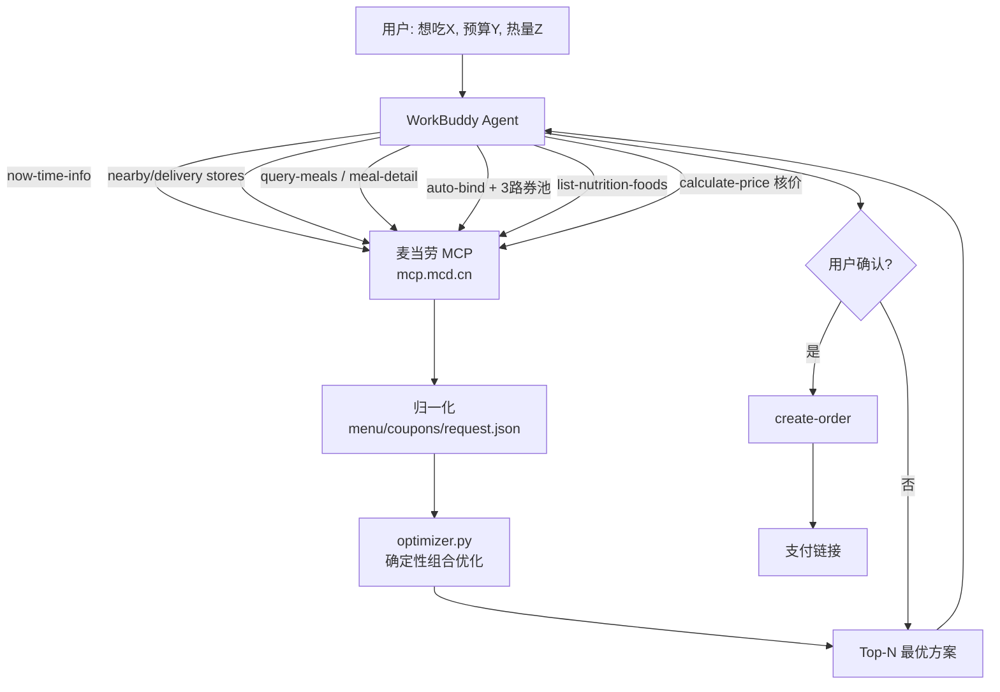

# 麦门省钱精算师 · mcd-saver-strategist

> 基于 **麦当劳中国 MCP（McDonald's China MCP）** 开发的省钱点餐 Skill / AI 智能体技能：
> 把「菜单 × 优惠券 × 叠加规则」的组合优化交给确定性算法，
> 让每一顿麦麦都点得明明白白、省得清清楚楚。
> 又名：麦门省钱精算师 / 麦当劳省钱点餐助手 / MCD Saver Strategist。

麦当劳程序员创意开发大赛参赛作品 · 非麦当劳官方产品。

[](https://github.com/hujjun/mcd-saver-strategist/actions/workflows/ci.yml)
  

---

## 项目介绍

**用户说"我想吃巨无霸套餐，怎么最便宜"，它拉取门店菜单和所有可用优惠券，
用算法穷举出总价最低的合规组合，并帮你下单。**

示例：巨无霸 + 中薯条 + 可乐，直选 **¥47.00**；
用「1+1 随心配」组合后 **¥21.90**，省 **¥25.10（53%）**。

它不止会算"最便宜"，还能回答四个衍生问题：

| 问题 | 能力 |
|---|---|
| 这顿饭我想省钱 / 吃全 / 低卡 / 少排队 | **多目标优化**：4 种点餐目标，同一约束给不同最优解 |
| 手里这堆券，哪张优惠更实在？ | **券体检**：名义面额 vs 实际节省 vs 机会成本 |
| 差几块钱到下一档满减，加购划不划算？ | **凑单建议**：最小代价补位，算出净变化（可能为负） |
| 便宜和低卡不可兼得，边界在哪？ | **帕累托前沿**：价格 × 热量的不可支配解集 |
| 一家人 / 一桌同事怎么点？ | **多人拼单**：按份数计价、人均分摊，优惠只计一次（保守） |

🎮 **在线试算（无需登录）**：<https://hujjun.github.io/mcd-saver-strategist/> ——
优化算法的前端完整复刻，选好想吃的、切换目标、拖动预算和热量上限，实时算出最优组合；
页面里还有券体检和帕累托前沿图，打开即玩。

🔎 静态示例：[`docs/demo.html`](docs/demo.html) ·
🖼️ 原理图：[`images/how-it-works.png`](images/how-it-works.png) ·
🎬 宣传动画：[`images/promo.mp4`](images/promo.mp4)


---

## 它解决什么问题

麦当劳的优惠是典型的**组合爆炸**问题：

- 菜单几十项、优惠券动辄十几张、叠加规则各不相同；
- 用券还要考虑「为凑满减而加购是否划算」；
- 用户懒得算，大模型**也容易算错**（价格、折扣、叠加口算不可靠）。

本 Skill 的核心洞察是：**取数交给 MCP，算术交给代码，表达交给 Agent。**

| 角色 | 职责 |
|---|---|
| 麦当劳 MCP | 实时菜单、价格、优惠券、营养、门店、下单 |
| `scripts/optimizer.py` | 确定性组合优化，输出总价最低的 Top-N 方案 |
| WorkBuddy Agent | 理解需求、归一化数据、讲解方案、确认后下单 |

---

## 架构



---

## 一句话安装

```bash
git clone https://github.com/hujjun/mcd-saver-strategist.git && cp -r mcd-saver-strategist/skills/mcd-saver-strategist ~/.workbuddy/skills/
```

（Windows 为 `%USERPROFILE%\.workbuddy\skills\`；MCP Token 配置见下文「安装」。）

---

## 安装

### 1. 申请麦当劳 MCP Token

前往麦当劳 MCP 开放平台 https://open.mcd.cn/mcp ，手机号登录后在「控制台」激活并复制 Token。

### 2. 配置 MCP 连接

在 WorkBuddy 左侧边栏【专家·技能·连接器】→【连接器】→ 右上角【自定义连接器】→【配置 MCP】中，
填入 [`mcp-config.example.json`](mcp-config.example.json) 的内容，
并把 `${MCD_MCP_TOKEN}` 替换为你的真实 Token（或用环境变量注入），保存后【启用】。

### 3. 安装本 Skill

把 `skills/mcd-saver-strategist/` 整个目录复制到 WorkBuddy 的用户技能目录：

```bash
cp -r skills/mcd-saver-strategist ~/.workbuddy/skills/
```

（Windows 为 `%USERPROFILE%\.workbuddy\skills\`）

装好后在对话框里直接说「我想吃巨无霸套餐，怎么点最便宜」即可触发。

---

## 使用示例

**示例 1 · 单人到店**
> 用户：我想吃巨无霸 + 薯条 + 可乐，怎么最便宜？

精算师：拉菜单 + 四路券池 → 优化 → 「1+1 随心配 ¥12.9 覆盖巨无霸和中薯条，另外单点可乐 ¥9，
合计 ¥21.90，比直选省 ¥25.10」。

**示例 2 · 预算硬约束**
> 用户：30 块钱在麦当劳能吃到什么？

精算师：以 `budget=30` 求解，返回在预算内的最优搭配，并列出各方案到手价与热量。

**示例 3 · 热量约束**
> 用户：减脂期，想吃麦当劳，800 大卡以内还要便宜。

精算师：引入 `list-nutrition-foods`，以 `max_calories=800` 求解，
给出低卡又省钱的组合（如板烧鸡腿堡 + 麦咖啡 + 圆筒）。

**示例 4 · 外送**
> 用户：帮我在麦乐送点一份午餐，别超过 40。

精算师：`delivery-query-addresses` → `delivery-query-stores` → 后续流程同上，
下单前用 `calculate-price` 核价（含配送费）。

**示例 5 · 券太多不会用**
> 用户：我有 8 张券，帮我看看哪张值得用。

精算师：四路券池归一化 → `audit_coupons()` 逐张体检 →
「1+1 随心配值得用；这张'满 35 减 7'名义省 7 元，但用了它就吃不到 1+1，反而多花 18 元」。

**示例 6 · 凑单**
> 用户：还差多少能到满减？加个什么划算？

精算师：`suggest_gap()` 用子集和 DP 找最小代价补位 →
「还差 7 元，加个香芋派 7.5 元，多减 12 元，净省 4.5 元」。

**示例 7 · 多人拼单**
> 用户：我们 3 个人各要一份，一共多少钱？

精算师：`party_size=3` 求解 → 总价 + 人均，优惠只计一次（保守计价，不报假低价）。

---

## 命令行快速体验（无需 Token）

内置样例数据，可离线跑通完整优化流程：

```bash
cd skills/mcd-saver-strategist/scripts

# 看优化结果（默认到店自取场景）
python optimizer.py

# 同时输出结构化 JSON
python optimizer.py --json

# 一键看 7 个真实场景（含拼单 / 外送 / 券体检 / 凑单）
python demo.py

# 切换点餐目标: cheapest(默认) / balanced / lightest / fewest
python optimizer.py --objective lightest

# 多人拼单
python optimizer.py --party 3

# 券体检: 每张券的名义面额 vs 实际节省 vs 机会成本
python optimizer.py --audit

# 外送场景: 配送费计入总价, 且仅外送可用的券参与优化
python optimizer.py --mode delivery --fee 9

# 预算 / 热量硬约束
python optimizer.py --budget 25
python optimizer.py --max-calories 800

# 跑 46 项自测（改逻辑后必跑）
python selftest.py

# 性能基准: 菜品 10~160 款规模下的耗时
python bench.py

# 真实 MCP 连通自检（需 Token, 证明数据链路是真的）
export MCD_MCP_TOKEN=你的token
python mcp_probe.py --call now-time-info

# 前后端对拍: 页面试算器与 optimizer.py 是否一致（需 Node）
node parity_check.mjs
```

---

## 真实性对照表

| 项目 | 性质 | 说明 |
|---|---|---|
| 优化算法 | ✅ 真实 | `optimizer.py` 与在线试算页为同一套逻辑，且 CI 里有 17 项前后端对拍防漂移 |
| 「省 53%」结论 | ✅ 真实 | 算法在示例数据上算出，非人工编排 |
| 券叠加规则 | ✅ 真实 | 保守策略：`stackable:false` 与任何券互斥，保证方案价 ≤ 实付价 |
| MCP 数据链路 | ✅ 真实 | `mcp_probe.py` 可现场验证：Token 握手 + 35 个工具清单 + 试调用 |
| 菜单价格 / 热量 | 🟡 示例快照 | 结构对齐 MCP 返回，数值为演示用，以门店实时返回为准 |
| 优惠券内容 | 🟡 示例快照 | 结构对齐 MCP 四路券池归一化结果，可用性以账号实时状态为准 |
| 下单能力 | ✅ 真实 | 经 MCP 核价（`calculate-price`）→ 下单（`create-order`），本仓库页面不涉及下单 |

---

## 参赛合规自查

对照《麦当劳程序员创意开发大赛活动规则》逐条自查（自查日期 2026-10-19）：

| 规则要求 | 本仓库情况 |
|---|---|
| 仓库创建时间在 2025-12-25 ~ 2026-10-25 之间 | ✅ 创建于 2026-10-09 |
| 仓库公开可访问 | ✅ public |
| `README.md`（介绍 / 安装 / 使用示例 / 目标用户） | ✅ 四个部分均有独立章节 |
| `CONTEST_DECLARATION.md` | ✅ 与官方原文**逐字节一致**（md5 `91a7b32e…`） |
| `MCP_INTEGRATION.md`（Server / Tool / 调用流程 / 业务价值） | ✅ 六个章节，含 Tool 清单与字段映射 |
| `mcp-config.example.json`（只允许环境变量占位符） | ✅ 仅 `Bearer ${MCD_MCP_TOKEN}` |
| `workbuddy.md`（WorkBuddy 专项） | ✅ 含开发环境、对话摘要、技术决策与迭代记录 |
| 真实使用麦当劳 MCP | ✅ `scripts/mcp_probe.py` 可复现握手 + tools/list + 调用 |
| 真实使用 WorkBuddy | ✅ 本 Skill 在 WorkBuddy 中开发与联调，过程见 `workbuddy.md` |
| 未包含真实 Token / 密钥 | ✅ 全 git 历史扫描为零命中 |
| 内容合规（不贬损品牌与产品） | ✅ 仅陈述券面数据与算法结果，使用中性表述，不与其它品牌对比 |

---

## 实测发现

开发过程中用真实 MCP 联调得到的观察（2026-10，个人账号实测）：

- **券要四路查全**：`query-my-coupons` 返回的是已入卡包的券；麦麦省的可领券需先 `auto-bind-coupons` 领取才会出现，门店券在 `query-store-coupons`。只查一个来源会漏掉最优组合。
- **券有场景属性**：实测部分门店券仅到店可用。优化器已支持 `channel` 字段（`pickup` / `delivery` / `any`），外送场景自动剔除不可用券，并把配送费计入总价参与预算判断。
- **历史订单可能为空**：`order-list` 在账号无历史订单时返回空列表，依赖它做推荐的功能必须有空态兜底。
- **营养数据可以直接用**：`list-nutrition-foods` 一次返回约 160 款餐品的多维营养数据，热量约束场景无需额外估算。
- **名义面额 ≠ 实际节省**：实测里最贵的不是"假券"，而是"小券挤掉大组合"——每张券单看都在省钱，但用了它就吃不到 1+1 随心配。券体检的"机会成本"指标就是为此设计的。

---

## 目录结构

```
.
├── README.md                      # 本文件
├── CONTEST_DECLARATION.md         # 参赛声明（官方原文，未改动）
├── MCP_INTEGRATION.md             # MCP 集成说明：Tool 清单 / 调用流程 / 业务价值
├── mcp-config.example.json        # 脱敏 MCP 配置（仅环境变量占位符）
├── workbuddy.md                   # WorkBuddy 开发对话上下文
├── LICENSE                        # MIT
├── .github/workflows/ci.yml       # CI: 46 项自测 + 前后端对拍 + 性能基准
├── docs/
│   ├── index.html                 # 可交互在线试算（多目标 + 券体检 + 帕累托图）
│   ├── demo.html                  # 静态示例快照
│   └── preview.png                # 在线试算页整页截图
├── images/
│   ├── how-it-works.svg / .png    # 「省 53% 是怎么算出来的」原理图
│   └── promo.mp4                  # 宣传动画（AI 生成，仅作视觉物料）
└── skills/mcd-saver-strategist/   # ← Skill 本体
    ├── SKILL.md                   # 技能指令（Agent 加载）
    ├── scripts/
    │   ├── optimizer.py           # 确定性优惠组合优化器 v2（纯标准库）
    │   ├── selftest.py            # 46 项自测
    │   ├── demo.py                # 7 个真实场景一键演示
    │   ├── bench.py               # 性能基准（规模 × 耗时）
    │   ├── mcp_probe.py           # MCP 连通自检（握手 / 工具清单 / 试调用）
    │   ├── parity_check.mjs       # 前后端对拍（页面引擎 = optimizer.py）
    │   └── sample_data/           # 离线示例：菜单/券/请求
    └── references/
        ├── mcp-tools.md           # MCP Tool 清单与字段映射
        └── coupon-strategy.md     # 5 类券建模与省钱策略
```

---

## 目标用户

- **价格敏感的学生 / 上班族**：想吃得划算，但懒得比价、算券。
- **减脂健身人群**：既要控制热量，又不想多花钱。
- **家庭 / 多人拼单**：需要在预算内配齐多人餐。
- **经常用券的"羊毛党"**：手里券多，需要最优组合方案，还想知道哪张券不值得用。

---

## 技术亮点

- **确定性优化，不靠大模型口算**：所有金额由 `optimizer.py` 计算或 MCP 返回。
- **多目标优化**：4 种点餐目标都先以「最低到手价」为价格锚，只在容忍带内做次级优选，不会为了"更均衡"报出贵得离谱的方案。
- **券体检（机会成本）**：名义面额 / 实际节省 / 机会成本三个口径，把"小券挤掉大组合"这种最容易被忽略的代价显式标出来。
- **凑单建议 = 子集和 DP**：不是简单推荐最便宜的单品，而是算出"补上差额的最小代价组合"，并给出净变化（可能为负 = 加购反而更省）。
- **保守计价**：拼单优惠只计一次、`stackable:false` 一律互斥、凑单先过互斥校验——宁少报优惠，不给假低价。
- **帕累托前沿**：价格 × 热量的不可支配解集（O(n log n) 扫描），把"想更省就要多吃多少热量"讲清楚。
- **前后端一致**：页面试算器是 `optimizer.py` 的复刻，CI 里 17 项对拍防两份实现漂移。
- **真实可验证**：`mcp_probe.py` 现场验证 Token 与 35 个工具；46 项自测 + 7 项 CI 关卡。
- **零依赖**：纯 Python 标准库，WorkBuddy 沙箱可直接运行；页面单文件零依赖。
- **性能可控**：搜索空间三层裁剪，160 款菜品 × 12 张券约 260ms（见 `bench.py`）。

---

## 搜索关键词

<details>
<summary>🔍 想用哪些词能搜到本项目？（点开查看）</summary>

**中文**：麦当劳 · 麦门 · 麦当劳优惠券 · 麦当劳省钱 · 麦当劳点餐 · 麦乐送 / 外送 · 巨无霸 · 1+1 随心配 · 优惠券组合 / 叠加 · 满减 · 组合优化 · 省钱算法 · 麦当劳程序员创意开发大赛 · WorkBuddy 技能 · AI 智能体 · Agent Skill

**English**: McDonald's / McDonalds China / MCD · MCP (Model Context Protocol) · mcd-mcp · coupon optimizer · coupon combination · money saving · fast food deals · deterministic optimization · brute-force search · WorkBuddy skill · AI agent · agent skill · Python

推荐搜索词：`麦当劳 MCP` · `mcd mcp` · `mcdonalds skill` · `优惠券 优化` · `麦门 省钱`
</details>

---

## 免责声明

本项目为麦当劳程序员创意开发大赛参赛作品，由参赛者独立开发，**非麦当劳官方产品**。
项目输出仅供参考，不构成医疗、营养或其他专业建议；餐品信息、价格及供应状态
以麦当劳官方渠道的实时结果为准。使用麦当劳 MCP 服务须遵守其《使用条款》与《麦当劳 MCP 服务规则》。

## 许可

MIT License（见 [LICENSE](LICENSE)）。
