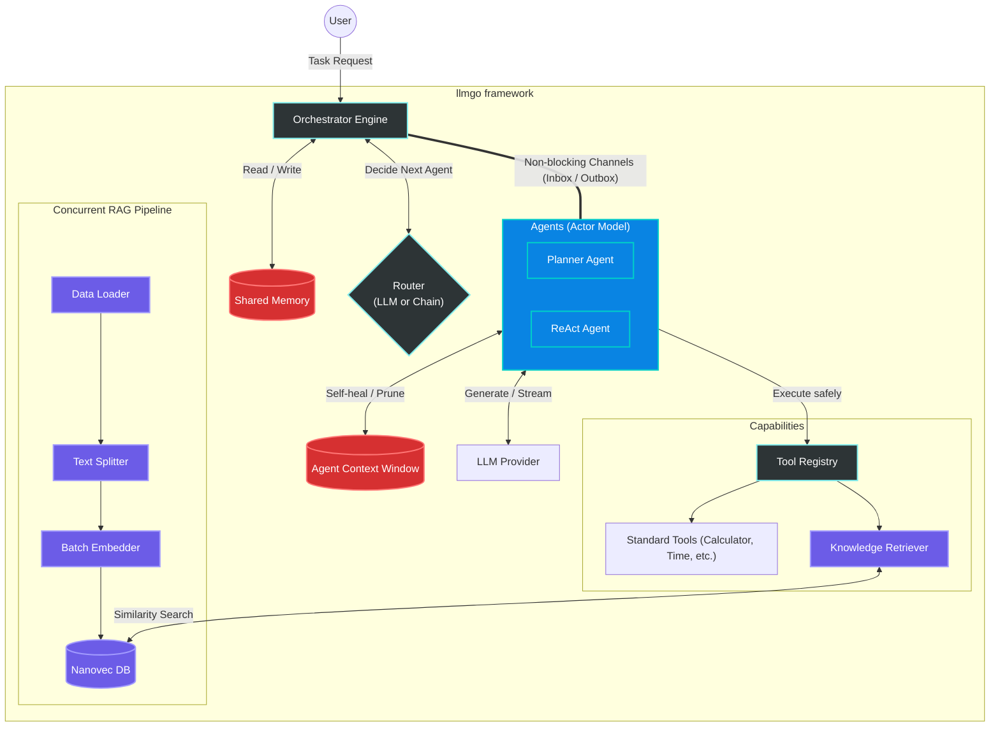

<!-- markdownlint-disable MD033 -->
<!-- markdownlint-disable MD041 -->
<p align="center">
  
</p>

[](https://deepwiki.com/hungpdn/llmgo)
[](https://pkg.go.dev/github.com/hungpdn/llmgo)

[](https://goreportcard.com/report/github.com/hungpdn/llmgo)
[](https://github.com/hungpdn/llmgo/actions/workflows/ci.yml)

[](https://opensource.org/licenses/MIT)

**llmgo** is a high-performance, modular framework designed to bring the most powerful concepts of the Python AI ecosystem (like LangChain, AutoGen, CrewAI, ...) into the robust, concurrent, and statically typed world of Go.

## Key Features

- **Built-in Agents:** `ReActAgent` (Reason + Act loop) and `PlannerAgent` (Plan-and-Execute).
- **Multi-Agent Orchestrator:** `LLMRouter` and `ChainRouter` to coordinate dynamically between specialized agents.
- **High-Performance RAG:** Zero-copy string chunking, recursive text splitting, and native integration with `nanovec` (embedded vector DB).
- **Zero-GC Buffer Pool:** Intelligent `internal/pool` to marshal/unmarshal massive API payloads without triggering Garbage Collection spikes.
- **Bulletproof Resilience:** Built-in Exponential Backoff Retries (`pkg/x/retry`), panic recovery across all tool executions, and graceful teardown via `context.Context`.

## Prerequisites & Environment Setup

Before building applications with `llmgo`, ensure your development environment meets the following requirements.

### 1. System Requirements

- **Go 1.22+**: `llmgo` heavily leverages Go Generics (for Type Safety and Tool parsing) and the latest concurrency idioms.
- **Make** (Optional): For running tests, linters, and build scripts via the provided `Makefile`.

### 2. LLM Providers

`llmgo` supports both local and cloud-based Large Language Models. Depending on your use case, you need to configure the following:

**For Local Models (Recommended for Development & Privacy):**

- Install [Ollama](https://ollama.com/).
- Pull your preferred models (e.g., `qwen2.5:7b-instruct` for reasoning and `nomic-embed-text` for RAG/Embeddings):

  ```bash
  ollama run qwen2.5:7b-instruct
  ollama pull nomic-embed-text
  ```

- Ensure the Ollama server is running (default: `http://localhost:11434`).

**For Cloud Models:**

- **[Comming soon]** Obtain API keys for your target providers (e.g., OpenAI, Anthropic, Google Gemini).

## Installation

**For Users (Importing as a library):**

```bash
go get github.com/hungpdn/llmgo
```

**For Contributors (Developing the framework):**

```bash
git clone https://github.com/hungpdn/llmgo.git
cd llmgo
make setup # Automatically installs dependencies and pre-commit hooks
```

## Quick Start & Examples

A simple agent that can think and use tools (e.g., Calculator, Time).

```go
package main

import (
    "context"
    "fmt"

    "github.com/hungpdn/llmgo/pkg/agent"
    "github.com/hungpdn/llmgo/pkg/core"
    "github.com/hungpdn/llmgo/pkg/llm/ollama"
    "github.com/hungpdn/llmgo/pkg/memory"
    "github.com/hungpdn/llmgo/pkg/tools"
    "github.com/hungpdn/llmgo/pkg/tools/std"
)

func main() {
    // 1. Setup Provider
    provider := ollama.NewClient("http://localhost:11434", "qwen2.5:7b-instruct")

    // 2. Setup Tools
    registry := tools.NewRegistry()
    registry.Register(std.NewTimeTool())
    registry.Register(std.NewCalculatorTool())

    // 3. Create Agent
    mem := memory.NewTokenWindowMemory(2048, nil)
    bot := agent.NewReActAgent("Jarvis", "Assistant", "You are a helpful AI.", provider, mem, registry)

    ctx := context.Background()
    go bot.Run(ctx) // Run in background

    // 4. Send Message & Wait for Output
    bot.Send(ctx, core.Message{Role: core.RoleUser, Content: "What is 1234 * 5678?"})
    reply := <-bot.Outbox()

    fmt.Printf("[%s]: %s\n", reply.Name, reply.Content)
}
```

We provide several production-ready examples in the [`cmd/examples`](cmd/examples) directory to help you get started quickly.

### 1. Simple Chat (Single Agent)

A basic example of setting up a `ReActAgent` to communicate with a local Ollama model.

- **[View Example: cmd/examples/simple_chat](cmd/examples/simple_chat)**

### 2. HTTP Server with Graceful Shutdown

Learn how to wrap `llmgo` inside a standard Go HTTP Server. This example demonstrates context propagation, timeout handling, and graceful shutdown—critical for production deployments.

- **[View Example: cmd/examples/httpserver](cmd/examples/httpserver)**
- **[View Graceful Shutdown Specifics: cmd/examples/graceful_shutdown](cmd/examples/graceful_shutdown)**

### 3. Tool Calling & RAG (Retrieval-Augmented Generation)

See how to equip your agent with custom tools (like a Calculator) and build a highly concurrent document ingestion pipeline for RAG.

- **[View RAG Example: cmd/examples/rag](cmd/examples/rag)**
- **[View Data Ingestion Example: cmd/examples/data_ingestion](cmd/examples/data_ingestion)**

### 4. Streaming Responses

LLMs can be slow. Learn how to consume `StreamEvent` to stream responses chunk-by-chunk to your frontend (useful for SSE or WebSockets).

- **[View Stream Example: cmd/examples/stream](cmd/examples/stream)**

### 5. Multi-Agent Orchestration (Full System)

The ultimate example. Watch how multiple agents (Planner, Coder, Reviewer) collaborate using the Actor Model and `ChainRouter` to solve complex problems autonomously.

- **[View Full System Example: cmd/examples/full_system](cmd/examples/full_system)**

## Testing & Coverage

`llmgo` is built for production. It maintains a strictly high test coverage (**> 80%**) across all its business logic, ensuring Goroutine leak prevention, Context cancellation, and panic recovery.

```bash
make test-coverage
```

## Architecture

`llmgo` leverages the **Actor Model** and Go's concurrency primitives (Goroutines & Channels) to ensure lock-free, high-performance interactions between agents and tools.



## Project Structure

- `cmd/exmamples`: Example applications demonstrating various features of `llmgo`.
- `internal/pool`: High-performance, zero-allocation memory pools.
- `pkg/agent`: Core Agent implementations (`BaseAgent`, `ReActAgent`, `PlannerAgent`).
- `pkg/orchestrator`: Multi-Agent coordination (`Engine`, `Router`).
- `pkg/core`: Core primitives (`Message`, `ToolCall`, `Options`).
- `pkg/tools`: Tool registry and Reflection-based JSON Schema generator.
- `pkg/memory`: Context management (`BufferMemory`, `RedisMemory`, Tokenizers).
- `pkg/rag`: Data ingestion, splitting, and retrieval.
- `pkg/llm`: Provider integrations (Ollama, etc.).

## Roadmap & Milestones

`llmgo` is actively under development. Our goal is to become the standard LLM Orchestration framework for the Go ecosystem.

### Milestone 1: Core Foundation (v0.0.1) - *Current*

- [x] Type-Safe Tool Calling (Generics + Struct Tags).
- [x] Core Actor Model (`BaseAgent`, `ReActAgent`).
- [x] Basic Memory Interfaces (`BufferMemory`, `RedisMemory`).
- [x] Standard LLM Providers (Ollama).
- [x] Concurrent RAG Pipeline (`IngestionPipeline`, Semaphore limits).
- [x] Implement `LLMRouter` and `ChainRouter` for orchestration.

### Milestone 2: Advanced Orchestration (v0.0.2)

- [ ] **Planner Agent:** Implement `PlannerAgent` (Plan-and-Execute)
- [ ] **Multi-Agent Routing:** Implement `SemanticRouter` to dynamically route tasks based on intent.
- [ ] **Human-in-the-Loop (HitL):** Add `HumanRouter` to pause execution, request user approval/input, and resume.
- [ ] **Streaming Support:** Full support for `StreamEvent` across Agents and Orchestrators to enable real-time UI updates (e.g., SSE, WebSockets).
- [ ] **Reflexion Agent:** Implement `ReflexionAgent` to self-critique and correct its own outputs before final delivery.
- [ ] **More Memory:**: Add `SemanticMemory` with native Vector DB support and `FileMemory` for local file-based history storage.

### Milestone 3: Ecosystem & Integrations (v0.0.3)

- [ ] **Observability:** Integrate OpenTelemetry (OTel) for distributed tracing of Agent chains and LLM latency.
- [ ] **Vector Databases:** Native integrations with Qdrant, Milvus, and pgvector.
- [ ] **More Providers:** Add native support for OpenAI, Anthropic and Google Gemini.
- [ ] **Tool Library:** Expand `pkg/tools/std` with built-in tools for Web Scraping, SQL querying, and File System operations.

### Milestone 4: Production Ready (v0.0.x)

- [ ] Comprehensive E2E Testing and Benchmarking.
- [ ] Stable API guarantee.
- [ ] Extensive documentation and examples repository.

We welcome contributions! If you're interested in tackling any of these roadmap items, please check out our [Contributing Guidelines](CONTRIBUTING.md).

## License

This project is licensed under the MIT License - see the LICENSE file for details.
