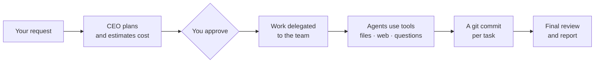

<div align="center">


# Deskforce

**A virtual office of AI agents.** Hire a team, give the CEO a goal, and watch it get planned, delegated and built — with OpenAI, Claude, Gemini, Grok or a local model.

[](https://github.com/husseinzayat3/Deskforce/actions/workflows/ci.yml)
[](https://github.com/husseinzayat3/Deskforce/releases/latest)
[](https://github.com/husseinzayat3/Deskforce/releases)
[](LICENSE)
[](https://github.com/husseinzayat3/Deskforce)


<sub>A real run: four employees on gpt-4o built this bakery landing page in about a minute, for $0.11. More in [examples/](examples/).</sub>

</div>

## Get it

[](https://github.com/husseinzayat3/Deskforce/releases/latest)
[](https://github.com/husseinzayat3/Deskforce/releases/latest)
[](docs/getting-started.md#desktop-app)

Installers for macOS (Apple Silicon and Intel), Windows and Linux (AppImage and .deb) are on the [Releases page](https://github.com/husseinzayat3/Deskforce/releases/latest); add your API keys in the app's settings. The Mac app is signed and notarised by Apple; the Windows installer is not signed yet, so [allow it the first time](docs/getting-started.md#desktop-app).

**Docker** (Intel and ARM):

```bash
docker run -p 127.0.0.1:3000:3000 -v $(pwd)/workspace:/app/workspace --env-file .env.local ghcr.io/husseinzayat3/deskforce
```

**From the source** (Node.js 22+):

```bash
git clone https://github.com/husseinzayat3/Deskforce.git && cd Deskforce
npm install && cp .env.example .env.local   # add a key, or use Ollama for free
npm run dev                                  # open http://localhost:3000
```

No key yet? Providers without one answer with mock text, so you can explore the interface first. Full setup: [Getting started](https://husseinzayat3.github.io/Deskforce/getting-started).

## Why Deskforce

- 👀 **Watch your team work** — every employee is an avatar on a floorplan; speech bubbles show what each model is writing as it writes it.
- 🧠 **A model per employee** — a strong model for the CEO and reviewers, a cheap one for juniors, from any provider.
- ✅ **Approve before anything is spent** — the CEO proposes a plan with a cost estimate; nothing is built until you approve it.
- ↩️ **Undo anything** — every task is a git commit in the employee's name: see what it changed and revert it with one click.
- 💰 **Costs under control** — a budget per task, a monthly cap, spending per employee and model, and side-by-side model comparisons.
- 💬 **Works from Slack** — ask for work, check progress and approve plans from a Slack message.
- 🔒 **Runs on your computer** — files stay on your machine, and with Ollama nothing leaves it at all.

[All features →](docs/features.md) · [Examples with real costs →](examples/)

## Screenshots

<table>
  <tr>
    <td><br><sub><b>Plan first</b> — approve, edit or ask for another plan</sub></td>
    <td><br><sub><b>The team at work</b> — live output on the floorplan</sub></td>
  </tr>
  <tr>
    <td><br><sub><b>Files, history and preview</b> — the result, inside the app</sub></td>
    <td><br><sub><b>Costs</b> — per day, employee and model, with a monthly cap</sub></td>
  </tr>
</table>

## How it works

You give a request to your most senior employee. It plans the work, and once you approve, delegates parts to more junior colleagues, who can only hand work further down. Each agent works by calling tools — reading and writing project files, searching the web, asking its manager or you — and every finished task is committed to the project's git history. When all the work is in, the owner reviews the whole project, fixes gaps and writes you a report.



More: [How it works](docs/how-it-works.md) · [Slack](docs/slack.md) · [Checks](docs/checks.md) · [Desktop app](docs/desktop-app.md)

## How it compares

| | Deskforce | Agent frameworks<br/><sub>CrewAI, LangGraph, Microsoft Agent Framework</sub> | Multi-agent platforms<br/><sub>ChatDev 2.0, MetaGPT / MGX</sub> |
| --- | --- | --- | --- |
| What it is | A desktop app (macOS, Windows, Linux) or a Docker image | Libraries for building agents into your own code, with visual builders (CrewAI Studio, LangGraph Studio) | ChatDev: a self-hosted, zero-code workflow builder · MetaGPT: a Python library, with MGX as a hosted service |
| Getting started | Download, add a key | Write or design the agents, then run and host them | Run a Python backend and a web frontend (ChatDev) or sign up (MGX) |
| Seeing the work | An office floorplan with live output, a task tree and a report per request | Traces, logs and execution timelines | A workflow canvas and run logs (ChatDev) |
| Control built in | A plan with a cost estimate to approve, budgets per task, a monthly cap | Human-in-the-loop steps and checkpoints you add to your code | Human steps you add to a workflow (ChatDev) |
| Undo | Every task is a git commit of the files it changed: undo with one click | Rewind the agent's state to a checkpoint (LangGraph); files and other effects are up to you | Depends on the workflow |

Frameworks are the right choice when you are building agents into your own product, and ChatDev when you want to design your own workflows. Deskforce is for getting work done with a team of agents today, on your own machine, and seeing what they do.

<sub>Compared in October 2026. These projects move fast: if something here is out of date, please [open an issue](https://github.com/husseinzayat3/Deskforce/issues/new/choose).</sub>

## Documentation

- **Docs:** [husseinzayat3.github.io/Deskforce](https://husseinzayat3.github.io/Deskforce/) — getting started, concepts, providers, costs, Slack, FAQ and troubleshooting (also readable in [docs/](docs/README.md))
- **Contributing:** [CONTRIBUTING.md](CONTRIBUTING.md) — setup, tests, and what a pull request needs · [ARCHITECTURE.md](ARCHITECTURE.md) — how it is built
- **Security:** [the security model](docs/security.md) · report a vulnerability via [SECURITY.md](SECURITY.md)
- **License:** [MIT](LICENSE) © 2026 Hussein Zayat — free to use, change and redistribute, including commercially. The default floorplan and avatars in `public/` were generated with Google Gemini and are distributed under the same terms.

## Work with me

Deskforce is built by **Hussein Zayat**, a backend & AI engineering consultant (.NET, Azure, LLMs) and technical lead. If your team is planning AI features or agents, needs a backend that scales, or wants Deskforce built around its own roles, tools and models, I can help:

- **AI assessment & workshop:** where AI pays off in your work, with a working prototype and a roadmap
- **AI features & agents:** production-ready AI in your product or processes
- **Backend & cloud engineering:** .NET and Azure, modernisation, CI/CD
- **Technical leadership & consultancy:** reviews, part-time tech lead, AI adoption in dev teams
- **Deskforce for your team:** [custom builds](https://husseinzayat3.github.io/Deskforce/custom-builds), integrations, a hosted team edition

[**Book a free 30-minute call**](https://calendly.com/husseinzayat10) · [more about how I work](https://husseinzayat3.github.io/Deskforce/work-with-me) · [husseinzayat.it](https://husseinzayat.it)
