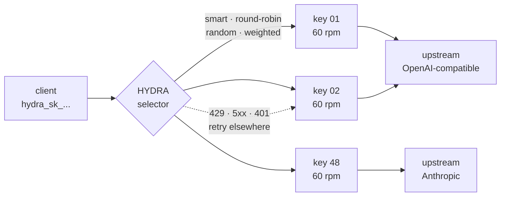

<p align="center">
  
</p>

<p align="center">
  <a href="LICENSE"></a>
  
  
  
  
  <a href="bench/FINAL_REPORT.md"></a>
  <a href="https://github.com/hydradevc/rotation/actions/workflows/ci.yml"></a>
</p>

<h3 align="center">A hundred API keys in. One endpoint out.</h3>

<p align="center">
  Paste a pile of OpenAI-compatible and Anthropic keys into the panel, get a single key that behaves
  like the sum of all of them. Rate limits land on the pool instead of on you.
</p>

<p align="center">
  
</p>

---

## The problem

You have 100 keys. Each one gives you 60 requests per minute and some token budget.
A single key is a bottleneck, and rotating by hand turns into a wall of `429`s.

## The answer

HYDRA keeps every key in a live pool and picks one per request. If a key answers `429`, `5xx`
or dies on auth, the request silently moves to the next key — your client still sees a `200`.
The ceiling becomes the sum of the pool: **100 keys × 60 RPM = 6,000 RPM** on a single key.

| Without HYDRA | With HYDRA |
|---|---|
| 1 key → 60 RPM, hard wall | 100 keys → 6,000 RPM, one key to hand out |
| `429` reaches your app | `429` is absorbed and retried on another key |
| Manual key shuffling in code | Keys are ranked by live load and free window |
| OpenAI and Anthropic = two integrations | One endpoint speaks both shapes |

## Features

| | |
|---|---|
| **Pooled throughput** | Every upstream key contributes its own RPM and TPM. The pool is the limit, not the key. |
| **Four selection policies** | Smart load-aware sampling, round-robin, random, weighted random — switchable without a restart. |
| **Rate-limit absorption** | Per-key 60-second windows for requests *and* tokens, reservations before the call, `Retry-After` / `x-ratelimit-reset-*` aware exponential cooldown. |
| **Queue instead of fail** | When every key is cooling down, a request parks for a configurable window instead of answering `503`. |
| **Circuit breaker** | A key that keeps failing is parked for a long cooldown and auto-probed back. |
| **Both API shapes** | Native OpenAI and Anthropic endpoints. Mixed pools work: ask with `/v1/messages`, get served by an OpenAI key — and the other way round. |
| **Streaming that stays streaming** | Native SSE is piped byte by byte, no buffering, no re-serialisation. Cross-format streams are emitted as proper SSE for the client's format. |
| **Access keys** | Give each app its own key with its own RPM ceiling, daily token budget and model allow-list. Revoke or rotate without touching the pool. |
| **Playground** | Send a prompt through the pool from the panel and see which key answered, how fast and with how many tokens. |
| **Analytics** | P50/P95/P99 latency, error reasons, top models, top clients, traffic by provider. |
| **Prometheus + OpenAPI** | `GET /metrics` and `GET /openapi.json` out of the box, no plugins. |
| **Alerts** | POST a JSON webhook when a key is disabled or the pool runs dry. Works with Discord, Slack, n8n. |
| **Backups** | Export keys, access keys and settings as one JSON file; restore it on another box. |
| **Secrets encrypted at rest** | Upstream and access keys are sealed with AES-256-GCM; `state.json` never holds plaintext. |
| **Hardened admin** | HttpOnly + SameSite=Strict cookies, `Secure` and `__Host-` behind TLS, scrypt password, cross-origin writes rejected. |
| **Zero dependencies** | Pure Node ≥ 20. No build step, no `node_modules`, no container required. |
| **Panel in two languages** | Full English and Russian UI, dark, keyboard-friendly, live metrics once per second. |

## Quick start

```bash
git clone https://github.com/hydradevc/rotation.git
cd rotation
node server.js
```

First start prints the admin password once and creates your first access key:

```
┌─────────────────────────────────────────────┐
│  HYDRA admin password (save it now)         │
│  xxxxxxxxxxxx                               │
└─────────────────────────────────────────────┘
HYDRA 1.2.2 listening on http://0.0.0.0:8080
  admin panel    http://localhost:8080/admin
  openai base    http://localhost:8080/v1
  anthropic base http://localhost:8080
  metrics        http://localhost:8080/metrics
  Default access key created:
  hydra_sk_....
```

Open `http://localhost:8080/admin`, go to **Key pool**, paste your keys, done.
No `npm install` — there is nothing to install.

### Docker

```bash
docker compose up -d
```

Or without compose:

```bash
docker build -t hydra .
docker run -d --name hydra -p 8080:8080 \
  -e HYDRA_ADMIN_PASSWORD=change-me \
  -v hydra-data:/data hydra
```

### systemd

`deploy/hydra.service` is a hardened unit file — drop it into `/etc/systemd/system/`,
point `WorkingDirectory` at the checkout and `HYDRA_DATA` at a writable directory.

> Runs on Android/Termux as well: `pkg install nodejs`, then `node server.js`.

## Connect a client

**OpenAI SDK (Python)**

```python
from openai import OpenAI

client = OpenAI(base_url="http://localhost:8080/v1", api_key="hydra_sk_...")

print(client.chat.completions.create(
    model="gpt-4o-mini",
    messages=[{"role": "user", "content": "hello"}],
).choices[0].message.content)
```

**OpenAI SDK (JavaScript)**

```js
import OpenAI from 'openai';

const client = new OpenAI({ baseURL: 'http://localhost:8080/v1', apiKey: 'hydra_sk_...' });
```

**Anthropic SDK (Python)**

```python
from anthropic import Anthropic

client = Anthropic(base_url="http://localhost:8080", api_key="hydra_sk_...")

print(client.messages.create(
    model="claude-3-5-sonnet",
    max_tokens=128,
    messages=[{"role": "user", "content": "hello"}],
).content[0].text)
```

**curl**

```bash
curl http://localhost:8080/v1/chat/completions \
  -H "Authorization: Bearer hydra_sk_..." \
  -H "Content-Type: application/json" \
  -d '{"model":"gpt-4o-mini","messages":[{"role":"user","content":"hello"}]}'
```

Any OpenAI-compatible client works — OpenWebUI, SillyTavern, Cline, LibreChat, LiteLLM —
just point the base URL at HYDRA.

## The panel

<table>
  <tr>
    <td width="50%"></td>
    <td width="50%"></td>
  </tr>
  <tr>
    <td></td>
    <td></td>
  </tr>
  <tr>
    <td></td>
    <td></td>
  </tr>
</table>

<p align="center">
  
  
</p>


## Benchmarks

HYDRA was measured by **KeyRotatorBench**, an external harness that drives three rotators
through their real control surface against one shared mock upstream — `200/401/403/429/5xx`,
dropped connections, stalls, per-key RPM and recovery. 107 cases per project across 12
categories, weighted into a single score.

<p align="center">
  
</p>

| # | Project | Score | Tier | Pass rate | Security | Rotation |
|---|---|---|---|---|---|---|
| **1** | **HYDRA 1.2.1** | **86.68** | Excellent | 92.7% | **100.0** | 81.8 |
| 2 | Keymesh 1.0.0 | 85.70 | Excellent | 84.6% | 66.7 | 100.0 |
| 3 | API Key Rotator | 67.59 | Good | 66.0% | 45.5 | 100.0 |

<p align="center">
  
</p>

**Where HYDRA leads:** security (100 vs 66.7 / 45.5), failover (100), configuration (100),
observability (100), developer experience (100), API compatibility (85.7), rotation (81.8).

**Where it does not:** raw throughput — 356 rps against Keymesh's 408 at concurrency 100 — and
memory, where V8 heap ramp-up during the soak is counted against the score (28.5). The margin over
second place is 0.98 points, so read the top of this table as a tie broken by security and
operability, not as a blowout.

Method, caveats and the full data: [`bench/`](bench) · [final report](bench/reports/FINAL_REPORT.md) ·
[raw results](bench/RAW_RESULTS.json).

### What the benchmark caught — and what we fixed

The run was done on 1.2.1. Every finding below is fixed in the current tree, with a regression
test behind it.

| Finding | Before | After |
|---|---|---|
| A key label with a non-ASCII character broke `x-hydra-key` on every response (the panel generates such labels itself) | request hangs or 500 | label is percent-encoded into the header and masked labels are ASCII — 6/6 requests answer 200 |
| Client headers were not forwarded upstream | 0 hits | arbitrary headers reach the provider; hop-by-hop and auth headers are stripped |
| Random and smart selection drifted 43% and 47% from an even split | 43.3% / 46.7% deviation | 0% / 20–33% deviation |
| Saturated pool answered `429`, i.e. the rate limit reached the client | 8 of 140 | 0 of 140 — the pool answers `503` with `Retry-After` |

## How a request flows



Per request, in order:

1. Authenticate the access key, check its RPM window, daily token budget and model allow-list.
2. Route the model to a provider (`claude*` → Anthropic, `gpt-*`/`o*` → OpenAI) — configurable by prefix.
3. Pick a key: candidates are filtered by status, cooldown and provider, then scored by
   `(inflight + 1) / weight × (1 + rpm_pressure + tpm_pressure) + failures`.
4. Reserve RPM and estimated tokens on that key, call the upstream.
5. `429`/`5xx`/auth error → cooldown that key with backoff and retry the next candidate. If every key
   is busy, park the request for `queueWaitMs` instead of failing immediately.
6. Stream the body straight back, then settle real token usage into the key's window.

## Importing keys

Paste one key per line. Everything except the key is optional:

```
# label | key | base url | provider
main-1   | sk-proj-...      | https://api.openai.com/v1
main-2   | sk-proj-...
claude-1 | sk-ant-...       | https://api.anthropic.com | anthropic
groq-1   | gsk_...          | https://api.groq.com/openai/v1
```

Flat lists and JSON arrays also work:

```json
[{ "label": "main-1", "key": "sk-...", "provider": "openai", "baseUrl": "https://api.openai.com/v1" }]
```

Defaults per key: 60 RPM, unlimited TPM, weight 1. Edit any key from the panel — weight, limits,
provider, base URL or the secret itself. Bulk actions (enable, disable, delete) work on selection.

## Endpoints

| Method | Path | Description |
|---|---|---|
| `POST` | `/v1/chat/completions` | OpenAI chat completions, streaming included |
| `POST` | `/v1/embeddings` | OpenAI embeddings |
| `POST` | `/v1/messages` | Anthropic messages, streaming included |
| `POST` | `/v1/messages/count_tokens` | Anthropic token counting |
| `GET` | `/v1/models` | Models advertised in settings, or discovered from the pool when that list is empty (OpenAI and Anthropic shapes) |
| `GET` | `/healthz` | Liveness |
| `GET` | `/readyz` | Readiness: pool healthy, state writable |
| `GET` | `/metrics` | Prometheus exposition (protected unless enabled) |
| `GET` | `/openapi.json` | OpenAPI 3.1 spec |
| `GET` | `/admin` | Admin panel |

Auth: `Authorization: Bearer hydra_sk_...` or `x-api-key: hydra_sk_...`.
CORS is off by default and can be enabled from **Settings → Network**.

## Tuning

All of it lives in **Settings** in the panel.

| Setting | Default | What it does |
|---|---|---|
| Selection policy | smart | `smart`, `round-robin`, `random` or `weighted` |
| Attempts per request | 8 | How many different keys one request may try |
| Request deadline | 120,000 ms | Give up and answer after this long |
| Queue wait | 5,000 ms | How long a request parks when every key is cooling |
| Cooldown base | 1,500 ms | First backoff after a `429` |
| Cooldown ceiling | 60,000 ms | Cap for exponential backoff |
| Circuit breaker | 4 failures | Consecutive failures before the long cooldown |
| Circuit cooldown | 120,000 ms | How long a broken key stays parked |
| Sampling window | 5 | Candidates compared per pick |
| Upstream timeout | 180,000 ms | Time allowed for upstream headers |
| Stream idle timeout | 240,000 ms | Abort a stream that stops producing |

## Security

| Control | Behaviour |
|---|---|
| Secrets at rest | Upstream keys and access keys are sealed with AES-256-GCM. The master key lives in `data/master.key` (mode `0600`) or in `HYDRA_MASTER_KEY`. A different master key disables the affected keys instead of leaking garbage upstream. |
| State file | Written atomically with `fsync`, mode `0600`, previous revision kept as `state.json.bak`. |
| Admin password | scrypt hash, never stored or logged in clear. |
| Sessions | 12 h, random 32-byte token, `HttpOnly`, `SameSite=Strict`, `Secure` + `__Host-` prefix when the request arrives over TLS. |
| CSRF | Any state-changing admin call with a foreign `Origin`/`Referer` is rejected. |
| Access key in panel | The list shows a mask; the secret is returned only by an explicit reveal call (audit-logged). |
| Headers | CSP on the panel, `X-Frame-Options: DENY`, `nosniff`, `no-referrer`, COOP/CORP, HSTS when TLS is detected. |
| Query-string auth | `?key=` is not accepted; only `Authorization: Bearer` and `x-api-key`. |
| Brute force | Login attempts are limited per IP. |
| Metrics | `/metrics` requires an admin session or `HYDRA_METRICS_TOKEN`; open it deliberately in Settings → Network. |
| Upstream URLs | Plain `http://` is accepted only for loopback/private hosts, so API keys never travel unencrypted to the internet. |
| Webhooks | Public `https://` only by default, redirects disabled — no SSRF into your internal network. |

## Configuration

| Variable | Default | Purpose |
|---|---|---|
| `PORT` / `HOST` | `8080` / `0.0.0.0` | Listen address |
| `HYDRA_DATA` | `./data` | State directory |
| `HYDRA_ADMIN_PASSWORD` | generated | Password for the first start |
| `HYDRA_MASTER_KEY` | generated file | 32-byte hex/base64 key for secrets at rest |
| `HYDRA_SECURE_COOKIES` | `auto` | `1`/`0` to force the `Secure` cookie flag |
| `HYDRA_TRUST_PROXY` | off | Trust `X-Forwarded-For` / `X-Forwarded-Proto` |
| `HYDRA_ACCESS_LOG` | off | `json` for structured access logs |
| `HYDRA_METRICS_TOKEN` | none | Bearer token accepted by `/metrics` |
| `HYDRA_REQUEST_TIMEOUT_MS` | `120000` | Drop slow/incomplete requests |
| `HYDRA_ALLOW_INSECURE_UPSTREAM` | off | Let `http://` upstreams leave the local network |
| `HYDRA_ALLOW_PRIVATE_WEBHOOK` | off | Allow webhooks to private addresses |

## Tests

```bash
npm test            # 39 backend + 45 security checks
npm run test:ui     # 32 panel checks, self-hosted server + Chromium
npm run test:security  # encryption, cookies, CSRF, budgets, aborts
npm run bench       # 100 keys, 2,000 requests
```

Backend coverage: bulk import, concurrent fan-out across keys, `429` absorption against a
6×5 RPM ceiling, saturation behaviour, SSE streaming, native Anthropic calls, cross-format routing
both ways, failover from a dead key, token accounting, request log.

Security coverage: no plaintext secrets on disk, `0600` permissions, master-key mismatch handling,
cookie flags over HTTP and behind a TLS proxy, query-string auth rejection, cross-origin admin
writes, model allow-list filtering, daily budget under parallel load, client-disconnect behaviour,
readiness gating.

UI coverage: every view renders without console errors, key editing, bulk actions, probe-all,
playground round trip, settings persistence, CORS headers, backup/restore, CSV export,
Prometheus and OpenAPI endpoints, language switching.

## Project layout

```
server.js            http server, static files, routes
src/store.js         state, persistence, metrics buckets
src/pool.js          rate windows, policies, circuit breaker
src/proxy.js         upstream calls, retries, streaming, playground
src/translate.js     OpenAI ⇄ Anthropic translation
src/metrics.js       counters, percentiles, Prometheus rendering
src/alerts.js        webhook notifications
src/admin.js         sessions, admin API
src/openapi.js       API description
src/crypto.js        master key, AES-256-GCM sealing
public/              panel (vanilla JS, no framework, no build)
deploy/hydra.service systemd unit
bench/               external benchmark results, charts and reports
test/                mock upstream, integration, UI and bench harnesses
```

## Roadmap

- Sticky routing by prompt hash for cache-friendly providers
- Per-model cost weighting in the selector
- Key-level usage charts over time
- Optional Postgres storage for multi-node deployments

## License

MIT — see [LICENSE](LICENSE).

---

<details>
<summary><b>🇷🇺 Русская версия — коротко</b></summary>

<br>

**HYDRA** — самохостящийся ротатор ключей для ИИ-API. Загружаете пачку ключей
OpenAI-совместимых и Anthropic, на выходе один ключ, который ведёт себя как сумма всех.

```bash
git clone https://github.com/hydradevc/rotation.git
cd rotation
node server.js        # зависимостей нет, npm install не нужен
```

Или одной командой в Docker: `docker compose up -d`.

При первом запуске в консоль печатается пароль админки и создаётся первый ключ доступа.
Панель: `http://localhost:8080/admin`. Ключи вставляются пачкой на вкладке **Пул ключей**,
по строке на ключ: `метка | ключ | адрес | провайдер` — обязателен только ключ.

Клиенты подключаются так:

- OpenAI-совместимые: base URL `http://localhost:8080/v1`, ключ `hydra_sk_...`
- Anthropic SDK: base URL `http://localhost:8080`, тот же ключ

Что внутри: секундные окна RPM/TPM на каждый ключ, четыре политики выбора, ожидание
свободного ключа вместо мгновенной ошибки, предохранитель для сломанных ключей,
честный стриминг без буферизации, трансляция форматов в обе стороны, ключи доступа
с лимитами, песочница, аналитика с перцентилями, `GET /metrics` для Prometheus,
`GET /openapi.json`, вебхуки в Discord/Slack, бэкап и восстановление, панель на русском.

Тесты: `npm test` (39 бэкенд + 45 безопасность), `npm run test:ui` (32 проверки), `npm run bench`.

</details>