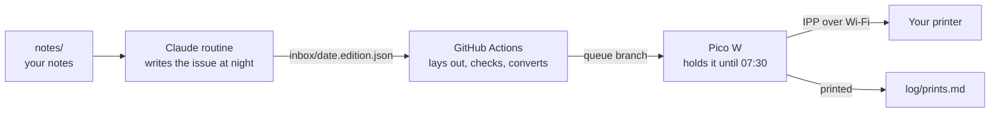

# Coffee Edition

**A two-page newspaper, written overnight from your own notes, waiting on your printer in the morning.**


*Issue 001 and its RADAR page (now Fresh Ink), as the printer left them at 10:00 on 17 October 2026. Nobody pressed print. The story of how it was built: [erolsen.dev/writing/coffee-edition](https://erolsen.dev/writing/coffee-edition).*

You keep notes in a folder. Every night a Claude routine turns the next one into an issue, GitHub Actions lays it out like a newspaper and checks every page, and a Raspberry Pi Pico W on your Wi-Fi prints it at the time you chose. Your computer can stay off.

| Front page | Results page |
|---|---|
|  |  |

*The sample issue, written from the included note on the Raven paper (EverMind AI, arXiv 2609.33439, CC BY 4.0).*

**Fresh Ink, if you follow AI.** With `"radar": true` in `printer.json`, every issue gets one to four more pages at the back, laid out like a newspaper's front page and inside pages: 5 to 17 new AI methods, models and tools from the night before, picked from Hugging Face (daily and trending papers, new models), arXiv's new submissions, GitHub trending and eleven AI lab blogs, with Hacker News and four AI newsletters as signals. Each story says what the method is, how it works and when to use it, gives one number, and many carry a chart redrawn from the source's own table. A QR code under each story opens its paper or code. Every number and every chart value is checked against its source before the push.

| Fresh Ink, front page | An inside page |
|---|---|
|  |  |

*Pages 1 and 2 of the Fresh Ink sample (`edition/fixtures/fresh-ink.edition.json`), from the night of 22 October 2026.*

## How it works



1. **The writer.** A [Claude routine](docs/routine.md) runs a few hours before the print time. It picks the next unprinted note, reads it, writes the issue as a small JSON file following [edition/STYLE.md](edition/STYLE.md), builds it once to be sure it fits, and pushes it.
2. **The press.** GitHub Actions lays the issue out in headless Chrome with fonts that ship in the repository, paginates it into three columns, and checks the result: every line inside its column, at most four pages, and the printed PDF holding every character the layout had. It then converts the PDF into what your printer takes (PDF, PWG raster or JPEG) and puts it on the `queue` branch.
3. **The courier.** A [Pico W](docs/pico.md) polls the queue every five minutes. It holds each issue until its print time, finds the printer on your network and streams the job to it, then reports back so the print log says "printed".

Nothing on the internet reaches into your home network: the Pico only makes outgoing requests, like a phone. Details: [docs/architecture.md](docs/architecture.md).

## What you need

- **A Raspberry Pi Pico 2 W or Pico W** (tested on a Pico 2 W with MicroPython 1.28), a USB data cable and a phone charger.
- **A network printer** on the same 2.4 GHz Wi-Fi that accepts PDF, PWG raster or JPEG over IPP. Most AirPrint printers do; [docs/printers.md](docs/printers.md) shows how to check. A4 paper.
- **A GitHub account**, for your private copy of this repository and its Actions.
- **A Claude plan with Claude Code routines**: Pro, Max, Team or Enterprise.
- **On your computer**, for the setup: Python 3.9+, Node 22+, Chrome or Chromium, poppler (`pdftoppm`, `pdfinfo`, `pdftotext`) and `mpremote`.

## Set it up

The quickest way: make your copy (step 1), open it in Claude Code and paste [SETUP_PROMPT.md](SETUP_PROMPT.md). Claude walks you through the rest and stops before anything you should do yourself.

By hand:

1. **Make your copy.** Click **Use this template** → **Create a new repository**, and choose **Private**: your notes and your print log live there. Clone it.
2. **Check the tools.** `node edition/test.mjs` and `python3 scripts/test_nightly.py` should end with all cases passing.
3. **Your time.** In `printer.json`, set `timezone` (like `Europe/London`) and `edition_print_time` (like `07:30`), and `"nightly": "dry-run"`.
4. **Your printer.** Find its address and run `python3 tools/printer_info.py <address>`. Put the suggested `formats` and `pwg_dpi` in `printer.json` ([docs/printers.md](docs/printers.md)). Commit and push.
5. **The Pico's settings.** In `pico/config.py`, set `GITHUB_REPO`, `WIFI_COUNTRY` and `PRINTER_MATCH`. Copy `.env.example` to `.env` and fill in your Wi-Fi and a fine-grained GitHub token for this repository only (Contents read-only, Actions read and write). [docs/pico.md](docs/pico.md#4-the-github-token) shows each click.
6. **MicroPython.** Flash MicroPython onto the Pico and install `mpremote` ([docs/pico.md](docs/pico.md#1-put-micropython-on-the-board)).
7. **Self-test.** Run `python3 tools/test_lab.py` on your computer, copy `.env`, `pico/coffee_edition.py` and `pico/config.py` to the board and run `mpremote run pico/selftest.py`. Eight OKs.
8. **Install.** `mpremote cp pico/main.py :`, `mpremote reset`, and move the Pico to a charger near the printer.
9. **First print.** Copy `examples/test-page.html` into `inbox/`, commit and push. It prints within a few minutes.
10. **The nightly writer.** Create the routine at [claude.ai/code/routines](https://claude.ai/code/routines) with the prompt in [routine/nightly-prompt.md](routine/nightly-prompt.md), your repository, the Default environment, a daily time about three hours before the print time, and no connectors. Click **Run now** and look at the draft on the `archive` branch. When you like it, set `"nightly": "live"`.

## Writing notes

Every Markdown file in [notes/](notes/README.md) is a note, and every note becomes one issue, once. They print in order of their file names (`order:` and `print_on:` in the frontmatter change that). Put pictures next to a note and the issue can show them. The two example notes print first: a welcome issue, then the Raven paper.

The writer does not browse the web. The issue is only as good as the note: put in the idea, how it works, the numbers that matter and where they come from.

## Every day

- **In the morning:** take the paper off the printer.
- **When you like:** add notes. When the folder runs dry, nothing prints and the routine says so.
- **To look back:** `log/prints.md` lists what was queued, printed, drafted, refused or skipped, and the `archive` branch keeps every PDF.
- **To pause:** `"nightly": "off"` in `printer.json`, or switch the routine off.
- **To change the voice:** edit [edition/STYLE.md](edition/STYLE.md); section 0 describes you, the reader.
- **Fresh Ink:** `"radar": true` in `printer.json` adds the pages of new AI methods at the back. The `radar` workflow collects the candidates at 01:30 UTC; move its cron so it runs an hour or more before your routine ([docs/routine.md](docs/routine.md)).
- **Another language:** translate [edition/labels.json](edition/labels.json) (the words printed around the article) and tell the writer in STYLE.md which language to write in. `edition/fixtures/labels-tr.json` is a Turkish example.

## What it costs

- **Claude:** the routine runs on your plan's usage, one session a night.
- **GitHub Actions:** a few minutes a day on a private repository, well inside the Free plan's monthly minutes at the time of writing.
- **Hardware:** a Pico 2 W costs a few dollars, plus paper and toner.

## Safety

- Your copy is private, and the template's own copy never runs the printing workflows.
- The Pico's token can read one repository and start its workflows, nothing else. It lives in `.env` on the board and on your computer, never in git.
- Only `scripts/commit_issue.sh` commits on the routine's behalf, and it refuses anything that looks like a key or a token.
- A paper never prints twice, never before its time, never when the Pico does not know the time, and never more than an hour late.

## Known limits

- A4 only for now; Letter is on the roadmap.
- Printers that take only Apple raster (URF) are not supported yet.
- The Pico encrypts its connection to GitHub but does not verify GitHub's certificate yet.
- If the Pico ever hangs (very rare), unplug it and plug it back in; it prints anything due straight away.
- Routines are a research preview feature of Claude Code; their details may change.

## Repository map

```
notes/              your notes (one note, one issue)
edition/            the newspaper: template, build, checks, labels, style guide, fixtures
scripts/            pick, verify, commit, prepare, PWG raster, print log, Fresh Ink (radar.py), tests
pico/               the MicroPython firmware and its tests
tools/              a fake printer and GitHub for the self-test, printer_info.py
routine/            the routine's prompt
docs/               the Pico, the routine, printers, architecture
sources/radar/      the night's Fresh Ink candidates, texts and tables (written by the radar workflow)
.github/workflows/  prepare (build the queue), print-log (the Pico's report), radar (Fresh Ink candidates), test
```

## License

MIT, see [LICENSE](LICENSE). The fonts (SIL Open Font License), mermaid (MIT) and the Raven example (CC BY 4.0) keep their own licenses: [THIRD_PARTY_NOTICES.md](THIRD_PARTY_NOTICES.md).

Made by Erol Sen.
