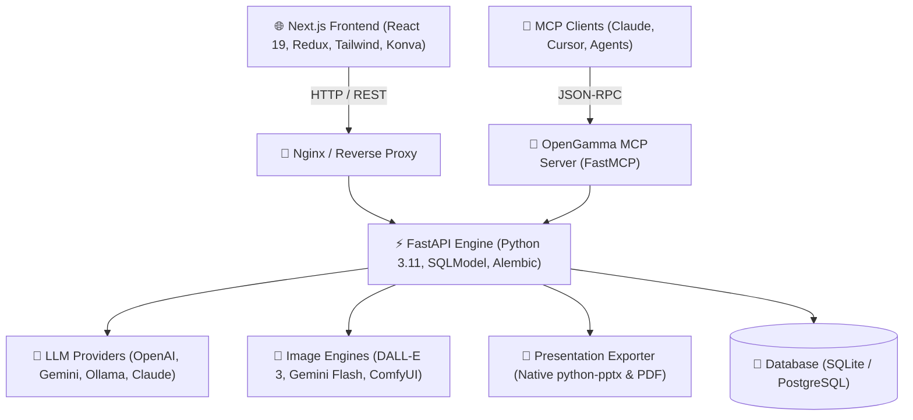

<p align="center">
  
</p>

<p align="center">
  <strong>🚀 Next-Generation Open-Source AI Presentation Generator & Slide Engine</strong>
</p>

<p align="center">
  <a href="#-quick-start"><strong>⚡ Quickstart</strong></a> &middot;
  <a href="#-features"><strong>✨ Features</strong></a> &middot;
  <a href="#-saas-alternatives--pricing-comparison"><strong>💰 Pricing Comparison</strong></a> &middot;
  <a href="#-architecture"><strong>🏗️ Architecture</strong></a> &middot;
  <a href="#-model-providers"><strong>🤖 Supported Models</strong></a> &middot;
  <a href="#-api--developer-guide"><strong>🛠️ Developer API</strong></a>
</p>

<p align="center">
  <a href="https://github.com/ishandutta2007/Awesome-Awesome-Awesome"></a>
  <a href="https://discord.gg/jc4xtF58Ve"></a>
  <a href="LICENSE"></a>
  <a href="https://github.com/ishandutta2007/open-gamma"></a>
  <a href="https://github.com/ishandutta2007/open-gamma"></a>
  <a href="https://github.com/ishandutta2007"></a>
</p>

---

# 🌟 OpenGamma: Open-Source AI Presentation Generator & Automation Suite

**OpenGamma** is a high-performance, fully open-source AI presentation workspace and slide generator. It provides a sovereign, privacy-first alternative to proprietary slide platforms like **Gamma App**, **Canva Slides**, **Beautiful.ai**, **Decktopus**, and **Tome**.

With **OpenGamma**, you can generate complete slide decks from natural language prompts, raw markdown, research documents, spreadsheets, or existing PowerPoint (`.pptx`) templates. Every presentation is exportable to clean, fully editable PowerPoint (`.pptx`) and PDF files with absolute pixel accuracy.

<p align="center">
  
</p>

---

## 🎯 Why OpenGamma?

- 🔒 **100% Privacy & Local-First**: Run local LLMs with [Ollama](https://ollama.ai) or [LM Studio](https://lmstudio.ai). Your sensitive decks and business intelligence never leave your network.
- 🔑 **Bring Your Own Key (BYOK)**: Connect your API keys for OpenAI (GPT-4.1 / GPT-5), Google Gemini, Anthropic Claude, Azure OpenAI, Amazon Bedrock, OpenRouter, Together AI, or Fireworks.
- 🎨 **Visual Template Engine V2**: JSON-driven slide layouts that allow custom designs with HTML and Tailwind CSS alongside native Konva canvas rendering.
- 📊 **Rich Multi-Element Canvas**: Real-time editable slide elements including data charts, interactive infographics, tables, code blocks, KaTeX math formulas, icons, and diagrams.
- 🔄 **Editable PPTX Export**: Unlike tools that export static images into PowerPoint slides, OpenGamma outputs native, fully editable PowerPoint shapes, text frames, and layout geometries.
- 🔌 **Native Model Context Protocol (MCP)**: Built-in MCP server support for autonomous generation directly inside Claude Desktop, Cursor, or OpenWebUI.

---

## 💰 SaaS Alternatives & Pricing Comparison

When evaluating AI presentation generators, commercial SaaS tools typically impose strict credit limits, expensive tiered subscriptions, and cloud data retention policies. Here is how **OpenGamma** compares against proprietary market alternatives:

| Product | Pricing / Plans | Free Tier Limits | Self-Hosted / Local | Native PPTX Export |
| :--- | :--- | :--- | :---: | :---: |
| **OpenGamma** | **Free & Open Source** (Apache 2.0) | **Unlimited** (Unlimited generation using local models or your own API keys) | ✅ Yes | ✅ Fully Editable |
| **Gamma App** | • Plus: **$10/mo**<br>• Pro: **$20/mo** | 400 one-time credits (~8 presentations), Gamma badge, limited export | ❌ No | ⚠️ Static shapes |
| **Beautiful.ai** | • Pro: **$12/mo** (billed annually at $144)<br>• Team: **$40/user/mo** | 14-day free trial only, no permanent free tier | ❌ No | ⚠️ Partial formatting |
| **Decktopus** | • Business: **$36/mo**<br>• Enterprise: Custom quote | 100 AI credits one-time, watermark on slides, export limitations | ❌ No | ⚠️ Basic export |
| **Tome** | • Professional: **$16/user/mo**<br>• Enterprise: Custom quote | 500 AI credits total, limited export, watermark | ❌ No | ❌ PDF only |
| **Canva (Magic Design)** | • Canva Pro: **$15/mo** or $120/year<br>• Canva Teams: **$10/user/mo** | 50 lifetime AI queries, basic template selection | ❌ No | ⚠️ Flattened elements |

---

## ✨ Features

<p align="center">
  
</p>

### 🛠️ Interactive Slide Editor
- **Direct Canvas Editing**: Click, drag, resize, and re-order elements with instant visual feedback.
- **Deep Formatting Controls**: Fine-tune colors, fonts, margins, alignments, backgrounds, and drop-shadows.
- **Dynamic Infographics**: Pre-built components for timelines, funnels, pyramids, milestone roadmaps, maturity matrices, and cyclical processes.

<p align="center">
  
</p>

### 📄 Document-to-Deck Conversion
- Upload `.pdf`, `.docx`, `.txt`, markdown files, or structured spreadsheets.
- OpenGamma extracts outlines, synthesizes executive summaries, and builds structured multi-slide decks automatically.

### 🤖 Built-In ChatGPT Subscription Integration
- Sign in with your ChatGPT account to generate presentations using your existing subscription without managing separate API credit balances.

<p align="center">
  
</p>

---

## 🎨 Built-In Professional Slide Templates

OpenGamma comes packed with clean, responsive slide layouts ready out-of-the-box:

<table border="1" cellpadding="14" cellspacing="0" width="100%">
<tr>
<td align="center" width="33%">
  
  <br />
  <strong>Momentum</strong>
  <br />
  <sub>High-impact corporate decks, KPI breakdowns, executive reports</sub>
</td>
<td align="center" width="33%">
  
  <br />
  <strong>Dynamic</strong>
  <br />
  <sub>High-contrast creative storytelling, product launch presentations</sub>
</td>
<td align="center" width="33%">
  
  <br />
  <strong>Executive</strong>
  <br />
  <sub>Board presentations, strategic roadmaps, investor decks</sub>
</td>
</tr>
<tr>
<td align="center" width="33%">
  
  <br />
  <strong>General</strong>
  <br />
  <sub>All-purpose flexible layouts for webinars, team updates, and education</sub>
</td>
<td align="center" width="33%">
  
  <br />
  <strong>Modern</strong>
  <br />
  <sub>Sleek startup pitch decks, product portfolios, venture showcases</sub>
</td>
<td align="center" width="33%">
  
  <br />
  <strong>Standard</strong>
  <br />
  <sub>Clean corporate proposals, formal research papers, sales decks</sub>
</td>
</tr>
</table>

---

## 🏗️ Architecture

OpenGamma is organized as a decoupled, modular monorepo engineered for speed, testability, and enterprise-grade resilience:



### Key Modules:
- **`servers/nextjs/`**: Next.js 16 / React 19 interactive slide studio with real-time Konva canvas rendering, Redux state management, and Tailwind CSS runtime.
- **`servers/fastapi/`**: High-throughput FastAPI backend handling outline synthesis, prompt orchestration, schema validation, database migrations, and export workers.
- **`assets/`**: Repository assets, UI illustrations, documentation graphics, and template previews.
- **`templates/`**: Versioned, layout-driven JSON presentation templates.

---

## ⚡ Quick Start

### 1. Run with Docker (Recommended)

The easiest way to get up and running with **OpenGamma** is using Docker Compose:

```bash
# Clone the repository
git clone https://github.com/open-gamma/open-gamma.git
cd open-gamma

# Launch OpenGamma services
docker compose up -d
```

Open your browser and navigate to **`http://localhost:3000`**.

---

### 2. Manual Development Setup

#### Prerequisites
- **Node.js**: `v20.x` or higher
- **Python**: `3.11`
- **uv** or **pip**

#### Step 1: Install Root & Frontend Dependencies
```bash
npm install
cd servers/nextjs
npm install
npm run dev
```

#### Step 2: Set Up FastAPI Engine
In a separate terminal:
```bash
cd servers/fastapi

# Create virtual environment & install packages
python -m venv .venv
source .venv/bin/activate  # On Windows: .venv\Scripts\activate
pip install -e .

# Run the backend server
python server.py --port 8000 --reload true
```

---

## 🤖 Model Providers

OpenGamma gives you full flexibility over your choice of text and image generation models:

| Category | Supported Providers |
| :--- | :--- |
| **Local LLMs** | • **Ollama** (Llama 3, Mistral, Qwen, DeepSeek R1)<br>• **LM Studio** (Local OpenAI-compatible endpoints) |
| **Cloud LLMs** | • **OpenAI** (GPT-4.1, GPT-4o, GPT-5 models)<br>• **Google Gemini & Vertex AI** (Gemini 2.5 Flash / Pro)<br>• **Anthropic** (Claude 3.5 Sonnet, Claude 3.7 Sonnet)<br>• **Azure OpenAI** & **AWS Bedrock**<br>• **OpenRouter**, **Together AI**, **Fireworks AI**, **Cerebras** |
| **Image Generation** | • **DALL-E 3** & **GPT Image 1.5**<br>• **Gemini Flash Image**<br>• **ComfyUI** (Self-hosted workflows)<br>• **Open WebUI** & Custom OpenAI-compatible `/v1/images`<br>• **Pexels** & **Pixabay** (Royalty-free photography) |
| **Web Grounding** | • **SearXNG** (Self-hosted search)<br>• **Tavily**, **Exa**, **Brave Search** |

---

## 🔌 Model Context Protocol (MCP) Server

OpenGamma includes a native **FastMCP** server, allowing AI agents to generate and export presentations directly over JSON-RPC.

Run the MCP server:
```bash
cd servers/fastapi
python mcp_server.py --port 8001
```

Configure in Claude Desktop (`claude_desktop_config.json`):
```json
{
  "mcpServers": {
    "opengamma": {
      "command": "python",
      "args": ["servers/fastapi/mcp_server.py", "--port", "8001"]
    }
  }
}
```

---

## 🤝 Contributing

Contributions to OpenGamma are warmly welcomed! Please read our [CONTRIBUTING.md](CONTRIBUTING.md) and [CODE_OF_CONDUCT.md](CODE_OF_CONDUCT.md) before opening pull requests or issues.

1. Fork the Project
2. Create your Feature Branch (`git checkout -b feature/OpenGammaEnhancement`)
3. Commit your Changes
4. Open a Pull Request

---

## 🌟 Star History

[](https://star-history.dera.page/#ishandutta2007/open-gamma&type=date&legend=top-left)

---

## 📜 License

OpenGamma is released under the **Apache 2.0 License**. See [LICENSE](LICENSE) for full details.

## ⭐ Star History

<a href="https://star-history.com/#ishandutta2007/open-gamma&Timeline" align="center">
  <picture>
    <source media="(prefers-color-scheme: dark)" srcset="assets/ishandutta2007_open-gamma_growth.svg">
    
  </picture>
</a>
