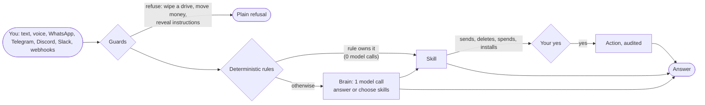

<p align="center">
  
  
</p>

<h3 align="center">A private, local-first personal AI assistant for Windows</h3>

<p align="center">
  Talk or type. ISHTI remembers, reminds, searches, reads your files, runs 120+ skills and plugs into any MCP tool,<br/>
  on a local model or the cloud API you choose. Nothing is sent, deleted or paid without your <b>yes</b>.
</p>

<p align="center">
  <a href="https://github.com/ishtiaq-ahmed-dev/ishti-ai/actions/workflows/ci.yml"></a>
  <a href="https://github.com/ishtiaq-ahmed-dev/ishti-ai/stargazers"></a>
  
  
  
  
  <a href="https://github.com/ishtiaq-ahmed-dev/ishti-ai/issues?q=is%3Aopen+label%3A%22good+first+issue%22"></a>
  <a href="CONTRIBUTING.md"></a>
  <a href="LICENSE"></a>
</p>

<p align="center">
  <a href="#-quick-start">Quick start</a> ·
  <a href="#-features">Features</a> ·
  <a href="#-screenshots">Screenshots</a> ·
  <a href="#-how-it-works">How it works</a> ·
  <a href="#-how-ishti-compares">Compare</a> ·
  <a href="#-contributing">Contribute</a>
</p>

<p align="center">
  
</p>

---

## ✨ Why ISHTI

| 🔒 **Private by default** | ⚡ **Fast and frugal** | 🧩 **Open to the ecosystem** |
|---|---|---|
| Runs on your PC and listens on `127.0.0.1`. Keys live in Windows Credential Manager. Secrets you type are masked in history and never reach a cloud prompt. | Deterministic rules answer what they can with **zero** model calls; everything else takes **at most one**. Typical replies take about 0.3 s, plus model time. | Any **MCP** server becomes ISHTI tools, ISHTI is an MCP server itself, and **Agent Skills** (`SKILL.md`) install from a folder or a URL. |

## 🚀 Quick start

**You need:** Windows 10 or 11 and Python 3.11. For local models, an NVIDIA GPU (8 GB minimum, 16 GB recommended).
For cloud mode, an API key from any OpenAI-compatible provider.

```bat
git clone https://github.com/ishtiaq-ahmed-dev/ishti-ai.git C:\ISHTI
cd C:\ISHTI
install.bat              :: or: install.bat --provider api   (lightweight, no GPU models)
start.bat
```

On first start ISHTI asks how it should think, **On this PC** (Ollama) or **Cloud API**, and remembers the choice.
Then just ask:

```text
remind me tomorrow at 9 to submit the report
what's the weather in Lahore this weekend?
what is 18% of 45,000?
find my files named invoice
summarize https://www.python.org/downloads/
research the best laptops under 200k in the background  ← the answer arrives in the bell
what did we talk about the client demo last week?
send "running 10 minutes late" to Ahmed on WhatsApp      ← shows the draft and waits for your yes
```

## 🧠 Features

<table>
<tr><td width="50%" valign="top">

**Everyday assistant**
- Reminders, timers, calendar, notes, lists, habits and a spending log
- Weather, prices, news and web search with sources
- Reads PDFs, Word, Excel and slides; charts, OCR, media tools
- English, Urdu and Pashto, typed or Roman script
- Searches your **past conversations**, not just saved facts

</td><td width="50%" valign="top">

**Agent features**
- **MCP client and server**: `add mcp server github npx -y @modelcontextprotocol/server-github`
- **Agent Skills** (`SKILL.md`), read only when a request needs them
- **Background tasks**, **scheduled jobs**, folder and page watches, inbound **webhooks**
- Independent read-only steps of a plan run **in parallel**
- **Docker sandbox** for Python: no network, no access to your files

</td></tr>
<tr><td valign="top">

**Everywhere you chat**
- Desktop app, browser and voice (wake word, on-device Whisper and Kokoro)
- WhatsApp through [WAHA](https://waha.devlike.pro), Telegram, Discord and Slack
- Every remote channel obeys only your account and supports `/kill` and `/lock`

</td><td valign="top">

**Safe by design**
- Sending, deleting, paying and installing always ask first; the yes is single-use
- Wiping a drive or moving money is refused outright
- Web pages, emails and tool output are data: instructions inside them are flagged, never followed
- A kill switch stops all running work at the next step

</td></tr>
</table>

**Your choice of brain:** a local model through [Ollama](https://ollama.com), or OpenAI, Anthropic, Gemini,
OpenRouter, AgentRouter or any OpenAI-compatible URL. If the cloud refuses, **automatic failover** answers with a light
local model, and a circuit breaker stops ISHTI retrying a dead provider on every message.

## 📸 Screenshots

<table>
<tr>
<td></td>
<td></td>
</tr>
<tr>
<td align="center"><b>Overview</b> - the pipeline with live counts</td>
<td align="center"><b>Connectors</b> - every input and channel, read live</td>
</tr>
<tr>
<td></td>
<td></td>
</tr>
<tr>
<td align="center"><b>Skills</b> - 123 skills by category</td>
<td align="center"><b>Learning</b> - what it learned, all reversible</td>
</tr>
</table>

## 🔧 How it works



| Layer | Where | What it guarantees |
|---|---|---|
| Guards | `ishti/dispatcher.py` | Hard boundaries run before any model call; injected "skip confirmation" text is refused |
| Rules | `ishti/tool_routing.py` | A skill whose own trigger owns the request runs directly |
| Brain | `ishti/brain.py` | One model call over a shortlist of skills; multi-step plans become a journaled workflow |
| Execution | `ishti/skill_execution.py` | Tier gates (T0 read-only to T3 blocked), scope checks, single-use approvals, audit log |
| Models | `ishti/llm.py` | One code path for local and cloud: GPU governor, failover, kill switch, output caps |

More detail: [Architecture](docs/ARCHITECTURE.md) · [Safety](docs/SAFETY.md) · [API contract](docs/API_CONTRACT.md) ·
[Skills](docs/SKILLS.md)

## ⚙️ Setup guides

<details>
<summary><b>Model providers</b> (local or cloud)</summary>

| Mode | Runs on | Configure |
|---|---|---|
| Local | Ollama on this PC; the GPU is governed so models never spill to the CPU | `install.bat` downloads the models |
| API | `openai`, `anthropic`, `gemini`, `openrouter`, `agentrouter`, or any OpenAI-compatible `base_url` | First-run card, or `llm.api` in [`ishti/config.json`](ishti/config.json) |

```jsonc
"llm": {
  "provider": "api",
  "api": {
    "provider": "openrouter",             // or openai | anthropic | gemini | agentrouter
    "model": "<model name>",
    "api_key_env": "ISHTI_API_KEY",       // or save the key from the first-run card (Credential Manager)
    "failover_local_model": "gemma3:4b"   // answers while the cloud refuses; "" disables failover
  }
}
```

Failover only uses a model Ollama **already** has; it never downloads or starts anything heavy.
</details>

<details>
<summary><b>WhatsApp</b> (optional, through WAHA)</summary>

ISHTI runs [WAHA](https://waha.devlike.pro) in its **own** Docker container, listening on `127.0.0.1` only, with the
image pinned by digest. Open **Settings → Connectors → WhatsApp → Link** and scan the QR code under *WhatsApp →
Linked devices*. The API key is kept in Credential Manager; the container only gets its SHA-512 hash.

> WhatsApp access is unofficial (WhatsApp Web protocol) and can get a number banned. Use a number you can afford to lose.
</details>

<details>
<summary><b>Gmail, Calendar, Telegram, Discord, Slack</b></summary>

- **Google:** Settings → Connectors, OAuth with PKCE ([guide](docs/OAUTH_SETUP.md)).
- **Telegram:** a bot token and a one-time pairing code.
- **Discord / Slack:** create a bot, then say on the PC `connect discord bot <token> owner <your user id>` (or
  `connect slack bot <xoxb-token> owner <member id>`). ISHTI reads only your DMs with that bot. Slack needs the scopes
  `im:history`, `im:write` and `chat:write`.
</details>

<details>
<summary><b>MCP servers, skills, webhooks, sandbox</b></summary>

```text
add mcp server <name> <command or https address>
set mcp secret <name> <value>        ← use it as keyring:<name> in the server's env
list mcp servers
install skill from <folder or URL>
create a webhook called <name> that <instruction>
run this in the sandbox: ```print(sum(x*x for x in range(100)))```
```

Servers can also go in `ishti/config.json` under `mcp_servers`, in the format Claude Desktop uses. Adding a server, a
skill, a channel or a webhook always asks first.
</details>

## 🆚 How ISHTI compares

ISHTI covers the same core as the popular open-source agents [OpenClaw](https://github.com/openclaw/openclaw) and
[Hermes Agent](https://github.com/NousResearch/hermes-agent): your own hardware, any model, MCP, Agent Skills, chat
channels and scheduled automation. It differs in its defaults:

| | ISHTI |
|---|---|
| **Desktop** | A native Windows app with a wake word, on-device speech both ways, desktop and file control |
| **Cost per message** | Rules answer what they can for free; everything else takes at most one model call |
| **Approvals** | Sending, deleting, paying and installing wait for your yes on every channel, in the background too |
| **Extensions** | MCP servers and skills come from addresses you choose, with no public marketplace to poison; AI-aimed instructions in a skill are refused |
| **Outside content** | Web pages, emails, tool output and webhook bodies are data; instruction-like text is flagged |
| **Secrets** | In Windows Credential Manager, masked in chat history, never put into a cloud prompt |
| **Code execution** | Shell commands that can run code ask first; the Docker sandbox has no network and none of your files |

Their strengths are breadth: OpenClaw lists more than 20 chat platforms and a large community skill hub, and Hermes
Agent runs on Linux, macOS and Android too. ISHTI is single-owner and Windows-first by design.

## 🤝 Contributing

ISHTI is built in the open and **contributions are very welcome**, from typo fixes to new skills.

1. Pick an issue labelled [`good first issue`](https://github.com/ishtiaq-ahmed-dev/ishti-ai/issues?q=is%3Aopen+label%3A%22good+first+issue%22)
   or [`help wanted`](https://github.com/ishtiaq-ahmed-dev/ishti-ai/issues?q=is%3Aopen+label%3A%22help+wanted%22).
2. Read [CONTRIBUTING.md](CONTRIBUTING.md). The offline test suite needs no model, no network and none of your data.
3. Open a pull request. Every contributor is credited below with [All Contributors](https://allcontributors.org).

```bat
python -m venv venv && venv\Scripts\pip install -r requirements.txt
set ISHTI_OFFLINE_EVAL=1
venv\Scripts\python -m pytest              :: offline suite: no model, no network, scratch data
```

### Contributors

<!-- ALL-CONTRIBUTORS-LIST:START - Do not remove or modify this section -->
<table>
  <tr>
    <td align="center" valign="top" width="14%"><a href="https://github.com/ishtiaq-ahmed-dev"><br /><sub><b>Ishtiaq Ahmed</b></sub></a><br />💻 🎨 📖 🤔 🚧 ⚠️</td>
  </tr>
</table>
<!-- ALL-CONTRIBUTORS-LIST:END -->

## 🛡️ Safety, privacy and limits

- **Local by default.** The backend binds to `127.0.0.1`; remote access is opt-in and authenticated.
- **Auditable.** Every action is logged with who started it; `tools/privacy_report.py` lists every host the code can reach.
- **Report vulnerabilities privately:** see [SECURITY.md](SECURITY.md).
- **Limits:** Windows only, tested on one NVIDIA card. Small local models make more mistakes than cloud models
  ([accuracy notes](docs/ACCURACY.md)). Pages that need JavaScript or a login can't be read; there is no browser
  automation, by design. Uploaded files are not encrypted at rest yet.

## 📄 License

[MIT](LICENSE): free to use, change and share, including commercially. Keep the copyright notice. Third-party notices are in
[THIRD_PARTY_NOTICES.md](THIRD_PARTY_NOTICES.md); release history is in [CHANGELOG.md](CHANGELOG.md).

<p align="center">
  Built by <a href="https://github.com/ishtiaq-ahmed-dev"><b>Ishtiaq Ahmed</b></a> ·
  if ISHTI is useful to you, a ⭐ helps other people find it.
</p>
