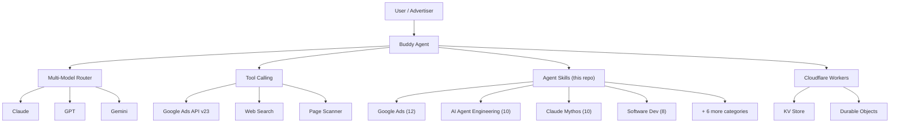

<p align="center">
  
</p>

<p align="center">
  <strong>73 skills for AI-powered Google Ads management, built from 15+ years of hands-on experience.</strong><br>
  Compatible with Claude Code, Cursor, Codex, and Gemini CLI. Follows the <a href="https://github.com/agentskills/agentskills">Agent Skills specification</a>.
</p>

[English](README.md) | [Francais](README.fr.md) | [Espanol](README.es.md) | [中文](README.zh.md) | [Nederlands](README.nl.md) | [Русский](README.ru.md) | [한국어](README.ko.md)

---

## Why This Repo?

These skills encode what we learned running Google Ads for hundreds of accounts across every industry vertical — from $500/month local businesses to $500K/month ecommerce brands. Every pattern, threshold, and best practice comes from real campaign data and real optimization decisions, not generated from documentation.

The skills power [Buddy Agent](https://googleadsagent.ai/tools/auditor/app), the AI advertising agent at [googleadsagent.ai](https://googleadsagent.ai), which manages live Google Ads accounts through the API with a 1,000-pattern knowledge base, multi-model routing (Claude, GPT, Gemini), and persistent entity memory.

---

## What Does a Skill Look Like?

Every skill is a `SKILL.md` file with YAML frontmatter per the [Agent Skills spec](https://github.com/agentskills/agentskills). Here is a real skill from this repo:

```markdown
---
name: keyword-research
description: >-
  Systematic keyword discovery, expansion, and optimization for Google Ads campaigns.
---

# Keyword Research

## Description

Systematic keyword discovery, expansion, and optimization for Google Ads.
Builds keyword universes from seed keywords through semantic expansion,
competitor mining, search term analysis, and intent-based grouping.

## Use When

- User asks for "keyword research" or "keyword ideas"
- User wants to "expand keywords" or "find new keywords"
- User mentions "negative keywords" or "search term mining"
- User asks about "match types" (broad, phrase, exact)
- User wants to "reduce wasted spend" on irrelevant queries

## Implementation

​```javascript
function assignMatchType(keyword) {
  if (keyword.conversionRate > 0.05 && keyword.volume < 1000)
    return 'EXACT';
  if (keyword.intent === 'transactional' && keyword.wordCount >= 3)
    return 'PHRASE';
  return 'PHRASE';
}
​```

## Platform Compatibility

| Platform    | Supported |
|-------------|-----------|
| Cursor      | ✅        |
| Claude Code | ✅        |
| Codex       | ✅        |
| Gemini CLI  | ✅        |

## Related Skills

- [Ad Copy Generation](../google-ads/ad-copy-generation/)
- [Competitor Analysis](../google-ads/competitor-analysis/)
```

Every skill follows this structure:

<p align="center">
  
</p>

Full format specification: [docs/skill-format.md](docs/skill-format.md) | Official spec: [agentskills/agentskills](https://github.com/agentskills/agentskills)

---

## Quick Start

### Claude Code (Plugin Marketplace)

Register this repo as a plugin marketplace, then install any skill set:

```
/plugin marketplace add itallstartedwithaidea/agent-skills
```

Then install by category:

```
/plugin install google-ads-skills@googleadsagent-skills
/plugin install ai-agent-engineering-skills@googleadsagent-skills
/plugin install claude-mythos-skills@googleadsagent-skills
/plugin install software-dev-skills@googleadsagent-skills
/plugin install security-skills@googleadsagent-skills
/plugin install all-skills@googleadsagent-skills
```

### Claude Code (Direct)

Point Claude at any skill directly:

```
/read skills/google-ads/keyword-research/SKILL.md
```

### Cursor

Add the `skills/` directory to your workspace. Cursor loads `SKILL.md` files automatically via YAML frontmatter.

### npx skills (works with Claude Code, Codex, Cursor, Gemini CLI, Windsurf, Amp, Antigravity)

```bash
npx skills add itallstartedwithaidea/agent-skills
```

Installs all 73 skills to `.agents/skills/` in your project. Compatible with 12+ AI coding agents.

### Manual Install

```bash
git clone https://github.com/itallstartedwithaidea/agent-skills.git
cd agent-skills
```

### Validate all skills

```bash
bash scripts/validate-skills.sh
```

### Count skills by category

```bash
bash scripts/count-skills.sh
```

Each `SKILL.md` is self-contained. Point your agent at it, and it has everything it needs.

---

## Skills Catalog

73 skills across 10 categories:

| Category | Skills | What It Covers |
|----------|--------|----------------|
| [Google Ads](skills/google-ads/) | 12 | Audits, keywords, ad copy, bidding, PMax, Shopping, audiences, conversions, budgets, Quality Score, remarketing, competitor analysis |
| [AI Agent Engineering](skills/ai-agent-engineering/) | 10 | Knowledge base injection, entity memory, multi-model routing, proactive intelligence, MCP servers, parallel orchestration |
| [Claude Mythos](skills/claude-mythos/) | 10 | Prompt architecture, context engineering, tool mastery, self-healing agents, verification loops, cognitive scaffolding |
| [Software Development](skills/software-dev/) | 8 | Code review, TDD, systematic debugging, git worktrees, brainstorming, subagent-driven development |
| [Scientific Research](skills/scientific-research/) | 8 | Data analysis, machine learning, bioinformatics, cheminformatics, geospatial analysis, scientific writing |
| [Web Frontend](skills/web-frontend/) | 6 | React best practices, React Native, view transitions, edge deployment, composition patterns, web design |
| [Productivity](skills/productivity/) | 6 | Workflow orchestration, batch processing, RAG knowledge bases, AI chat studio, low-code generation |
| [Infrastructure](skills/infrastructure/) | 6 | Cloudflare Workers, CI/CD pipelines, edge rendering, observability, service discovery, configuration management |
| [Security](skills/security/) | 4 | Agent security scanning, CodeQL/Semgrep, sandbox hardening, secret protection |
| [Media Creative](skills/media-creative/) | 3 | Web asset generation, programmatic video, ML model integration |

---

## SKILL.md Format

Follows the [Agent Skills specification](https://github.com/agentskills/agentskills). Every skill has YAML frontmatter and these required sections:

| Section | Purpose |
|---------|---------|
| YAML frontmatter (`name`, `description`) | Machine-readable metadata for discovery and indexing |
| `# Title` | Human-readable skill name |
| `## Description` | 2-5 sentence explanation |
| `## Use When` | Bullet list of trigger scenarios |
| `## Implementation` | Code snippets, algorithms, procedures |
| `## Platform Compatibility` | Cursor / Claude Code / Codex / Gemini support table |
| `## Related Skills` | Links to complementary skills |

Optional: `## Prerequisites`, `## Configuration`, `## Best Practices`, `## Limitations`, `## Keywords`

Full specification: [docs/skill-format.md](docs/skill-format.md)

---

## Architecture

Buddy Agent loads skills on demand based on user intent matching:



Full architecture documentation: [docs/architecture.md](docs/architecture.md)

---

## Contributing

We welcome contributions. See [CONTRIBUTING.md](CONTRIBUTING.md) for guidelines.

To add a new skill:

1. Create a directory under the appropriate `skills/` category
2. Add a `SKILL.md` with YAML frontmatter (`name`, `description`) and required sections
3. Run `bash scripts/validate-skills.sh` to confirm it passes
4. Submit a pull request

---

## Acknowledgments

We studied these open-source projects while building Agent Skills:

| Repository | What We Studied |
|------------|-----------------|
| [agentskills/agentskills](https://github.com/agentskills/agentskills) | Official Agent Skills specification by Anthropic |
| [anthropics/skills](https://github.com/anthropics/skills) | Reference skill implementations |
| [obra/superpowers](https://github.com/obra/superpowers) | Agent architecture and autonomous workflow patterns |
| [affaan-m/everything-claude-code](https://github.com/affaan-m/everything-claude-code) | Claude Code best practices |
| [vercel-labs/agent-skills](https://github.com/vercel-labs/agent-skills) | Skills format specification |
| [K-Dense-AI/scientific-agent-skills](https://github.com/K-Dense-AI/scientific-agent-skills) | Scientific methodology for skill validation |

---

## License

MIT License. See [LICENSE](LICENSE).

---

Built by [John Williams](https://itallstartedwithaidea.com) — 15+ years in paid media, Lead at [Seer Interactive](https://www.seerinteractive.com) | Powered by [googleadsagent.ai](https://googleadsagent.ai)
