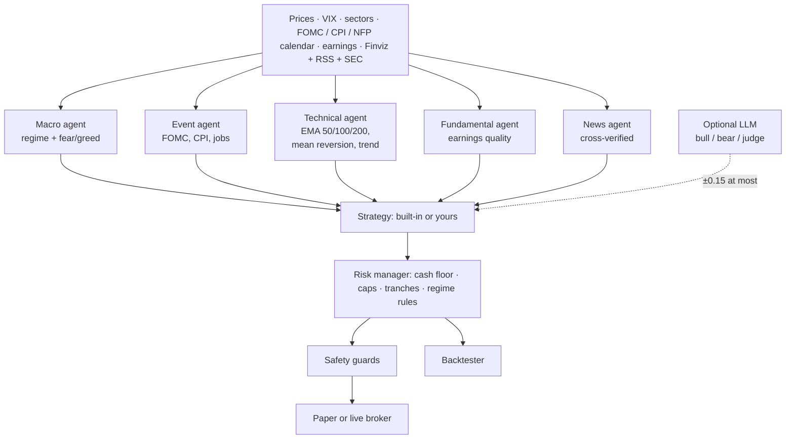

<!-- mcp-name: io.github.jackson-cmd/risk-aware-trading-agents -->

<div align="center">


**AI trading agents for US stocks that check the macro calendar, the fear index and verified news before they buy.**

Market regimes from VIX and the FOMC / CPI calendar · dip buying with an earnings check · a 30% cash floor · cross-verified news · paper-trading agents ranked against SPY · news backtests that cannot see the future · a frozen 2026 dataset for research · LLM agents over MCP · paper and live trading on 10 brokers.

[🌐 Website](https://jackson-cmd.github.io/risk-aware-trading-agents/) · [中文说明 → README_zh.md](README_zh.md) · [🚀 Quick start](#-quick-start) · [🆕 What's new](#-whats-new) · [🔬 Research kit](#-research-kit) · [🔗 MCP](#-mcp-server) · [📸 Screenshots](#-screenshots) · [Changelog](CHANGELOG.md)

[](https://github.com/jackson-cmd/risk-aware-trading-agents/actions/workflows/ci.yml) [](https://pypi.org/project/risk-aware-trading-agents/) [](https://www.python.org/) [](LICENSE) [](#-mcp-server) [](https://github.com/jackson-cmd/risk-aware-trading-agents/pkgs/container/risk-aware-trading-agents) [](https://huggingface.co/datasets/jacksonwangpro1/point-in-time-market-data-2026) [](README_zh.md)


<sub>Screens from the dashboard and from <code>riskaware research run</code> on the bundled 2026 data. A backtest shows what a strategy would have done, not what it will do.</sub>

</div>

## 🚀 Quick start

```bash
pip install "risk-aware-trading-agents[dashboard,mcp]"   # Python 3.10+
riskaware dashboard          # the web UI on http://localhost:8501, English and 中文
```

Then, in another terminal:

```bash
riskaware init                        # 2-minute wizard: language, risk profile, broker, watchlist
riskaware regime                      # market regime, VIX, fear & greed, next FOMC / CPI / jobs report
riskaware scan                        # today's signals, each with its reasons
riskaware analyze NVDA                # what every agent thinks about one stock
riskaware news AAPL                   # cross-verified headlines
riskaware backtest --compare buy_and_hold,ema_bounce
riskaware run                         # one paper-trading cycle (built-in paper account)
riskaware agents init                 # four starter paper-trading agents
riskaware agents run                  # let them trade once now
riskaware agents schedule --install   # ...and every trading day from now on
riskaware research run -s swing_trend # a strategy on the frozen 2026 market, with a look-ahead check
```

No account or API key is needed for any of these. Add `--lang zh` to any command for Chinese output. For the newest code before it is released, use `pip install "risk-aware-trading-agents[dashboard,mcp] @ git+https://github.com/jackson-cmd/risk-aware-trading-agents"`; to change the code, clone the repository and run `pip install -e ".[dashboard,mcp]"`.

**Docker**, for x86-64 and ARM:

```bash
docker run --rm -p 8501:8501 ghcr.io/jackson-cmd/risk-aware-trading-agents dashboard   # http://localhost:8501
docker run -i --rm ghcr.io/jackson-cmd/risk-aware-trading-agents mcp                   # MCP server over stdio
```

For the daily paper-trading scheduler as well, put `riskaware.yaml` (from `riskaware init`) and, if you use broker keys, `.env` in the repository root, then run `docker compose -f docker/docker-compose.yml up -d` (or `make docker`).

**Nothing to install:** [](https://codespaces.new/jackson-cmd/risk-aware-trading-agents) opens the repository in your browser with every extra installed. Run `riskaware dashboard` there and port 8501 opens by itself.

## Is it for you?

- You trade **US stocks over days to weeks** and want rules you can read: buy quality names on pullbacks, keep cash, and never sell in a panic.
- You want **backtests that cannot cheat**: news replayed as it was published, orders at the next open, and a look-ahead check on every research run.
- You **study LLM trading agents** and need data and a setup that others can repeat: a frozen 2026 market, a blind mode, and a saved record of every run.
- You use **Claude, Codex or Gemini** and want them to test a strategy you describe in words, on your own plan, with no API key.
- You want to **paper trade first**: several strategies side by side on simulated money, ranked against SPY every trading day.
- You read **English or Chinese**: the CLI, the dashboard, the reports and the docs come in both.

<sub>If you were looking for an AI trading bot for US stocks, a backtester with historical news and no look-ahead bias, a point-in-time dataset of 2026 prices, VIX and headlines, a benchmark for LLM trading agents, an MCP server for trading research, or paper-trading agents for Alpaca and other brokers: it is all here, open source.</sub>

---

## Contents

- [🚀 Quick start](#-quick-start) · [Is it for you?](#is-it-for-you) · [🆕 What's new](#-whats-new) · [💡 The idea](#-the-idea) · [Four ways to use it](#four-ways-to-use-it)
- [✨ Feature tour](#-feature-tour): [How it works](#-how-it-works) · [Cross-verified news](#-cross-verified-news) · [Paper-trading agents](#-paper-trading-agents) · [MCP server](#-mcp-server) · [Strategy lab](#-strategy-lab) · [Research kit](#-research-kit) · [Backtest](#-backtest) · [Strategy library](#-strategy-library) · [Write your own strategy](#-write-your-own-strategy)
- [📸 Screenshots](#-screenshots) · [🔌 Brokers](#-brokers) · [🔒 Safety](#-safety) · [🔧 Configuration](#-configuration) · [🧰 Under the hood](#-under-the-hood): [CLI](#-cli) · [Project layout](#-project-layout)
- [❓ FAQ](#-faq) · [🧭 Roadmap](#-roadmap) · [🤝 Contributing](#-contributing) · [📝 Citation](#-citation) · [❗ Disclaimer](#-disclaimer) · [📜 License](#-license)

## 🆕 What's new

- **0.7.2** · 🔗 **One step into Claude and other MCP clients**: the server is on the official MCP Registry, `uvx risk-aware-trading-agents mcp` starts it with nothing installed first, and every release carries a Claude Desktop extension (`.mcpb`) that installs when you open it. [How →](#-mcp-server)
- **0.7.1** · 📦 **On PyPI and Docker**: `pip install risk-aware-trading-agents`, or run the dashboard or the MCP server from `ghcr.io/jackson-cmd/risk-aware-trading-agents` without installing Python; GitHub Codespaces opens the repository with everything installed. [How →](#-quick-start)
- **0.7.0** · 🔬 **A frozen 2026 market for research**: point-in-time prices, VIX and news for the whole year ship with the package. Ask what was known at any close, let Claude turn a strategy you describe into code and test it, or let an LLM trade the year step by step. Every run gets a look-ahead check and a record for papers; trend following made **+21.1%** against SPY's +12.1%. [How →](#-research-kit)
- **0.6.3** · ⏳ **Long runs keep going in the background**: scans, backtests, agent runs and news fetches go on when you switch pages or reload, and a bar takes you back to the result.

<details>
<summary>Earlier releases</summary>

- **0.6.2** · ❓ **Every number explains itself**: a ? next to every card, column and field says what it is, how it is calculated and how to use it, in English and 中文. [See it →](#-screenshots)
- **0.6.1** · 🔎 **The news behind every backtest trade**: pick a trade and see the headlines the backtest had at that close and the order it placed. [How →](docs/news-history.md#see-what-a-backtest-saw)
- **0.6.0** · 🗞️ **2026 news in the box**: 16,945 headlines and SEC filings for the 64 built-in stocks, so `riskaware backtest --news` works with nothing to download. The agent with news made **+15.9%** against SPY's +12.1%, with a **-5.3%** drawdown against -8.9%. [Results →](#2026-so-far-with-news)
- **0.6.0** · 🧪 **Describe a strategy, the AI writes and tests it**: over MCP, Claude, Codex or Gemini write the strategy as code; it is checked for look-ahead and side effects and runs in a separate process. [How →](#-strategy-lab)
- **0.6.0** · 🔭 **No peeking at the future**: each backtest day sees only news published before its close, and a strategy cannot reach later prices. [Details →](docs/news-history.md#how-the-backtest-avoids-look-ahead)
- **0.5.0** · 🔑 **No API key needed**: agent reviews run on your Claude, ChatGPT or Gemini plan with `--llm claude-cli`, `codex-cli` or `gemini-cli`. [How →](docs/agents.md#no-api-key-use-your-plan)
- **0.5.0** · 🔌 **MCP in one command**: `riskaware mcp-setup claude-desktop` (or `claude-code`, `codex`, `gemini`, `antigravity`). [Set it up →](#-mcp-server)
- **0.5.0** · 🗄️ **Your own news archive** for other years: SEC 8-K filings for free, your Benzinga key, or any CSV, replayed the same way. [How →](docs/news-history.md)
- **0.4.0** gave each agent its own LLM review with every decision on record, **0.3.0** added daily paper-trading agents, the MCP server and the new dashboard, and **0.2.0** added options backtests and four stock strategies.

The full history is in the [changelog](CHANGELOG.md).
</details>

---

## 💡 The idea

Most trading bots either chase every signal or need a quant team to configure. This one follows a simple, explainable discipline that long-term investors already use: buy quality stocks when they pull back to their moving averages, add when fear is high and the earnings still hold up, trim when prices run too far, never panic-sell into uncertainty, and always keep a cash reserve. Four agents check the market, the calendar, the company and the news; a deterministic risk manager has the final word on every order.

**How it did.** On 2026 so far, reading the news that ships with the package, the agent made **+15.9%** against SPY's +12.1%, with a Sharpe ratio of 1.70 against 0.77, and its worst drop was **-5.3%** against SPY's -8.9% ([details](#2026-so-far-with-news)). From 2018 to 2026 it earned less than SPY in the long bull market, 10.4% a year against 14.1%, and fell about half as far, -18.2% against -33.7% ([details](#-backtest)).

> Not financial advice. It starts in paper mode, and live trading needs three explicit switches.

## Four ways to use it

| | **Dashboard** | **Command line** | **AI assistants (MCP)** | **Python** |
|---|---|---|---|---|
| Start with | `riskaware dashboard` | `riskaware scan` | `riskaware mcp-setup claude-desktop --apply` | `from riskaware.research import run_experiment` |
| What you do | watch the regime, the signals, the agents and the backtests, in English or 中文 | scan, backtest, paper trade, and schedule the agents | describe a strategy in words; Claude, Codex or Gemini write it, test it and explain the result | run experiments on the frozen 2026 market and keep a record for a paper |
| Needs | the `dashboard` extra | nothing else | the `mcp` extra; runs on your plan, no API key | nothing else |

```python
from riskaware.research import Experiment, run_experiment

r = run_experiment(Experiment(strategy="swing_trend", news=True, split="2026-07-01"))
print(r.summary()["metrics"], r.leak, r.folder)
```

---

## ✨ Feature tour

The highlights. The guides in [docs/](docs/) cover every command and setting, and the [website](https://jackson-cmd.github.io/risk-aware-trading-agents/) has longer answers on news backtesting, point-in-time data and LLM agents.

### 🧠 How it works

- **Macro-aware market regimes.** VIX and its term structure (VIX/VIX3M), sector breadth, credit appetite (HYG vs IEF), safe-haven demand, a fear-and-greed gauge computed from free data (and CNN's Fear & Greed for reference), and the **FOMC, CPI, jobs report, PPI, GDP and PCE** calendar put the market in one of four regimes: risk-on, neutral, uncertain, risk-off.
- **Buy low, sell high.** Pullbacks to **EMA 50 / 100 / 200**, RSI(2) and z-score mean reversion, **quality dips that must pass an earnings check** (revenue growth, margins, free cash flow, leverage, EPS beats), breakouts and trend continuation in strong markets. Take-profit trims when a stock runs far above EMA50; trend exits after a break of a falling EMA50.
- **No panic selling.** When the regime is uncertain or risk-off the agent holds, does not sell, and only buys at strong support. Only a disaster the company itself confirms (bankruptcy, delisting, restatement in its own 8-K or press release) or an optional hard stop can force an exit.
- **Risk first.** A **30% cash + T-bill floor**, position, sector and speculative ("lottery ticket") caps, volatility-scaled sizes, buying in tranches, a Treasury sleeve for conservative profiles, idle cash parked in a T-bill ETF, a drawdown pause, a kill switch.
- **Optional LLM review, per agent.** A bull analyst, a bear analyst and a risk judge (GPT, Claude, any OpenAI-compatible model such as DeepSeek or Qwen, or a free local model through Ollama) can nudge conviction by at most ±0.15 or veto a buy. They can never create a trade or change a limit. News reaches them only as quoted, untrusted text, and every prompt and reply is kept in the local journal so you can see how each decision was made.



#### What the agent does in each regime

| Regime | Typical trigger | Buys | Sells | Size |
|---|---|---|---|---|
| 🟢 **Risk-on** | SPY above a rising EMA50 and EMA200, VIX < 20, most sectors above EMA200 | pullbacks, breakouts, dips | take profit, trend exits | 100% |
| ⚪ **Neutral** | none of the others | EMA support, mean reversion, quality dips | take profit | 75% |
| 🟡 **Uncertain** | 2 days before an FOMC decision, the day before CPI or the jobs report, VIX 20–30, fear gauge < 35, downtrend | EMA100 / EMA200 support only | **none: hold** | 50% |
| 🔴 **Risk-off** | VIX ≥ 30, VIX backwardation below EMA200, credit stress | quality dips and broad ETFs, small tranches | **none: hold** | 35% |

Emergency exits (a severe red flag the company itself confirms in its 8-K or its own press release, or the profile's hard stop) work in every regime.

#### Risk profiles

| | Conservative | Balanced | Aggressive |
|---|---|---|---|
| Cash + T-bill floor | 30% | 30% | 30% |
| Treasury sleeve (IEF) | 15% | 5% | 0% |
| Max single stock / sector | 5% / 20% | 7% / 25% | 10% / 35% |
| Speculative sleeve (high-volatility names) | 0% | 3% (2 names) | 7% (3 names) |
| Minimum conviction | 0.65 | 0.58 | 0.52 |
| Earnings score needed for a dip buy | 70 | 60 | 50 |
| Take-profit trigger | +20% | +25% | +30% |
| Breakout entries | off | off | on |

Every limit can be overridden in `riskaware.yaml`. Positions are built in tranches (50% / 25% / 25% of the target); a later tranche needs a deeper support touch or a winning position, and trimmed positions can be rebuilt on the next pullback.

### 📰 Cross-verified news

- **Sources.** Finviz (free), Google News, Nasdaq, Seeking Alpha and Yahoo RSS, plus the company's own **SEC 8-K filings**.
- **Confirmed means two sources.** A story only counts toward the company it names, and it is confirmed when two independent outlets, the company's own press release or its SEC filing carry it. A red flag on a confirmed story blocks new buys.
- **Hard to fool.** Only the company's 8-K, or its own release confirming what independent outlets reported first, can force a sale, so a fake headline, a fake press release and the outlets that repeat it, or another company's bad news cannot. A denial clears the story it refutes instead of confirming it.

The same check runs in backtests, on news replayed as it was published: see [News in backtests](#news-in-backtests).

### 🤖 Paper-trading agents

An agent is a strategy with its own paper account. Pick a strategy (built-in or your own file), a risk profile, a stock list and the starting cash, and the agent trades that account once every trading day on free Yahoo Finance prices. Run several side by side and see which one beats SPY. Agents only ever use the built-in paper account, never a broker.

```bash
riskaware agents init                                    # steady, momentum, breakout, fear-buyer
riskaware agents add dips --strategy rsi2 --universe tech --cash 25000
riskaware agents add mine --strategy my_dip.py:MyDip --profile aggressive
riskaware agents add luna --strategy risk_aware --llm openai:gpt-5.6-luna   # with an LLM review board
riskaware agents add local --strategy risk_aware --llm ollama:qwen2.5:3b    # a free local model
riskaware agents run                                     # trade every active agent now
riskaware agents why luna                                # how it decided: setups, risk check, bull / bear / judge
riskaware agents                                         # the leaderboard
riskaware agents schedule --install                      # every trading day, by itself
```

The daily job (a LaunchAgent on macOS, a crontab line on Linux, a scheduled task on Windows) wakes every 15 minutes on weekdays and trades each agent once per trading day after 15:40 New York time, before the close. It skips holidays, catches up after the laptop sleeps, and keeps going when one agent fails. Each agent keeps its account, journal and daily equity in `~/.riskaware/arena/NAME/`. The **Agents** page of the dashboard shows the leaderboard and lets you create, run, pause, reset and delete agents; its **Decisions** tab shows how each decision was made, including the LLM's bull case, bear case and verdict and the exact prompt it was sent. GPT needs `OPENAI_API_KEY` in your `.env`; a local model needs [Ollama](https://ollama.com) (`ollama pull qwen2.5:3b`); and `--llm claude-cli`, `codex-cli` or `gemini-cli` uses your Claude, ChatGPT or Gemini plan through its command-line tool, with no API key. More in [docs/agents.md](docs/agents.md).


### 🔗 MCP server

`riskaware mcp` serves the agents over the Model Context Protocol, so Claude, Codex, Gemini, Cursor or any MCP client can use them, on your plan and without an API key. `riskaware mcp-setup` prints (or, with `--apply`, runs) the one step that connects it:

```bash
pip install risk-aware-trading-agents        # the MCP server is part of the base install since 0.7.2
riskaware mcp-setup claude-desktop --apply   # or: claude-code, codex (your ChatGPT login), gemini, antigravity
```

Other ways in: in Claude Desktop, download `risk-aware-trading-agents-<version>.mcpb` from the [latest release](https://github.com/jackson-cmd/risk-aware-trading-agents/releases/latest) and open it. A client that starts servers by command can use `uvx risk-aware-trading-agents mcp` (nothing to install first) or `docker run -i --rm ghcr.io/jackson-cmd/risk-aware-trading-agents mcp`. The server is listed on the official MCP Registry as `io.github.jackson-cmd/risk-aware-trading-agents`.

Twenty-one tools: `market_regime`, `scan`, `analyze_stock`, `stock_news`, `list_strategies`, `backtest`, `strategy_guide`, `backtest_code`, `agents_leaderboard`, `agent_detail`, `agent_decisions`, `agents_create` and `agents_run`, and for research `research_guide`, `market_day`, `run_experiment`, `list_experiments`, `experiment_report`, `trading_session_start`, `trading_session_step` and `trading_session_status`. They are read-only or act on local paper accounts; no tool can send an order to a broker. Then just ask, for example "What regime is the market in, and what is coming up this week?" or "Backtest the wheel on megacap with $1M since 2018." ChatGPT itself only connects to remote servers, so on the OpenAI side use Codex, which runs on your ChatGPT login. More in [docs/agents.md](docs/agents.md#use-it-from-claude-chatgpt-or-gemini-mcp).

### 🧪 Strategy lab

Describe a strategy in plain words and let the AI build it. Over MCP, Claude, Codex or Gemini read `strategy_guide`, write the strategy as a Python class and run it with `backtest_code`. Before the code runs, the lab refuses dates and stock tickers written into it (both let a backtest know the future), files, network and private attributes. Then it backtests the code in a separate process with no API keys and a time limit, and returns the metrics next to SPY and buy-and-hold, or the lines to fix.

> Write a strategy that buys two-day pullbacks in uptrends when the recent news is positive, and sells after 10 days or at +8%. Backtest it on the tech list for 2026 with news.

`save_as` keeps a strategy that works: it then shows up on the dashboard and can run as a paper agent. For code from anywhere else, `riskaware lab my_strategy.py --preset tech` does the same checks and backtest. More in [docs/strategy-lab.md](docs/strategy-lab.md).

### 🔬 Research kit

The whole of 2026 ships with the package, frozen, for experiments that anyone can repeat: daily prices since 2024 for the 64 stocks and 25 ETFs, the VIX term structure, 16,945 headlines and SEC filings, and every indicator and regime reading the agents use, each as it was known at that day's close. The same data is also on [Hugging Face](https://huggingface.co/datasets/jacksonwangpro1/point-in-time-market-data-2026), as Parquet with a data viewer and the original files.

```bash
riskaware research day 2026-04-08 --symbols NVDA,TSLA           # everything known at that close
riskaware research run --strategy swing_trend --split 2026-07-01
riskaware research trade --llm ollama:qwen2.5:3b --universe core --blind
```

- **Point in time.** Signals at the close, orders at the next open: swing trading on daily bars. A headline counts only after it was published, and indicators only look back.
- **A look-ahead check on every run.** The run is repeated with every price and headline after three cut days replaced by random ones, and the decisions before each cut must not change.
- **A record for papers.** Each run saves its data hashes, code, settings, metrics, bootstrap intervals, trades and every decision.
- **Made for LLMs.** Over MCP, describe a strategy and Claude writes and tests it (`run_experiment`), looks at any day (`market_day`), or trades the year step by step (`trading_session_start`), blind if you like: no tickers, company names or dates.

Five common swing strategies, 2026-01-02 to 2026-11-11 on the 56 megacaps, at most 10 equal positions:

| Strategy | Without news | With news | Sharpe | Max drawdown |
|---|---:|---:|---:|---:|
| Trend following (EMA20 / EMA50 cross) | **+21.1%** | +19.6% | **1.44** | **-4.7%** |
| Post-news drift (without news: the same trade on a price jump) | +15.7% | +4.4% | 1.01 | -9.8% |
| Connors RSI(2) | +12.7% | +10.8% | 0.85 | -7.9% |
| Pullback in an uptrend | +2.3% | +1.7% | -0.13 | -4.4% |
| 20-day breakout | -0.3% | -3.5% | -0.15 | -15.6% |
| SPY buy and hold | +12.1% | | 0.77 | -8.9% |


Sharpe and drawdown are without news. Trend following beat SPY with half its drawdown. The news filter made every strategy slightly worse, and buying on positive headlines did worse than buying the same price move without them. Every interval overlaps, and every run passed the look-ahead check. Definitions, the full table with 95% intervals, and advice for papers in [docs/research.md](docs/research.md).

### 📊 Backtest

Built-in strategy, balanced profile, the 55-stock `megacap` list, $100k, signals at the close and fills the next day, 5 bps slippage, January 2018 to November 2026:

| | risk_aware | SPY buy & hold |
|---|---|---|
| CAGR | 10.4% | 14.1% |
| Volatility | 9.3% | 19.0% |
| Sharpe | 0.84 | 0.66 |
| Max drawdown | -18.2% | -33.7% |
| Worst calendar year | -3.7% | -18.2% |
| Average stocks / cash + T-bills | 57% / 39% | 100% / 0% |


Read it honestly: in a long bull market the agent earns less than the index because it keeps at least 30% in cash, and it loses roughly half as much when markets fall. The list is today's large caps, so it carries survivorship bias; these numbers use neither news nor fundamentals (2026 with news is below), and past results do not predict future ones. Reproduce it with `riskaware backtest --compare buy_and_hold`.

```bash
riskaware backtest --strategy risk_aware --compare buy_and_hold,ema_bounce,rsi2 --start 2018-01-01 --open
riskaware backtest --preset etf --profile conservative
riskaware backtest --symbols AAPL,MSFT,NVDA,COST --cash 25000
riskaware backtest --synthetic                     # offline demo, no download
```

Every run writes a self-contained HTML report (metrics, equity and drawdown charts with regime shading, monthly returns, every trade with its reason) plus CSV files.

#### 2026 so far, with news

The same agent and settings on 2026, from January 2 to November 11, now reading the news that ships with the package: 15,542 Benzinga headlines and 605 SEC filings for these 56 stocks, each day only what was out before its close.

| January 2 – November 11, 2026 | risk_aware + news | risk_aware, no news | SPY buy & hold |
|---|---|---|---|
| Return | **+15.9%** | +15.4% | +12.1% |
| Volatility | 8.2% | 7.8% | 14.0% |
| Sharpe | 1.70 | 1.73 | 0.77 |
| Max drawdown | **-5.3%** | -5.3% | -8.9% |
| Average stocks / cash + T-bills | 60% / 35% | 61% / 34% | 100% / 0% |


The agent beat SPY by 3.8 points while holding stocks with 60% of its money on average, and its worst drop was 60% of SPY's: in the March sell-off it fell 5.3% while SPY fell 8.9%. News added half a point of return this year. Ten months is a short test, so the 2018–2026 table above is still the better guide. Reproduce it with `riskaware backtest --preset megacap --start 2026-01-02 --end 2026-11-11 --news`.

#### News in backtests

A backtest may only use news it would have seen on that day, so it needs each item's publication time. News for 2026 ships with the package: 16,945 items for the 64 stocks of the built-in lists (Benzinga headlines, titles only, and SEC 8-K filings, January 1 to November 11, 2026). For other years, `riskaware news-history` keeps an archive on your own machine (`~/.riskaware/news`, never in the repository). `--news` replays both through the same clustering and two-source check used in live trading. Each day sees only items published before its close (16:00 New York, 13:00 on early-close days), and orders fill the next day.

```bash
riskaware backtest --strategy examples/strategies/news_earnings_drift.py --preset megacap --start 2026-01-02 --news   # 2026: nothing to download
riskaware news-history build --preset core --contact-email you@example.com   # SEC 8-K filings since 2018
riskaware news-history build --symbols AAPL,NVDA --source benzinga             # with your own BENZINGA_API_KEY
riskaware news-history import my_news.csv --tz America/New_York               # timestamp, symbol, headline[, source, url, sentiment]
riskaware news-history status
riskaware news-history show NVDA --date 2024-05-22                             # what the backtest saw at that close
riskaware backtest --strategy examples/strategies/news_earnings_drift.py --preset core --news --compare buy_and_hold
```

| Source | What goes into the archive | Cost |
|---|---|---|
| Bundled with the package | 2026 Benzinga headlines (titles only) and SEC 8-K filings for the 64 stocks of the built-in lists | free, already installed |
| SEC EDGAR | every 8-K (earnings, officer changes, deals, impairments, restatements) with SEC's acceptance time | free; SEC asks for a contact email |
| Benzinga | headlines from your own news API key | your Benzinga plan |
| CSV | any news you have the right to use | — |

The `core` preset is SPY, QQQ, AAPL, MSFT, NVDA, AMZN, GOOGL, META and TSLA. SPY and QQQ are funds, not companies, so the SEC archive has little or nothing for them; the FOMC, CPI and jobs calendar already drives the regime in every backtest. Benzinga counts as one publisher, so a Benzinga-only story stays single-source until an SEC filing or a second publisher backs it. What you download or import stays on your machine. Details: [docs/news-history.md](docs/news-history.md).

**More history.** We keep a much larger archive, about 3.2 million Benzinga headlines from 2011 to 2026. It is far too big to ship in the package, so the package carries 2026 for the built-in lists. If you need more years or more stocks, open an issue and we will look at how to provide them, for example as a separate download.

### 📚 Strategy library

Every built-in strategy runs through the same risk manager, so all of them keep the cash floor. Backtest any of them with `riskaware backtest --strategy NAME`; compare several with `--compare a,b,c`.

| Strategy | Type | Idea |
|---|---|---|
| `risk_aware` | stocks (default) | the multi-agent strategy described above |
| `momentum_rotation` | stocks | each month hold the strongest names by 6-month relative strength, above EMA200 |
| `donchian_breakout` | stocks | Turtle-style: 55-day highs on volume, exit on a 20-day low |
| `bollinger_reversion` | stocks | buy closes below the lower Bollinger band in uptrends, sell at the middle band |
| `fear_greed_dca` | stocks / ETFs | buy in steps when fear is high, trim in extreme greed |
| `ema_bounce`, `rsi2`, `golden_cross`, `buy_and_hold` | stocks | simple references and baselines |
| `swing_trend`, `swing_rsi2`, `swing_breakout`, `swing_pullback`, `swing_news` | stocks | five textbook swing strategies with a news switch, the [research kit](#-research-kit)'s baselines |
| `aggressive_calls` | options | buy ~0.6-delta calls 45–60 days out on pullbacks in strong uptrends; +100% take profit, -50% stop |
| `wheel` | options | sell ~0.25-delta cash-secured puts near support; after assignment, sell covered calls above cost |

Backtests from January 2018 to November 2026 on the `megacap` list:

| Strategy | Profile, capital | CAGR | Sharpe | Max drawdown | Worst year |
|---|---|---|---|---|---|
| `wheel` | aggressive, $1M | 14.1% | 1.12 | -21.7% | +5.8% |
| `momentum_rotation` | balanced, $100k | 12.5% | 0.91 | -18.2% | -8.2% |
| `risk_aware` | balanced, $100k | 10.4% | 0.84 | -18.2% | -3.8% |
| `donchian_breakout` | balanced, $100k | 9.8% | 0.86 | -12.6% | -6.7% |
| `aggressive_calls` | aggressive, $100k | 6.7% | 0.30 | -40.3% | -24.7% |
| `bollinger_reversion` | balanced, $100k | 4.5% | 0.58 | -4.4% | +0.8% |
| SPY buy & hold | | 14.1% | 0.66 | -33.7% | -18.2% |

#### Options (backtest only)

Option strategies open long calls or puts, cash-secured puts and covered calls. The risk manager caps the premium in long options (`options_sleeve`: 0% conservative, 3% balanced, 12% aggressive; `options_per_trade`: 0 / 1% / 3%), keeps put collateral out of the 30% cash floor and inside the single-stock cap, and never lets shares that back a written call be sold. Expiring options settle at intrinsic value; written puts are assigned into shares, covered calls are called away.

There is no free archive of historical option quotes, so the backtester prices options with Black-Scholes on a modelled implied volatility (VIX for index ETFs; realized volatility, a 10% volatility premium and a VIX scaling for stocks) and pays half of a 4% bid-ask spread plus $0.65 per contract. The results move with these assumptions: without the 10% volatility premium the wheel drops to a 0.81 Sharpe and `aggressive_calls` ranges from 3% to 15% a year depending on spread and volatility, always with a drawdown near -40%. Treat option backtests as the shape of a strategy, not a forecast. `riskaware run` skips option orders in this version.

Written puts need cash for 100 shares per contract inside the single-stock cap, so the wheel only trades names whose strike × 100 fits (about $10k per name on a $100k aggressive account); test it with `--cash 1000000` or a list of lower-priced names.

### 🧩 Write your own strategy

Write one Python method, and the same strategy object runs in backtests, paper trading and live trading with the same risk engine.

```bash
riskaware new-strategy my_dip          # creates my_dip.py from a template
riskaware backtest --strategy my_dip.py --compare risk_aware,buy_and_hold
riskaware run --strategy my_dip.py     # paper trade it
```

```python
from riskaware.strategy import Action, Signal, Strategy

class MyDip(Strategy):
    name = "my_dip"
    default_params = {"rsi_entry": 30, "take_profit": 0.20}

    def on_bar(self, ctx):
        signals = []
        for sym in ctx.universe:
            row = ctx.row(sym)                 # indicators at today's close
            if row is None:
                continue
            pos = ctx.position(sym)
            if pos is None and row["close"] > row["ema200"] and row["rsi14"] < self.params["rsi_entry"]:
                signals.append(Signal(sym, Action.BUY, strength=0.7, reason="oversold in an uptrend"))
            elif pos and pos.gain >= self.params["take_profit"]:
                signals.append(Signal(sym, Action.SELL, strength=0.8, fraction=0.5, reason="take profit"))
        return signals
```

A strategy only says what it wants and how sure it is; the risk manager decides the size and enforces the cash floor, caps and regime rules, so your strategy inherits the same protection. `ctx.market` has the regime, VIX and upcoming events; `ctx.quality(sym)` and `ctx.news(sym)` give the earnings verdict and the verified news in live runs; `ctx.news` also works in backtests run with `--news`. See [docs/custom-strategies.md](docs/custom-strategies.md). Or describe the strategy and let an AI write it in the [strategy lab](#-strategy-lab).

---

## 📸 Screenshots

Every page of the dashboard (`riskaware dashboard`), in English and 中文. Click a picture to open it full size.

<table>
<tr><td width="50%"><a href="site/assets/dashboard_en.jpg"></a><br><sub><b>Market</b> — the regime, fear and greed, VIX, breadth and the macro calendar</sub></td><td width="50%"><a href="site/assets/agents_en.jpg"></a><br><sub><b>Agents</b> — paper-trading agents ranked against SPY</sub></td></tr>
<tr><td width="50%"><a href="site/assets/decisions_en.jpg"></a><br><sub><b>How it decided</b> — the setups, the risk check, and the LLM's bull case, bear case and verdict</sub></td><td width="50%"><a href="site/assets/agent_detail_en.jpg"></a><br><sub><b>Agent details</b> — positions, orders and the reason behind every decision</sub></td></tr>
<tr><td width="50%"><a href="site/assets/signals_en.jpg"></a><br><sub><b>Signals</b> — what a strategy would buy or sell today: conviction and its technical (TA), earnings, news and macro parts, each with a ? that explains it</sub></td><td width="50%"><a href="site/assets/backtest_en.jpg"></a><br><sub><b>Backtest</b> — any strategy against SPY, with drawdowns and every trade</sub></td></tr>
<tr><td width="50%"><a href="site/assets/news_en.jpg"></a><br><sub><b>Cross-verified news</b> — a story counts when two outlets, the company's own release or its SEC filing carry it</sub></td><td width="50%"><a href="site/assets/backtest_news_en.jpg"></a><br><sub><b>News the backtest saw</b> — pick any trade and see the headlines the backtest had at that close, their verdict and the order it placed</sub></td></tr>
</table>

## 🔌 Brokers

| Broker | `broker.name` | Paper trading | Install | Status |
|---|---|---|---|---|
| Built-in paper account | `paper` | always | built in | tested |
| Alpaca | `alpaca` | yes | built in | **tested on a paper account** (orders, fills, cancels, full cycle) |
| Public.com | `public` | no (live only) | built in | unit-tested against the documented API |
| Tradier | `tradier` | sandbox | built in | unit-tested against the documented API |
| Interactive Brokers | `ibkr` | paper account | `.[ibkr]` | written against `ib_async` |
| Charles Schwab | `schwab` | no | `.[schwab]` | written against `schwab-py` |
| tastytrade | `tastytrade` | cert sandbox | `.[tastytrade]` | written against the `tastytrade` SDK |
| Futu / moomoo | `futu` | simulate | `.[futu]` | written against `futu-api` (OpenD) |
| Tiger Brokers | `tiger` | paper account | `.[tiger]` | written against `tigeropen` |
| Longbridge | `longbridge` | paper account | `.[longbridge]` | written against `longport` |

Setup for each broker (keys, gateways, paper accounts) is in [docs/brokers.md](docs/brokers.md). Reports from live use of the SDK-based adapters are very welcome.

## 🔒 Safety

- `riskaware run` uses the paper account unless you change the broker; `--dry-run` previews without sending anything.
- A live order needs `execution.mode: live` in the config **and** `--live` on the command line **and** a typed confirmation (or `--yes`).
- Guards: limit price within a band of the quote, a per-order value cap, a maximum number of orders per run, no trading on market holidays, and deterministic client order ids so a rerun on the same day cannot duplicate an order.
- `riskaware halt` blocks all order submission until `riskaware resume`.
- Every run, decision and order is written to a local SQLite journal (`~/.riskaware/journal.db`), visible in the dashboard.
- API keys stay in `.env` (see [examples/.env.example](examples/.env.example)); they are never written to the config or the journal.

## 🔧 Configuration

`riskaware init` writes a commented `riskaware.yaml`; every key is optional.

```yaml
language: en                 # en | zh
profile: balanced            # conservative | balanced | aggressive
profile_overrides:
  cash_floor: 0.30           # cash + T-bill ETF never below 30%
  hard_stop: 0.30            # emergency exit after a 30% loss (null = never)
broker:
  name: alpaca
  options: {paper: true}
universe:
  preset: megacap            # megacap | tech | defensive | etf | sectors (combine with +)
  symbols: [PLTR, SHOP]
  cash_vehicle: SGOV         # idle cash goes into T-bills
news:
  min_independent_sources: 2
llm:
  enabled: false
  provider: anthropic        # or openai (any OpenAI-compatible endpoint)
```

`riskaware config` prints the resolved configuration; `riskaware doctor` checks data sources and the broker connection.

## 🧰 Under the hood

### 💻 CLI

| Command | What it does |
|---|---|
| `riskaware init` | config wizard |
| `riskaware doctor` | check packages, data sources, broker |
| `riskaware regime` | market regime and upcoming macro events |
| `riskaware calendar [--earnings] [--refresh]` | FOMC, CPI, jobs report, PPI, GDP, PCE, earnings dates |
| `riskaware scan` | today's signals |
| `riskaware analyze SYMBOL` | technical, earnings, news and the decision for one stock |
| `riskaware news SYMBOL [--all]` | cross-verified news |
| `riskaware plan` | preview today's orders against your account |
| `riskaware run [--dry-run] [--live]` | one trading cycle |
| `riskaware schedule [--print-cron]` | run every trading day at `execution.run_time` (New York) |
| `riskaware portfolio` | account, positions, open orders |
| `riskaware backtest [--news]` | backtest and compare strategies (`--news` replays the news; 2026 ships with the package) |
| `riskaware lab FILE [--check-only] [--save NAME]` | check a strategy for look-ahead and side effects, then backtest it in a separate process |
| `riskaware news-history build / import / status / show` | local point-in-time news archive for backtests |
| `riskaware research day / run / baselines / trade / runs / data` | the frozen 2026 market: any day's data, experiments with a look-ahead check, LLM trading |
| `riskaware strategies` / `new-strategy` | list built-ins / create a strategy file |
| `riskaware brokers` | supported brokers and their requirements |
| `riskaware halt` / `resume` | kill switch |
| `riskaware agents [init\|add\|run\|list\|show\|pause\|resume\|reset\|remove]` | paper-trading agents |
| `riskaware agents schedule --install` | trade the agents every trading day |
| `riskaware mcp` | MCP server for Claude and other assistants |
| `riskaware dashboard` | web dashboard |

### 📁 Project layout

```
src/riskaware/      the package
  agents/           macro regime, technical setups, earnings quality, news
  strategy/         Strategy interface, the risk-aware strategy, examples, swing baselines, loader
  risk.py           the risk manager (cash floor, caps, tranches, regime rules)
  engine.py         paper / live cycle, guards, journal, state
  backtest/         backtester, metrics, HTML report
  research/         the frozen 2026 market, point-in-time days, experiments, look-ahead check, LLM trading sessions
  news/             Finviz + RSS + SEC sources, relevance filter, cross-source verification, the 2026 news file
  data/             prices (Yahoo, CSV, synthetic), FOMC/BLS/BEA calendar, fundamentals, CNN Fear & Greed
  brokers/          paper + 9 broker adapters
  options/          option pricing and contract selection for backtests
  llm/              optional bull / bear / judge review
  dashboard/        Streamlit app (pages, theme, charts)
  arena.py          paper-trading agents: accounts, daily runs, leaderboard
  scheduler.py      the daily background job (launchd, cron, Task Scheduler)
  mcp_server.py     tools for Claude and other MCP clients
  cli.py            the riskaware command
tests/              offline test suite (pytest)
docs/               guides and design notes; docs/zh/ holds the Chinese guides and changelog
examples/           example configs, example strategies, .env.example
scripts/            rebuild the bundled market and news data, release notes, the Claude Desktop extension, the privacy check and its git hook
server.json         the MCP Registry entry that each release publishes
site/               bilingual project website and guides (GitHub Pages)
docker/             Dockerfile and docker-compose.yml
.devcontainer/      GitHub Codespaces and VS Code dev container
.github/            CI, release and website workflows, issue and PR templates, contributing, security and conduct notes
```

---

## ❓ FAQ

Longer answers on the website: [backtesting with news without look-ahead bias](https://jackson-cmd.github.io/risk-aware-trading-agents/news-backtesting.html) · [point-in-time market data for 2026](https://jackson-cmd.github.io/risk-aware-trading-agents/point-in-time-market-data.html) · [testing LLM trading agents](https://jackson-cmd.github.io/risk-aware-trading-agents/llm-trading-agents.html).

### How do I backtest a trading strategy with news, without look-ahead bias?

Run `riskaware backtest --news`, or `riskaware research run` for a record you can cite. News is replayed point in time: each day the strategy sees only the headlines and SEC filings published before that day's 16:00 New York close, and its orders fill at the next open. Every research experiment is also run again with a random future after three cut days, and the decisions before each cut must not change. See [news in backtests](docs/news-history.md) and the [research kit](docs/research.md).

### Where can I get historical news data for backtesting?

2026 ships with the package: 16,945 news items for 64 large-cap US stocks, Benzinga headlines (titles only) and SEC 8-K filings, each with its publication time. For other years, `riskaware news-history build` downloads SEC 8-K filings for free, and Benzinga headlines with your own API key; a CSV with a time, a ticker and a headline works too. See [docs/news-history.md](docs/news-history.md).

### Is there a free point-in-time dataset of US stock prices, VIX and news?

Yes. The research kit's frozen market holds daily bars from January 2024 to November 2026 for 64 stocks and 25 ETFs, the VIX term structure (VIX9D, VIX, VIX3M, VVIX) and the 2026 news, with SHA-256 hashes so that a paper can cite the exact data. `riskaware research day 2026-04-08` shows everything that was known at that close. See [what ships](docs/research.md#what-ships).

### How do I evaluate an LLM trading agent fairly?

Let it trade the frozen 2026 market one decision at a time with `riskaware research trade --llm ...`, or with `trading_session_start` over MCP. Each observation holds only what was known at that close, orders fill at the next open, and the run is saved with every order and its metrics against SPY. Blind mode replaces tickers, company names and dates, so the model cannot recall how a stock did. See [LLM agents](docs/research.md#let-an-llm-trade-the-year).

### Can Claude, ChatGPT (Codex) or Gemini backtest my strategy?

Yes, over MCP. Run `riskaware mcp-setup claude-desktop --apply` (or `claude-code`, `codex`, `gemini`), then describe the strategy in words. The assistant writes it as code; the code is checked for dates, tickers and side effects, runs in a separate process, and comes back with metrics, confidence intervals and a look-ahead verdict. See the [MCP server](#-mcp-server) and the [strategy lab](docs/strategy-lab.md).

### Does news sentiment improve swing trading strategies?

Not in our 2026 test with headline sentiment from one feed. A news filter made each of five common swing strategies (trend following, RSI(2) mean reversion, breakouts, pullbacks, post-news drift) slightly worse, and buying on positive headlines did worse than buying the same price move without them. Trend following made +21.1% against SPY's +12.1%. See the [results](#-research-kit).

### How do I paper trade before risking real money?

Paper trading is the default. `riskaware run` trades the built-in paper account, `riskaware agents` runs several strategies on simulated money every trading day, and broker paper accounts such as Alpaca's work too. Live trading needs three explicit switches. See [safety](#-safety).

### Which brokers are supported?

A built-in paper account, Alpaca, Interactive Brokers, Public.com, Charles Schwab, tastytrade, Tradier, Futu/moomoo, Tiger Brokers and Longbridge. See [brokers](#-brokers).

## 🧭 Roadmap

- Point-in-time fundamentals from SEC XBRL for backtests
- Live option orders (option chains from each broker), protective puts and collars
- More brokers (Webull, E*TRADE) and crypto / HK / A-share markets
- Walk-forward parameter studies

## 🤝 Contributing

Issues and pull requests are welcome: new brokers, data sources, strategies, translations. Run `pip install -e ".[dev]" && pytest` before you open a PR, and see [CONTRIBUTING.md](.github/CONTRIBUTING.md). Questions and ideas go to [Discussions](https://github.com/jackson-cmd/risk-aware-trading-agents/discussions), bugs to [Issues](https://github.com/jackson-cmd/risk-aware-trading-agents/issues/new/choose), and security problems to a private report ([SECURITY.md](.github/SECURITY.md)). Everyone here follows the [code of conduct](.github/CODE_OF_CONDUCT.md).

## 📝 Citation

[](https://doi.org/10.5281/zenodo.24202496)

If you use the package or its frozen 2026 market in your research, please cite it. Every release is archived on Zenodo; [10.5281/zenodo.24202496](https://doi.org/10.5281/zenodo.24202496) always resolves to the latest version, and each release page there has its own DOI. GitHub's **Cite this repository** button gives other formats ([CITATION.cff](CITATION.cff)); for the data, add the version and SHA-256 from `src/riskaware/research/data/manifest.json`.

```bibtex
@software{risk_aware_trading_agents,
  title   = {Risk-Aware Trading Agents: AI trading agents for US stocks with point-in-time news backtesting},
  author  = {{Risk-Aware Trading Agents contributors}},
  year    = {2026},
  version = {0.7.2},
  doi     = {10.5281/zenodo.24202496},
  url     = {https://github.com/jackson-cmd/risk-aware-trading-agents}
}
```

## ❗ Disclaimer

This software is for research and education. It is not investment advice, and nothing in it is a recommendation to buy or sell any security. Trading involves risk of loss. You are responsible for every order your account sends; test with paper trading first.

## 📜 License

[MIT](LICENSE)
