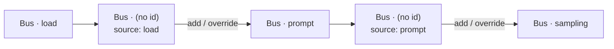

<div align="center">

# 🚌 Bus

**One wire to carry everything. Anywhere in your workflow.**

A dynamic, remote-capable **Bus** node for ComfyUI. Plug anything in once, then pick it up from any other Bus by id. Rename it, reorder it, override it, extend it, with no spaghetti and no packed-dict instability.


[](https://registry.comfy.org/nodes/comfyui-bus)


</div>

---

## ✨ Why

Context/bus nodes are great until a workflow gets big: slots vanish when you disconnect them, order shifts, and links across the canvas become unreadable. **Bus** keeps the idea and fixes the weak spots:

- 🔌 **Dynamic members.** Plug a wire into the trailing `+` slot and it becomes a member.
- 🧬 **Remote inheritance.** Give a Bus an `id`. Any other Bus can pick it as its `source`, with no wire between them.
- 🪢 **Override anywhere.** Plug into an inherited input to replace that value downstream. Unplug to revert.
- 🧷 **Permanent members.** Disconnecting never deletes a member. Removing is always a deliberate action.
- ✏️ **Rename and reorder** members without breaking anything. Identity is a hidden uid, not the label.
- 🛡️ **Safe by default.** Unfed members, missing sources, duplicate ids and loops are reported when you queue, in one message.
- 🧩 **Zero backend footprint.** Bus is frontend-only. The prompt sent to the backend contains plain links, so caching, validation and API export behave exactly as if you had wired everything by hand.

## 🚀 Install

**ComfyUI-Manager:** search for **Bus**.

**Comfy CLI:** `comfy node install comfyui-bus`

**Manual:**

```bash
cd ComfyUI/custom_nodes
git clone https://github.com/javierportillo/comfyui-bus
```

Restart ComfyUI. Add the node from the search box: **Bus** (category `utils`).

Requires ComfyUI frontend ≥ 1.58.5. No Python dependencies.

## 🧭 Quick start

1. Add a **Bus**, set `id` to `load`.
2. Drag any output onto the **`+`** slot. A member is created, named after that output and typed to it. Repeat for more.
3. Add a second **Bus** and set `source` to `load`. It shows every member of `load`, greyed. Connect its outputs to whatever needs them.
4. Plug a wire into one of its inputs to override that member. Unplug to go back to the inherited value.
5. Plug into its `+` to add members that only exist from here on. Give it an `id` to publish them to the next section.

### The section pattern



Add a Bus at the start of each section with no id (it only receives) and one at the end with an id (it publishes). Buses with an empty id never show up in the `source` list.

## 📖 Behavior

| Situation | What happens |
|---|---|
| Wire into `+` | New member: named after the source output, typed to the wire, appended last |
| Unplug a member input | Member stays; value is empty (**unfed**, shown red) |
| Wire into an inherited input | Overrides that member for this bus and everything downstream |
| Unplug an override | Reverts to the inherited value |
| **Delete member** (right-click a slot) | Removed everywhere, consumer wires on it are disconnected, other outputs keep their positions |
| Change `source` | Members are remapped by uid, then by name and type. Unmatched wired outputs become red **orphans**; unmatched overrides become local members. Nothing is destroyed |
| Upstream renames or reorders | Flows down automatically |
| Upstream deletes a member | Disappears downstream. If you had plugged an override, it is kept as your own member |
| Rename the publisher's `id` | Consumers follow |
| Paste or clone a Bus | Members keep their uids; a duplicate id gets the next `_N` suffix. Copy a publisher together with its consumers and the copies read from the copied publisher |
| Muted publisher | All its members are unfed |

Member types are locked at creation. A different type means a new member.

**Scope:** a Bus is visible from its own graph and every enclosing graph, so subgraphs can read buses from the outside.

**Right-click a slot:** Rename, Move up, Move down, Delete member. **Right-click the node:** Go to source bus, Select consumers, Remove all orphans.

## ⚠️ Limits

- Unfed members are reported for every wired consumer at queue time, even on branches that would not run.
- Reordering members is refused (with a message) while a member is wired straight to a subgraph input or output node.
- A bypassed Bus node uses ComfyUI's native bypass pass-through, not "unfed".
- Built for the classic canvas renderer. Not tested with Vue nodes mode.

## 🛠 How it works

Bus is a *virtual* node. It implements the frontend's `resolveVirtualOutput` hook, so when the workflow is converted to a prompt, every consumer is linked straight to the real upstream output, through any chain of buses and across subgraph boundaries. See [`SPEC.md`](SPEC.md) for the full design.

## 🧪 Development

```bash
node --test tests/          # pure logic
```

`tests/browser.mjs` is an end-to-end check in Chromium (needs `playwright-core` and a ComfyUI on port 8199; see the header of the file).

## 📦 Releasing

Bump `version` in `pyproject.toml` (semver) and push to `main`. The `Publish to Comfy registry` workflow runs only when `pyproject.toml` changes, using the `REGISTRY_ACCESS_TOKEN` repo secret (publisher `javierportillo`). Docs, tests and `SPEC.md` are excluded via `.comfyignore`.

## 📄 License

MIT
