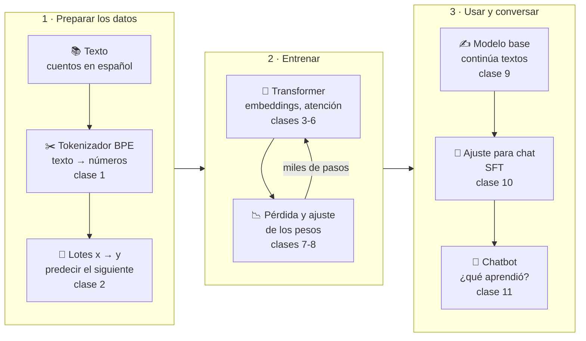

<div align="center">

# Crear un LLM desde cero

**Construye, entrena y conversa con tu propio modelo de lenguaje, y entiende cada pieza.**

Herramienta docente en español · funciona en CPU o en GPU · curso de 13 clases incluido

[](https://github.com/jceronch1/Crear-LLM-desde-cero/actions/workflows/pruebas.yml)


[](LICENSE)
[](https://huggingface.co/Jhonic)


<sub>Un modelo de 0,9 millones de parámetros, entrenado desde cero en 72 segundos. A la derecha, los tokens exactos que «ve» el modelo.</sub>

</div>

---

## ¿Qué es?

Un proyecto para **aprender cómo funciona un LLM construyendo uno**: sin descargar ningún modelo
ya entrenado y sin cajas negras. Partes de un texto y terminas con un chatbot que conversa contigo,
habiendo visto y programado cada pieza: el tokenizador, la atención, el entrenamiento, la generación
y el ajuste para chat.

| | Qué es | Para qué |
|---|---|---|
| 🧠 **El motor** · [`cero/`](cero) | Un LLM completo en PyTorch, escrito para leerse y comentado en español | Entrenar y usar modelos desde la consola con la orden `cero` |
| 📚 **El curso** · [`curso/`](curso) | 13 clases en Jupyter con 11 ejercicios que se corrigen solos, guía del profesor y soluciones | Aprender (o enseñar) paso a paso, de los tokens al chatbot |
| 🔬 **El laboratorio** · [`cero/lab/`](cero/lab) | Una página web local para ver el modelo por dentro | Ver la atención, las curvas, la generación y la conversación en directo |

Todo se ejecuta en tu ordenador: sin claves, sin servicios externos, sin GPU obligatoria.

## Instalación en 3 pasos

> 📖 Guía detallada, con solución de problemas: [docs/instalacion.md](docs/instalacion.md)

**1. Instala Python 3.11 o posterior** (recomendado 3.12) desde [python.org](https://www.python.org/downloads/).
En Windows, marca la casilla **«Add python.exe to PATH»** al instalar.

**2. Descarga este proyecto:** botón verde **`<> Code` → `Download ZIP`** y descomprímelo, o con git:

```bash
git clone https://github.com/jceronch1/Crear-LLM-desde-cero.git
```

**3. Ejecuta el instalador** de la carpeta descargada:

| Windows | Linux / macOS |
|---|---|
| Doble clic en **`instalar.cmd`** | `sh instalar.sh` |

El instalador crea un entorno aislado (no toca tu Python), detecta si tienes GPU NVIDIA, instala
la versión de PyTorch adecuada y **comprueba que funciona de verdad**. Si la GPU no responde, usa la
CPU: todo el curso funciona igual, solo que más despacio.

## Tu primer LLM en 5 minutos

**En Windows, lo más fácil:** doble clic en **`menu.cmd`** y elige las opciones en orden.

O desde una terminal abierta en la carpeta del proyecto:

| | Windows | Linux / macOS |
|---|---|---|
| Entrenar el LLM y su chatbot | `.\cero todo --receta nano` | `./cero.sh todo --receta nano` |
| Conversar con él | `.\cero chat` | `./cero.sh chat` |
| Abrir el laboratorio | `.\cero lab` | `./cero.sh lab` |
| Abrir el curso | `.\cero curso` | `./cero.sh curso` |

Esto es lo que verás al entrenar (salida real, abreviada; en GPU tarda ~1 minuto y en CPU ~6):

```text
── 1/3 · Datos y tokenizador ──────────────────────────────────────────
      764 fusiones aprendidas en 0.6 s. Vocabulario final: 1.024 tokens.
      Listo: 4.443.693 tokens de entrenamiento y 95.171 de validación

── 2/3 · Preentrenamiento: aprender a continuar texto ─────────────────
  Modelo de 922.752 parámetros · GPU NVIDIA GeForce RTX 4070 Laptop GPU · bfloat16 (mixta)
  paso      0/1.500 · validación 6.957   (azar puro sería ln(1024) = 6.931)
  paso    150/1.500 · entreno 2.901 · validación 1.003  ★ mejor
      «Había una vez unv pequeño que se llamaba Tadomi. Pito vivía en un jardín...»
  paso  1.500/1.500 · entreno 0.415 · validación 0.423  ★ mejor
      «Había una vez un oso tranquilo que se llamaba Martín. Martín vivía en un valle verde...»

── 3/3 · Ajuste fino: aprender a conversar ────────────────────────────
  paso  2.000/2.000 · entreno 0.190 · validación 0.180  ★ mejor
      «Cuéntame un cuento sobre un gato. → Érase una vez un gato travieso llamado Elsa...»

── Listo ──────────────────────────────────────────────────────────────
  Tu modelo de 922.752 parámetros está entrenado (72 s en total).
```

Fíjate en las muestras: en el paso 150 ya escribe frases, pero cambia de protagonista en cada
una; al final mantiene el nombre de principio a fin. Eso lo aprende la **atención**.

> 🤗 **¿Sin tiempo para entrenar?** Este mismo modelo (la versión base y el chatbot) está publicado
> en Hugging Face: [**Jhonic/cero-nano-es**](https://huggingface.co/Jhonic/cero-nano-es), junto con
> las otras tres recetas ya entrenadas ([tabla de recetas](#recetas-del-portátil-a-la-gpu)). Cada
> ficha explica cómo descargarlo y conversar con él en tres pasos.

## Cómo funciona

Todo el recorrido, con la clase del curso que explica cada etapa:



> 📖 Explicación completa, con la arquitectura del modelo, el bucle de entrenamiento y la plantilla
> de chat, relacionada con el artículo *«Attention Is All You Need»*: [docs/como-funciona.md](docs/como-funciona.md)

## El laboratorio

`cero lab` abre en el navegador una página para **mirar el modelo por dentro**, calculada con tu
propio modelo y en tu ordenador.

<table>
<tr>
<td width="50%"><br/><sub><b>Atención.</b> Capa 3, cabeza 3: antes de escribir el nombre, el token «A» mira al «Luna» de antes. Nadie le enseñó a hacerlo.</sub></td>
<td width="50%"><br/><sub><b>Entrenar.</b> La pérdida en directo, desde el azar (ln 1024) hasta 0,42, y lo que escribe el modelo en cada medición.</sub></td>
</tr>
<tr>
<td><br/><sub><b>Generar.</b> Qué tokens baraja el modelo y cómo los recortan la temperatura, top-k y top-p.</sub></td>
<td><br/><sub><b>Tokenizador.</b> Cómo se trocea cualquier texto que escribas, token a token.</sub></td>
</tr>
</table>

Además: los datos y la tarea `x → y`, el diagrama y el reparto de parámetros de tu modelo, y un
formulario para crear y entrenar proyectos sin usar la consola.

## El curso

Trece clases en Jupyter. Cada una explica una pieza, la construye a mano, la compara con la del
proyecto y la usa sobre un modelo de verdad. Los ejercicios **«Tu turno»** se corrigen solos y,
si algo falla, dan una pista concreta.


| Nº | Clase | Idea central |
|---:|---|---|
| 0 | [Qué vamos a construir](curso/00_bienvenida.ipynb) | El recorrido entero, en miniatura y en un minuto |
| 1 | [El tokenizador](curso/01_tokenizador.ipynb) | BPE: fusionar la pareja más frecuente, una y otra vez |
| 2 | [Los datos](curso/02_datos.ipynb) | La respuesta está en el propio texto, un lugar a la derecha |
| 3 | [Embeddings y posición](curso/03_embeddings_y_posicion.ipynb) | Una fila por token; senos, tabla aprendida o RoPE |
| 4 | [La atención](curso/04_atencion.ipynb) | softmax(QKᵀ/√d)·V, la máscara causal y las cabezas |
| 5 | [El bloque Transformer](curso/05_bloque.ipynb) | Atajos residuales, normalización y red de avance |
| 6 | [El modelo completo](curso/06_modelo.ipynb) | Logits, pesos atados y por qué se empieza en ln(V) |
| 7 | [Entrenar](curso/07_entrenar.ipynb) | Los cuatro pasos del bucle y la tasa de aprendizaje |
| 8 | [Evaluar y mirar por dentro](curso/08_evaluar.ipynb) | Perplejidad, mapas de atención y sobreajuste |
| 9 | [Generar](curso/09_generar.ipynb) | Temperatura, top-k, top-p y la caché KV |
| 10 | [De LLM a chatbot](curso/10_chat.ipynb) | Plantilla de chat, máscara de pérdida y ajuste fino |
| 11 | [¿Qué aprendió de verdad?](curso/11_que_aprendio.ipynb) | Copiar frente a memorizar, con preguntas nunca vistas |
| 12 | [Experimentos y escala](curso/12_experimentos.ipynb) | Tres arquitecturas, tamaños, corpus reales y proyecto final |

Unas 11 horas en total. 👩‍🏫 Para docentes: [guía del profesor](curso/GUIA_DEL_PROFESOR.md)
(reparto en sesiones, momentos clave, respuestas y problemas frecuentes) y
[soluciones](curso/soluciones.py).

## Recetas: del portátil a la GPU

Una receta es un proyecto ya dimensionado. Tiempos del recorrido completo medidos en un portátil
con Ryzen 7 8845HS y RTX 4070 de 8 GB; `cero comprobar` los estima en tu equipo.

| Receta | Parámetros | Corpus | GPU | CPU | Ya entrenado |
|---|---:|---|---:|---:|---|
| `nano` | 0,9 M | cuentos sintéticos, sin descargas | ~2 min | ~6 min | [🤗 cero-nano-es](https://huggingface.co/Jhonic/cero-nano-es) |
| `micro` | 5,8 M | TinyStories en español (40 M de caracteres) | ~3 min | ~1 h | [🤗 cero-micro-es](https://huggingface.co/Jhonic/cero-micro-es) |
| `mini` | 15,7 M | TinyStories en español (120 M de caracteres) | ~19 min | — | [🤗 cero-mini-es](https://huggingface.co/Jhonic/cero-mini-es) |
| `base` | 35,7 M | TinyStories en español (248 M de caracteres) | ~50 min | — | [🤗 cero-base-es](https://huggingface.co/Jhonic/cero-base-es) |

Las recetas con cuentos reales descargan el corpus (258 MB) la primera vez. Cada receta se puede
montar con tres generaciones del Transformer: `--arquitectura paper2017`, `gpt2` o `moderna`, y se
puede entrenar con tus propios textos: `--texto carpeta_con_txt`.
Todas las órdenes y opciones: [docs/ordenes.md](docs/ordenes.md).

## Estructura del repositorio

```text
Crear-LLM-desde-cero/
├── instalar.cmd · instalar.sh   el instalador (Windows · Linux y macOS)
├── menu.cmd                     menú de doble clic para Windows
├── cero.cmd · cero.sh           la orden «cero»
├── cero/                        el motor, para leer de arriba abajo
│   ├── tokenizador.py           BPE a nivel de bytes, escrito a mano
│   ├── cuentos.py · datos.py    el corpus y los lotes x → y
│   ├── modelo.py                el Transformer: atención, bloque, GPT, caché KV
│   ├── entrenar.py              el bucle de entrenamiento
│   ├── generar.py               temperatura, top-k, top-p
│   ├── chat.py                  plantilla de chat, ajuste fino y evaluación
│   └── lab/                     el laboratorio web
├── curso/                       13 clases (.ipynb), sus fuentes, la guía del profesor y las soluciones
├── docs/                        instalación, cómo funciona, órdenes y decisiones técnicas
└── tests/                       107 pruebas (también ejecutan las 13 clases enteras)
```

## Tecnologías

PyTorch 2.15 (CUDA 13.2 o CPU) · Python 3.11+ · NumPy · Jupyter · sin frameworks web: el
laboratorio usa la biblioteca estándar de Python y JavaScript sin dependencias. El modelo
predeterminado es un Transformer decodificador moderno (RoPE, RMSNorm, SwiGLU, pesos atados,
caché KV) entrenado con AdamW, calentamiento y coseno, y precisión mixta en GPU.

> 📖 Por qué se eligió cada pieza, qué cambia respecto al artículo original y a otros
> repositorios, y qué está verificado: [docs/decisiones.md](docs/decisiones.md)

## Autor

**PhD Jhoni Cerón** · [@jceronch1](https://github.com/jceronch1)

Si usas este material en clase o en una investigación, puedes citarlo con el botón
**«Cite this repository»** de GitHub (archivo [CITATION.cff](CITATION.cff)).

## Créditos y licencia

- Código y curso: licencia [MIT](LICENSE).
- Vaswani et al. (2017), [*Attention Is All You Need*](https://arxiv.org/abs/1706.03762): la arquitectura de la que parte todo.
- Eldan y Li (2023), [*TinyStories*](https://arxiv.org/abs/2305.07759), y su traducción al español
  [ffuuugor/tinystories_spanish](https://huggingface.co/datasets/ffuuugor/tinystories_spanish) (licencia CDLA-Sharing-1.0).
- [train-llm-from-scratch](https://github.com/FareedKhan-dev/train-llm-from-scratch) (FareedKhan-dev): referencia inicial del proyecto.
