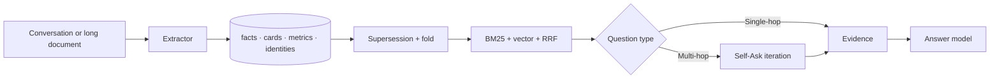

<div align="center">

# 🐋 WhaleYing Memory

### Structured long-term memory for AI agents

**Extract facts. Resolve updates. Retrieve evidence. Answer across long histories.**

[](https://doi.org/10.5281/zenodo.24402954)
[](LICENSE)
[](#quick-start)
[](https://platform.deepseek.com/)
[](#benchmark-results)

**93.2% single-hop** · **48.3% multi-hop** on MemoryAgentBench Conflict_Resolution at 262k context

</div>

WhaleYing Memory turns conversations and long documents into a structured memory store. Instead of treating every retrieved chunk as equally current, it tracks which facts supersede older versions, folds memory to the latest state, retrieves evidence with hybrid search, and passes that evidence to an answer model.

It is built for the failure cases that plain long context and ordinary RAG handle poorly: **conflicting fact versions, stale retrieval, and questions that require multiple retrieval hops**.

## Demo

The demos query a prebuilt 262k memory store from an agent interface. WhaleYing loads the structured store, retrieves evidence, and sends the relevant evidence to DeepSeek for answering. The timings printed by the system are the original measured timings.

Demo questions and answer keys are from [MemoryAgentBench](https://github.com/yyhugo/MemoryAgentBench) (MIT License, © 2026 Yuanzhe Hu).

### 1. Single question: retrieve, answer, verify

<div align="center">
  
</div>

One question is sent to the agent. The interface reports store loading, retrieval, and answer time; the returned answer is then searched in the benchmark answer key to verify that it matches the labeled answer. Playback is accelerated to 1.5×.

### 2. Multiple questions: batch answer, per-question timing, verify every answer

<div align="center">
  
</div>

Three questions are sent in one message. WhaleYing returns the three answers with retrieval and answer time for each question. Each returned answer is then searched in the benchmark answer key to verify all three against their labeled answers. Playback is accelerated to 2×.

## Why WhaleYing

| Capability | What it changes |
|---|---|
| **Structured extraction** | Converts source text into assertions, events, measurements, and identities instead of storing only opaque chunks. |
| **Supersession chains** | Marks older versions with `invalidated_at`, giving retrieval an explicit notion of what is current. |
| **Evidence-grounded records** | Deterministic validation requires extracted quotations to be substrings of the source. |
| **Hybrid retrieval** | Combines multi-field BM25, `all-MiniLM-L6-v2` vectors, and reciprocal rank fusion (RRF). |
| **Iterative multi-hop answering** | Decomposes a question into subquestions, retrieves each hop, and assembles an evidence chain. |
| **Answer-model flexibility** | Uses an OpenAI-compatible answer endpoint; tested with DeepSeek, gpt-4o-mini, and a local Qwen2.5-Coder 7B. |

## How it works



1. **Extract** — An LLM converts source text into four tables: `facts` for assertions, `cards` for events, `metrics` for measurements, and `identities` for entities. Deterministic gates validate the result and its source quotations.
2. **Resolve** — Records for the same subject form a supersession chain. Older values are invalidated; folding selects the latest value by sequence.
3. **Retrieve** — Multi-field BM25 and vector rankings are fused with RRF. Database embeddings are built once and cached; this produced an approximately **1,340× retrieval speedup** in the measured cache test.
4. **Answer** — Retrieved evidence is passed to an LLM. Optional Self-Ask-style iteration retrieves and composes evidence one hop at a time.

For implementation details and terminology, see [ARCHITECTURE.md](ARCHITECTURE.md).

**Model configuration.** Extraction uses DeepSeek-flash; reranking uses DeepSeek at temperature 0 with thinking disabled; answering disables thinking for DeepSeek models (gpt-4o-mini runs use temperature 0.7, which has no thinking toggle). The current extractor disables DeepSeek-flash thinking (it otherwise consumes `max_tokens` with its default thinking stream); extraction-thinking ablation is reported in Ablations.

## Benchmark results

All results below use the current system: four-table extraction, supersession/folding, hybrid retrieval, and optional Self-Ask iteration. The metric is **substring exact match** on **MemoryAgentBench · Conflict_Resolution**.

**Prebuilt stores are shipped in [`stores/`](stores/)** — load them and run retrieval + answering directly, without re-running the expensive extraction stage. The stores' facts are extracted from the MemoryAgentBench dataset (MIT License, © 2026 Yuanzhe Hu); see [`stores/README.md`](stores/README.md) for provenance and extraction/retrieval timing.

### 262k context

| Task | WhaleYing | Answer model and runs | Reported comparison |
|---|---:|---|---|
| Single-hop | **93.2%** | gpt-4o-mini · mean of 5 runs (93–94%, std 0.4%) | GPT-4o 60 · BM25 56 · gpt-4o-mini 45 |
| Single-hop | **93.0%** | DeepSeek, thinking off · 1 run | — |
| Single-hop | **92.0%** | local Qwen2.5-Coder 7B · 1 run | — |
| Multi-hop | **48.3%** | DeepSeek, thinking off · mean of 3 runs (48–49%, std 0.6%) | BM25 3 · HippoRAG-v2 5 · Mem0 2 · MemGPT 3 · CAR with gpt-4o 41 |
| Multi-hop | **25.3%** | gpt-4o-mini · mean of 3 runs | — |

### Memory system vs. direct full-context reading

| Task at 262k | Direct full context | With WhaleYing | Gain |
|---|---:|---:|---:|
| Single-hop | 64% — DeepSeek | **93.2% — gpt-4o-mini** | **+29pp** |
| Multi-hop | 5.3% — DeepSeek | **48.3% — DeepSeek** | **+43pp** |

At 6k context, WhaleYing scored **98% single-hop** and **66% multi-hop substring match** (65% exact), both with DeepSeek and thinking disabled.

The single-hop result remains in the same 92–93% band across a cloud model, DeepSeek, and a local 7B answer model. Multi-hop performance is more dependent on the reasoning ability of the answer model: DeepSeek reached 48.3%, while gpt-4o-mini reached 25.3% under the stated runs. Answer-model temperature was 0.7 for these MemoryAgentBench runs.

### Ablations

The headline gains decompose into a few measured effects:

| Change | Effect (substring exact match) |
|---|---|
| Memory system on/off (262k) | Single-hop 64% → 93.2% (+29pp); multi-hop 5.3% → 48.3% (+43pp) |
| Self-Ask iteration on/off (mh_6k) | 27% → 66% (+39pp) |
| Answer model (single-hop 262k) | gpt-4o-mini 93.2% ≈ DeepSeek 93.0% ≈ Qwen2.5-Coder 7B 92.0% (stable across the three tested answer models) |
| Answer model (multi-hop 262k) | DeepSeek 48.3% vs gpt-4o-mini 25.3% (model-dependent) |
| Folding on/off (LoCoMo) | 38.6% (no folding) vs 36.3% (folding); see LoCoMo below |

Thinking mode was ablated on DeepSeek 262k single-hop. With reranking and answering thinking disabled, disabling extraction thinking as well measured 90.0% on the first run and 92% on a re-test, versus 93.0% with extraction thinking on — a −1~3pp swing inside the temperature-0.7 single-run noise band, so thinking mode was not a measurable contributor at these settings. The single-hop 93.2% headline (gpt-4o-mini) was measured with extraction thinking on; the current extractor disables thinking, and re-tests put the difference inside noise.

The single-hop 93.2% is the mean of five runs (93/93/93/94/93). One additional run (86%) was excluded because a mobile-hotspot connection dropped during store extraction and left the memory store incomplete; that run's raw output is still shipped in [`results/singlehop-262k/`](results/singlehop-262k/) for inspection, and re-extraction over a stable connection returned the 93–94% band.

Single-hop baselines come from [MemoryAgentBench (arXiv:2507.05257)](https://arxiv.org/abs/2507.05257). Multi-hop baselines and CAR come from [CAR (arXiv:2606.01435)](https://arxiv.org/abs/2606.01435). Raw multi-hop and single-hop run outputs are included in [`results/`](results/) (see [`results/README.md`](results/README.md) for the verified numbers and provenance).

<details>
<summary><strong>LoCoMo results and what they show</strong></summary>

LoCoMo uses the official F1 string-match metric and official QA prompt, with DeepSeek at temperature 0 and thinking disabled.

| LoCoMo task (1,986 questions) | No folding (BM25 only) | Full config (folding + BM25 + vector + RRF) |
|---|---:|---:|
| Multi-hop | 19.9% | 20.4% |
| Single-hop | 28.3% | 30.1% |
| Temporal | 13.9% | 15.3% |
| Open-domain | 43.9% | 38.9% |
| Adversarial / abstention | 53.4% | 50.4% |
| **Overall F1** | **38.6%** | **36.3%** |

These results identify a clear task boundary. The current fold is designed to answer **“what is true now?”** by retaining the latest value. LoCoMo often asks **“what happened before?”**, where removing superseded values loses useful history. Relative-time extraction is also the weakest current component at 13.9–15.3% F1. Historical-state retrieval and stronger temporal normalization are therefore direct development targets.

Only the reported LoCoMo scores are cited here; the LoCoMo data is CC BY-NC 4.0 (non-commercial), so its data files are not redistributed in this repository.

</details>

## Quick start

### 1. Install

```bash
git clone https://github.com/jing-ying-dev/whale-ying-memory.git
cd whale-ying-memory
python -m pip install -r requirements.txt
```

Python 3.10+ is required. Extraction can use the DeepSeek API or a local Ollama-compatible endpoint.

To install the `whaleying` CLI (optional), use an editable install so the CLI can locate the extractor and memory modules from the source tree:

```bash
python -m pip install -e .
whaleying --help
```

Note: an editable install is supported; a non-editable wheel build would need the `memory/` and `extractor/` directories packaged as well, which is not done yet.

### 2. Configure an extraction model

DeepSeek:

```bash
export DEEPSEEK_API_KEY="your-api-key"
```

PowerShell:

```powershell
$env:DEEPSEEK_API_KEY = "your-api-key"
```

Or use Ollama through its OpenAI-compatible endpoint:

```bash
export DEEPSEEK_API_PROVIDER=ollama
export DEEPSEEK_MODEL=qwen2.5-coder:7b
```

### 3. Extract structured memory

```bash
python extractor/extract.py \
  --chunk examples/sample_chunk.json \
  --out output/entities.json \
  --log-dir output
```

The output contains the four structured tables. The build log records validation, coverage, source-grounding, retry, and density information.

### 4. Run the standalone CLI (no benchmark needed)

The repository can build a memory store and answer questions on its own, without MemoryAgentBench:

```bash
# Build a store from one or more documents (extraction + supersession/folding)
python examples/build_store.py --doc document.txt --out memory.json

# Ask a question (fold to latest → hybrid retrieval → rerank → answer)
python examples/answer.py --store memory.json --question "What is the current value of X?"

# Multi-hop question (Self-Ask iteration)
python examples/answer.py --store memory.json --question "..." --iterative
```

- Extraction and reranking read `DEEPSEEK_API_KEY` (see step 2); answering reads the standard OpenAI environment variables `OPENAI_API_KEY` / `OPENAI_BASE_URL` / `OPENAI_MODEL` (default `gpt-4o-mini`).
- Large documents can be split for parallel extraction with `--chunk-chars 4000`.
- The same entry points are available as `python -m whaleying.standalone` (subcommands `ingest` / `ask`).

### 5. Use the MemoryAgentBench adapter

[`memory/whale_ying.py`](memory/whale_ying.py) exposes the benchmark integration hooks:

- `initialize_our_agent(...)`
- `handle_our_agent(...)`
- `WHALE_YING_ITERATIVE=1` to enable multi-hop iteration
- `WHALE_YING_STORE_SAVE` / `WHALE_YING_STORE_LOAD` to separate extraction and evaluation stages

The answer model is supplied by the host agent/benchmark through an OpenAI-compatible interface.

## Repository structure

```text
.
├── extractor/
│   ├── extract.py          # Four-table extraction and deterministic gates
│   ├── deepseek_api.py     # DeepSeek / Ollama-compatible LLM adapter
│   ├── schema.json         # Structured memory schema
│   └── extract_rules.json  # Field production and validation rules
├── memory/
│   └── whale_ying.py       # Folding, retrieval, reranking, and multi-hop adapter
├── whaleying/
│   └── standalone.py       # Standalone CLI (ingest / ask), no benchmark dependency
├── assets/                 # README demo and social-preview artwork
├── results/                # Raw benchmark run outputs (multi-hop + single-hop)
├── docs/
│   ├── project-story.md
│   ├── development-cost.md
│   └── reproduction.md
├── examples/
│   ├── build_store.py      # Document → memory store
│   ├── answer.py           # Question → retrieval → answer
│   └── sample_chunk.json
├── ARCHITECTURE.md
└── LICENSE
```

## Development direction

- **Historical-state retrieval** — preserve and query superseded values when the question asks about the past.
- **Stronger temporal normalization** — improve relative-time extraction and cross-event timelines.
- **Local-first memory** — keep extraction and retrieval deployable with local models for high-privacy environments.
- **One memory server, many lightweight agents** — centralize expensive extraction while keeping retrieval clients inexpensive.
- **Packaged agent API and reproducible evaluation** — make integration and independent benchmark reproduction easier.

## Built from scratch on a laptop

WhaleYing Memory was started by a 21-year-old third-year Traditional Chinese Medicine student with no formal computer science or AI background. Development began with API experiments on 14 October 2026 and shifted to agent long-term memory on 22 October. The current benchmark results were reached on 18–19 November.

The system was developed and evaluated on a Windows 11 laptop with an Intel i5-13420H, 16 GB RAM, and no discrete GPU. The goal of open-sourcing it is to turn the work already invested into the compute, collaboration, and feedback needed for the next stage.

Read the longer [project story](docs/project-story.md) and the recorded [development cost](docs/development-cost.md).

## License

[Apache-2.0](LICENSE)
