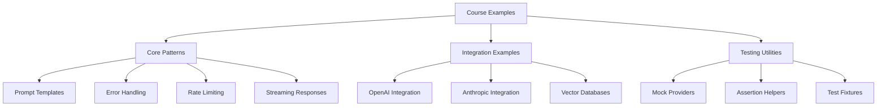

# ai-practice-examples

Course examples demonstrating AI implementation with industry best practices

## motivation

Most AI tutorials show you how to call an API and print the result. This misses the hard parts: error handling, rate limiting, prompt versioning, testing, and monitoring. These examples bridge that gap by showing production-ready patterns you can actually use in real applications. Each example focuses on one concept and implements it properly, with tests, error cases, and documentation.

## architecture



## getting started

### install

```
npm install
```

### quickstart

```typescript
import { PromptTemplate, withRetry } from './core';
import { OpenAIClient } from './integrations/openai';

// Use a prompt template with type safety
const summarizer = new PromptTemplate({
  system: 'You are a technical writer.',
  user: 'Summarize this in 3 sentences: {{text}}'
});

const client = new OpenAIClient({
  apiKey: process.env.OPENAI_API_KEY,
  maxRetries: 3
});

// Wrap API calls with retry logic
const result = await withRetry(() =>
  client.complete(summarizer.format({ text: 'Your content here' }))
);

console.log(result.content);
```

## how it works

The examples are organized by concept, not by provider. Each directory contains a focused example with its own README, test suite, and implementation. The `core/` directory provides reusable utilities like prompt templating, error handling, and rate limiting. Integration examples in `integrations/` show how to apply these patterns with specific AI providers. All examples use dependency injection to make testing straightforward. You can run examples individually or use them as reference implementations for your own code.

## configuration

Each example uses environment variables for API keys and configuration:

```bash
# Required for OpenAI examples
OPENAI_API_KEY=sk-...

# Required for Anthropic examples
ANTHROPIC_API_KEY=sk-ant-...

# Optional configuration
AI_REQUEST_TIMEOUT=30000
AI_MAX_RETRIES=3
LOG_LEVEL=info
```

Copy `.env.example` to `.env` and fill in your values:

```bash
cp .env.example .env
```

Examples will fail fast with clear error messages if required configuration is missing.

## faq

**Q: Do I need API keys to run the tests?**

No. Tests use mock providers by default. Integration tests that require real API keys are marked and skipped unless you opt in.

**Q: Which AI providers are covered?**

Currently OpenAI and Anthropic. The patterns apply to other providers as well.

**Q: Can I use these examples in production?**

Yes, but review them first. They demonstrate patterns, not complete production systems. Add monitoring, logging, and security measures appropriate for your use case.

**Q: Why TypeScript instead of Python?**

TypeScript examples are less common in AI education, and the type system catches errors that matter in production. Python examples may be added later.

**Q: How do I suggest new examples?**

Open an issue describing the pattern you want to see. Include why existing examples don't cover it.

## license

MIT
