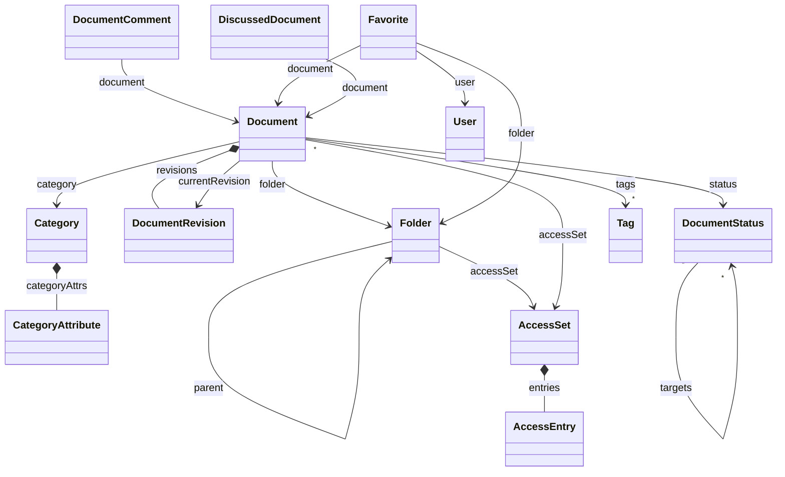

# Jmix DocAI

Jmix DocAI is a reference document management system with AI, built on [Jmix](https://www.jmix.io) 3.1. It shows developers how to build a document management system on Jmix and how to add AI to it: filling document cards from their files, assistants that answer from the documents, and search by meaning. You can clone it, run it locally with demo data in English or Russian, and read the code as an example.

## 📑 Table of Contents

- [Overview](#-overview)
- [AI Features](#-ai-features)
- [Technical Stack](#️-technical-stack)
- [Add-ons](#-add-ons)
- [Build and Run](#-build-and-run)
- [Configuration](#-configuration)
- [Demo Data](#-demo-data)
- [Application Accounts](#-application-accounts)
- [Domain Model](#️-domain-model)
- [Role Model](#-role-model)
- [More about Jmix](#ℹ️-more-about-jmix)

## 📖 Overview

Employees keep documents in a folder tree in the main menu, share them with colleagues and departments, and find them by words or by meaning.

**Repository and documents**

- Access as in SharePoint: inherited from the parent folder or set on the item, with the View, Edit and Manage levels for users and department roles
- Versions, and a preview of images, PDF and text files
- Upload of up to 20 files at a time, 20 MB each, in a dialog or by dropping them onto the document table
- Moves by drag and drop
- Document types with fields of their own, which the administrator adds in the application
- Statuses with allowed transitions, by default Draft → Active ⇄ Archived; Archived locks the document
- Tags from a shared vocabulary, comments, and favorites of each user
- Trash with preview and restore; the administrator deletes forever

**Search**

- Every search starts in the search palette: the search field in the header opens it, and so do ⌘K and Ctrl+K. Before you type, it lists your recent searches, which you can remove, your favorites and, with the AI on, two questions for the AI assistant. As you type, it finds documents, folders and tags, with chips to filter them. A document opens its card over the palette.
- Full-text search in the names, tags and type fields of documents and in the text of their PDF, DOC, DOCX, XLS, XLSX, ODT, ODS, RTF and TXT files: whole words and their forms in English and Russian first, then word beginnings of three letters or more; a long query finds whole words only
- Search by meaning

**AI**, with an OpenAI key

- Fill with AI: the type, fields, date and tags of a document from its file
- The Assistant tab of the document card: a chat about one document
- The AI assistant in the main menu: questions about all documents, with retrieval by meaning (RAG)
- Discuss with AI: a chat about the selected documents

**Interface**

- The Aura theme of Vaadin with the DocAI branding, in light, dark and mixed schemes
- English and Russian

## 🤖 AI Features

The AI features run on [Spring AI](https://docs.spring.io/spring-ai/reference/), with OpenAI by default, and work with the rights of the person who asks: the AI neither reads nor shows a document that person may not open.

The chats come from two Jmix add-ons. **AI Chat** draws the chat of the Assistant tab and of Discuss with AI. **AI Tools** gives the AI assistant in the main menu, the history of its chats and the tools that query the data; the application adds its own tools that read documents and search them by meaning.

- **Fill with AI.** The button in the header of the document card reads the file the card shows, fills the type, the fields of the type and the date of the document, and adds up to three tags; you check the values and save. A new document type reaches the AI without a code change. A scan without a text layer gives the AI nothing to read.
- **Assistant.** The Assistant tab of a saved document is a chat about it, next to its preview. The AI reads the text of the current version and, for a question about what people said or agreed, the comments. The conversation lasts while the card is open.
- **AI assistant.** The menu item opens a chat about the whole repository, on the AI Tools add-on. It counts and lists documents by folder, status, type, tag or date, finds them by the fields of their types, reads a document, and finds passages by meaning to answer with quotes and links to the cards. Each person keeps their own chats.
- **Discuss with AI.** Select documents in the table and choose Discuss with AI: a window on the right holds up to 10 of them (`docai.ai.discussion.max-documents`) and a chat about them. The first question saves the discussion in the history of the AI assistant.
- **AI search.** The wand in the search field and in the palette switches between **By words** and **AI search**, which finds documents by meaning: *agricultural machinery* finds a tractor lease that never uses those words. The chat model checks every candidate, and the results page shows up to 20 documents with the matching quote marked.

The queries of the AI assistant see only documents, folders, document types, tags and statuses (`jmix.aitools.dataload.include-entities`); users, access, versions, comments, favorites and discussions are closed to them (`@ExcludeFromAi`).

### Key and models

Set `OPENAI_API_KEY` in the environment before the start; `DOCAI_AI_ENABLED=false` turns the AI off while the key is set. The default models are `gpt-5.6-luna` for the chat and `text-embedding-3-large` for the vectors of the search by meaning; see [Configuration](#-configuration) to change them.

### Other providers

The application and both AI add-ons reach the models through Spring AI, so another [Spring AI provider](https://docs.spring.io/spring-ai/reference/api/chat/comparison.html) can take the place of OpenAI: Anthropic, Azure OpenAI, Google Gemini, Mistral AI or a local model in Ollama. DocAI is built and checked with OpenAI; to switch:

1. Replace `spring-ai-starter-model-openai` in `build.gradle` with the starter of the provider.
2. Set its properties in `application.properties` in place of `spring.ai.openai.*`, and set `docai.semantic.dimensions` to the vector size of its embedding model.
3. Point the two classes that read OpenAI properties to the new ones: `AiSettings` checks the key, and `DocumentVectorIndex` keeps the name of the embedding model.

The chat model must call tools and answer in a JSON schema. The search by meaning also needs an [embedding model](https://docs.spring.io/spring-ai/reference/api/embeddings.html). Anthropic has none, so with Anthropic the vectors come from a second provider; `spring.ai.model.chat` and `spring.ai.model.embedding` choose which starter serves what.

### What goes to OpenAI

> **The texts of all documents go to OpenAI.** While the key is set, every document is sent to the embedding model when it is uploaded, renamed, gets another current version or comes back from the trash, whoever opens it later: its name and the first 40,000 characters of its text (`docai.semantic.max-text-length`), in fragments of about 1,000 characters.

The chat model gets:

| Feature | What it sends |
|---|---|
| Fill with AI | The text of the file, up to 12,000 characters (`docai.ai.max-text-length`), the document name, the document types with their fields, the names of all tags |
| Assistant | The document name and id, your questions with the answers so far, today's date and your time zone; when needed, the text of the document, its comments and the document types with their fields |
| AI assistant | Your questions with the answers so far, today's date and your time zone, the data model, the document types with their fields, the rows of its queries (names, dates, statuses, folders, types, tags, uploaders and upload times, field values), the passages it finds by meaning, the text and comments of a document it reads |
| Discuss with AI | The same, and with every question the names, ids, types and dates of the selected documents you may open |
| AI search | The query, then the names and nearest fragments of up to 20 candidates for the check |

Comments go with their authors and times: the latest 50 that fit into 12,000 characters.

The pages load pictures, media, styles and fonts from the application only (`Content-Security-Policy`), so an answer in Markdown cannot send data to another site in the address of a picture.

#### What it costs

OpenAI bills by tokens, three to four characters of text each. Per million tokens, `gpt-5.6-luna` costs $0.20 for input and $1.20 for output, and `text-embedding-3-large` costs $0.13 ([OpenAI pricing](https://developers.openai.com/api/docs/pricing), November 2026). Estimates from the limits above:

| Operation | Cost, about |
|---|---|
| Indexing a document of two pages | $0.0002 |
| Indexing a long document, up to the 40,000-character limit | $0.002 |
| Indexing the demo set, at the first start and after a reset | $0.003 |
| Fill with AI, one click | $0.002 or less |
| AI search, one query | $0.002 |
| One question in a chat | from $0.001 to a few cents |

A question costs more the more the model looks up: each tool call sends the chat again with what the tools returned, and reading the ten documents of a discussion can send up to 120,000 characters of their texts. To spend less:

- `DOCAI_AI_EMBEDDING_MODEL=text-embedding-3-small` with `DOCAI_AI_EMBEDDING_DIMENSIONS=1536` makes indexing about 6.5 times cheaper, at some cost to the search by meaning; the vector index is filled anew once.
- Lower `docai.ai.max-text-length` and `docai.semantic.max-text-length` send less of a long document.

## 🛠️ Technical Stack

- Java 21, Gradle
- [Jmix](https://www.jmix.io) 3.1: Spring Boot 4, Vaadin 25 with the Aura theme
- HSQLDB by default, Liquibase
- OpenSearch 2.17 in Docker Compose
- [Spring AI](https://docs.spring.io/spring-ai/reference/) 2.0, OpenAI by default
- JUnit 6

## 🧩 Add-ons

- [AI Chat](https://docs.jmix.io/jmix/ai-chat/index.html): the chats of the document card and of a discussion; an experimental add-on of the Jmix Enterprise subscription
- [AI Tools](https://docs.jmix.io/jmix/ai-tools/index.html): the AI assistant in the main menu and the history of its chats
- [Data Tools](https://docs.jmix.io/jmix/data-tools/index.html): the restore from the trash and the entity inspector
- [Dynamic Attributes](https://docs.jmix.io/jmix/dyn-attr/index.html): the document types and their fields
- [Local File Storage](https://docs.jmix.io/jmix/files/file-storage.html)
- [Quartz](https://docs.jmix.io/jmix/quartz/index.html): runs the indexing queue of the search
- [Search](https://docs.jmix.io/jmix/search/index.html) with OpenSearch
- [UI Recovery](https://docs.jmix.io/jmix/ui-recovery/index.html): unsaved changes of a document card come back as a draft after its browser tab was closed

## 🚀 Build and Run

### Prerequisites

- Java 21
- Docker with Docker Compose, for OpenSearch
- Credentials of the Jmix premium repository, for the AI Chat add-on: they come with a Jmix Enterprise subscription or its trial

Put the credentials into `~/.gradle/gradle.properties`: the part of your license key before the dash is the user name, and the part after it is the password. Without these properties the build reads `CUBA_PREMIUM_USER` and `CUBA_PREMIUM_PASSWORD` from the environment, as CI does.

```properties
premiumRepoUser=123456123456
premiumRepoPass=abcdefabcdef
```

### Run the application

```bash
docker compose up -d --wait
./gradlew bootRun
```

Open <http://localhost:8080/docai> and log in as `admin` / `admin`. Compose starts OpenSearch on `127.0.0.1:19200` and returns once it answers. Without OpenSearch the application starts, and the search says it is unavailable; start OpenSearch and restart the application.

The first start loads the English demo set. The database and the document files live under `.jmix/`, see [Configuration](#-configuration).

### Run without an OpenAI key

Without `OPENAI_API_KEY` the application shows no AI button, tab, menu item or search mode and sends nothing to OpenAI. Set the key and start the application again to turn the AI on.

### Reset the demo data

Stop the application and run `./gradlew resetDemoData`. It deletes the HSQLDB file database, the document files and the search indexes `docai_document` and `docai_document_vectors`, and the next start loads the set of `DOCAI_DEMO_DATA` again.

The database, the files and the indexes belong together: after you replace the database in another way, run `docker compose down -v`, and the application fills the indexes again at start.

### Run on a stand

Gradle builds the jar, and Compose puts it into an image and runs it next to OpenSearch:

```bash
./gradlew -Pvaadin.productionMode=true bootJar
docker compose --profile app up -d --build
```

The application answers on port 8080 of the host at `/docai`. Its database and files live in the `docai-data` volume, the search indexes in `opensearch-data`; `docker compose --profile app down -v` deletes both. Compose passes `DOCAI_ACTIVE_PROFILE`, `DOCAI_DEMO_DATA`, `DOCAI_AI_ENABLED` and `OPENAI_API_KEY` from the environment; without them the stand runs with the `local` profile. Another profile, for example `prod`, leaves the login form empty and loads no demo set unless `DOCAI_DEMO_DATA` names one.

### Run the tests

| Command | Needs | Runs |
|---|---|---|
| `./gradlew test` | Nothing | Every test but the search and AI ones, on an in-memory database, without calls to OpenAI |
| `./gradlew searchTest` | OpenSearch from `compose.yaml` | The tests of the full-text search and the vector index, in indexes of their own (`docai_test_`) |
| `./gradlew aiTest` | OpenSearch and `OPENAI_API_KEY` | The tests that call the OpenAI models, on English samples and the English demo set; each run is billed to the key |

### Use another database

Add the JDBC driver of your database to `build.gradle` and set `DOCAI_DB_URL`, `DOCAI_DB_USERNAME` and `DOCAI_DB_PASSWORD`. The Liquibase changelogs keep the branches Jmix Studio writes for different databases.

### Develop with AI agents

The repository ships the [Jmix Agent Toolkit](https://github.com/jmix-framework/jmix-agent-toolkit): its Jmix skills live in `.agents/skills/` for Codex and OpenCode, `.claude/skills/` links to them for Claude Code, and [AGENTS.md](AGENTS.md) and [CLAUDE.md](CLAUDE.md) point the agents to the `jmix` skill.

## 🔧 Configuration

`src/main/resources/application.properties` reads these environment variables:

| Variable | Default | Meaning |
|---|---|---|
| `DOCAI_ACTIVE_PROFILE` | `local` | Spring profile; `local` pre-fills the login form |
| `DOCAI_DEMO_DATA` | `en` in the `local` profile, `none` in others | Demo set an empty database gets at the start: `en`, `ru` or `none` |
| `DOCAI_DB_URL` | `jdbc:hsqldb:file:.jmix/hsqldb/docai` | JDBC URL of the database |
| `DOCAI_DB_USERNAME` | `sa` | Database user |
| `DOCAI_DB_PASSWORD` | empty | Database password |
| `DOCAI_FILES_DIR` | `.jmix/work/filestorage` | Directory of the document files |
| `DOCAI_SEARCH_URL` | `http://localhost:19200` | Address of OpenSearch |
| `OPENAI_API_KEY` | empty | Key of the OpenAI API; without it the application shows no AI features |
| `DOCAI_AI_ENABLED` | `true` | `false` turns the AI features off while the key is set |
| `DOCAI_AI_MODEL` | `gpt-5.6-luna` | Chat model |
| `DOCAI_AI_REASONING_EFFORT` | `none` | gpt-5.6-luna calls tools only with `none`; for a model that does not reason, such as gpt-4o-mini, remove `spring.ai.openai.chat.reasoning-effort` from `application.properties` |
| `DOCAI_AI_TEMPERATURE` | `0` | A model that reasons takes only `1` |
| `DOCAI_AI_EMBEDDING_MODEL` | `text-embedding-3-large` | Embedding model of the text-embedding-3 family; another model fills the vector index anew |
| `DOCAI_AI_EMBEDDING_DIMENSIONS` | `3072` | Vector size: at most 3072 for text-embedding-3-large and 1536 for text-embedding-3-small; another size fills the vector index anew |
| `SERVER_PORT` | `8080` | HTTP port |

## 🎲 Demo Data

At the first start, an empty database gets the demo set that `DOCAI_DEMO_DATA` names: `en`, `ru` or `none`. Both sets hold the same folders, people and scenes: 46 documents with versions, types, fields, statuses, tags, comments and access, favorites of each user, and a few items in the trash.

| Folder | Access | What to try |
|---|---|---|
| Inbox | Inherits: every employee edits | Three scans without a type for **Fill with AI** |
| Contracts | Inherits | Lease Agreement No. 112 with three versions and comments on its penalty, for the assistant to sum up; a recruitment agreement open to Helen only |
| Invoices and Certificates | Inherits | An invoice due on November 30, 2026, for the AI assistant |
| Procurement | Inherits | 27 documents of the corpus of the AI search |
| Archive 2025 | Legal department and Accounting view, Alice edits | 3 more documents of the corpus |
| HR, HR / Vacations | HR department manages, every employee views Vacations | A hiring order, an employment contract and the vacation schedule with a comment by Peter |
| Trash | As before the deletion | The Drafts folder and the first edition of Lease Agreement No. 112, to restore or to delete forever as `admin` |

The corpus holds 12 documents about farm machinery and 18 about other machinery and goods, and none of them says "agricultural". Search by words for *agricultural machinery* finds nothing; AI search finds the 12, or 9 for `peter`, who may not open Archive 2025. Search by words for *fumigation* finds the one contract with the word only inside its PDF.

`demo-uploads/en` and `demo-uploads/ru` hold two invoices to upload during a demo: Invoice 1610, to fill with AI, and Invoice 2231 for a combine harvester under a neutral name, to find with AI search.

The sets lie in `src/main/resources/com/company/docai/demo/`; their PDFs use PT Serif and PT Sans by ParaType, under the SIL Open Font License. To load a set again, [reset the demo data](#reset-the-demo-data).

## 👥 Application Accounts

| Login | Password | Name | Roles | In the demo sets |
|---|---|---|---|---|
| `admin` | `admin` | | Full Access | Administrator |
| `peter` | `peter` | Peter Wilson | Employee | An employee with narrow access |
| `alice` | `alice` | Alice Morgan | Employee | Office manager: files the incoming documents |
| `helen` | `helen` | Helen Carter | Employee, HR department | HR manager |
| `maria` | `maria` | Maria Lopez | Employee, Accounting | Accountant |
| `john` | `john` | John Doe | Employee, Legal department | Lawyer |

The employees and their department roles come from the demo changelog `020-demo-users.xml`; delete it before the first start of a real deployment. The Russian set gives the employees Russian names, with the same logins and passwords.

> **Warning:** these are development credentials, and the `local` profile pre-fills the login form. Before you deploy the application anywhere, change the `admin` password and set `DOCAI_ACTIVE_PROFILE` to another value, for example `prod`.

## ⚙️ Domain Model



| Entity | What it is |
|---|---|
| `Folder` | A folder of the tree under one root, "Repository" |
| `Document` | A document: name, folder, status, date, type, tags and current version |
| `DocumentRevision` | A version with its file; it never changes, and a new file or a restored version adds one |
| `DocumentStatus` | A status of the dictionary: name, color, order, the statuses it moves to, and whether it locks its documents |
| `Category`, `CategoryAttribute` | A document type and its fields, from the Dynamic Attributes add-on |
| `Tag` | A tag of the shared vocabulary |
| `DocumentComment` | A comment on a document |
| `Favorite` | A mark of one user on a folder or a document |
| `AccessSet`, `AccessEntry` | The access in effect for a folder or a document, its parent's or its own; an entry gives a user or a role a level |
| `DiscussedDocument` | A document in the selection of a discussion with the AI |
| `User` | A user of the application |

Folders, documents and versions are deleted softly, into the trash.

## 🔐 Role Model

| Role | Code | Purpose |
|---|---|---|
| Full Access | `system-full-access` | All data, views and actions; assigned to `admin` |
| Employee | `employee` | Works with folders, documents, tags, comments and favorites, restores from the trash, searches and uses the AI; includes UI: minimal access and the chat role of AI Tools |
| UI: minimal access | `ui-minimal` | Sign-in to the UI and the main view; the base of every UI role |
| Folder and document access | `access-rl` | Row-level role: a user sees folders and documents by their access entries, and only their own favorites and discussions; assigned to everyone without Full Access |
| HR department, Legal department, Accounting | `hr-department`, `legal-department`, `accounting` | Departments of the demo: roles without policies that folders and documents give access to |

Deleting from the trash forever needs the specific policy `docai.trash.purge`, which Full Access has and Employee does not.

Access works as in SharePoint: a folder or a document inherits the access of its parent or has its own, set in the **Access** dialog.

| Level | Allows |
|---|---|
| View | See the folder or the document, open the card read-only, preview, download and comment |
| Edit | Also upload, create, add versions, change the status, rename, move, delete and restore from the trash |
| Manage | Also change who has access |

A user gets the highest level among their entries. The root gives the Employee role the Edit level, and the administrator has every level everywhere. Departments are resource roles without policies; with LDAP or Active Directory, map each department group to its role and keep the access entries on roles.

> **Warning:** the `access-rl` role comes from the Jmix role assignments. If users sign in through LDAP or SSO and get their roles from a group mapper, add `access-rl` in the mapper, or they will see every folder and document.

## ℹ️ More about Jmix

| Source | Link |
|---|---|
| 🌐 Website | https://www.jmix.io |
| 📚 Documentation | https://docs.jmix.io |
| 💬 Forum | https://forum.jmix.io |
| 💻 GitHub | https://github.com/jmix-framework/jmix |
| 🎥 YouTube | https://www.youtube.com/@jmixframework |
| 💼 LinkedIn | https://www.linkedin.com/company/jmix-framework |
