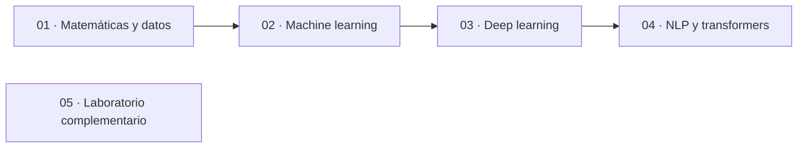

# JJ ML DL BOOK

**JJ ML DL BOOK** es un libro práctico en español sobre ciencia de datos, machine learning, deep learning y procesamiento del lenguaje natural. Su propósito es facilitar el aprendizaje mediante un recorrido progresivo que conecta los fundamentos matemáticos con ejemplos de código y proyectos educativos.

Para utilizarlo, descarga el repositorio, prepara el entorno de Python y abre los notebooks en VS Code o Jupyter. Puedes seguir las fases en orden, ejecutar y modificar los ejemplos, añadir tus apuntes y completar los proyectos para afianzar lo aprendido.

[](https://www.python.org/)
[](https://jupyter.org/)
[](https://numpy.org/)
[](https://pandas.pydata.org/)
[](https://scikit-learn.org/)
[](https://pytorch.org/)
[](https://huggingface.co/)
[](LICENSE)

**4 fases** · **35 temas** · **4 proyectos finales** · **143 notebooks**, incluido un cuaderno de laboratorio.

[Inicio rápido](#inicio-rápido) · [Explorar el recorrido](#el-recorrido) · [Ver los proyectos](#proyectos-finales) · [Preparar el entorno](#preparación-del-entorno) · [Licencia](#licencia-y-uso)

> **Alcance:** este material está orientado al estudio y la experimentación sin fines comerciales. También puede utilizarse para impartir clases gratuitas según la [licencia](LICENSE). Los ejemplos y sus resultados no son soluciones listas para producción ni una base suficiente para tomar decisiones reales.

---

## A quién va dirigido

Este libro está dirigido a personas que quieren iniciarse en la ciencia de datos y el aprendizaje automático, así como a quienes desean repasar sus fundamentos y practicar con ejemplos. No es necesario tener experiencia previa en machine learning, pero se recomienda conocer los conceptos básicos de Python, como variables, funciones y estructuras de datos.

El recorrido comienza con fundamentos matemáticos aplicados; si ya tienes experiencia, puedes acceder directamente a los temas o proyectos que te interesen.

## Inicio rápido

1. En GitHub, selecciona **Code > Download ZIP** y descomprime el archivo, o clona el repositorio si utilizas Git.
2. Abre la carpeta descargada en VS Code e instala sus extensiones de Python y Jupyter si aún no las tienes.
3. Crea el entorno e instala las dependencias siguiendo la [preparación del entorno](#preparación-del-entorno).
4. Abre el [primer notebook de álgebra lineal](01_FASE_MATEMATICAS_Y_CIENCIA_DE_DATOS_/01_Algebra_lineal_aplicada/01_El_algebra_lineal_aplicada.ipynb), selecciona el intérprete del entorno como kernel y ejecuta las celdas en orden.

## Qué encontrarás

- **Fundamentos conectados:** matemáticas y datos antes de modelos, redes y aplicaciones de NLP.
- **Notebooks por tema:** ejemplos organizados en carpetas numeradas para estudiar y ejecutar en orden.
- **Cuatro proyectos locales:** casos de clientes, riesgo crediticio, imágenes industriales y tickets de soporte, cada uno con su propia documentación.
- **Un laboratorio:** un cuaderno inicial para experimentar fuera del recorrido principal.
- **Limitaciones explícitas:** los ejemplos priorizan el aprendizaje; sus datos, evaluaciones y dependencias tienen límites que conviene conocer.

## El recorrido



| Fase | Enfoque | Punto de entrada |
| --- | --- | --- |
| [**01 · Matemáticas y ciencia de datos**](01_FASE_MATEMATICAS_Y_CIENCIA_DE_DATOS_) | Álgebra, estadística, cálculo, preparación y visualización de datos | [Álgebra lineal aplicada](01_FASE_MATEMATICAS_Y_CIENCIA_DE_DATOS_/01_Algebra_lineal_aplicada/01_El_algebra_lineal_aplicada.ipynb) |
| [**02 · Machine learning**](02_FASE_MACHINE_LEARNING_) | Preprocesamiento, modelos, evaluación e interpretabilidad | [Fundamentos de machine learning](02_FASE_MACHINE_LEARNING_/01_Fundamentos_de_machine_learning/01_Los_fundamentos_de_machine_learning.ipynb) |
| [**03 · Deep learning**](03_FASE_DEEP_LEARNING_) | PyTorch, entrenamiento, regularización, CNN, RNN y transfer learning | [Fundamentos de PyTorch](03_FASE_DEEP_LEARNING_/01_Fundamentos_de_pytorch/01_Los_fundamentos_de_pytorch.ipynb) |
| [**04 · NLP y transformers**](04_FASE_NLP_Y_TRANSFORMERS_) | Tokenización, embeddings, modelos de texto, ajuste e inferencia | [Tokenización](04_FASE_NLP_Y_TRANSFORMERS_/01_Tokenizacion/01_La_tokenizacion.ipynb) |
| [**05 · Laboratorio**](05_LABORATORIO_) | Espacio complementario para experimentar | [Cuaderno del laboratorio](05_LABORATORIO_/01_Sala_a.ipynb) |

Si empiezas desde cero, sigue las fases y sus temas en orden y cierra cada fase con su proyecto. Si ya tienes experiencia, puedes empezar por los proyectos y volver a los temas que quieras repasar.

### Índice de temas

<details>
<summary><strong>01 · Matemáticas y ciencia de datos</strong></summary>

1. [Álgebra lineal aplicada](01_FASE_MATEMATICAS_Y_CIENCIA_DE_DATOS_/01_Algebra_lineal_aplicada)
2. [Estadística aplicada](01_FASE_MATEMATICAS_Y_CIENCIA_DE_DATOS_/02_Estadistica_aplicada)
3. [Cálculo aplicado al aprendizaje automático](01_FASE_MATEMATICAS_Y_CIENCIA_DE_DATOS_/03_Calculo_aplicado_al_aprendizaje_automatico)
4. [Normalización y estandarización](01_FASE_MATEMATICAS_Y_CIENCIA_DE_DATOS_/04_Normalizacion_y_estandarizacion)
5. [NumPy](01_FASE_MATEMATICAS_Y_CIENCIA_DE_DATOS_/05_Numpy)
6. [Pandas](01_FASE_MATEMATICAS_Y_CIENCIA_DE_DATOS_/06_Pandas)
7. [Visualización de datos](01_FASE_MATEMATICAS_Y_CIENCIA_DE_DATOS_/07_Visualizacion_de_datos)
8. [Proyecto de ciencia de datos](01_FASE_MATEMATICAS_Y_CIENCIA_DE_DATOS_/08_Proyecto_de_ciencia_de_datos/README.md)

</details>

<details>
<summary><strong>02 · Machine learning</strong></summary>

1. [Fundamentos de machine learning](02_FASE_MACHINE_LEARNING_/01_Fundamentos_de_machine_learning)
2. [Preprocesamiento](02_FASE_MACHINE_LEARNING_/02_Preprocesamiento)
3. [Ingeniería de características](02_FASE_MACHINE_LEARNING_/03_Ingenieria_de_caracteristicas)
4. [Modelos supervisados](02_FASE_MACHINE_LEARNING_/04_Modelos_supervisados)
5. [Modelos basados en árboles](02_FASE_MACHINE_LEARNING_/05_Modelos_basados_en_arboles)
6. [Modelos avanzados](02_FASE_MACHINE_LEARNING_/06_Modelos_avanzados)
7. [Modelos no supervisados](02_FASE_MACHINE_LEARNING_/07_Modelos_no_supervisados)
8. [Evaluación de modelos](02_FASE_MACHINE_LEARNING_/08_Evaluacion_de_modelos)
9. [Interpretabilidad de modelos](02_FASE_MACHINE_LEARNING_/09_Interpretabilidad_de_modelos)
10. [Proyecto de machine learning](02_FASE_MACHINE_LEARNING_/10_Proyecto_de_machine_learning/README.md)

</details>

<details>
<summary><strong>03 · Deep learning</strong></summary>

1. [Fundamentos de PyTorch](03_FASE_DEEP_LEARNING_/01_Fundamentos_de_pytorch)
2. [Datasets y dataloaders](03_FASE_DEEP_LEARNING_/02_Datasets_y_dataloaders)
3. [Transformaciones](03_FASE_DEEP_LEARNING_/03_Transformaciones)
4. [Redes neuronales artificiales](03_FASE_DEEP_LEARNING_/04_Redes_neuronales_artificiales)
5. [Entrenamiento de redes](03_FASE_DEEP_LEARNING_/05_Entrenamiento_de_redes)
6. [Regularización](03_FASE_DEEP_LEARNING_/06_Regularizacion)
7. [Optimización avanzada](03_FASE_DEEP_LEARNING_/07_Optimizacion_avanzada)
8. [Data augmentation](03_FASE_DEEP_LEARNING_/08_Data_augmentation)
9. [Redes convolucionales](03_FASE_DEEP_LEARNING_/09_Redes_convolucionales)
10. [Redes recurrentes](03_FASE_DEEP_LEARNING_/10_Redes_recurrentes)
11. [Transfer learning](03_FASE_DEEP_LEARNING_/11_Transfer_learning)
12. [Proyecto de deep learning](03_FASE_DEEP_LEARNING_/12_Proyecto_de_deep_learning/README.md)

</details>

<details>
<summary><strong>04 · NLP y transformers</strong></summary>

1. [Tokenización](04_FASE_NLP_Y_TRANSFORMERS_/01_Tokenizacion)
2. [Embeddings](04_FASE_NLP_Y_TRANSFORMERS_/02_Embeddings)
3. [Modelos recurrentes para texto](04_FASE_NLP_Y_TRANSFORMERS_/03_Modelos_recurrentes_para_texto)
4. [Transformers](04_FASE_NLP_Y_TRANSFORMERS_/04_Transformers)
5. [Hugging Face](04_FASE_NLP_Y_TRANSFORMERS_/05_Hugging_face)
6. [Fine-tuning con Trainer](04_FASE_NLP_Y_TRANSFORMERS_/06_Fine_tuning_con_trainer)
7. [Evaluación de modelos de texto](04_FASE_NLP_Y_TRANSFORMERS_/07_Evaluacion_de_modelos_de_texto)
8. [Inferencia optimizada](04_FASE_NLP_Y_TRANSFORMERS_/08_Inferencia_optimizada)
9. [Proyecto de NLP y transformers](04_FASE_NLP_Y_TRANSFORMERS_/09_Proyecto_de_nlp_y_transformers/README.md)

</details>

## Proyectos finales

Cada proyecto reúne su notebook y los recursos locales que utiliza. Sus README explican la ejecución, los resultados y las limitaciones.

| Proyecto | Caso educativo | Acceso |
| --- | --- | --- |
| **Ciencia de datos** | Analizar abandono de clientes y comparar clasificadores tabulares. | [Notebook](01_FASE_MATEMATICAS_Y_CIENCIA_DE_DATOS_/08_Proyecto_de_ciencia_de_datos/Proyecto_de_ciencia_de_datos.ipynb) · [Documentación](01_FASE_MATEMATICAS_Y_CIENCIA_DE_DATOS_/08_Proyecto_de_ciencia_de_datos/README.md) |
| **Machine learning** | Preparar datos y comparar modelos de clasificación del impago. | [Notebook](02_FASE_MACHINE_LEARNING_/10_Proyecto_de_machine_learning/Proyecto_de_machine_learning.ipynb) · [Documentación](02_FASE_MACHINE_LEARNING_/10_Proyecto_de_machine_learning/README.md) |
| **Deep learning** | Entrenar una CNN pequeña para distinguir piezas correctas y defectuosas. | [Notebook](03_FASE_DEEP_LEARNING_/12_Proyecto_de_deep_learning/Proyecto_de_deep_learning.ipynb) · [Documentación](03_FASE_DEEP_LEARNING_/12_Proyecto_de_deep_learning/README.md) |
| **NLP y transformers** | Tokenizar tickets, ajustar un clasificador local y realizar inferencia. | [Notebook](04_FASE_NLP_Y_TRANSFORMERS_/09_Proyecto_de_nlp_y_transformers/Proyecto_de_nlp_y_transformers.ipynb) · [Documentación](04_FASE_NLP_Y_TRANSFORMERS_/09_Proyecto_de_nlp_y_transformers/README.md) |

### Antes de interpretar los resultados

Ejecutar un ejemplo no garantiza que sus resultados sean fiables ni que la evaluación mida generalización:

- **Proyectos tabulares:** el análisis exploratorio usa todos los datos antes de la división y la evaluación emplea una sola partición de prueba.
- **Proyecto visual:** las copias exactas de imágenes de prueba se excluyen del entrenamiento, pero el dataset sigue siendo pequeño y sintético.
- **Proyecto de NLP:** el vocabulario y el dataset son pequeños; no se ha verificado el origen de los pesos locales ni la utilidad real de las predicciones. La puntuación softmax no está necesariamente calibrada.

Los datos de los proyectos son ejemplos pequeños y sintéticos. Consulta las limitaciones de cada README antes de interpretar métricas o predicciones.

## Preparación del entorno

Las versiones fijadas están en [requirements.txt](requirements.txt). El entorno de revisión utiliza **Python 3.13.2** y `pip check` no detectó conflictos en él. Esto no certifica una instalación limpia, compatibilidad con otras versiones de Python ni el funcionamiento en otras plataformas o con GPU.

### Windows

Desde la raíz del proyecto:

```powershell
python -m venv .venv
.\.venv\Scripts\Activate.ps1
python -m pip install -r requirements.txt
```

Si la política de PowerShell impide activar el entorno, usa su intérprete directamente:

```powershell
.\.venv\Scripts\python.exe -m pip install -r requirements.txt
```

Como alternativa, [setup_env.cmd](setup_env.cmd) crea o reutiliza `venv`, instala las dependencias y ejecuta `pip check`. No borra el entorno existente ni ejecuta los notebooks; la instalación puede modificar los paquetes de ese entorno.

### macOS y Linux

```bash
python3 -m venv .venv
source .venv/bin/activate
python -m pip install -r requirements.txt
```

Estas instrucciones son orientativas: no se ha verificado una instalación limpia en macOS o Linux.

### Ejecutar los notebooks

1. Abre el proyecto en VS Code con soporte de Python y Jupyter, o usa una instalación propia de Jupyter.
2. Selecciona el intérprete del entorno virtual como kernel.
3. Abre un notebook y ejecuta sus celdas en orden.
4. Para los proyectos finales, comprueba el [directorio de trabajo](#directorio-de-trabajo-de-los-proyectos): cada notebook busca sus recursos en el directorio actual y sus antecesores.
5. Consulta el README del proyecto para comprobar los resultados esperados y sus limitaciones.

El archivo de dependencias incluye componentes de Jupyter y el kernel de Python, pero no instala por sí mismo la interfaz de JupyterLab. GitHub permite consultar los archivos publicados; para ejecutar los ejemplos es necesario un entorno de Python preparado.

### Directorio de trabajo de los proyectos

Cada proyecto final necesita que el directorio de trabajo sea su propia carpeta o una carpeta dentro de ella. Si el kernel se inicia desde la raíz del repositorio, no encontrará los recursos del proyecto.

Para comprobarlo, ejecuta `from pathlib import Path; print(Path.cwd())` en una celda. Si necesitas cambiarlo, ejecuta la siguiente celda antes de las demás, sustituyendo el texto por la ruta absoluta de la carpeta del proyecto:

```python
import os
from pathlib import Path

os.chdir(r"RUTA_ABSOLUTA_DE_LA_CARPETA_DEL_PROYECTO")
print(Path.cwd())
```

El cambio afecta al proceso del kernel; si lo reinicias, comprueba de nuevo el directorio.

### Recursos externos y archivos de salida

Los cuatro proyectos finales usan recursos locales. Algunos notebooks temáticos necesitan conexión y espacio adicional para descargar modelos, tokenizadores o datasets:

- El ejemplo de **GloVe** necesita sus vectores preentrenados si no están en caché. TorchText los guarda por defecto en `.vector_cache/` dentro del directorio de trabajo; esta carpeta está excluida de Git.
- El ejemplo de **ELMo** requiere AllenNLP y sus modelos, que no están incluidos en el entorno base; su compatibilidad con el resto de dependencias no se ha verificado.
- Algunos entrenamientos o exportaciones pueden crear archivos y carpetas de salida. Revisa sus rutas antes de ejecutarlos; las salidas locales conocidas están excluidas en [.gitignore](.gitignore).

Revisa las licencias y condiciones de las bibliotecas, datasets, modelos y demás recursos de terceros antes de utilizarlos.

## Documentación y participación

| Documento | Para qué sirve |
| --- | --- |
| [Proyectos finales](#proyectos-finales) | Acceder a cada notebook y su documentación |
| [Laboratorio](05_LABORATORIO_/README.md) | Conocer el estado y uso del espacio de experimentación |
| [Contribuciones](CONTRIBUTING.md) | Comunicar errores, dudas o propuestas |
| [Código de conducta](CODE_OF_CONDUCT.md) | Conocer las normas de participación |
| [Seguridad](SECURITY.md) | Reportar problemas mediante divulgación responsable |
| [Licencia](LICENSE) | Consultar permisos, restricciones y responsabilidad |

Si están habilitados, los issues y las Discussions pueden utilizarse para comunicar errores o propuestas. Los pull requests externos no son la vía ordinaria de contribución; consulta [CONTRIBUTING.md](CONTRIBUTING.md).

## Licencia y uso

Puedes descargar el libro gratuitamente, abrirlo en VS Code y ejecutar sus notebooks para estudiar, investigar y experimentar sin fines comerciales ni de lucro, sin pedir permiso. Puedes modificar y guardar tus copias privadas: añade apuntes, comentarios o celdas, resuelve ejercicios y cambia el texto o el código para aprender. Esto también se permite si estudias en un curso de pago o te preparas para tu actividad profesional. Puedes compartir el enlace al repositorio.

Los profesores pueden utilizar y mostrar el contenido en clases gratuitas para los estudiantes, incluso si reciben un salario por enseñar. Este permiso no incluye entregar o distribuir copias ni publicar adaptaciones.

El contenido original está sujeto a una **licencia de uso educativo no comercial**, no a una licencia de código abierto. Los forks dentro de GitHub están sujetos a las [condiciones de la plataforma](https://docs.github.com/terms-of-service). La redistribución fuera de GitHub, la publicación de adaptaciones o fragmentos y los usos comerciales requieren autorización previa, salvo los usos permitidos por la ley. Consulta los detalles en [LICENSE](LICENSE).

Las bibliotecas, datasets, modelos y demás componentes de terceros conservan sus propios términos.
