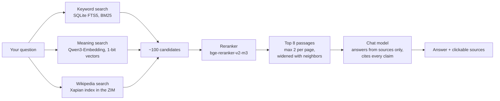

<p align="center">
  
</p>

<p align="center">
  <b>A local AI model and a 200 GB offline library, on one Mac, with no internet.</b><br>
  Ask a question when the grid, the phones, and the internet are down. Get plain steps, with every claim cited to a real source you can read.
</p>

<p align="center">
  <a href="LICENSE"></a>
  
  
  
</p>

> [!WARNING]
> **Lifeboat is an aid, not an authority.** A local AI model can be wrong, even with sources.
> Read the source passage before you act. If you can reach trained help, get it. See [Disclaimer](#disclaimer).

---

## Contents

- [What it is](#what-it-is)
- [Features](#features)
- [What you need](#what-you-need)
- [Install](#install)
- [Daily use](#daily-use)
- [How an answer is made](#how-an-answer-is-made)
- [The library](#the-library)
- [Models](#models)
- [Your household](#your-household)
- [Your region](#your-region)
- [Offline guarantee](#offline-guarantee)
- [Power and battery](#power-and-battery)
- [Storage layout](#storage-layout)
- [Faster indexing with a helper GPU](#faster-indexing-with-a-helper-gpu)
- [Backup and paper copy](#backup-and-paper-copy)
- [Configuration](#configuration)
- [Project layout](#project-layout)
- [Performance](#performance)
- [Troubleshooting](#troubleshooting)
- [FAQ](#faq)
- [Roadmap](#roadmap)
- [Contributing](#contributing)
- [Acknowledgments](#acknowledgments)
- [License](#license)
- [Disclaimer](#disclaimer)

---

## What it is

Lifeboat is a self-contained emergency reference you set up while you still have the internet. It
answers practical questions, such as "how do I treat a deep cut?" or "my generator won't start".
To answer, it searches a large offline library and has a local language model write a short, cited
answer.

Everything runs on one Apple Silicon Mac:

- **A chat model** (Qwen 3.6 or 3.8, or Gemma 4 for low power) runs in [llama.cpp](https://github.com/ggml-org/llama.cpp) on the GPU.
- **A search index** of millions of passages lives in one SQLite file.
- **The library** holds medical manuals, US Army field manuals, survival, repair, farming, water,
  power, and radio guides, plus all of English Wikipedia with images.
- **A web page** on `127.0.0.1` gives you a chat box, a **Load model** button, and the source text behind every answer.

No cloud. No accounts. No telemetry. After setup, you can pull the network cable and it works the same.

## Features

- **Cited answers.** Every claim carries a `[n]` citation. Click it to jump to the exact passage. The
  model is told to say "My sources don't cover this" rather than guess.
- **Steps first.** Answers lead with numbered actions, then explain. They name danger signs for
  medical problems and warn about shock, fire, and carbon monoxide.
- **Safety rules in the prompt.** The model must never invent doses, dilutions, wire sizes, or plant
  IDs. Any number must come from a source. Mushroom and wild-plant answers must name deadly look-alikes.
- **Child-dose guard.** A check in code, not in the prompt, reads every finished answer. If the
  question is about a child and the answer gives a dose, a red box tells you to check it against the
  source. If the answer mentions an adult daily maximum for acetaminophen or ibuprofen, the box says so.
- **Hybrid search.** Keyword (BM25) and meaning (vector) search over every passage, plus Wikipedia's
  own full-text index. A reranker picks the best 8.
- **Three model profiles.** `battery` (fast MoE), `best` (dense, more careful), and `tiny` (runs on 16 GB).
- **Library-only mode.** No model loaded? Search still works and shows source passages, at very low power.
- **Works with the drive unplugged.** The index stores passage text, so answers still work if the
  external drive with the archives is missing.
- **Knows your household.** A short intake records ages, weights, conditions, medicines, and allergies.
  Answers use the right person's details and flag any conflict with their allergies or medicines.
- **Region aware.** One file tells it where you are and what your local hazards are.
- **Provably offline.** `./lifeboat verify-offline` checks every socket while it answers 15 test questions.
- **Paper backup.** `./lifeboat print` builds a printable binder of ~50 critical procedures, with
  verbatim source text and no AI-written words.
- **Boring tools.** Bash, Python standard library where possible, SQLite, llama.cpp. No Docker, no
  database server, no JavaScript framework, no CDN.

## What you need

| | Minimum | Recommended |
|---|---|---|
| Computer | Apple Silicon Mac (M1 or later) | M3 Max / M4 Max / M5 Max |
| Memory | 16 GB (`tiny` model only) | 64 GB (all models) |
| Internal disk | ~40 GB free | ~60 GB free |
| Extra disk | ~170 GB, internal or external | 500 GB external NVMe SSD |
| Software | [Homebrew](https://brew.sh), then `brew install uv aria2` | |
| For setup | A fast connection for a few hours | |

After setup, Lifeboat needs no network at all.

## Install

```bash
git clone https://github.com/johnpsasser/lifeboat.git
cd lifeboat

./lifeboat setup                      # installs llama.cpp and a private Python 3.12
# or keep the big archives on an external drive:
./lifeboat setup /Volumes/MyDrive/lifeboat

nano region.json                      # set your area (see "Your region")
./lifeboat fetch                      # download models, archives, PDFs (~210 GB, resumable)
./lifeboat index                      # build the search index (hours; see "Faster indexing")
./lifeboat start                      # opens http://127.0.0.1:9110
```

What each step does:

| Step | Network | Time | Result |
|---|---|---|---|
| `setup` | yes | ~2 min | `bin/llama-server` (pinned release), `runtime/python`, `.venv`, `vendor/wheels`, `region.json` |
| `fetch` | yes | 2–4 h | Models in `models/` and `data/models/`, archives in `data/library/zim/`, PDFs in `data/library/pdf/`, checksums in `MANIFEST.json` |
| `index` | no | 4 h – 2 days | `index/index.sqlite`: every passage with keyword and vector search |
| `start` | no | ~30 s | Search helpers, web app, and chat model running on `127.0.0.1` |

**Smaller install.** Download groups run in order. Skip the ones you don't need:

```bash
./lifeboat fetch 1 2 4      # base models + core archives + PDFs, about 55 GB
./lifeboat fetch 3          # later: the 'best' and 'tiny' chat models (34 GB)
./lifeboat fetch 5          # later: full English Wikipedia with images (119 GB)
```

`fetch` is safe to re-run. It resumes partial files and skips finished ones. It checks the sha256 of
every model and archive against a pinned value or the publisher's checksum file. PDFs have no
published checksums (agencies update them), so `fetch` records their sha256 but cannot check it.

**Some PDFs need a browser.** A few government sites block scripted downloads. `fetch` tries each of
these once. If the site blocks it, `fetch` lists the link and the path at the end. Open the link,
save the PDF to that path, and run `fetch` again. These files are marked `"manual": true` in
`sources_pdf.json`.

## Daily use

| Command | What it does |
|---|---|
| `./lifeboat start` | Start everything and load the default model (`battery`) |
| `./lifeboat start best` | Start with the most careful model |
| `./lifeboat start --no-model` | Library search only. Lowest power. |
| `./lifeboat load tiny` | Switch to another model |
| `./lifeboat unload` | Free the model's memory. Search still works. |
| `./lifeboat stop` | Stop everything and free all memory |
| `./lifeboat status` | Show models, battery, drive, and index size |
| `./lifeboat verify-offline [--wifi-off]` | Prove nothing uses the network, and run test questions |
| `./lifeboat backup [dest]` | Copy program, models, and index to a drive |
| `./lifeboat print` | Build the printable emergency binder |
| `./lifeboat help` | List all commands |

In the web page:

- **Model menu + Load / Unload** switch models without the terminal.
- **Think harder** lets the model reason before it answers. It is slower but helps hard questions.
- **Search library** shows passages with no model. Use it to save power.
- **Quick topics** (bleeding, shock, water, smoke, generator, snakebite, and more) fill in a question for you.
- **Sources** under each answer show the full passage. Click **Open full source** to read the whole
  article or PDF page from the archive.
- The header shows the loaded model and its memory use, battery level, drive status, and passage count.

## How an answer is made



1. **Search three ways.** Keyword search (SQLite FTS5, BM25, with titles weighted) and meaning search
   (Qwen3-Embedding-0.6B vectors, 1-bit quantized in [sqlite-vec](https://github.com/asg017/sqlite-vec))
   run over every indexed passage. Full English Wikipedia is too large to embed, so it is searched
   live through the Xapian full-text index built into its ZIM archive.
2. **Rerank.** A cross-encoder (bge-reranker-v2-m3) scores about 100 candidates against the question.
   It keeps the best 8, at most two per page, so one article can't crowd out the rest.
3. **Widen.** Each passage is joined with the passages before and after it, so numbered steps are not cut in half.
4. **Answer.** The chat model gets the passages and strict rules: cite every claim, lead with steps,
   copy numbers exactly, warn about danger, and say when the sources are silent.
5. **Show the work.** The web page shows each source with its title, section, and page. Every `[n]` links to it.

Short follow-up questions ("what if it's a child?") carry the earlier question into the search, so the context stays right.

## The library

Every source is listed in `sources.json`, `sources_pdf.json`, or your `region.json`, with its URL and
license. After `fetch`, `MANIFEST.json` records the size and sha256 of every file on your disk, and
whether that checksum was verified against the source.

### Archives (ZIM, from [Kiwix](https://kiwix.org))

| Topic | Archive | Size | License |
|---|---|---|---|
| Medicine | WikiMed: Wikipedia medicine, with images | 1.9 GB | CC BY-SA |
| Medicine | zimgit medicine library (field manuals and guides) | 70 MB | various, free |
| Medicine | Medical Sciences Stack Exchange | 61 MB | CC BY-SA |
| Survival | zimgit post-disaster library | 645 MB | various, free |
| Water | zimgit water library | 21 MB | various, free |
| Survival | zimgit knots library | 28 MB | various, free |
| Food | zimgit food preparation library | 98 MB | various, free |
| Food | Cooking Stack Exchange | 238 MB | CC BY-SA |
| Repair | iFixit repair guides | 3.6 GB | CC BY-NC-SA |
| Repair | Motor Vehicle Maintenance & Repair Stack Exchange | 342 MB | CC BY-SA |
| Repair | Electrical Engineering Stack Exchange | 4.3 GB | CC BY-SA |
| Building | Home Improvement (DIY) Stack Exchange | 2.1 GB | CC BY-SA |
| Appropriate tech | Appropedia | 582 MB | CC BY-SA |
| Power | Energypedia | 800 MB | CC BY-SA |
| Farming | Gardening & Landscaping Stack Exchange | 933 MB | CC BY-SA |
| Farming | Sustainable Living Stack Exchange | 28 MB | CC BY-SA |
| Outdoors | The Great Outdoors Stack Exchange | 142 MB | CC BY-SA |
| Radio | Amateur Radio Stack Exchange | 77 MB | CC BY-SA |
| How-to | Wikibooks, with images | 4.7 GB | CC BY-SA |
| Everything | English Wikipedia, with images (searched live) | 127 GB | CC BY-SA |

### PDF manuals (public domain or free to use)

About 80 PDFs, including:

- **Medicine:** US Army ATP 4-02.11 and TC 4-02.1 (first aid), ST 31-91B (Special Forces Medical
  Handbook), Hesperian *Where There Is No Doctor* and *Where There Is No Dentist*.
- **Survival:** ATP 3-50.21 (Survival), FM 21-76, FM 3-05.70.
- **Navigation:** TC 3-25.26 (Map Reading and Land Navigation).
- **Water and food:** CDC and FEMA emergency water guides, the USDA *Complete Guide to Home Canning* (all parts).
- **Preparedness:** FEMA *Are You Ready?*, Ready.gov hazard sheets (wildfire, earthquake, winter storm, power outage),
  a wildfire Ready-Set-Go guide, and the EPA wildfire smoke guide.
- **Power and CO:** CDC and CPSC generator and carbon monoxide safety.
- **Radio:** CISA NIFOG (national interoperability field operations guide), FCC Part 97.
- **Your region:** whatever you list in `region.json`.

### Licenses

**This repo contains code only.** It holds no archives, models, or PDFs. `./lifeboat fetch` downloads
each file from its publisher, for your own use.

- US government works: public domain.
- Wikipedia, Wikibooks, Stack Exchange, Appropedia, Energypedia: CC BY-SA.
- iFixit: CC BY-NC-SA (no commercial use).
- Hesperian: free for personal use. Do not resell or redistribute.
- Models: Qwen (Apache-2.0), Gemma (Gemma terms of use), BGE reranker (Apache-2.0).

If you share a built copy (for example, a drive for a neighbor), follow these licenses. Do not sell it.

## Models

| Profile | Model | File size | Speed (M5 Max) | Use it when |
|---|---|---|---|---|
| `battery` (default) | Qwen3.6 35B-A3B, Q6_K | 29 GB | ~60 tokens/s | Most of the time. Mixture-of-experts: only ~3B parameters work per token, so it is fast and light on power. |
| `best` | Qwen3.8 27B, Q8_0 | 29 GB | ~30–75 s per answer | Children's doses, and hard medical or technical questions. Dense and more careful. |
| `tiny` | Gemma 4 E4B, Q4_0 | 5 GB | fast | Very low battery, or a Mac with 16 GB of memory. Least accurate. |

Two helpers always run while Lifeboat is on. Together they use about 1.5 GB:

- **Qwen3-Embedding-0.6B** (Q8_0) turns questions into vectors for meaning search.
- **bge-reranker-v2-m3** (Q8_0) scores candidate passages.

> [!IMPORTANT]
> **Use `best` for children's doses.** In testing, `battery` sometimes copied an adult daily maximum
> into a child's answer. One source prints "Do not give more than 8 tablets in 24 hours" right after
> its child dose table, with no age. `best` got the child limit right in 5 of 5 tests. `battery` gave
> the adult maximum in 3 of 5. The child-dose guard flags these answers, but read the source either way.

All models are GGUF files run by `llama-server` with Metal. The default model and helpers live on
the internal disk. `best` and `tiny` can live on the external drive. To change models, edit
`PROFILES` in `app/config.py` and the matching entries in `sources.json`.

## Your household

The first time you open Lifeboat, a short intake asks about your home and the people you live with.
You can skip any question, and change anything later with the **Household** button.

| For each person | For the home |
|---|---|
| Name, birth year, sex, weight | Rural, town, or city, and anything about the location |
| Pregnant or breastfeeding | Water source and storage |
| Health conditions and daily medicines, with doses | Heat and cooking |
| Allergies, and what happens | Backup power |
| Blood type | Medical and emergency supplies on hand |
| Mobility, vision, hearing, or other needs | Pets and their needs |
| First aid or other training | |

Every answer then uses it. Ask "Mia got stung by a bee and her lips are swelling", and the model
knows Mia is 7, weighs 45 lb, and has a bee-sting allergy with an EpiPen Jr on hand. The rules say:

- Match "Mia", "my son", or "my wife" to the right person, and ask if it is unclear.
- Check every treatment, medicine, and food against that person's allergies, conditions, and medicines.
  Put any conflict first, in bold.
- For children, pregnancy, and older adults, give only doses the sources state for that age or weight,
  and show the arithmetic. Never scale an adult dose. A child's daily limit is the child's dose times
  the doses per day in the source, never an adult maximum.
- Point out supplies and training in the household that help.

When a question names a child, an infant, or someone pregnant, the search also looks for passages about that group.

**Privacy.** The answers live only in `household.json` in the project folder. The file is readable
by your user account only, git ignores it, and it never leaves the Mac. `./lifeboat backup` copies it,
and `./lifeboat print` puts it on the binder's cover page. It holds health information, so keep
FileVault on.

## Your region

`region.json` tells Lifeboat where you are. The model is told your area and its main hazards, so
it can weigh its advice, for example toward smoke, heat, or snow. `region.json` is not in git.

```json
{
  "name": "Los Angeles County, California",
  "short": "Los Angeles County",
  "hazards": "earthquakes, wildfire and smoke, extreme heat, debris flows and flash floods after fires, and tsunami on the coast",
  "test_question": ["hazards", "A major earthquake just hit. What do I do now and in the next hour?"],
  "pdfs": [
    {"id": "usgs-shakeout-scenario", "title": "USGS OFR 2008-1150 The ShakeOut Scenario",
     "url": "https://pubs.usgs.gov/of/2008/1150/of2008-1150.pdf", "license": "US Gov public domain"}
  ]
}
```

`./lifeboat setup` copies `regions/los-angeles.json` if you have no `region.json` yet. Edit it for
your area. Good local PDFs: USGS hazard fact sheets, your county's evacuation guide, and your state's
wildfire, flood, or winter storm guides. Then run `./lifeboat fetch 4` and `./lifeboat index`.
See [`regions/README.md`](regions/README.md). Pull requests with new region files are welcome.

## Offline guarantee

Lifeboat is built so it *cannot* depend on the network at run time:

- Every server binds to `127.0.0.1` only: the app (9110), chat model (9120), embedder (9121), and reranker (9122).
- `llama-server` runs with `--offline`. The web page loads no fonts, scripts, or images from anywhere else.
- Wikipedia and other archives are read from local ZIM files through libzim. There is no kiwix-serve and no web proxy.
- The Python environment can be rebuilt from `vendor/wheels` with no internet.

`./lifeboat verify-offline` proves it on your machine:

1. It lists every Lifeboat process and its children, and checks that each listens on loopback only.
2. It asks 15 test questions across all topics and watches for any outside connection while each answer runs.
3. It scans the web page files for outside URLs.
4. It writes every answer, its timing, and its sources to `logs/verify-<date>.md`.

Add `--wifi-off` to turn Wi-Fi off for the test and back on afterward.

## Power and battery

- A MacBook draws 60–100 W while it writes an answer. A full battery gives about 1–1.5 hours of
  nonstop answers, but many hours of light use.
- Click **Unload model** when you are not asking questions. It frees 29 GB of memory.
- **Search library** with no model uses very little power and still shows source passages.
- Leave **Think harder** off unless you need it. It can triple the answer time.
- Turn on macOS Low Power Mode and dim the screen.
- A 100 W+ solar panel and a USB-C PD power station can keep it running indefinitely.

## Storage layout

| What | Where | Size | Needed for |
|---|---|---|---|
| Program, Python, llama.cpp | project folder | ~1 GB | Everything |
| Default model + helpers | `models/` | ~31 GB | Answers |
| Search index (includes passage text) | `index/index.sqlite` | 5–15 GB | Answers and search |
| Archives (ZIM) and PDFs | `data/library/` | ~150 GB | "Open full source", Wikipedia search |
| Extra models (`best`, `tiny`) | `data/models/` | ~34 GB | Those profiles only |

`data` can be a folder or a link to an external drive (`./lifeboat setup /Volumes/MyDrive/lifeboat`).
If the drive is unplugged, Lifeboat still answers from the index. Only "Open full source", full
Wikipedia search, and the `best`/`tiny` models need it. The header shows the drive status.

## Faster indexing with a helper GPU

On the Mac alone, indexing runs at about 60 passages per second. The core library is several million
passages, so a full index can take a day or more. A Linux machine with an NVIDIA GPU can do the
embedding during setup instead, at about 280 passages per second on a DGX Spark. Lifeboat never
uses the helper at run time.

On the helper machine:

```bash
mkdir -p ~/lifeboat-prep/hf
# copy scripts/remote_embed_worker.py from the Mac into ~/lifeboat-prep/
docker run -d --name lifeboat-embed --gpus all --ipc host -p 127.0.0.1:9121:8000 \
  -v ~/lifeboat-prep/hf:/root/.cache/huggingface nvcr.io/nvidia/vllm:26.02-py3 \
  vllm serve Qwen/Qwen3-Embedding-0.6B --runner pooling --max-model-len 2048 \
  --gpu-memory-utilization 0.35 --max-num-seqs 512
```

On the Mac:

```bash
./lifeboat index --embed ssh:user@gpu-box
# or index each archive as soon as its download finishes:
scripts/index_loop.sh ssh:user@gpu-box
```

How it works: the Mac reads and splits the archives, and sends text in batches over a plain `ssh`
session to `remote_embed_worker.py`. The worker calls vLLM on the helper's loopback and sends back
1-bit vectors. It uses ssh stdin/stdout, so it needs no open ports and works where TCP forwarding is
disabled. Each request has a time limit, and a text that stalls the server is retried in smaller
pieces, so one bad passage cannot stop the index. vLLM vectors agree with the Mac's llama.cpp vectors
on 98.7–99.4% of bits, so the two are interchangeable.

When indexing is done: `docker rm -f lifeboat-embed`.

## Backup and paper copy

```bash
./lifeboat backup /Volumes/MyDrive/lifeboat/system
```

This copies the program, Python, models, and index. If `data` is a folder (not a drive link), it
copies the archives too. To run on another Apple Silicon Mac, copy the folder over, link `data` to
the archives (`ln -s /Volumes/MyDrive/lifeboat data`), and run `./lifeboat start`. If the Python
environment is broken, `start` rebuilds it from `vendor/wheels` with no internet.

**Paper backup.** `./lifeboat print` searches the library for about 50 critical procedures in 10
chapters: life threats, injuries, illness, bites and poisons, water, food, fire and shelter, power,
navigation, and radio. It writes `print/binder.html` with three verbatim passages per topic, their
sources, and no AI-written text. The cover lists your household from the intake, with blanks for
corrections, meeting points, and a radio plan. Print it from the browser and keep it with your kit.

## Configuration

| File | What it controls |
|---|---|
| `household.json` | Your people, health details, home, and pets (written by the intake; not in git) |
| `region.json` | Your area, hazards, test question, and local PDFs (not in git) |
| `app/config.py` | Paths, ports, model profiles, context sizes, and retrieval settings |
| `sources.json` | Models and ZIM archives to download, with sha256 and license |
| `sources_pdf.json` | Shared PDF manuals to download |
| `app/server.py` | The model's rules (`SYSTEM` prompt) |
| `scripts/make_binder.py` | Binder chapters and topics |
| `scripts/verify_offline.py` | Test questions |

Retrieval settings in `app/config.py`:

| Setting | Default | Meaning |
|---|---|---|
| `TOP_K_FTS` | 60 | Keyword candidates |
| `TOP_K_VEC` | 60 | Vector candidates |
| `TOP_K_WIKI` | 6 | Wikipedia articles pulled live |
| `RERANK_POOL` | 48 | Candidates sent to the reranker |
| `FINAL_PASSAGES` | 8 | Passages given to the model |

**Updating the library.** Edit `sources.json` with newer Kiwix file names, run `./lifeboat fetch`,
then `./lifeboat index`. The indexer skips sources it already finished and redoes any that changed.

## Project layout

```
lifeboat/
  lifeboat                 control script (start, stop, load, fetch, index, ...)
  app/
    config.py              paths, ports, models, region
    household.py           your household: storage and the text the model sees
    server.py              FastAPI app: chat (SSE), search, load/unload, archive reader
    llm.py                 starts and stops llama-server processes
    retrieve.py            hybrid search, rerank, neighbor widening
    library.py             reads ZIM archives with libzim, live Wikipedia search
    index.py               builds the index: extract, chunk, embed, store
    extract.py             HTML, Stack Exchange, and PDF text extraction
    embedder.py            local or ssh-helper embedding
    static/                the web page (vanilla HTML, CSS, JS)
  scripts/
    setup.sh               one-time install
    fetch.py               resumable, checksummed downloads (aria2 or curl)
    index_loop.sh          index archives as downloads finish
    remote_embed_worker.py helper-GPU embedding worker
    verify_offline.py      offline proof and test questions
    make_binder.py         printable binder
  regions/                 example region files
  assets/                  logo and banner
  sources.json             models and archives
  sources_pdf.json         PDF manuals
  DESIGN.md                research and design decisions
```

Not in git: `household.json`, `region.json`, `bin/`, `models/`, `data/`, `library/`, `index/`, `runtime/`, `vendor/wheels/`, `.venv/`, `logs/`.

## Performance

Measured on a MacBook Pro M5 Max (64 GB) with the `battery` model:

| Step | Time |
|---|---|
| Load chat model | 20–60 s |
| Search (keyword + vector + Wikipedia + rerank) | ~2 s |
| Generation | ~60 tokens/s |
| Full cited answer | ~10 s |
| Indexing, Mac only | ~60 passages/s |
| Indexing, DGX Spark helper | ~280 passages/s |
| Downloads with aria2 metalinks | 17–22 MB/s |

## Troubleshooting

| Problem | Fix |
|---|---|
| Page does not open | `./lifeboat status`. If it is not running, `./lifeboat start`. Check `logs/app.log`. |
| "No chat model loaded" | Click **Load model**, or `./lifeboat load`. Search still works without it. |
| Model will not load | Check `logs/chat.log`. Close other large apps. Use `tiny` on 16–32 GB Macs. |
| "Drive missing" | Plug in the data drive. Answers still work from the index. |
| Slow answers | Use `battery`, not `best`. Turn off **Think harder**. Plug in power. |
| Search finds nothing | `./lifeboat status` shows the passage count. If it is 0, run `./lifeboat index`. |
| A download fails or is slow | Run `./lifeboat fetch` again. It resumes. Install `aria2` for mirror downloads. |
| Indexing stops on one source | Run `./lifeboat index` again. It redoes unfinished sources. |
| Python errors after moving the folder | Delete `.venv` and run `./lifeboat start`. It rebuilds offline. |

## FAQ

**Why not just use a chatbot on my phone?** In a wildfire, earthquake, or long outage, cell service and
the internet are often the first things to fail. Lifeboat keeps working on battery with no signal.

**Why not just carry the PDFs?** You should, and `./lifeboat print` helps. But under stress, a search
across 200 GB that answers in plain steps, with the source page attached, is faster than paging
through 80 manuals.

**Can the model be wrong?** Yes. That is why every answer shows its sources, the model is told to say
when the sources are silent, and the binder holds only verbatim text. Read the source before you act.

**Why Apple Silicon only?** Unified memory lets a laptop run a 29 GB model on its GPU, on battery.
The code is mostly portable. Linux with an NVIDIA GPU would need a different llama.cpp build and
small changes to the control script. Contributions are welcome.

**Can other people on my network use it?** Not by default. It binds to `127.0.0.1` on purpose. Opening
it to a network needs a password and more care.

**Why not Ollama or Open WebUI?** One pinned `llama-server` binary is easier to keep working for years
offline. A small custom page shows sources and power status, and loads nothing from the internet.

**How is this different from Project NOMAD?** [Project NOMAD](https://github.com/Crosstalk-Solutions/project-nomad)
is a Docker server for Linux. Lifeboat is a laptop-first, single-machine build for macOS, with
cited retrieval over the whole library.

## Roadmap

- Offline maps: OpenStreetMap / Protomaps regional extracts and USGS topo.
- Linux + NVIDIA support.
- More region files.
- A small field-test suite with expected answers, to catch regressions in retrieval and dosing.
- A second check pass for doses in every medical answer, not only children's.

## Contributing

Pull requests are welcome, especially:

- new region files in `regions/`
- new public-domain or openly licensed sources, with the license recorded
- Linux and NVIDIA support
- better extraction for specific archives

Ground rules:

- **No network calls at run time.** Ever.
- **Record the license** of every new source.
- **Prefer boring tools.** No new services, frameworks, or build steps without a strong reason.
- Never commit models, archives, PDFs, or the index.

## Acknowledgments

Lifeboat stands on the work of [Kiwix](https://kiwix.org) and openZIM,
[llama.cpp](https://github.com/ggml-org/llama.cpp), [sqlite-vec](https://github.com/asg017/sqlite-vec),
[Qwen](https://github.com/QwenLM), [Gemma](https://ai.google.dev/gemma), [BAAI](https://huggingface.co/BAAI),
[vLLM](https://github.com/vllm-project/vllm), [Hesperian Health Guides](https://hesperian.org),
the Wikipedia and Stack Exchange communities, Appropedia, Energypedia, iFixit, and the US government
agencies whose manuals are in the public domain. [Project NOMAD](https://github.com/Crosstalk-Solutions/project-nomad)
inspired the content list.

## License

Code: [MIT](LICENSE). Downloaded content keeps its own license (see [Licenses](#licenses)).

## Disclaimer

Lifeboat is not a doctor, an electrician, or an emergency service. It does not call for help. A local
AI model can be wrong, even with sources. Read the source passage before you act. If you can reach
trained help, get it. The software comes with no warranty.
