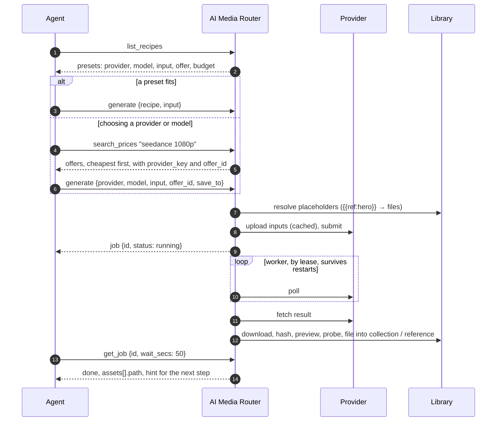
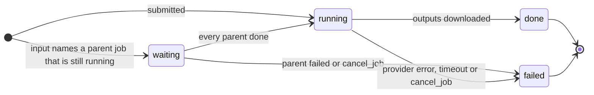
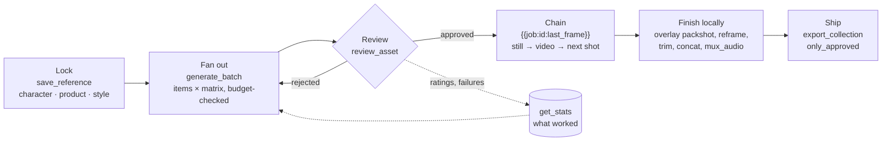
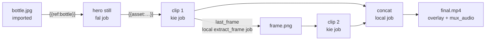
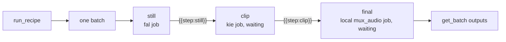
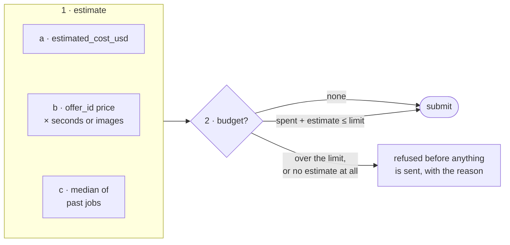
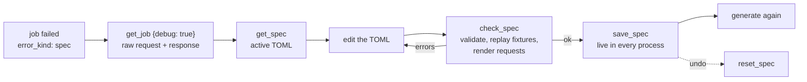
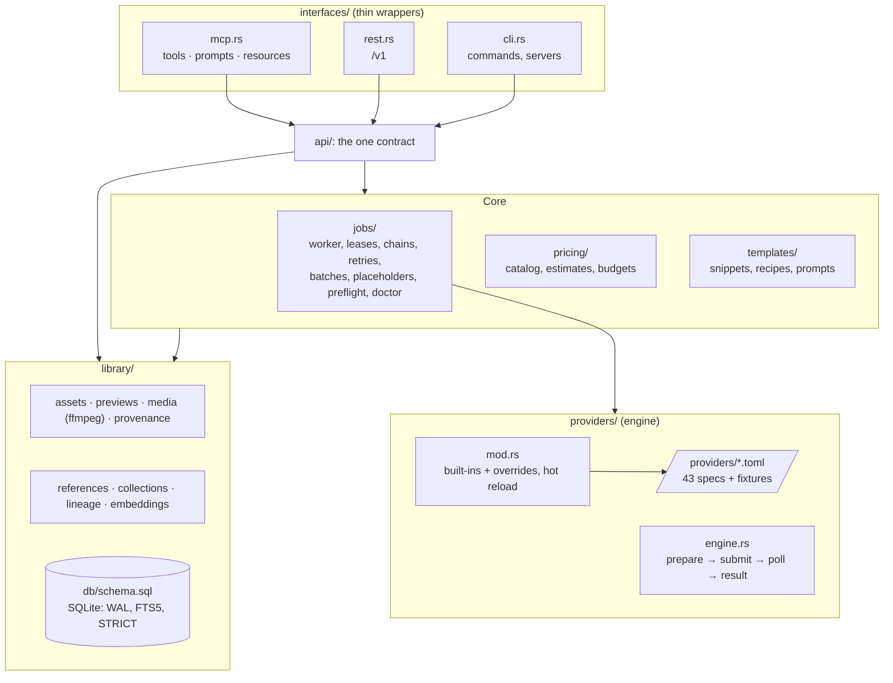

<h1 align="center">
  <picture>
    <source media="(prefers-color-scheme: dark)" srcset="docs/assets/logo-wordmark-dark.svg">
    <source media="(prefers-color-scheme: light)" srcset="docs/assets/logo-wordmark-light.svg">
    
  </picture>
</h1>

<p align="center">
  <strong>One MCP server for AI image and video generation across 40+ providers, with your own keys and a local library that remembers everything.</strong>
</p>

<p align="center">
  <a href="https://github.com/jutsuhq/ai-media-router/actions/workflows/ci.yml"></a>
  <a href="https://github.com/jutsuhq/ai-media-router/releases/latest"></a>
  <a href="LICENSE"></a>
  <a href="https://modelcontextprotocol.io"></a>
</p>

AI Media Router is an open-source MCP server that lets Claude, Cursor, Codex or any MCP client generate images and videos with Seedance, Kling, Veo, Wan, FLUX, GPT Image, Nano Banana, Seedream and more, through 43 providers: fal, Replicate, kie, Runware, WaveSpeed, OpenRouter, BytePlus and 35 others, or your own ComfyUI server. The agent compares prices across providers before it spends, pays each one with your own key, and gets every result back as a local file it can search, review, reuse as a reference and chain into the next shot. Self-hosted, a single Rust binary, MIT.

For example, on November 1, 2026 the price catalog listed Seedance 2.5 text-to-video at 720p with audio from $0.216 a second (302.AI) to $0.462 (fal) among the providers the router can call: the same 10-second clip for $2.16 or $4.62. `search_prices` shows the agent that spread before it picks.

<p align="center">
  <picture>
    <source media="(prefers-color-scheme: dark)" srcset="docs/assets/architecture-dark.svg">
    <source media="(prefers-color-scheme: light)" srcset="docs/assets/architecture-light.svg">
    
  </picture>
</p>

**Contents:**
- [Why](#why)
- [Supported providers](#supported-providers)
- [Compared with other ways to generate from an agent](#compared-with-other-ways-to-generate-from-an-agent)
- [Quick start](#quick-start)
- [How a generation works](#how-a-generation-works)
- [The five pillars](#the-five-pillars)
- [Production pipelines](#production-pipelines)
- [Placeholders](#placeholders)
- [Costs and budgets](#costs-and-budgets)
- [Checks before spending](#checks-before-spending)
- [When a job fails](#when-a-job-fails)
- [Interface](#interface)
- [Fixing a provider whose API changed](#fixing-a-provider-whose-api-changed)
- [Architecture](#architecture)
- [Testing](#testing)
- [FAQ](#faq)

## Why

| Without it | With AI Media Router |
|---|---|
| Every provider has its own API, auth, polling and output format | One `generate` → `get_job` loop for all 43; providers are TOML files |
| Result URLs expire after hours or days | Every output is downloaded at once, content-hashed, indexed, previewed |
| The agent forgets what it made last week | Full-text and similarity search, history, lineage graph, per-model stats |
| A character or product drifts between shots | Named references fed into every generation with `{{ref:name}}` |
| "$5 budget" is a promise in a prompt | Budgets refuse a job before it is submitted, from real price estimates |
| An API change breaks the integration until a release | The agent reads the raw exchange, fixes the spec, saves it live |

Principles: bring your own keys (no middleman account), the agent chooses provider and price (no hidden routing), `model` and `input` pass through unchanged (no lagging unified schema). Details are in [docs/concept.md](docs/concept.md).

## Supported providers

44 built-in provider specs (Higgsfield has two), each a TOML file in [`providers/`](providers) with recorded fixtures. `ai-media-router providers` lists them with the env vars each one still needs.

| Kind | Providers (key) |
|---|---|
| Inference platforms and API aggregators | fal.ai (`fal`), Replicate (`replicate`), Runware (`runware`), WaveSpeedAI (`wavespeed`), kie.ai (`kie`), OpenRouter (`openrouter`), Vercel AI Gateway (`vercel`), Together AI (`together`), DeepInfra (`deepinfra`), Novita AI (`novita`), SiliconFlow (`siliconflow`), Segmind (`segmind`), Atlas Cloud (`atlascloud`), each::labs (`eachlabs`), AI/ML API (`aimlapi`), 302.AI (`ai302`), APIMart (`apimart`), CometAPI (`cometapi`), EvoLink (`evolink`), PiAPI (`piapi`), ModelsLab (`modelslab`), Makernice (`makernice`), Pollo AI (`pollo`), Sume (`sume`), Unifically (`unifically`), Yir (`yir`), Higgsfield (`higgsfield`; `higgsfield-account` signs in to the account and pays in credits), Comfy Router partner models (`comfy`) |
| Model makers' own APIs | BytePlus ModelArk (`byteplus`) and Volcengine Ark (`volcengine`) for Seedance and Seedream, Kling (`kling`), Gemini API (`gemini`) for Veo and Nano Banana, Google Vertex AI (`vertex`) for Veo, Imagen and Nano Banana, Alibaba Cloud Model Studio (`alibaba`, `alibaba-cn`) for Wan, MiniMax Hailuo (`minimax`), Runway (`runway`), Luma (`luma`), LTX (`ltx`), PixVerse (`pixverse`), Vidu (`vidu`), xAI Grok Imagine (`xai`) |
| Self-hosted | ComfyUI (`comfyui`): your own server or a rented GPU, any workflow in API format, 0 USD per job |

Models are not a fixed list: `model` goes to the provider as written, so a model a provider adds today works today. `get_provider` shows the model id format and an example call. Specs not yet checked against a live response say so in their `notes`; live verification of every spec is on the [roadmap](docs/concept.md#roadmap).

## Compared with other ways to generate from an agent

| | One provider's own MCP server (for example fal's or Replicate's) | A local ComfyUI | AI Media Router |
|---|---|---|---|
| Providers | That one | Models you run yourself | 43 providers, plus your ComfyUI as one of them |
| Price comparison | Its own prices | Free per job, your GPU | Catalog prices across providers, before the agent picks |
| Spending limit | Whatever that provider offers | Not needed | Named USD budgets that refuse a job before it is sent |
| Where results end up | That provider's storage or URLs | Your ComfyUI output folder | A local library: search, ratings, references, lineage |
| Account | That provider's | None | None of ours: your keys go straight to each provider |

AI Media Router is not a hosted gateway like OpenRouter: there is no account, no balance and no markup, and OpenRouter itself is one of the providers it calls. It does not route to the cheapest provider by itself either; it shows prices and the agent or you choose.

## Quick start

**1. Install.** Prebuilt binaries for Linux (x86_64, arm64), macOS (Apple silicon, Intel) and Windows (x86_64) are on the [releases page](https://github.com/jutsuhq/ai-media-router/releases). You can also build from source with Rust 1.89 or later:

```bash
cargo install --git https://github.com/jutsuhq/ai-media-router
```

Or run the container (stdio MCP; `/data` holds the library):

```bash
docker run -i --rm -v ai-media-router:/data -e KIE_API_KEY ghcr.io/jutsuhq/ai-media-router
```

**2. Add keys** in a terminal. The value is read from a hidden prompt, or from stdin, and never passes
through an agent or a tool call:

```bash
ai-media-router keys set KIE_API_KEY
pbpaste | ai-media-router keys set FAL_KEY
```

On Windows there is no hidden prompt: pipe the value in (`Get-Clipboard | ai-media-router keys set FAL_KEY`).

`--store auto` (the default) keeps the secret in the OS keychain (macOS keychain, Linux Secret Service
via `secret-tool`) when one is available, else in `<home>/config.toml` under `[env]`, written atomically
with mode 0600; `--store keychain` or `--store file` forces one. In `config.toml` a keychain-held key
appears as `FAL_KEY = "keychain:ai-media-router/<id>"`, with no secret in the file. The process
environment still overrides both, and keys apply without a restart.

`ai-media-router keys list` shows every key variable, which providers use it, whether it is set, its source
(environment, keychain or config file), its last four characters and the exact `keys set` command.
`ai-media-router keys test kie` makes a free auth check where its spec defines `auth_check`: accepted, refused,
inconclusive, not_supported or not_configured. `ai-media-router keys remove FAL_KEY` deletes a key.

**Or sign in to an account.** `higgsfield-account` uses your Higgsfield account and its credits instead of
an API key (the `higgsfield` provider is the API key pair, billed in USD):

```bash
ai-media-router login higgsfield-account
```

A browser opens to sign in (`--no-browser` prints the URL instead); the command listens on 127.0.0.1 only
until the sign-in finishes or five minutes pass. The session is stored like a key, in the keychain or
`config.toml`, and refreshes itself; `ai-media-router logout higgsfield-account` signs out. Agents see
only whether you are signed in, never a token. Budgets count USD: a job paid in credits counts its
`estimated_cost_usd`, as kie's credit-billed jobs do.

`<home>` is set by `--home` or `AI_MEDIA_ROUTER_HOME`. By default it is the OS data dir: `~/Library/Application Support/jutsu.ai-media-router` on macOS, `%APPDATA%\jutsu\ai-media-router\data` on Windows, `~/.local/share/ai-media-router` on Linux. `ai-media-router providers` lists every provider and the env vars it still needs.

**3. Connect an agent.** For Claude Code:

```bash
claude mcp add ai-media-router -- ai-media-router mcp
```

For Claude Desktop (`claude_desktop_config.json`), Cursor (`~/.cursor/mcp.json`) and other clients that take an `mcpServers` block, use the binary's full path, since these apps may not see your shell's `PATH`:

```json
{
  "mcpServers": {
    "ai-media-router": {
      "command": "/usr/local/bin/ai-media-router",
      "args": ["mcp"]
    }
  }
}
```

Then ask the agent something like "find the cheapest Seedance 2.5 offer at 720p among my providers and make a 5-second clip of a paper boat on a rainy street".

| Mode | Command |
|---|---|
| MCP over stdio (one process per agent session) | `ai-media-router mcp` |
| HTTP: REST `/v1/*` and MCP `/mcp` | `ai-media-router serve --bind 127.0.0.1:8787` |
| CLI | `ai-media-router prices seedance --res 1080p`, `generate`, `jobs`, `assets`, … (`--help`) |

`serve` refuses a non-loopback address unless `AI_MEDIA_ROUTER_TOKEN` is set. Then every request needs `Authorization: Bearer <token>`, and `save_spec` / `reset_spec` stay disabled unless `--allow-spec-writes` is given.

**4. Save a preset.** A preset is a saved single generation; `--input` merges over its input field by field:

```bash
ai-media-router recipes save video-draft --provider fal --model <model> --input '{"prompt": "…"}' --budget ad
ai-media-router generate --recipe video-draft --input '{"prompt": "a bottle on wet stone"}'
```

The preset supplies provider, model, input, save_to, offer and budget; fields given in the call win.
`ai-media-router recipes list` shows the presets.

**Optional extras:**

| Install / set | Unlocks |
|---|---|
| `COMFYUI_URL` (e.g. `http://127.0.0.1:8188`), optional `COMFYUI_TOKEN` | Your own ComfyUI server as provider `comfyui`: `input` is the API-format workflow, `{{asset:…}}` in a LoadImage node uploads the file, jobs cost 0 USD |
| `ffmpeg` and `ffprobe` on PATH, or `FFMPEG` / `FFPROBE` in `[env]` | Previews; `width`, `height`, `duration_secs`, `has_audio` on assets; media operations; `{{job:…:last_frame}}` |
| `EMBEDDINGS_API_KEY` (OpenAI), or `EMBEDDINGS_URL` + `EMBEDDINGS_MODEL` for any OpenAI-compatible endpoint such as Ollama | `similar_assets` |

## How a generation works



A job moves through these states:



## The five pillars

| Pillar | The agent's question | Main tools |
|---|---|---|
| **Generation gateway** | "Make this with that model, at that price." | `search_prices`, `estimate_cost`, `preflight`, `generate`, `get_job`, `generate_batch`, `cancel_job`, budgets |
| **Asset library** | "Where is everything I have made?" | `search_assets`, `get_asset`, `review_asset`, collections, `export_collection`, media operations |
| **Reference manager** | "Keep this character, product or style consistent." | `save_reference`, `{{ref:name}}`, `add_to_reference` |
| **Agent memory** | "What did I make before, from what, and what worked?" | `list_jobs`, `get_lineage`, `similar_assets`, `get_stats` |
| **Prompt blocks and recipes** | "Do that again, with this changed." | `save_snippet`, `save_recipe`, `run_recipe`, MCP prompts |

### Provenance in files

Every generated file carries where it came from, so a file shared, moved or restored from a backup
still knows its history without the database. Saved outputs get one JSON record: `generator`
(router version), `job_id`, `provider`, `model`, `input` (snippets expanded, `{{asset:…}}` / `{{ref:…}}`
placeholders kept), `prompt` and `parents` (the asset ids the job read).

| Format | Where | Writer |
|---|---|---|
| PNG | `iTXt` chunk `ai-media-router` | built in |
| JPEG | `COM` segment | built in |
| MP4, MOV, WebM | `comment` tag, stream copy (no re-encode) | ffmpeg; skipped without it |
| WebP, GIF, audio, others | not written | |

API keys are never written: values of the provider's key variables are replaced by `<redacted>`,
URLs lose their query string and credentials (or become `{{asset:<id>}}` when the library knows them),
and data URIs are left out. The asset id and size are those of the file with its metadata.

`import_asset` reads the record back: it fills `prompt`, adds provider and model to `tags`, links the
asset to its job (recreating it as a finished job in another library, so `save_recipe {from_job}`
works) and to its parents. The result has `provenance`, `missing_parents` (import those files to link
them) and a `hint`. Importing the same file again is harmless and links parents imported since.

Set `EMBED_METADATA = "false"` in `[env]` to store provider files unchanged. Embedding makes every
job's file unique, so two jobs returning identical bytes no longer share one asset.

## Production pipelines

Single generations are rarely the deliverable. The router supports the whole production loop: lock what must not change, fan out variants, keep only the good takes, chain stills into video, and finish locally.



**Example: a three-shot product ad.**

```jsonc
// 1. lock the real product photo
save_reference {"name": "bottle", "kind": "product", "description": "amber glass bottle, gold cap", "asset_ids": ["a1f3…"]}

// 2. four hero stills: two aspect ratios × two seeds, the whole batch checked against a $3 cap
set_budget     {"name": "ad", "limit_usd": 3}
generate_batch {"defaults": {"provider": "fal", "model": "<image model from get_provider>", "budget": "ad", "estimated_cost_usd": 0.05,
                             "input": {"prompt": "{{ref:bottle.description}} on wet black stone, {{snippet:brand-light}}",
                                       "image_url": "{{ref:bottle}}"},
                             "save_to": {"collection": "ad"}},
                "matrix": {"aspect_ratio": ["16:9", "9:16"], "seed": [1, 2]}}

// 3. keep the best take, animate it (priced from the catalog offer), continue from its last frame
review_asset   {"asset_ids": ["b7…"], "status": "approved", "rating": 5}
generate       {"provider": "kie", "model": "<video model>", "budget": "ad", "offer_id": "<from search_prices>",
                "input": {"image_url": "{{asset:b7…}}", "duration": 5}}
generate       {"provider": "kie", "model": "<video model>", "budget": "ad", "offer_id": "<from search_prices>",
                "input": {"image_url": "{{job:<clip 1 job id>:last_frame}}", "duration": 5}}

// 4. join, add the real packshot and the voice-over, export what was approved
concat / overlay / mux_audio → export_collection {"collection": "ad", "only_approved": true}
```

Every step is recorded, so `get_lineage` on the final video shows the whole graph back to the product photo:



## Placeholders

`model` and `input` go to the provider unchanged, except for these placeholders. The job stores the input with its placeholders, so it can be rerun or saved as a recipe.

| Placeholder | Write it as | The provider receives |
|---|---|---|
| `{{asset:<id>}}` | a whole string value | the file uploaded through the provider (URL, file id or data URI), cached per asset and provider |
| `{{ref:<name>}}` | a whole string value | inside an array: all assets of the reference; as a single value: its first one. Rejected assets are skipped |
| `{{job:<id>}}` | a whole string value | that job's outputs (all of them in an array, else the first). The new job is `waiting` until the parent is done |
| `{{job:<id>:<n>}}` | a whole string value | output `n` of that job, counting from 0 |
| `{{job:<id>:last_frame}}`, `first_frame` | a whole string value | that frame of the job's first video, extracted locally and recorded in lineage |
| `{{snippet:<name>}}` | anywhere inside a string | the snippet's text |
| `{{ref:<name>.description}}`, `.tags` | anywhere inside a string | the reference's words |
| `{{var:<name>}}` | in a recipe's input | the variable's value. As a whole string it keeps its JSON type: `5` stays a number |
| `{{step:<name>}}`, `{{step:<name>:<n>}}`, `{{step:<name>:last_frame}}` | a whole string value, in a recipe step | the outputs of an earlier step of the same run, like `{{job:…}}` |

An unknown name fails with the list of known ones. A parent job that fails also fails its waiting children, with the error `parent job X failed: …` (``step `name` (job X) failed: …`` inside a recipe run).

## Recipes

A recipe saves what worked so it can run again with new values. It holds either one generation (`provider`, `model`, `input`) or a whole chain of `steps`. Each step is a generation or one of the ffmpeg edits (`extract_frame`, `reframe`, `trim`, `concat`, `overlay`, `mux_audio`), and later steps take earlier outputs through `{{step:<name>}}`. A single-generation recipe is a **preset**: save it with `save_recipe {name, provider, model, input, save_to, offer_id, budget, description}` and run it directly with `generate {recipe, input}`, which merges the call's `input` over the preset's field by field; `vars` fills `{{var:…}}`.

```jsonc
save_recipe {"name": "teaser", "save_to": {"collection": "teasers"}, "steps": [
  {"name": "still", "provider": "fal", "model": "<image model>", "estimated_cost_usd": 0.05,
   "input": {"prompt": "{{ref:bottle.description}}, {{var:scene}}", "image_url": "{{ref:bottle}}"}},
  {"name": "clip",  "provider": "kie", "model": "<video model>", "offer_id": "<from search_prices>",
   "input": {"image_url": "{{step:still}}", "duration": 5}},
  {"name": "final", "op": "mux_audio", "input": {"video_asset_id": "{{step:clip}}", "audio_asset_id": "{{asset:<voice-over>}}"}}
]}
run_recipe {"name": "teaser", "vars": {"scene": "on wet black stone"}, "budget": "ad"}
```



- **One call.** `run_recipe` creates every step's job at once, in one batch. A step that uses another waits for it, like a `{{job:…}}` chain; edit steps are `local` jobs that the worker runs with ffmpeg when their inputs are done. It returns the last step's job, and `get_batch {batch_id}` follows the whole run. The batch's `outputs` are the final steps' files (those no other step uses), and `jobs[].step` names each step.
- **Failures.** A failed step fails every step after it, with an error that names the failed step.
- **Money.** Each generation step carries its own `estimated_cost_usd` or `offer_id`. With `budget`, the sum of all steps is admitted before anything is submitted, as for a batch. `preflight {recipe, vars}` checks every step (checks named `<step>/<check>`) and `estimate_cost {recipe, vars}` lists each step's price and the sum.
- **From lineage.** `save_recipe {name, from_job: <final job>, chain: true}` (or `from_asset`) walks back through the jobs that made its inputs, down to imported files and references, and saves them as steps; their job and asset ids become `{{step:…}}`. Without `chain` it copies that one job, as before.
- **Variables and prompts.** `{{var:<name>}}` works in any step. Every recipe is the MCP prompt `recipe:<name>`, which lists its steps and variables, and the resource `ai-media-router://recipes/<name>`.

## Costs and budgets



The estimate is the first of a, b, c that exists. Without a budget, the estimate is only stored on the job.

- **Offers.** `search_prices` returns catalog offers, cheapest first, each with a stable `offer_id` (provider, model, variant, mode, resolution, audio, quality; the price is not part of it). It lists only the user's configured providers by default (once at least one key is set); `configured_only: false` (CLI `prices --all`) lists every provider. Video and image prices come from [ai-media-api-prices](https://github.com/jutsuhq/ai-media-api-prices); `kind: "image"` lists image offers. `estimate_cost` shows the number and the formula used to get it. A saved preset already carries its `offer_id`, so running it needs no price search.
- **Seconds** are read from `duration`, `duration_seconds`, `duration_secs`, `seconds`, `video_length` or `length`. `"5s"` counts as 5.
- **Output count** is read from `num_images`, `n`, `num_outputs`, `image_count`, `number_of_images`, `sample_count`, `batch_size`, `num_videos` or `count`. The top level is checked first, then nested objects.
- **Spending.** A job counts its reported USD cost once known, otherwise its estimate. Failed jobs count nothing.
- **Batches** are admitted against the budget as one sum, so a batch either fits or is refused whole.

### Not paying twice

Every job stores a fingerprint: a hash of provider, model and the input after placeholder expansion. Library files
count by asset id, which is a content hash, so the same files give the same fingerprint whether they come through
`{{asset:…}}`, `{{ref:…}}` or `{{job:…}}`, and whatever upload URL they got.

- **`reuse: true`** on `generate`, `run_recipe` or `generate_batch` defaults (CLI `--reuse`): when a job with the same
  fingerprint is done, its outputs are all still in the library and none is rejected, the call returns at once with a
  new job. That job is `done`, costs 0 USD, names the original in `reused_from`, and links the same assets as outputs
  and inputs. It is filed into its own `save_to`, belongs to its own batch, and chains like any job. `get_stats` and
  the price-history median skip reused jobs, so they count only real generations. Reuse is off by default, because
  models are not deterministic and a repeat is usually meant as a new variant.
- **Identical requests in flight.** A request identical to one started in the last 5 minutes that is still waiting
  or running is not submitted again, even without `reuse`: agents call again when their client times out. With the
  same `save_to` the call returns that job, with a `note` saying so. Otherwise, or in a batch, it gets a new job that
  waits for the original and takes its outputs at no cost. Identical items of one batch are variants and are not
  merged. `reuse: false` (CLI `--no-reuse`) always submits.
- **Before running.** `preflight` and `estimate_cost` (both take `reuse`) return `reuse: {state, job_id}` and an
  estimate of 0 when the run would be reused.

## Checks before spending

`preflight` takes the arguments of `generate` and runs every check `generate` would run, without sending or spending anything:
- provider and keys;
- snippets and placeholders: assets, references, parent jobs;
- upload support and `save_to`;
- cost and budget.

It also returns the input as the provider would receive it and the exact HTTP requests. `ready` says whether `generate` would start. On the CLI it is `generate --dry-run`, which exits 1 when a check fails.

`doctor` checks the installation:
- the data directory and the database;
- ffmpeg and ffprobe;
- configured providers, broken overrides and fixtures that no longer match;
- jobs that no worker is polling;
- the last day's failure kinds.

`doctor --online` also pings each configured provider. Run it first when something does not work.

## When a job fails

Every failed job carries `error_kind`, `retryable` and a `hint` with what to do next. `list_jobs {status: "failed", error_kind}` finds failed jobs.

| `error_kind` | Retryable | What the agent should do |
|---|---|---|
| `moderation` | no | Rewrite the prompt or replace the input image |
| `auth` | no | Set the key with `ai-media-router keys set <NAME>` in a terminal, or sign in again with `ai-media-router login <provider>` for an account provider (`get_provider` shows what is missing) |
| `quota` | no | Top up with the provider, or switch provider |
| `invalid_input` | no | Compare with `get_provider`'s example and docs |
| `not_found` | no | Check the model id against `model_hint` |
| `spec` | no | The API changed: [fix the spec](#fixing-a-provider-whose-api-changed) |
| `cancelled` | no | Generate again if it is still needed |
| `rate_limit` | **yes** | Wait, or switch provider |
| `provider_error` | **yes** | Retry later, or switch provider |
| `network` | **yes** | Check the network and the spec's `base_url` |
| `timeout` | **yes** | Retry, or switch provider |

The kind is classified in this order:
1. The provider's error text, using built-in patterns plus the spec's [`[errors.kinds]`](docs/provider-spec.md#errorskinds-optional).
2. The HTTP status.
3. The engine's own messages.

`get_stats` sums the kinds up per provider and model.

**Automatic retries.** Pass `retry: {attempts: 1-5, delay_secs}` to `generate`, `run_recipe` or `generate_batch` defaults,
or `--retry N --retry-delay S` on the CLI. After a retryable failure the same job is submitted again, and the n-th retry
waits n × `delay_secs` (default 30). `progress` says which attempt failed and why, and `attempts` counts submissions.
Retries are off by default, because some providers bill a failed attempt.


## Interface

The same operations exist as MCP tools, REST endpoints and CLI commands. They are defined once, in `src/api/`. Keys are the exception: `keys set` and `keys remove` are CLI-only, so a secret never passes through a tool call; the MCP tools `list_keys` and `test_key` only report status. The MCP server also sends short instructions, so an agent knows the order of the tools without reading this file.

<details open>
<summary><b>Generate and follow jobs</b></summary>

| MCP tool | REST | Purpose |
|---|---|---|
| `list_providers` | `GET /v1/providers` | providers, missing env vars, built-in or override, broken override files |
| `get_provider` | `GET /v1/providers/{key}` | model id format, example call, docs, upload support, quirks |
| `list_keys` | `GET /v1/keys` | every key variable: set or not, source, last 4 characters, the `keys set` command; never a value |
| `test_key` | `POST /v1/providers/{key}/test_key` | free auth check where the spec has `[auth_check]`: accepted, refused, inconclusive, not_supported, not_configured |
| `search_prices` | `GET /v1/prices?query=&provider=&res=&mode=&kind=&quality=&configured_only=&limit=` | video (per second) and image (per image) offers, cheapest first, with `kind`, `provider_key` and `offer_id`; configured providers only unless `configured_only=false` |
| `estimate_cost` | `POST /v1/estimate` `{provider, model, input, offer_id, reuse}` or `{recipe, vars, reuse}` | USD estimate, the formula, the median of past jobs; per step for a recipe |
| `preflight` | `POST /v1/jobs/preflight` (same body as `generate`, or `{recipe, vars, budget}`) | dry run: every check plus the rendered requests; sends and spends nothing |
| `generate` | `POST /v1/jobs` `{provider, model, input, save_to, budget, estimated_cost_usd, offer_id, retry, reuse}` or `{recipe, input, vars}` | start a job, run a preset, or [reuse an identical one](#not-paying-twice) |
| `get_job` | `GET /v1/jobs/{id}?wait_secs=&debug=` | status, progress, inputs, files; `debug` adds the raw exchanges |
| `list_jobs` | `GET /v1/jobs?limit=&reference=&collection=&status=&error_kind=&batch=` | generation history |
| `cancel_job` | `POST /v1/jobs/{id}/cancel` | fail a waiting or running job and its waiting children; the provider is not told |
| `generate_batch` | `POST /v1/batches` `{defaults, items, matrix, label, recipe}` | up to 100 jobs, items × matrix; with `recipe` the matrix fills its variables |
| `get_batch` | `GET /v1/batches/{id}?wait_secs=` | counts per status, jobs, every output file |
| `doctor` | `GET /v1/doctor?online=` | installation check: home, database, ffmpeg, keys, specs, fixtures, stalled jobs, recent failures |

</details>

<details>
<summary><b>Library, review and memory</b></summary>

| MCP tool | REST | Purpose |
|---|---|---|
| `search_assets` | `GET /v1/assets?query=&collection=&status=&min_rating=&limit=` | full-text search over prompts, tags, descriptions, review notes |
| `similar_assets` | `GET /v1/similar?query=&asset_id=&collection=&limit=` | assets closest in meaning to a text or another asset |
| `get_asset` | `GET /v1/assets/{id}`, `/file`, `/preview` | metadata (fills a missing preview and metadata), bytes, preview |
| `import_asset` | `POST /v1/assets` `{path, tags, prompt}` | add a local file; restores provenance a file made here carries |
| `update_asset` | `PATCH /v1/assets/{id}` `{tags, description}` | edit tags and description |
| `delete_asset` | `DELETE /v1/assets/{id}` | remove the file and its entry |
| `upload_asset` | `POST /v1/assets/{id}/upload` `{provider}` | upload by hand; returns the reference and where it goes in `input` |
| `review_asset` | `POST /v1/review` `{asset_ids, status, rating, notes}` | approve, reject, rate 1–5 |
| `get_lineage` | `GET /v1/assets/{id}/lineage` | ancestors and descendants with the job of each step |
| `get_stats` | `GET /v1/stats?provider=&model=&collection=` | per provider+model: done/failed share, failure kinds, rating, approvals, cost, seconds |

</details>

<details>
<summary><b>References and collections</b></summary>

| MCP tool | REST | Purpose |
|---|---|---|
| `save_reference` | `POST /v1/references` `{name, kind, description, tags, asset_ids}` | create or update a reference |
| `get_reference` | `GET /v1/references/{ref}` | one reference with its assets |
| `list_references` | `GET /v1/references?kind=&query=&limit=` | references, recently changed first |
| `add_to_reference` | `POST /v1/references/{ref}/assets` `{asset_ids, role}` | append assets |
| `remove_from_reference` | `DELETE /v1/references/{ref}/assets` `{asset_ids}` | drop assets from it |
| `delete_reference` | `DELETE /v1/references/{ref}` | delete it; the assets stay |
| `list_collections` | `GET /v1/collections` | collections with asset counts |
| `add_to_collection` | `POST /v1/collections/{name}/assets` `{asset_ids, description}` | add assets, creating the collection |
| `remove_from_collection` | `DELETE /v1/collections/{name}/assets` `{asset_ids}` | drop assets; an empty collection disappears |
| `export_collection` | `GET /v1/collections/{name}/export?only_approved=` | ZIP of files, previews and `collection.json` |

</details>

<details>
<summary><b>Budgets</b></summary>

| MCP tool | REST | Purpose |
|---|---|---|
| `set_budget` | `PUT /v1/budgets` `{name, limit_usd}` | create a USD cap or change its limit |
| `list_budgets` | `GET /v1/budgets` | limit, spent, remaining |
| `delete_budget` | `DELETE /v1/budgets/{name}` | remove a cap; its jobs stay |

</details>

<details>
<summary><b>Media operations (ffmpeg, local, free)</b></summary>

Each result is a new asset made by a finished job with provider `local`, so lineage, history and `save_to` treat it like a generation. Without ffmpeg these tools fail with install instructions. CLI: `ai-media-router media frame|reframe|trim|concat|overlay|mux`.

| MCP tool | REST | Purpose |
|---|---|---|
| `extract_frame` | `POST /v1/media/extract_frame` `{asset_id, at, save_to}` | a video frame (`first`, `last` or seconds) as PNG |
| `reframe` | `POST /v1/media/reframe` `{asset_id, aspect, mode, save_to}` | new aspect ratio, centered `crop` or black `pad` |
| `trim` | `POST /v1/media/trim` `{asset_id, start, end, save_to}` | cut a video or audio file |
| `concat` | `POST /v1/media/concat` `{asset_ids, save_to}` | join videos in order (first clip's size, 30 fps) |
| `overlay` | `POST /v1/media/overlay` `{base_asset_id, overlay_asset_id, x, y, width, save_to}` | a real packshot or logo over an image or video |
| `mux_audio` | `POST /v1/media/mux_audio` `{video_asset_id, audio_asset_id, save_to}` | replace a video's sound |

</details>

<details>
<summary><b>Snippets, recipes and MCP prompts</b></summary>

| MCP tool | REST | Purpose |
|---|---|---|
| `save_snippet` | `PUT /v1/snippets` `{name, text, description}` | a prompt block used as `{{snippet:name}}` |
| `list_snippets` | `GET /v1/snippets` | snippets with their text |
| `delete_snippet` | `DELETE /v1/snippets/{name}` | remove a snippet |
| `save_recipe` | `PUT /v1/recipes` `{name, from_job \| from_asset [chain] \| provider+model+input [+offer_id, budget] \| steps, description, save_to, variables}` | a generation template with `{{var:name}}`, a preset, or a chain of steps |
| `list_recipes` | `GET /v1/recipes` | recipes with input or steps, and variables |
| `get_recipe` | `GET /v1/recipes/{name}` | one recipe |
| `run_recipe` | `POST /v1/recipes/{name}/run` `{vars, save_to, budget, estimated_cost_usd, offer_id, retry, reuse}` | one job from a recipe, or every step of a chain in one batch; for many single runs, `generate_batch {recipe, matrix}` |
| `delete_recipe` | `DELETE /v1/recipes/{name}` | remove a recipe; its jobs stay |
| MCP `prompts/list`, `prompts/get` | `GET /v1/prompts`, `GET /v1/prompts/{name}?<arg>=` | workflows `product_shoot`, `ugc_ad`, `character_consistency`, `localization_fanout`, `fix_provider`, and every recipe as `recipe:<name>` |

</details>

<details>
<summary><b>Provider specs</b></summary>

| MCP tool | REST | Purpose |
|---|---|---|
| `get_spec` | `GET /v1/providers/{key}/spec` | active spec TOML, its source, fixture names |
| `check_spec` | `POST /v1/specs/check` `{provider \| spec, model, input, vars}` | validate, replay fixtures, render requests without sending |
| `save_spec` | `PUT /v1/specs` `{spec}` | save an override, active immediately |
| `reset_spec` | `DELETE /v1/providers/{key}/spec` | back to the built-in spec |

</details>

**For agents.** [`skills/ai-media-router/SKILL.md`](skills/ai-media-router/SKILL.md) is a ready agent skill: setup, the generation loop, rules on money and failures, placeholders, batches and recipes. Copy it into your agent's skills folder. The MCP server exposes it as the resource `ai-media-router://guide`, along with every provider spec (`ai-media-router://providers/<key>`) and recipe (`ai-media-router://recipes/<name>`). [AGENTS.md](AGENTS.md) is for agents working on this repository.

## Fixing a provider whose API changed

No rebuild and no restart. The same loop works from an agent over MCP and from a shell:



| Step | MCP | CLI |
|---|---|---|
| See the raw exchange | `get_job {job_id, debug: true}` | `ai-media-router jobs <id> --debug` |
| Read the spec | `get_spec {provider}` | `ai-media-router spec show kie` |
| Check an edit | `check_spec {spec, model, input}` | `ai-media-router spec check kie --file kie.toml --model … --input '{…}'` |
| Activate | `save_spec {spec}` | `ai-media-router spec save kie.toml` |
| Undo | `reset_spec {provider}` | `ai-media-router spec reset kie` |

Error messages already point at the broken field. For example: `kie submit (builtin providers/kie.toml): capture id pointer /data/taskId matched nothing in the response: {…}`.

To make a fix permanent:
1. Copy the override into `providers/kie.toml`.
2. Add a fixture under `providers/fixtures/kie/`. A debug trace already has the fixture shape.
3. Run `cargo test`.

The format is described in [docs/provider-spec.md](docs/provider-spec.md).

**Adding a provider** is the same loop with a new file:
1. Write `providers/<key>.toml` following the spec format. Put the provider's name from the price catalog into `catalog`.
2. Add fixtures from the docs' example responses.
3. Run `cargo test`.

Parts of a spec that have not been verified go into its `notes`, which `get_provider` shows to agents.

## Architecture



- **Providers are data, not code.** Each `providers/<key>.toml` describes:
  - auth;
  - the HTTP steps;
  - JSON pointers to ids, status and outputs;
  - uploads.

  `build.rs` embeds every spec and fixture. Files in `<home>/providers/` override built-ins and are reloaded when they change.
- **One request type end to end.** The request a spec renders is the same one that is sent, shown by `check_spec`, stored in a job's trace and compared with fixtures, so these cannot drift apart. Credentials never leave the auth layer: traces show `<ENV_NAME>` instead.
- **Auth schemes live in the engine,** so specs only name env vars. Supported: `bearer`, `header`, `query`, `headers`, `basic`, `jwt_hs256` (Kling) and `command` (gcloud tokens).
- **Jobs survive restarts and parallel processes.** State lives in SQLite. Every process runs a worker, and each job is polled by whichever process wins the `UPDATE … RETURNING` lease. A retry or a job whose parents finished goes back through the same queue.
- **One schema, no migrations (pre-release).** `src/db/schema.sql` creates the database. A library from another schema version is refused with a message instead of being migrated.
- **Results are always local.** URLs, data URIs, base64 and authenticated downloads are all streamed into `<home>/assets/`, named by content hash.

```
<home>/
  ai-media-router.db   jobs, assets, references, collections, lineage, batches, budgets,
                       embeddings, snippets, recipes, upload cache (schema: src/db/schema.sql)
  assets/              files, named by content hash
  assets/previews/     JPEG previews
  exports/             collection ZIPs
  providers/           spec overrides (hot-reloaded)
  config.toml          [env]: settings; secrets kept in the file (mode 0600) or a
                       `keychain:<service>` marker
  prices.json          video price catalog, cached for a day
  image-prices.json    image price catalog, cached for a day
```

## Testing

```bash
cargo test
```

`cargo test`:
- validates every spec: required steps, auth fields, pointer and template lints, unique keys;
- replays every fixture;
- runs the engine and the API end to end against a mock provider.

```bash
python3 scripts/emulate.py --bin "$PWD/target/debug/ai-media-router"
```

`scripts/emulate.py` runs the real binary as an MCP server over stdio against a local emulator of every provider. The emulator answers the way each spec says that API answers. It checks:
- every route of every provider: submit, poll, result, download and uploads;
- every MCP tool, MCP prompt and MCP resource;
- batches, chains and `last_frame`;
- error kinds;
- every recorded fixture, replayed over HTTP.

`--only kie,fal` narrows the run. CI runs both commands on Linux, and `cargo test` on macOS and Windows too.

## FAQ

**What is an MCP server for image and video generation?**
A program an AI agent such as Claude, Cursor or Codex calls through the Model Context Protocol to make images and videos. AI Media Router is one: the agent calls `generate` and `get_job`, and the router talks to the provider's API and saves the result.

**Is AI Media Router free?**
Yes, MIT-licensed. You pay each provider directly at its own prices with your own key. The router adds no markup and has no account; ComfyUI jobs on your own server cost 0 USD.

**Does it pick the cheapest provider automatically?**
No. `search_prices` lists offers cheapest first, and the agent or you choose. There is no silent routing or fallback, so cost and quality stay explicit decisions.

**Which models can it use?**
Any model a supported provider serves, for example Seedance, Kling, Veo, Wan, Hailuo, Runway, Luma, LTX, FLUX, GPT Image, Nano Banana, Imagen and Seedream. `model` and `input` pass through unchanged.

**Is it a fal MCP or Replicate MCP alternative?**
It covers fal and Replicate as two of its 43 providers, behind one set of tools, with price comparison, budgets and a local library on top. Use a provider's own MCP server if you only ever use that provider.

**Is it like OpenRouter for images and video?**
In the sense of one interface over many providers, yes. Unlike OpenRouter it runs on your machine and has no account or balance: each provider bills you directly. OpenRouter is one of the providers it can call.

**Does it work with ComfyUI?**
Yes. Set `COMFYUI_URL` and your server becomes provider `comfyui`: the input is an API-format workflow, and files referenced as `{{asset:…}}` in a LoadImage node are uploaded for you. Comfy's hosted partner models are the separate provider `comfy`.

**Where are generated files stored?**
On your machine, in `<home>/assets/`, named by content hash and indexed in SQLite, with the prompt, provider, model and parents written into the file itself. Provider URLs that expire do not matter.

**Can an agent overspend?**
Not with a budget set. `set_budget` creates a USD cap, and a job is refused before anything is sent when what was spent plus its estimate would exceed it. The check works from estimates, so a provider that bills more than its listed price can still go over by that difference.

## License

MIT, see [LICENSE](LICENSE).
