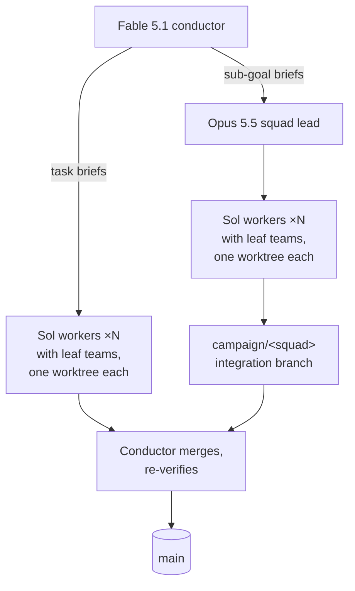

<p align="center">
  
</p>

# A Fable of Codexes

[](https://github.com/jvogan/a-fable-of-codexes/actions/workflows/validate.yml)
[](https://agentskills.io/specification)
[](https://github.com/jvogan/a-fable-of-codexes/releases)
[](LICENSE)

A Claude Code skill that makes Claude the conductor of a fleet of OpenAI Codex
workers. Claude Fable 5.1 plans the work, dispatches parallel Codex workers on
GPT-6.1 Sol to implement it, and verifies every branch before it merges. Each
Sol worker can run its own team of Sol and Luna agents, sized to the task, and
wide GPT-6 Luna sweeps take bulk read-only work. Claude Opus 5.5 agents handle
design and lead squads of Sol workers, and Claude Sonnet 5.5 agents survey the
codebase.

The conductor's context stays free for planning and judgment because workers
spend their own context on implementation and routine verification, and the
conductor reads their reports rather than their transcripts. Git worktrees let many writers work
in parallel without collisions, and campaign state lives in the repo, so a
later session resumes mid-campaign without setup.

## The fleet

| Role | Model and effort | Job |
|---|---|---|
| Conductor | Claude Fable 5.1, high (or Opus 5.5, high) | Plans, dispatches, integrates, and verifies. Writes no feature code. |
| Worker | Codex `gpt-6.1-sol`, `high` | Implements a task in its own worktree, alone or with a leaf team sized to the task. |
| Leaf | `feature`: Sol `high`; `critic`: Sol `high`, read-only; `grunt`: `gpt-6-luna` `xhigh` | Takes one slice of a Sol worker's task: judgment work, review of a sibling's diff, or mechanical work. |
| Design agent and squad lead | Claude Opus 5.5, high or xhigh | UI/UX and design review; leads a squad of Sol workers toward one integration branch. |
| Consultant and arbiter | Codex `gpt-6.1-sol`, `high` or `xhigh`, read-only | Reviews Claude diffs, answers architecture questions, judges bake-offs. |
| Deep consult | Codex `gpt-6-astra`, `max`, read-only | Runs only when you ask for an exceptional effort on a rare, very hard question. |
| Scout | Claude Sonnet 5.5, high or xhigh, or Codex `gpt-6-luna`: `max` for one deep scout, `xhigh` for many in parallel; read-only | Surveys the codebase, sweeps it package by package, and researches current APIs. |
| Other-family reviewers (optional) | `agy` Gemini 3.8 Flash high, `grok` Grok 4.7 xhigh, `muse` Muse Spark 1.3 Contributor max | Read-only second opinions from another model family. |

Without Codex, Sonnet 5.5 workers take the implementation role, Opus 5.5 takes
tasks that need design judgment, and every other part of the campaign stays the
same.



## What the skill does

The skill is [campaign-conductor](skills/campaign-conductor/SKILL.md).

- **Bootstrap.** First use in a repo copies templates into `docs/campaign-hq/`
  and the three leaf role files into `.codex/agents/`, then adds a pointer to
  the project's CLAUDE.md so later sessions resume from repo state.
- **Routing.** Defaults follow the fleet table. Say "send tests to Opus" or
  "run this wave at xhigh" and the conductor writes it to `preferences.md`,
  where it persists across sessions.
- **Sizing.** Small projects get a plan written directly. Large or unfamiliar
  ones get a parallel read-only survey first, and you sign off on the plan
  before any writer starts.
- **Parallel waves.** Each writer gets one worktree and branch. A fleet table
  tracks every dispatch with its session id, and each wave runs dispatch,
  collect, integrate, verify. A finished Codex session resumes with its
  context for small corrections.
- **Leaf teams.** A Sol worker spawns `feature` (bounded judgment), `critic`
  (read-only review), and `grunt` (mechanical, on Luna) leaves by role name. The
  role files carry the model and effort, so briefs name roles and a new model
  generation changes one line per file.
- **Squads.** An Opus 5.5 lead runs several Sol workers toward one integration
  branch. Depth stops at conductor, lead, Sol worker, leaf; leaves never spawn.
- **Review gates.** Every worker returns a fixed-schema JSON report. Codex
  reviews Claude diffs and Claude reviews Codex diffs, and high-stakes tasks
  can run as a bake-off judged on diffs and test output.
- **Permissions.** The Codex sandbox, network access, and Claude permission
  mode are set once at kickoff and recorded, so a wave never stops on a prompt.
- **Memory.** Dispatch outcomes and your corrections go into `LEARNINGS.md`
  and are compacted into standing rules before the file grows expensive.

[`examples/campaign-hq/`](examples/campaign-hq/) shows the state files
mid-campaign, including a worker brief, a report, and the routing file.

<p align="center">
  
</p>

Campaign state lives in the project:

```
docs/campaign-hq/
├── CAMPAIGN.md      plan, phases, fleet table
├── LEARNINGS.md     standing rules + dispatch log
├── preferences.md   worker routing, permission envelope
├── briefs/          one file per dispatch
├── out/             collected worker reports (event streams gitignored)
└── schemas/         worker-result.json
```

## Install

```bash
npx skills add jvogan/a-fable-of-codexes --skill campaign-conductor
```

or manually:

```bash
git clone --depth 1 https://github.com/jvogan/a-fable-of-codexes.git /tmp/afoc
cp -r /tmp/afoc/skills/campaign-conductor ~/.claude/skills/
```

## Use

In any project, tell Claude:

> start a campaign

Claude creates `docs/campaign-hq/`, sizes the plan to the project, and starts
dispatching workers. Every later session in that repo resumes the campaign.
Direct it in plain language:

- "add a phase for the billing migration"
- "send tests to Opus from now on" (saved to `preferences.md`)
- "think as hard as you can and get an Astra second opinion on this race
  condition" (one read-only `gpt-6-astra` run at `max`)
- "status" (reads the plan and fleet table)

## Requirements

- **Claude Code**, with Fable 5.1 or Opus 5.5 as the session model. The skill
  uses the Agent and Workflow tools and runs Claude subagents on Opus 5.5 and
  Sonnet 5.5.
- **OpenAI Codex CLI** ([github.com/openai/codex](https://github.com/openai/codex)).
  Install with `npm install -g @openai/codex` or `brew install codex`, then run
  `codex login`. ChatGPT-plan auth draws on plan usage, and limits vary by
  plan; API-key auth is billed per token. Size waves to your limits. The skill
  passes model and effort on every dispatch; to match it outside campaigns, set
  the default in `~/.codex/config.toml`:

  ```toml
  model = "gpt-6.1-sol"
  model_reasoning_effort = "high"
  ```

  Effort runs `low`, `medium`, `high`, `xhigh`, `max`, `ultra`, and the skill
  routes nothing below `high`. Luna stops at `max`. `ultra` delegates to
  subagents on its own, so the skill uses it only when you ask.
- **Other agent CLIs** (optional). Each adds a model family for read-only
  second opinions and signs in with OAuth: the Antigravity CLI `agy`
  ([antigravity.google](https://antigravity.google)) on
  `gemini-3.8-flash-high`, Grok Build `grok` on `grok-4.7` at `xhigh`, and
  Meta's Muse Code `muse` on `muse-spark-1.3-contributor` at `max`. Without
  them, cross-model review runs between Claude and Codex.
- **Codex plugin for Claude Code** (optional,
  [github.com/openai/codex-plugin-cc](https://github.com/openai/codex-plugin-cc)).
  Adds `/codex:review`, `/codex:adversarial-review`, and background-delegation
  commands for one-off tasks outside a campaign:

  ```
  /plugin marketplace add openai/codex-plugin-cc
  /plugin install codex@openai-codex
  ```

## Changing models

Model names live in four places. When a new generation ships, update them
together:

1. `skills/campaign-conductor/SKILL.md`: the frontmatter and the routing table.
2. `skills/campaign-conductor/references/`: the shape tables and command
   examples.
3. `skills/campaign-conductor/assets/`: the role files and `preferences.md`.
4. `examples/campaign-hq/` and this README.

A campaign already running keeps its own copies in `.codex/agents/` and
`docs/campaign-hq/preferences.md`; edit those to move it to new models.

## Validation

```bash
python3 scripts/validate.py
npx --yes skills add . --list
```

`validate.py` checks each skill against the
[Agent Skills spec](https://agentskills.io/specification) (frontmatter fields,
name format, description length), plus this repo's 500-line body limit,
relative links, and the required keys in every Codex role file. The `skills`
command confirms the installer can find the package. CI runs both on every
push and pull request.

## License

MIT
