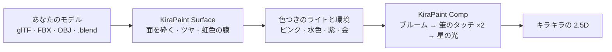

<div align="center">


<p>
  <a href="https://github.com/kanaworksai-hue/kirapaint/releases/latest"></a>
  
  
  
  
  <a href="LICENSE"></a>
  <a href="NOTICE.md"></a>
  <a href="https://github.com/kanaworksai-hue/kirapaint/stargazers"></a>
</p>

<p><a href="https://github.com/kanaworksai-hue"></a>&nbsp;<a href="https://github.com/kanaworksai-hue"><b>KanaWorks_AI のプロジェクト</b></a>&nbsp;·&nbsp;<a href="#-kanaworks-のアドオン">シリーズ一覧</a></p>

**日本語** | [English](README.en.md) | [简体中文](README.zh-CN.md) | [한국어](README.ko.md) | [Português](README.pt-BR.md) | [Español](README.es.md)

[🎨 ギャラリー](#-ギャラリー) · [🚀 はじめかた](#-はじめかた) · [🎛️ 調整できること](#️-調整できること) · [❓ FAQ](#-faq) · [⭐ Star で応援](#-star-で応援する)

</div>

**KiraPaint** は、Blender の 3D モデルを「キラキラの絵画風 2.5D」に変える、無料の Blender アドオンです。表面を小さなツヤのある面に砕いて、ピンク・水色・紫・金の光を映し込み、筆のタッチで塗りつぶしてから、いちばん明るいところに星の光を入れます。砕いたダイヤモンドのようにきらめく、手描き風の仕上がりになります。

ダウンロードしたモデル、スキャンしたモデル、AI で生成したモデルなど、**どんなモデルにも使えます**。元のマテリアルは置き換えず、前に処理を差し込むだけなので、いつでも元に戻せます。インストールから適用まで、AI エージェントに一言で頼むこともできます。

<p align="center">
  
  <br><sub>同じモデル、同じカメラ。左が通常のレンダー、右が KiraPaint。</sub>
</p>

## ✨ 特長

<table>
<tr>
<td align="center" width="25%"><br><b>どんなモデルにも</b><br><sub>glTF・FBX・OBJ・.blend。Principled BSDF ならそのまま使えます</sub></td>
<td align="center" width="25%"><br><b>砕いたダイヤのきらめき</b><br><sub>ツヤのある小さな面に色つきの光が映り、星の光が入ります</sub></td>
<td align="center" width="25%"><br><b>筆のタッチ</b><br><sub>解像度に合わせて筆の大きさが自動で変わります</sub></td>
<td align="center" width="25%"><br><b>AIにおまかせ</b><br><sub>エージェントに一言。インストール、適用、プレビューまで自動</sub></td>
</tr>
</table>

- **元に戻せる：** マテリアルは置き換えません。「KiraPaint を解除」（Remove KiraPaint）でマテリアル、ワールド、コンポジターが元どおりになります。
- **大きさに合わせて自動調整：** 面の細かさと輪郭線の太さはモデルの大きさから、筆の大きさはレンダー解像度から自動で決まります。
- **写実 ↔ 2.5D を1本のスライダーで：** 「2.5D」の値をキーフレームにすれば、写実から絵画風に変わる演出がそのまま作れます。
- **日本語の画面に対応：** Blender を日本語にしていれば、KiraPaint も自動で日本語になります。英語の Blender でも、パネル右上の🌐メニューで「日本語」を選べばパネルだけ日本語にできます。用語は Blender 公式の日本語訳（粗さ、薄膜、光沢、ブルーム、輪郭線の幅 など）に合わせています。
- **背景は10種類：** 夜空パープル、星空ネイビー、さくらピンク、いちごミルク水玉、ミントソーダ、空色ソーダ、レモンクリーム、ピーチドリーム、マジックサンセット、ソフトスタジオ。パネルのサムネイルをクリックするだけで切り替わり、落書きの色も背景に合わせて変わります。
- **ワンクリックのシーン設定：** EEVEE、照明一式（キーライト、リムライト、ツヤ専用の色つきライト5灯）、背景、コンポジターをまとめて設定します。
- **チョークの落書き：** 星・ハート・うずまき・キラキラを、モデルに重ならない位置に自動で描きます。食べ物には湯気も。

## 🎨 ギャラリー

### 3Dのまま、くるっと回せる


### どんなモデルにも

作者が用意したモデル、CC0 のモデル、Blender 標準のモンキーに、ボタン1回で適用しました。設定はすべて同じで、変えたのは背景だけです。


### 背景10種


### 4つのレイヤー


### プリセット4種


## 🧭 しくみ



1. **KiraPaint Surface**（シェーダー）を、各マテリアルの Principled BSDF の前に差し込みます。ボロノイの面ごとにノーマルを傾けて表面を平らな小さな面に砕き、ツヤを上げ、薄膜の虹色を足します。
2. 小さな面がそれぞれ違う向きで、**色つきのライトと環境**を映します。これがダイヤを砕いたようなきらめきになります。
3. **KiraPaint Comp**（コンポジター）が、ブルーム → シャープ → 異方性 Kuwahara 2種 → シャープ → ミックスで筆のタッチに塗り直し、いちばん明るい面に四方向の光を入れます。

## 🚀 はじめかた

### AI エージェントに頼む（おすすめ）

Claude Code や Codex のような、パソコンを操作できる AI エージェントにこう送るだけです。

> https://github.com/kanaworksai-hue/kirapaint の AGENTS.md に従って KiraPaint をインストールして、私のモデルをキラキラの絵画風にして。

そのあとは、プレビューを見ながら一言で直せます。

- 「キラキラをもっと強く」
- 「筆のタッチを大きく」
- 「虹色を強めに」
- 「背景をミントソーダにして」
- 「落書きはなしで」
- 「写実から絵に変わるアニメーションを付けて、60度回して」

### 自分でインストールする

**必要なもの：** Blender 5.0 以降（Blender 5.1 と 5.2 で動作確認済み）、レンダーエンジンは EEVEE。

1. [Releases](https://github.com/kanaworksai-hue/kirapaint/releases/latest) から `kirapaint-x.y.z.zip` をダウンロード
2. Blender → 編集 → プリファレンス → エクステンションを入手 → 右上の ▾ → **ディスクからインストール…** → zip を選択
3. 3D ビューで **N** キー → **KiraPaint** タブ

### 使い方

1. モデルを選択（何も選ばなければシーンのすべてのメッシュ）
2. スタイル（プリセット）と背景を選ぶ
3. **キラキラにする**（英語表示では **Make It Kira**）
4. **2.5D** スライダーで写実と絵画風を行き来し、**ルック**（Look）で微調整
5. F12 でレンダー（筆のタッチはコンポジターでかかるので、レンダー結果に出ます）

<p align="center">
  
</p>

## 🎛️ 調整できること

<details>
<summary><b>「ルック」パネルの項目</b></summary>

| 項目 | 内容 |
|---|---|
| 2.5D | 0 = 通常のレンダー、1 = KiraPaint。キーフレームを打てます |
| 砕け具合（Stroke） | 表面を小さな面に砕く強さ（ノーマルのゆがみ） |
| 面の細かさ（Facet Density） | 大きいほど面が細かくなります。1 でモデルの幅に約 6 個 |
| 光沢（Gloss） | 面のツヤ（粗さを 0.06 に近づける量） |
| 虹色（薄膜）（Iridescence） | 薄膜によるピンク・水色の虹色 |
| ブラシサイズ（Brush Size） | 筆の大きさ（1080p でのピクセル数。解像度に合わせて自動換算） |
| 星の光（Sparkle） | 星の光の強さと、ツヤ専用ライトの明るさ |
| ブルーム（Bloom） | ふんわりした光のにじみ |
| 輪郭線の幅（Outline Width） | 輪郭線の太さ（モデルの大きさに比例）。0 で無し |
| 背景（Background） | 10種類の背景（サムネイルから選択）か「自分のワールドを使う」（Keep Mine） |
| チョークの落書き・湯気（Chalk Doodles / Steam） | 落書きと湯気 |

</details>

<details>
<summary><b>プリセット</b></summary>

| プリセット | 雰囲気 |
|---|---|
| **キラ（砕いたダイヤ）**（Kira・初期設定） | ツヤのある面と色つきの光、星のきらめき。砕いたダイヤの質感 |
| **ソフトペイント**（Soft Paint） | やわらかい油絵風。きらめきは控えめ |
| **くっきりインク**（Bold Ink） | 太い輪郭線とくっきりしたタッチ |
| **ゆめかわ**（Dreamy） | 虹色と光のにじみが強い、ゆめかわいい仕上がり |
</details>

<details>
<summary><b>アニメーション</b></summary>

「シーンとアニメーション」（Scene & Animation）パネルから：

- **2.5D 切り替えを追加（Add Reveal）：** 今のフレームから「2.5D」を 0→1 にするキーフレームを挿入。写実から絵画風に変わります。
- **ターンテーブルを追加（Add Turntable）：** モデルを中心の空のオブジェクトにまとめて回転。ライトとカメラは動かないので、ツヤの光が面の上を流れます。
- **ライトを再配置・落書きを描き直す（Re-aim Lights / Redraw Doodles）：** カメラを動かしたあとに、ライトと落書きを置き直します。
</details>

## ❓ FAQ

<details>
<summary><b>日本語で使えますか？</b></summary>

はい。Blender の言語を日本語にしていれば（編集 → プリファレンス → インターフェイス → 翻訳）、パネル・ツールチップ・メッセージが自動で日本語になります。Blender は英語のまま使いたい場合は、KiraPaint パネル右上の🌐メニューで「日本語」を選んでください（アドオン設定からも変えられます）。


</details>

<details>
<summary><b>Cycles でも使えますか？</b></summary>

マテリアル部分は Cycles でも動きますが、筆のタッチと星の光はコンポジターでかけているので、仕上がりは EEVEE 前提で調整しています。「キラキラにする」（Make It Kira）を押すと EEVEE に切り替わります。
</details>

<details>
<summary><b>ビューポートで筆のタッチが見えません。</b></summary>

筆のタッチはコンポジターでかかるので、F12 のレンダー結果に出ます。ビューポートで見たいときは、ビューポートシェーディングの「コンポジター」を「常時」にしてください。
</details>

<details>
<summary><b>白っぽく飛んでしまいます。</b></summary>

クリーム色や白のモデルは光が強く出やすいです。**Sparkle** と **Gloss** を少し下げてください。逆に、ブロンズや木、かぼちゃのような暗い色のモデルは **Iridescence** を上げると虹色がきれいに出ます。
</details>

<details>
<summary><b>元のマテリアルはどうなりますか？</b></summary>

置き換えません。各プリンシプルBSDF の前に「KiraPaint Surface」ノードを差し込み、元のつながりと値を覚えておきます。「KiraPaint を解除」（Remove KiraPaint）で元どおりになります。プリンシプルBSDF を使っていないマテリアル（MochiToon のトゥーンマテリアルや、エミッションだけのものなど）はスキップして、報告します。
</details>

<details>
<summary><b>作った画像や動画は商用で使えますか？</b></summary>

はい。KiraPaint で作ったレンダー画像や動画は、あなたの作品として自由に使えます。GPL が適用されるのはアドオン本体のコードで、それを使って作った作品には及びません（使ったモデルやテクスチャのライセンスには従ってください）。クレジットは必要ありませんが、`Made with KiraPaint by @KanaWorks_AI` と入れてもらえると嬉しいです。
</details>

## 📝 クレジット表記

KiraPaint は無料で、商用でも使えます。

**アドオンを再配布・改変・同梱するとき**（フォーク、改変版、移植版、パックや製品への同梱など。有償・無償を問いません）は、次の表記をアドオンの説明文とドキュメントにそのまま残すことが**必須**です（GPL-3.0 第7条(b)に基づく追加条項。詳しくは [NOTICE.md](NOTICE.md)）。

```
KiraPaint by KanaWorks_AI (@KanaWorks_AI) — https://github.com/kanaworksai-hue/kirapaint
```

**作った画像や動画**にはクレジットは必要ありません。よければ投稿文や概要欄に入れてもらえると嬉しいです。

```
Made with KiraPaint by @KanaWorks_AI
```

## ⭐ Star で応援する

KiraPaint を気に入ったら、[リポジトリのページ](https://github.com/kanaworksai-hue/kirapaint)の右上にある **⭐ Star** を押してもらえると嬉しいです。無料で、1秒で終わります。

作品を X で [@KanaWorks_AI](https://x.com/KanaWorks_AI) と **#KanaWorksBlender** をつけて見せてもらえたり、バグや欲しい機能を [Issue](https://github.com/kanaworksai-hue/kirapaint/issues) で教えてもらえたりすると、とても励みになります。

## 🧩 KanaWorks のアドオン

同じ作者の、無料・オープンソースの Blender アドオンです。どれも AI エージェントに一言で頼めます。

<table>
<tr>
<td align="center" width="50%"><a href="https://github.com/kanaworksai-hue/mochitoon"></a><br><b><a href="https://github.com/kanaworksai-hue/mochitoon">MochiToon</a></b><br><sub>3D をかわいいマンガ風に。色つきの影、ハートや星の網点、輪郭線</sub></td>
<td align="center" width="50%"><a href="https://github.com/kanaworksai-hue/kirapaint"></a><br><b>KiraPaint</b>（このページ）<br><sub>3D をキラキラの絵画風 2.5D に。砕いたダイヤのツヤ、筆のタッチ、星の光</sub></td>
</tr>
</table>

## 🛠️ 開発

```bash
# スモークテスト
blender -b --factory-startup --python tests/test_ops.py

# 任意のモデルで適用前・適用後を1枚ずつ
blender -b --factory-startup --python tests/render_demo.py -- model.glb tests/out/demo KIRA 1080 1350

# 配布用の zip を dist/ に作成
blender --factory-startup --command extension build --source-dir kirapaint --output-dir dist
```

```
kirapaint/
  nodes.py     「KiraPaint Surface」シェーダーと「KiraPaint Comp」コンポジターのノードグループ
  core.py      マテリアルへの差し込みと復元、輪郭線、ライト、ワールド、コンポジター、アニメーション
  doodles.py   チョークの落書き（Grease Pencil）
  api.py       make_kira()：エージェントやスクリプト向けの一括適用の入口
  ops.py, ui.py  設定、オペレーター、パネル
  presets.py   プリセット4種
agent/kirapaint_agent.py  AI エージェント用のコマンドライン
```

## 📄 ライセンスとクレジット

- **このアドオン：** Copyright © 2026 東京AI映像合同会社。[GPL-3.0-or-later](LICENSE) で公開しています（再配布時のクレジット表記を求める追加条項付き。[NOTICE.md](NOTICE.md)）。
- **ブランド：** KanaWorks_AI の名称、ロゴ、キャラクター Kana の権利は東京AI映像合同会社に帰属し、GPL の対象**外**です。詳しくは [docs/brand](docs/brand/README.md) を見てください。
- **サンプル画像のモデル：** 作者が用意したモデル、CC0 のモデル、Blender 標準の Suzanne です。
- **しくみの元になった手法：** Kuwahara フィルターとノイズでゆがめた法線による絵画風の表現は、Blender コミュニティで広く共有されている手法です。
- **Blender** は Blender Foundation の商標です。本プロジェクトは独立したプロジェクトで、Blender Foundation とは提携しておらず、承認も受けていません。

<br>

<div align="center">

<a href="https://x.com/KanaWorks_AI"></a>

<p><b>Made with ♥ by <a href="https://x.com/KanaWorks_AI">KanaWorks_AI</a></b></p>

<p><sub>KiraPaint が役に立ったら、⭐ が次のアップデートの励みになります。ほかのプロジェクト：<a href="https://github.com/kanaworksai-hue">github.com/kanaworksai-hue</a></sub></p>

</div>
