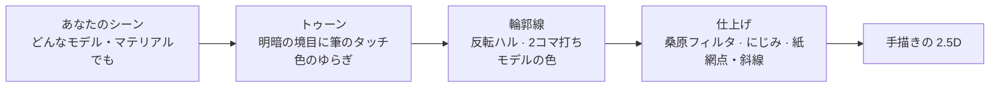

<div align="center">


<p>
  <a href="https://github.com/kanaworksai-hue/painterly-25d/releases/latest"></a>
  
  
  
  
  <a href="LICENSE"></a>
  <a href="NOTICE.md"></a>
  <a href="https://github.com/kanaworksai-hue/painterly-25d/stargazers"></a>
</p>

<p><a href="https://github.com/kanaworksai-hue"></a>&nbsp;<a href="https://github.com/kanaworksai-hue"><b>KanaWorks_AI のプロジェクト</b></a>&nbsp;·&nbsp;<a href="#-kanaworks-のアドオン">シリーズ一覧</a></p>

**日本語** | [English](README.en.md) | [简体中文](README.zh-CN.md) | [한국어](README.ko.md) | [Português](README.pt-BR.md) | [Español](README.es.md)

[🎨 ギャラリー](#-ギャラリー) · [🚀 はじめかた](#-はじめかた) · [🎛️ 調整できること](#️-調整できること) · [❓ FAQ](#-faq) · [⭐ Star で応援](#-star-で応援する)

</div>

**Painterly 2.5D** は、Blender のシーンをボタンひとつで「手描きの絵」に変える、無料の Blender アドオンです。光と影の境目にだけ筆のタッチを入れるトゥーン、2コマ打ちでゆらゆら揺れる手描きの輪郭線、油絵のような仕上げのフィルターを、どんなシーンにもまとめてかけます。

**油絵・ガッシュ・水彩・クレヨン・色鉛筆・アニメ塗り**の6つの画材から選べて、**シャッフル**を押すたびに筆の向きや色合いが変わるので、同じシーンでも毎回ちがう一枚になります。インストールから適用まで、AI エージェントに一言で頼むこともできます。

<p align="center">
  
  <br><sub>同じシーン、同じカメラ。左が普通のレンダリング、右が Painterly 2.5D。</sub>
</p>

## ✨ 特長

<table>
<tr>
<td align="center" width="25%"><br><b>ワンクリック</b><br><sub>EEVEE、マテリアル、輪郭線、コンポジターまで一括で設定</sub></td>
<td align="center" width="25%"><br><b>画材は6種類</b><br><sub>油絵・ガッシュ・水彩・クレヨン・色鉛筆・アニメ塗り</sub></td>
<td align="center" width="25%"><br><b>シャッフル</b><br><sub>押すたびに筆の向き・色むら・影の色・線の色・紙が変わる</sub></td>
<td align="center" width="25%"><br><b>AIにおまかせ</b><br><sub>エージェントに一言。インストール、適用、プレビューまで自動</sub></td>
</tr>
</table>

- **どんなシーンでも動く：** マテリアルのないオブジェクトには自動でマテリアルを作り（頂点カラーも保持）、ライトがなければキーライトを足します。Diffuse・Emission・画像だけ・ノードグループのマテリアルも元の色を引き継ぎ、ガラスや半透明の面はそのまま残します。コレクションインスタンスにも対応しています。
- **大きさに合わせて自動調整：** オブジェクトの大きさとカメラの距離から、筆のタッチ・深度フォグ・線のフェードを決めます。10cm の小物でも 50m の建物でも同じ見た目になります。
- **線にモデルの色：** 輪郭線を、それぞれのモデルの色を暗くした色で描けます（黒一色にもできます）。
- **プリセット5種：** ブルーアワーの夜、ゴールデンアワー、パステルスイーツ、絵本の昼、クリーン／プロダクト。画材と組み合わせて使えます。
- **元に戻せる：** 「絵画風を解除」で元のマテリアル、コンポジター、表示設定に戻ります。値はシェーダーの中で読むので、アドオンがない環境でも同じ見た目でレンダリングできます。
- **UI は日本語・英語・簡体中国語：** Blender の「インターフェイス › 翻訳」の設定に従います。

## 🎨 ギャラリー

### 画材6種

同じモデル、同じライト。画材だけを切り替えました。


### シャッフル

押すたびに、筆の向き、色のゆらぎ、影の色、線の色、紙の色がプリセットと画材の範囲でランダムに変わります。番号を覚えておけば、同じ見た目をいつでも再現できます。


### どんなモデルにも

CC0 のモデル、Blender 標準のスザンヌ、作者が用意したモデルに、ボタン1回で適用しました。


### 3つのレイヤー


## 🧭 しくみ



1. **トゥーン：** Diffuse → Shader to RGB で明暗を取り、キーライトの強さで割ってセル分けします。明暗の境目の近くでだけ、ボロノイの筆タッチで法線を揺らし、タッチごとに色相・彩度・明度を少しずつずらします。
2. **輪郭線：** ジオメトリノードの反転ハルで、画面上で一定の太さの線を作ります。ノイズで途切れさせ、2コマごとに描き直します。
3. **仕上げ：** コンポジターで、深度フォグ → 2段の桑原フィルタ（線は保護）→ にじみの縁・顔料の粒状感 → 網点や斜線 → ブルーム → 紙の質感 → 粒子 → グレーディング。ピクセル単位の値は解像度に合わせて自動で変わります。

## 🚀 はじめかた

### AI エージェントに頼む（おすすめ）

Claude Code や Codex のような、パソコンを操作できる AI エージェントにこう送るだけです。

> https://github.com/kanaworksai-hue/painterly-25d の AGENTS.md に従って Painterly 2.5D をインストールして、私の Blender シーンを手描きの絵っぽくして。

そのあとは、プレビューを見ながら一言で直せます。

- 「水彩にして」
- 「夕焼けの雰囲気で」
- 「別のパターンも見せて」
- 「筆のタッチを大きく」
- 「線をもっと細く」

### 自分でインストールする

**必要なもの：** Blender 5.0 以降（Blender 5.2 で動作確認済み）、レンダーエンジンは EEVEE。

1. [Releases](https://github.com/kanaworksai-hue/painterly-25d/releases/latest) から `painterly_25d-x.y.z.zip` をダウンロード（解凍しないでください）
2. Blender → 編集 → プリファレンス → エクステンションを入手 → 右上の ⌄ → **ディスクからインストール…** → zip を選択


### 使い方

1. シーンを開く（モデルやマテリアルは何でも OK）
2. 3D ビューで **N** キー → **Painterly** タブ
3. **Make It Painterly**（ワンクリックで絵画風に）
4. **プリセット**と**画材**を選ぶ。迷ったら **シャッフル**
5. 「トゥーン＆筆タッチ」「アウトライン」「ポストエフェクト」で微調整して、**F12** でレンダリング

<p align="center">
  
</p>

## 🎛️ 調整できること

<details>
<summary><b>メインパネル</b></summary>

| 項目 | 内容 |
|---|---|
| プリセット | 色と雰囲気（夜・夕焼け・パステル・昼・クリーン） |
| 画材 | 塗り方（油絵・ガッシュ・水彩・クレヨン・色鉛筆・アニメ塗り） |
| バリエーション / シャッフル | 筆の向き・色のゆらぎ・影の色・線の色・紙をランダムに変える番号。0 でオフ |
| 選択中のオブジェクトのみ | 選んだものだけに適用（初期設定はシーン全体） |
| キーライトがなければ追加 | ライトが1つもないとき、カメラ側からのサンを追加（解除で削除） |
| シーンのスケールに合わせる | 筆タッチ・フォグ・線のフェードを大きさとカメラ距離から設定 |
| 絵画風を解除 | 元のマテリアル・コンポジター・表示設定に戻す |

</details>

<details>
<summary><b>画材</b></summary>

| 画材 | 仕上がり |
|---|---|
| **油絵**（初期設定） | 明暗の境目に厚い筆のタッチ。桑原フィルタで油彩らしく |
| **ガッシュ** | 不透明でマットな平塗り、やわらかい縁 |
| **水彩** | 透明感のある塗り。縁に顔料がたまり、輪郭がにじみ、紙に顔料が沈む |
| **クレヨン** | ワックスのような筆跡、紙の凹凸が白く抜け、影に斜線 |
| **色鉛筆** | 軽いタッチとクロスハッチングの影 |
| **アニメ塗り** | くっきりしたセル塗りと線。絵の具の質感なし |

画材は「塗り方」の値だけを変え、プリセットは「色と雰囲気」の値だけを変えるので、自由に組み合わせられます。
</details>

<details>
<summary><b>おもな細かい設定</b></summary>

| グループ | 項目 |
|---|---|
| 筆タッチ | 強さ・細かさ・伸び・ゆがみ・**向き**・明暗境界の幅・シード |
| 色のばらつき | **色のゆらぎ**（タッチごと）・**色むら**（大きな斑） |
| アウトライン | 太さ・線の色・**線にモデルの色を使う**・手描きのゆらぎ・2コマ打ち |
| 画材 | **にじみの縁**・**にじみのゆらぎ**・**顔料の粒状感**・**紙の凹凸** |
| 影の模様 | **網点 / 斜線 / クロスハッチング**・量・間隔・色 |
| フィルム | 紙の質感・ブルーム・ハレーション・粒子・色収差・周辺減光・グレーディング |

オブジェクトごとに、しきい値・影の明るさ・筆タッチ・発光・線の太さを上書きすることもできます（オブジェクトプロパティ）。
</details>

## ❓ FAQ

<details>
<summary><b>Cycles でも使えますか？</b></summary>

使えません。EEVEE 専用の「Shader to RGB」ノードを使っているため、EEVEE でレンダリングしてください。**Make It Painterly** を押すと EEVEE に切り替わります。
</details>

<details>
<summary><b>筆のタッチが大きすぎる・小さすぎます。</b></summary>

カメラを動かしたり、シーンの大きさを変えたりしたあとは「シーンに合わせる」を押してから、「筆タッチの細かさ」（1m あたりの数）で調整してください。
</details>

<details>
<summary><b>全部明るくて影が出ません。</b></summary>

明るいワールドや HDRI は補助光が強いので、「環境光の補正」を上げてください。
</details>

<details>
<summary><b>元のマテリアルはどうなりますか？</b></summary>

トゥーンのノードグループを差し込み、元のつながりを覚えておきます。「絵画風を解除」で元どおりになります。アドオンが自動で作ったマテリアルやライトも削除されます。
</details>

<details>
<summary><b>作った画像や動画は商用で使えますか？</b></summary>

はい。Painterly 2.5D で作ったレンダリング画像や動画は、あなたの作品として自由に使えます。GPL が適用されるのはアドオン本体のコードで、それを使って作った作品には及びません（使ったモデルやテクスチャのライセンスには従ってください）。クレジットは必要ありませんが、`Made with Painterly 2.5D by @KanaWorks_AI` と入れてもらえると嬉しいです。
</details>

## 📝 クレジット表記

Painterly 2.5D は無料で、商用でも使えます。

**アドオンを再配布・改変・同梱するとき**（フォーク、改変版、移植版、パックや製品への同梱など。有償・無償を問いません）は、次の表記をアドオンの説明文とドキュメントにそのまま残すことが**必須**です（GPL-3.0 第7条(b)に基づく追加条項。詳しくは [NOTICE.md](NOTICE.md)）。

```
Painterly 2.5D by KanaWorks_AI (@KanaWorks_AI) — https://github.com/kanaworksai-hue/painterly-25d
```

**作った画像や動画**にはクレジットは必要ありません。よければ投稿文や概要欄に入れてもらえると嬉しいです。

```
Made with Painterly 2.5D by @KanaWorks_AI
```

## ⭐ Star で応援する

Painterly 2.5D を気に入ったら、[リポジトリのページ](https://github.com/kanaworksai-hue/painterly-25d)の右上にある **⭐ Star** を押してもらえると嬉しいです。無料で、1秒で終わります。

- **もっと多くの人に届く：** Star が増えると GitHub で見つけてもらいやすくなります。
- **アップデートの励みになる：** 新しい画材やプリセットを作り続ける力になります。

ほかにも、バグや欲しい機能を [Issue](https://github.com/kanaworksai-hue/painterly-25d/issues) で教えてもらったり、作品を X で [@KanaWorks_AI](https://x.com/KanaWorks_AI) をつけて見せてもらえたりすると、とても励みになります。

## 🧩 KanaWorks のアドオン

同じ作者の、無料・オープンソースの Blender アドオンです。どれも AI エージェントに一言で頼めます。

<table>
<tr>
<td align="center" width="33%"><a href="https://github.com/kanaworksai-hue/painterly-25d"></a><br><b>Painterly 2.5D</b>（このページ）<br><sub>3D を手描きの絵に。油絵・水彩・クレヨン・アニメ塗り</sub></td>
<td align="center" width="33%"><a href="https://github.com/kanaworksai-hue/kirapaint"></a><br><b><a href="https://github.com/kanaworksai-hue/kirapaint">KiraPaint</a></b><br><sub>3D をキラキラの絵画風 2.5D に。砕いたダイヤのツヤと星の光</sub></td>
<td align="center" width="33%"><a href="https://github.com/kanaworksai-hue/mochitoon"></a><br><b><a href="https://github.com/kanaworksai-hue/mochitoon">MochiToon</a></b><br><sub>3D をかわいいマンガ風に。色つきの影、ハートや星の網点</sub></td>
</tr>
</table>

## 🛠️ 開発

```bash
# ヘッドレステスト（調整していない汎用シーンで全機能を確認）
blender -b --factory-startup --python tests/test_generic.py

# 配布用の zip を dist/ に作成
BLENDER=blender ./build.sh
```

```
painterly_25d/
  __init__.py      設定、プリセット・画材・バリエーション、オペレーター、パネル
  toon.py          トゥーンのシェーダーノードグループ（筆タッチ、色のゆらぎ、影の色）
  outline.py       ジオメトリノードの輪郭線と、モデルの色を使う線のマテリアル
  post.py          コンポジター（桑原、にじみ、網点・斜線、紙、グレーディング）
  autosetup.py     どんなシーンでも動かすための自動設定（マテリアル、ライト、スケール）
  translations.py  日本語・簡体中国語の UI
agent/painterly_agent.py  AI エージェント用のコマンドライン
```

## 📄 ライセンスとクレジット

- **このアドオン：** Copyright © 2026 東京AI映像合同会社。[GPL-3.0-or-later](LICENSE) で公開しています（再配布時のクレジット表記を求める追加条項付き。[NOTICE.md](NOTICE.md)）。
- **ブランド：** KanaWorks_AI の名称、ロゴ、キャラクター Kana の権利は東京AI映像合同会社に帰属し、GPL の対象**外**です。詳しくは [docs/brand](docs/brand/README.md) を見てください。
- Blender コミュニティで公開されている NPR の解説（Shader to RGB のセル表現、桑原コンポジット、反転ハルの輪郭線）を参考にしています。
- **Blender** は Blender Foundation の商標です。本プロジェクトは独立したプロジェクトで、Blender Foundation とは提携しておらず、承認も受けていません。

<br>

<div align="center">

<a href="https://x.com/KanaWorks_AI"></a>

<p><b>Made with ♥ by <a href="https://x.com/KanaWorks_AI">KanaWorks_AI</a></b></p>

<p><sub>Painterly 2.5D が役に立ったら、⭐ が次のアップデートの励みになります。ほかのプロジェクト：<a href="https://github.com/kanaworksai-hue">github.com/kanaworksai-hue</a></sub></p>

</div>
