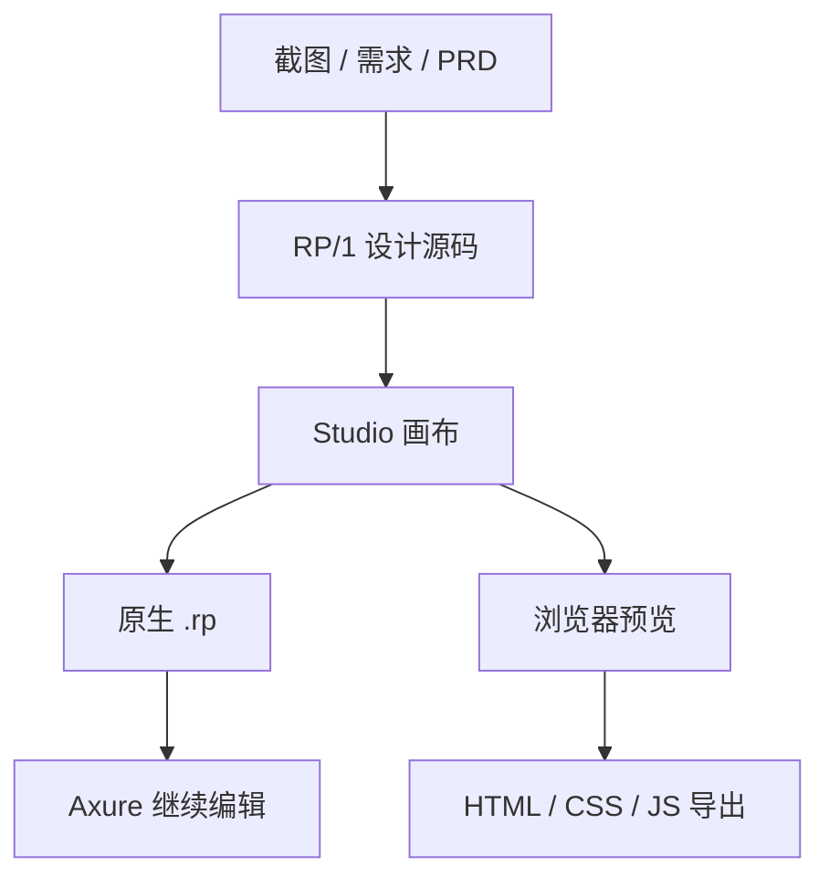

<div align="center">

<br>

# return_rp

### 给 AI 一张画布，把设计带回 Axure。

把截图、需求或 RP/1 源码，变成可以在 Axure 里继续编辑的原生 `.rp`，而不是一张原型截图。

**Axure RP 9 / RP 11　·　AI 原生画布　·　CLI 与 MCP**

[](https://github.com/karlmoriaty/AxurePR-return-rp/releases) [](https://www.npmjs.com/package/return_rp) [](https://github.com/karlmoriaty/AxurePR-return-rp/actions) [](docs/version-parity.md) [](LICENSE) [](https://glama.ai/mcp/servers/karlmoriaty/AxurePR-return-rp)

[开始使用](#quickstart)　·　[工作流](#workflow)　·　[Studio](#studio)　·　[RP/1](#rp1)　·　[版本对齐](#parity)　·　[常见问题](#faq)　·　[English](README.en.md)

</div>

<br>

## 一句话，说清楚它是什么

> **AI 负责起稿，你负责定稿，Axure 负责收尾。**<br>
> 页面、组件、变量与交互都写进一份可版本管理的 RP/1 源码，再编译成原生工程。

| 你给它 | 它交给你 |
| :--- | :--- |
| 一张截图、一段需求、一份 PRD，或一份 RP/1 源码 | 原生 `.rp`、浏览器预览、HTML / CSS / JS 导出，以及结构检查与验收报告 |

<br>

## 为什么不是又一个 UI 生成器

| | 多数截图转代码工具 | **return_rp** |
| :--- | :--- | :--- |
| **输出物** | HTML、图片或不可编辑稿 | 原生 `.rp`，也可导出 HTML / CSS / JS |
| **设计源码** | 一次性生成，难以 diff 与回改 | RP/1 文本源码，可版本管理、按图层局部修改 |
| **Agent 协作** | 往往只能整页重来 | 按图层、语义与范围查询，只改具体对象 |
| **Axure 版本** | 通常只覆盖一个版本 | RP 9 / RP 11 双向能力对齐 |
| **验证方式** | 看截图 | 结构检查 + 浏览器交互 + Axure 保存重开与预览 |

<br>

<a id="workflow"></a>

## 从想法到 Axure，只有一条链路



1. **把意图写成源码。** 截图走临摹管线，需求与 PRD 直接写成 RP/1；页面、组件、变量、交互都在同一份文本里。
2. **在画布里推敲。** Agent 搭第一版，你直接点选、改字、调整布局；也可以把局部交还 AI，继续探索另一种构图。
3. **在交付前验证。** 真实截图、交互场景、结构检查分别运行，确认跳转、状态与保存回显。
4. **带回 Axure。** 生成原生工程，或导出浏览器可运行版本；继续编辑、继续迭代。

<br>

<a id="studio"></a>

## Studio：一块人和 AI 都能编辑的画布

**AI 起稿。** 通过 RP/1 或命令创作，按图层、语义和范围查询，局部改稿。<br>
**人来精修。** 双击改字、Shift 框选、Option / Alt 悬停测距，撤销重做。<br>
**一起验证。** 查看真实截图、运行交互场景，再交付原型。

[画室工作流](docs/studio-design-workflow.md)　↗　[AI 创作指南](docs/studio-ai-authoring.md)　↗　[验收层级](docs/studio-acceptance.md)

<br>

<a id="rp1"></a>

## RP/1：设计意图，有自己的源码

**RP/1** 把页面、布局、组件、变量和交互写在一起。AI 的改动有明确目标，设计也保留结构、版本和继续迭代的起点。

```text
rp/1 target=9 name="下一次相遇" domain=mobile theme=mobile-hifi

page #home name="发现" device=iphone-17-pro
  phone-shell #shell title="去自然里，遇见飞羽。" gap=16
    card #bird [fillxhug] title="认识翠鸟" body="从一抹蓝绿开始。" actionText="记下遇见" goto="notes"

page #notes name="手记" device=iphone-17-pro
  phone-shell #shell title="我的第一篇手记" gap=16
    input #note [fillx44] value="今天在水边遇见了它。"
    button #back [fillx44] "返回发现" goto="home"
```

从一个页面到完整流程，`revise_prototype` 继续改稿；已有原生修改也能在支持范围内合并回源码。

[RP/1 手册](references/rp-language.md)　↗　[完整示例](examples/authoring/mobile-cards.rp1)　↗　[原生往返](docs/studio-native-roundtrip.md)

<br>

## 交到 Axure，仍然握得住设计

| 从哪里继续 | 可以做什么 |
| :--- | :--- |
| **Studio** | 和 AI 共用设计文档、事务与撤销历史 |
| **Axure** | 打开原生工程，继续编辑元件与支持的交互 |
| **浏览器** | 运行预览；也可导出独立 HTML / CSS / JS |

| 交付物 | 说明 |
| :--- | :--- |
| 原生 `.rp` | 默认目标 RP 11；`target=9` 或 `AXURE_TARGET_VERSION=9` 切到 RP 9 |
| 浏览器预览 | 真实交互场景，可复现点击、跳转与状态变化 |
| 代码导出 | 独立 HTML / CSS / JS，便于评审或嵌入 |
| 结构与验收报告 | 三零检查（未解析记录、悬空引用、问题数均为 0）、浏览器断言与 Axure 往返结果分开记录 |

页面、变量、动态面板与跳转可以一起交付，源稿、预览和检查报告也一并保留。

[原生导出与回填](docs/studio-native-roundtrip.md)　↗　[代码导出](docs/studio-code-export.md)

<br>

<a id="parity"></a>

## RP 9 与 RP 11，走同一条流水线

两个版本共用同一套 CLI、MCP 与 Studio。任一版本能做的事，另一版本不会以 `unsupported` 收场；缺口必须登记，并在运行时告警或写入前明确诊断，绝不静默丢参数。

| 能力 | RP 9 | RP 11 |
| :--- | :---: | :---: |
| RP/1 原生编译与场景写入 | 支持 | 支持 |
| 空白模板检测、裁剪与动态面板克隆 | 支持 | 支持 |
| 原生表单控件与状态样式 | 支持 | 支持 |
| 原生中继器与数据操作 | 支持 | 支持 |
| 核心交互、动作与自适应视图 | 支持 | 支持 |
| Studio 局部 RP/1 创作 | 支持 | 支持 |
| 自动 Axure 预览（Swift / PowerShell 宿主） | 支持 | 支持 |
| 图片离线生成原生工程 | 支持 | 支持 |

已登记的边界集中在以下几处：RP 11 没有面板注册链模型；RP 9 的缩放锚点、切换启用、应用样式与 RP 11 专属事件/函数没有对应结构，写入前显式诊断；RP 9 的过滤组合类型与按行号删除中继器行按等价规则改写，标记为部分支持。

[完整能力矩阵](docs/version-parity.md)　↗　[能力与验证边界](references/capabilities.md)　↗　[故障排查](references/troubleshooting.md)

<br>

<a id="quickstart"></a>

## 开始使用

| 依赖 | 版本 | 用途 |
| :--- | :--- | :--- |
| Node.js | 18+ | CLI、MCP、Studio 与测试 |
| Python | 3.10+ | 原生编译与图片处理 |
| Axure | RP 9 或 RP 11 | 原生生成、保存重开与自动预览（可选） |

```sh
git clone https://github.com/karlmoriaty/AxurePR-return-rp.git
cd AxurePR-return-rp
python3 -m venv .venv
source .venv/bin/activate
python -m pip install -r requirements.txt
npm ci
```

Windows PowerShell：

```powershell
git clone https://github.com/karlmoriaty/AxurePR-return-rp.git
cd AxurePR-return-rp
python -m venv .venv
.\.venv\Scripts\Activate.ps1
python -m pip install -r requirements.txt
npm ci
```

也可以直接从 [Releases](https://github.com/karlmoriaty/AxurePR-return-rp/releases) 下载 `return_rp-<version>-share.zip`，解压后在目录内执行 `npm ci --ignore-scripts`。分享包不含测试与私有素材；原生生成仍需要本机 Axure 和一份你自己保存的空白工程。

只用 CLI / MCP 时，也可以直接从 npm 运行，无需克隆仓库（原生生成与图片处理仍需要上面的 Python 依赖）：

```sh
npx -y -p return_rp return_rp --help
npx -y -p return_rp return_rp-mcp
```

<details>
<summary><b>连接你的 MCP 客户端</b> · 展开配置</summary>

将下面的绝对路径换成自己的安装目录、Python 环境和空白工程：

```json
{
  "mcpServers": {
    "return_rp": {
      "command": "node",
      "args": ["/absolute/path/AxurePR-return-rp/bin/mcp.mjs"],
      "env": {
        "PATH": "/absolute/path/AxurePR-return-rp/.venv/bin:/usr/local/bin:/usr/bin:/bin",
        "AXURE_BLANK_TEMPLATE_RP9": "/absolute/path/my-rp9-blank.rp",
        "AXURE_BLANK_TEMPLATE_RP11": "/absolute/path/my-rp11-blank.rp"
      }
    }
  }
}
```

`PATH` 应包含安装了依赖的 Python；Node 不在默认路径时，`command` 也使用绝对路径。空白工程用你自己在对应版本 Axure 中保存的单页文件；只用一个版本时，保留对应的 `AXURE_BLANK_TEMPLATE_RP9` / `RP11` 即可。安装更新后重新连接 MCP。

</details>

接好后，调用 `studio_open_project`，在浏览器打开返回的 `url`：

```json
{ "projectDir": "/absolute/path/my-first-prototype" }
```

然后把任务交给 Agent：

> 做一个观鸟 App，包含探索、鸟种详情和手记。先在画布里设计，验证跳转和保存回显，再导出可编辑的 `.rp`。

<details>
<summary><b>给 Agent 的入口与运行边界</b></summary>

Agent 从 `studio_describe({"topic":"workflow"})` 开始。导入已有 RP/1 可为 `studio_open_project` 指定 `sourcePath`；完整原生生成使用 `generate_prototype`。截图临摹走 `generate_from_image` 或 `scripts/trace.mjs`，局部创作和完整编译的支持范围分别记录。

原生生成默认目标 RP 11，也可用 `target=9` 或 `AXURE_TARGET_VERSION=9` 切到 RP 9。宿主证据覆盖 macOS + Axure RP 9，以及 Windows + Axure RP 9 / RP 11（GUI 保存重开与预览往返）。部分效果采用嵌入位图，字体和预览可能受宿主影响。任意小数缩放清晰度、单画板海量节点仍有边界。

结构检查、浏览器行为与 Axure 保存重开分别验证。[能力范围](references/capabilities.md) · [RP 9 / RP 11 能力对齐](docs/version-parity.md) · [验收层级](docs/studio-acceptance.md) · [故障排查](references/troubleshooting.md)

</details>

<br>

<a id="faq"></a>

## 常见问题

<details>
<summary><b>必须安装 Axure 吗？</b></summary>

不必须。只使用 Studio、浏览器预览或代码导出时，Node.js 与 Python 依赖就够了。生成原生 `.rp`、离线图片工程、保存重开与自动预览需要本机 Axure；首次使用请自己保存一份单页空白工程，并通过 `AXURE_BLANK_TEMPLATE_RP9` / `AXURE_BLANK_TEMPLATE_RP11` 指定。

</details>

<details>
<summary><b>Windows 上能用吗？</b></summary>

可以。Windows 走 PowerShell 宿主，RP 9 / RP 11 都已实测打开、保存命令、关闭、重开与预览；macOS 走 Swift 宿主。GUI 相关能力需要桌面会话和本机 Axure，无桌面会话的服务器环境只能使用非 GUI 部分。

</details>

<details>
<summary><b>MCP 连上了，为什么工具列表是空的？</b></summary>

通常是缺少可选依赖 `@modelcontextprotocol/sdk`。在项目目录执行 `npm ci --ignore-scripts`，重启或重连 MCP 客户端。启动时会给出明确提示，不会静默返回空列表。

</details>

<details>
<summary><b>为什么宿主返回 <code>saved: false</code>？</b></summary>

Axure 对未修改的文档可能跳过写盘。此时宿主如实返回 `saved: false`，并单独记录 `saveCommandIssued: true`；任务验收以保存命令已执行为准，是否真正写入由文件 mtime 判断。这比把保存键一律当成成功更接近真实行为。

</details>

<details>
<summary><b>生成的原型能 100% 还原设计吗？</b></summary>

文字、按钮、输入框与布局会写成独立原生元件，支持的交互一起交付。部分视觉效果使用嵌入位图；字体、预览与渲染受宿主影响；任意小数缩放的清晰度、单画板海量节点也有边界。建议按「结构检查 → 浏览器行为 → Axure 保存重开」三层分别验收。

</details>

<details>
<summary><b>默认生成哪个 Axure 版本？</b></summary>

默认 RP 11。需要 RP 9 时在 RP/1 头部写 `target=9`，或设置 `AXURE_TARGET_VERSION=9`。两个版本共用同一批 CLI / MCP 工具。

</details>

<br>

<details>
<summary><b>项目结构</b></summary>

| 目录 | 作用 |
| :--- | :--- |
| `bin/` | `return_rp` CLI 与 `return_rp-mcp` MCP 入口 |
| `scripts/` | RP/1 编译、原生装配、宿主往返、截图临摹与发布工具 |
| `studio/` | Studio 画布前端与本地服务 |
| `references/` | RP/1 语言、能力边界、工作流与故障排查手册 |
| `examples/` | 可直接运行的 RP/1 与场景示例 |
| `test/` | 结构、浏览器、版本对齐与跨平台回归 |
| `docs/` | 设计流程、验收层级与版本对齐说明 |

Node 源码以 TypeScript（`*.mts` / `studio/web/*.ts`）编写，`npm run build` 生成同路径 `.mjs` / `.js`；仓库与发布包同时包含源码和生成后的运行时文件，直接使用不需要先构建。

</details>

<br>

---

<div align="center">

[Agent Skill](SKILL.md)　·　[贡献指南](CONTRIBUTING.md)　·　[变更记录](CHANGELOG.md)　·　[Releases](https://github.com/karlmoriaty/AxurePR-return-rp/releases)　·　[MIT License](LICENSE)

<br>

**问题反馈**　[GitHub Issues](https://github.com/karlmoriaty/AxurePR-return-rp/issues)　·　QQ 邮箱：**3070687583@qq.com**

如果这个项目帮你省下了画原型的时间，欢迎 Star、分享给同事，或带着真实案例来提 Issue。

<sub>由 karlmoriaty 独立开发 · 与 Axure 无隶属关系</sub>

</div>
