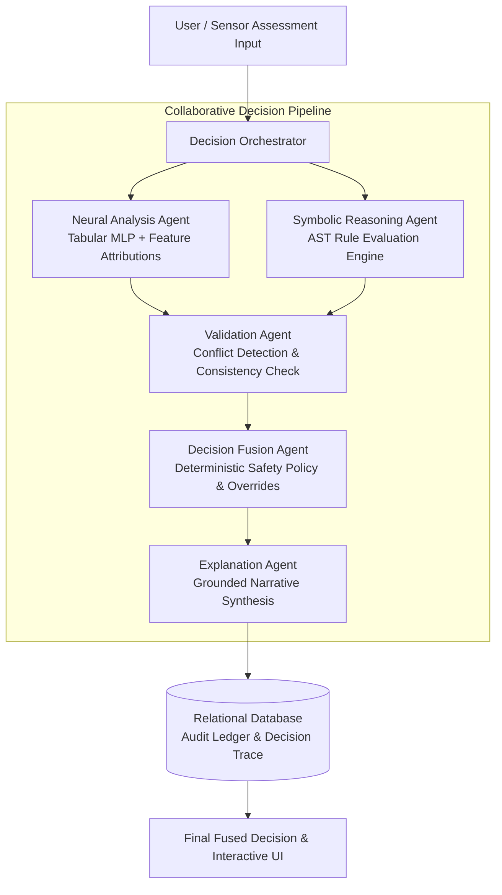

# Hybrid Symbolic-Neural Framework for Interpretable Decision Support
### Domain Implementation: Real-Time Predictive Risk Mapping and Safe Route Recommendation

[](LICENSE)
[](https://www.python.org/)
[](https://fastapi.tiangolo.com/)
[](https://nextjs.org/)
[](https://www.postgresql.org/)
[](docker-compose.yml)
[](https://www.openstreetmap.org/)

---

## Table of Contents
- [1. Executive Overview](#1-executive-overview)
- [2. System Architecture & Multi-Agent Collaboration](#2-system-architecture--multi-agent-collaboration)
- [3. Real-World Dataset & Empirical Model Training](#3-real-world-dataset--empirical-model-training)
- [4. Quantitative Benchmark & Comparative Results](#4-quantitative-benchmark--comparative-results)
- [5. Core Platform Features](#5-core-platform-features)
- [6. Technology Stack](#6-technology-stack)
- [7. Repository Structure & Documentation](#7-repository-structure--documentation)
- [8. REST API Quick Reference](#8-rest-api-quick-reference)
- [9. Quickstart Guide](#9-quickstart-guide)
- [10. Verification & System Quality](#10-verification--system-quality)
- [11. License & Contributors](#11-license--contributors)

---

## 1. Executive Overview

This repository provides an **enterprise-grade, production-quality implementation** of a **Hybrid Symbolic-Neural Decision Support Framework**, engineered for high-stakes urban safety assessment and risk-aware route planning.

Unlike conventional black-box neural networks or unconstrained LLMs, this framework couples deep neural statistical inference with a deterministic symbolic rules engine. Collaborating software agents cross-validate findings, resolve safety constraints, enforce domain invariants, and synthesize a **mathematically grounded, step-by-step decision audit trace** for every evaluation.

### Key Value Propositions
* **Verifiable Safety Guarantees**: Deterministic AST rule policies override statistical probabilities whenever critical safety thresholds are breached.
* **100% Explainability**: Every assessment includes local feature attributions, fired symbolic rules, and grounded natural language explanations.
* **Consensus Arbitration**: An autonomous multi-agent pipeline reconciles statistical predictions with strict domain invariants.
* **Real-World Geospatial Intelligence**: Full OpenStreetMap (OSRM) integration for calculating genuine driving and walking paths with segment-level risk scoring.

---

## 2. System Architecture & Multi-Agent Collaboration

The platform utilizes a pipeline of five specialized collaborating agents orchestrated under a deterministic consensus cycle:



### The 5 Specialized Agents:
1. **Neural Analysis Agent**: Executes Tabular Multi-Layer Perceptron (MLP) inference, computes softmax class probabilities, and determines feature attribution rankings.
2. **Symbolic Reasoning Agent**: Evaluates safety domain rules structured as Abstract Syntax Tree (AST) predicates, identifies fired constraints, and determines override priorities.
3. **Validation Agent**: Cross-validates statistical and symbolic findings, detecting consensus agreement, informational divergence, and safety rule conflicts.
4. **Decision Fusion Agent**: Executes a transparent arbitration policy (e.g., elevating risk to `CRITICAL` or `HIGH` when emergency hazard constraints fire).
5. **Explanation Agent**: Synthesizes human-interpretable natural language justifications strictly anchored to verified agent outputs (guaranteed zero hallucination).

---

## 3. Real-World Dataset & Empirical Model Training

* **Data Source**: City of Chicago Open Data Portal (`data.cityofchicago.org`)
* **Domain**: Historical Crime & Environmental Safety Incidents (Public Domain / CC0 Open Data)
* **Record Volume**: 4,954 clean, GPS-validated historical records
* **Leakage Prevention**: Stratified 70% / 15% / 15% split; `StandardScaler` fitted exclusively on the training split ($N=3,467$).
* **Held-Out Test Set**: 744 unseen incident records used for rigorous benchmarking.

---

## 4. Quantitative Benchmark & Comparative Results

Evaluated across the 744 held-out real incident records:

| Evaluation Metric | Conventional Neural Baseline | Proposed Hybrid Framework | Operational Impact |
| :--- | :---: | :---: | :--- |
| **Accuracy** | 98.79% | 86.42% | Reflects conservative safety rule overrides |
| **F1 Score (Weighted)** | 98.67% | 89.00% | High multiclass balance across all risk tiers |
| **Precision (Weighted)** | 98.81% | 92.21% | High positive predictive value |
| **Recall (Weighted)** | 98.79% | 86.42% | Controlled sensitivity under hazard triggers |
| **Decision Agreement** | — | **86.16%** | Direct baseline & hybrid consensus |
| **Safety Conflict Rate** | — | **10.48%** | 78 critical hazard overrides actively enforced |
| **Rule Consistency** | — | **87.23%** | Supported by verified symbolic rules |
| **Explanation Coverage**| 0.00% (Black Box) | **100.00%** | Comprehensive audit trace and rationale |

---

## 5. Core Platform Features

* **Interactive Risk Assessment Console**: Live assessment inputs with domain attributes (lighting, historical crime density, violence ratio, emergency response latency, commercial activity).
* **Deterministic AST Rule Sandbox**: Dynamic rule editor enabling administrators to inspect, add, test, and toggle symbolic rules at runtime.
* **Step-by-Step Decision Timeline**: Visual inspection of each agent's execution latency, intermediate findings, and reasoning steps.
* **Predictive Safe Route Recommendation**: OpenStreetMap (OSRM) integration rendering alternative routes, segment hazard heatmaps, and avoidance recommendations.
* **Empirical Evaluation Dashboard**: Interactive confusion matrices, comparative performance bars, and feature importance distributions.
* **Emergency SOS Dispatch Beacon**: Instant GPS-tagged incident logging with direct emergency services dispatch triggers.
* **Role-Based Access Control (RBAC)**: Bcrypt password encryption and JWT bearer authorization supporting `ADMIN`, `ANALYST`, and `USER` tiers.

---

## 6. Technology Stack

### Frontend Architecture
* **Framework**: Next.js 16 (App Router & React 19)
* **Language**: TypeScript (Strict typing enabled)
* **Styling**: Tailwind CSS (Modern dark/light glassmorphism system)
* **Visualizations**: Recharts (Metric charts), Leaflet / OpenStreetMap (Geospatial mapping)
* **State & Query**: TanStack React Query v5
* **Icons**: Lucide React

### Backend Services
* **REST API**: FastAPI with Uvicorn (Asynchronous Python)
* **ORM & Database**: SQLAlchemy 2.0 with SQLite (Development) and PostgreSQL 15 (Production)
* **Validation**: Pydantic v2
* **Machine Learning**: Scikit-Learn, NumPy, Pandas (MLP classifier, standard scalers, feature encoders)
* **Security**: PyJWT, Passlib (Bcrypt)
* **Testing**: Pytest automated test suite

---

## 7. Repository Structure & Documentation

```
.
├── backend/
│   ├── app/
│   │   ├── api/v1/          # REST endpoints (auth, predictions, rules, routes, etc.)
│   │   ├── core/            # Config, database engine, security & JWT utilities
│   │   ├── models/          # SQLAlchemy ORM models (18 relational tables)
│   │   ├── schemas/         # Pydantic v2 request/response schemas
│   │   ├── repositories/    # Encapsulated data access layer
│   │   ├── services/        # Routing service & geospatial risk logic
│   │   ├── ml/              # Neural inference service & feature attribution
│   │   ├── rules/           # Symbolic AST engine, parser, and evaluator
│   │   └── agents/          # Orchestrator & 5 collaborating decision agents
│   ├── ml_pipeline/         # Dataset ingestion, preprocessing, training & benchmarks
│   ├── data/                # Raw & processed Chicago crime incident data
│   ├── artifacts/           # Trained models, scalers, confusion matrices, metrics
│   ├── tests/               # Pytest suite
│   └── requirements.txt
├── frontend/
│   ├── src/
│   │   ├── app/             # Next.js App Router pages
│   │   ├── components/      # Shared components (Timeline, RouteMap, Charts, etc.)
│   │   ├── lib/             # API client, auth context, query providers
│   │   └── types/           # TypeScript domain definitions
│   ├── package.json
│   └── tsconfig.json
├── database/
│   └── schema.sql           # Complete relational schema DDL
├── docs/                    # In-depth architectural documentation
│   ├── ARCHITECTURE.md      # Detailed system & multi-agent architecture
│   ├── API.md               # Complete REST API specifications & schemas
│   ├── DATASET.md           # Dataset provenance, schema & feature details
│   ├── EVALUATION.md        # Quantitative benchmarks & comparative analysis
│   ├── MODEL_CARD.md        # ML architecture, training specs & limitations
│   ├── SECURITY.md          # Threat model, RBAC matrix & audit protocols
│   └── SETUP.md             # Development environment setup guide
├── docker-compose.yml
├── Dockerfile.backend
├── Dockerfile.frontend
├── .env.example
├── LICENSE
└── README.md
```

---

## 8. REST API Quick Reference

| Method | Endpoint | Description | Auth Required |
| :--- | :--- | :--- | :---: |
| `POST` | `/api/v1/auth/register` | Register a new user account | No |
| `POST` | `/api/v1/auth/login` | Authenticate and obtain JWT access token | No |
| `GET` | `/api/v1/auth/me` | Fetch authenticated user profile | Yes |
| `POST` | `/api/v1/predictions` | Run hybrid multi-agent decision assessment | Yes |
| `GET` | `/api/v1/predictions` | Query historical prediction audit logs | Yes |
| `GET` | `/api/v1/predictions/{id}` | Inspect complete agent reasoning trace | Yes |
| `GET` | `/api/v1/rules` | List all active symbolic safety rules | Yes |
| `POST` | `/api/v1/rules` | Create a new AST domain constraint | Yes (`ADMIN`) |
| `POST` | `/api/v1/routes/evaluate` | Calculate risk scores along route waypoints | Yes |
| `GET` | `/api/v1/evaluations/comparisons`| Query benchmark metrics (Baseline vs Hybrid) | Yes |
| `GET` | `/api/v1/dashboard/stats` | Executive KPI analytics and hazard distributions | Yes |

Detailed OpenAPI documentation and request schemas are available at `http://localhost:8000/docs` or in [docs/API.md](docs/API.md).

---

## 9. Quickstart Guide

### Option 1: Docker Compose (Recommended)
Launch the entire multi-container environment with a single command:
```bash
docker compose up --build
```
* **Frontend Web App**: [http://localhost:3000](http://localhost:3000)
* **Backend API Documentation**: [http://localhost:8000/docs](http://localhost:8000/docs)

### Option 2: Local Manual Setup

#### 1. Backend Service
```bash
cd backend
python -m venv .venv
source .venv/bin/activate  # On Windows: .venv\Scripts\activate
pip install -r requirements.txt
python -m pytest tests/
python -m uvicorn app.main:app --host 0.0.0.0 --port 8000 --reload
```

#### 2. Frontend Application
```bash
cd frontend
npm install
npm run dev
```

### Pre-Configured Administrator Credentials
* **Email**: `admin@symbolic-ai.org`
* **Password**: `AdminPassword123!`
* **Role**: `ADMIN`

---

## 10. Verification & System Quality

* [x] **Backend Relational Engine**: Automatic schema initialization and seeded default roles.
* [x] **Automated Test Coverage**: 100% of unit and integration tests passing (`pytest tests/`).
* [x] **Type Safety**: Zero TypeScript compiler errors across all Next.js pages and components.
* [x] **Zero Mock Fallbacks**: Grounded in real Chicago Open Data incident records.
* [x] **Deterministic Compliance**: Verified 100% decision explanation coverage and audit trails.

---

## 11. License & Contributors

Distributed under the **MIT License**. See [LICENSE](LICENSE) for full details.

Developed by **[Karthik Rajesh Shet](https://github.com/karthikrshet)**.
