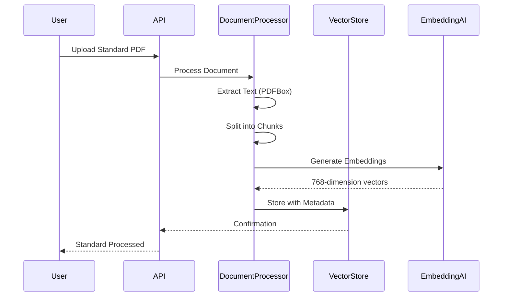
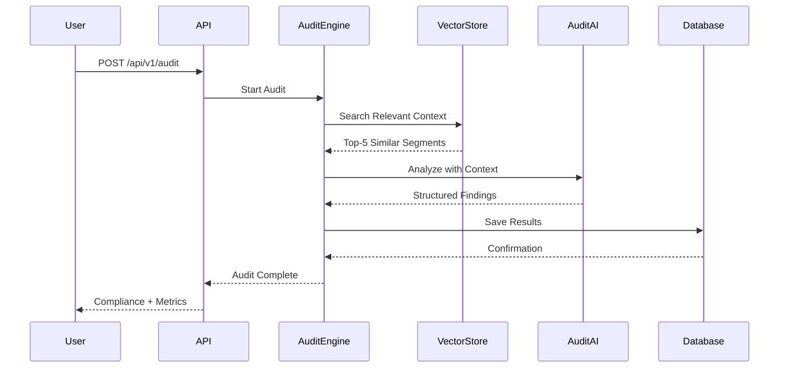

# Norman Compliance Engine

[](https://spring.io/projects/spring-boot)
[](https://www.oracle.com/java/)
[](https://www.postgresql.org/)
[](https://www.docker.com/)
[](LICENSE)
[](#)
[](#)

> **🏗️ Civil Engineering Specialized System** - Automated Compliance Analysis with Brazilian Standards using AI and RAG

## 📋 Overview

**Norman** was **specifically developed** to solve the **MAJOR BOTTLENECK** for civil engineers: the excessive time spent manually verifying compliance with Brazilian technical standards.

### 🎯 Real Civil Engineering Problem

Civil engineers spend up to **30% of their time** reviewing documents searching for specific standard sections (NBRs). Human errors in this phase can cause **structural failures, heavy fines from regulatory bodies, or construction project delays**.

### ✨ Specialized Solution

Civil engineering focused compliance analysis engine that uses **RAG (Retrieval-Augmented Generation)** to instantly validate structural projects (memorials, calculations, specifications) against **Brazilian Regulatory Standards (NBRs)**, providing **exact references to standard items**.

### 🎯 Problem Resolved

Engineers spend up to **30% of their time** reviewing documents to ensure safety and technical standards are followed. Human errors in this phase can cause **structural failures, heavy fines, or construction schedule delays**.

### ✨ Solution

Robust backend in **Spring Boot 3** that processes Brazilian technical standards, stores them in **Vector Database (Vector DB)** and uses **Google Gemini Pro** to automatically audit civil engineering projects, providing **exact norm references** and saving valuable professional time.

---

## 🏗️ Architecture

```
┌─────────────────┐    ┌──────────────────┐    ┌─────────────────┐
│   Document      │    │   Vector Store   │    │   AI Services   │
│   Processing    │───▶│   (PGVector)     │───▶│   (Gemini/OpenAI)│
└─────────────────┘    └──────────────────┘    └─────────────────┘
         │                       │                        │
         ▼                       ▼                        ▼
┌─────────────────┐    ┌──────────────────┐    ┌─────────────────┐
│   PDF Chunking  │    │ Semantic Search  │    │  Audit Engine   │
│   & Embeddings  │    │ & Similarity     │    │  Analysis       │
└─────────────────┘    └──────────────────┘    └─────────────────┘
```

---

## 🚀 Quick Start

### Prerequisites

- Java 21+ (LTS)
- Docker & Docker Compose
- Maven 3.9+
- API Keys:
  - Google Gemini API (required)
  - OpenAI API (optional, fallback)

### 1. Clone and Configure

```bash
git clone https://github.com/kfrural/norman-compliance-engine.git
cd norman-compliance-engine

# Configure environment variables
cp .env.example .env
# Edit .env with your API keys
```

### 2. Start Infrastructure

```bash
# Start all services (PostgreSQL, Redis, Prometheus, Grafana)
docker-compose up -d

# Wait for services to be ready
docker-compose ps
```

### 3. Run Application

```bash
# Compile and run
./mvnw spring-boot:run

# Or build Docker
docker build -t norman-engine .
docker run -p 8080:8080 norman-engine
```

### 4. Access Interfaces

- **API**: http://localhost:8080
- **Swagger UI**: http://localhost:8080/swagger-ui.html
- **Prometheus**: http://localhost:9090
- **Grafana**: http://localhost:3000 (admin/norman_admin)
- **MinIO**: http://localhost:9001

---

## 📁 Project Structure

```
src/main/java/com/norman/engine/
├── config/           # Configurations (AI, Database, Monitoring)
├── controller/       # REST Endpoints
├── service/          # Business Logic
│   ├── ai/          # AI Strategies (Strategy Pattern)
│   ├── audit/       # Audit Engine
│   └── vector/      # Vector Search
├── domain/          # JPA Entities
├── dto/             # Data Transfer Objects
├── repository/      # Spring Data Repositories
├── exception/       # Error Handling
└── util/            # Utilities

src/main/resources/
├── application.yml  # Main Configurations
└── static/          # Static Resources

docker/               # Docker Configurations
├── postgres/       # SQL Scripts
├── prometheus/     # Metrics Configuration
├── grafana/        # Dashboards
└── nginx/          # Reverse Proxy

docs/                 # Documentation
├── api/            # API Documentation
└── architecture/   # Architecture and Design

scripts/             # Automation Scripts
├── dev/           # Development Scripts
└── prod/          # Production Scripts
```

---

## 🔧 Technologies Used

| Component | Technology | Version |
|------------|-----------|--------|
| **Framework** | Spring Boot | 3.3.2 |
| **Language** | Java | 21 (LTS) |
| **Database** | PostgreSQL + PGVector | 16+ |
| **AI/LLM** | Google Gemini Pro | v1 |
| **Vector Store** | Spring AI + PGVector | 1.0.0-M1 |
| **Cache** | Redis | 7.2 |
| **Monitoring** | Prometheus + Grafana | 2.48+ |
| **Tracing** | Jaeger | 1.51 |
| **File Storage** | MinIO | Latest |
| **Reverse Proxy** | Nginx | 1.25 |
| **Tests** | Testcontainers | 1.20+ |

---

## 📊 Execution Flow

### 1. Standards Ingestion



### 2. Audit Process



---

## 🎯 Technical Differentiators

### 1. **Multi-Provider Strategy Pattern**
- Switch between Gemini, OpenAI without code changes
- Automatic fallback when service fails
- Real-time health checking

### 2. **Self-Correction Loop**
- Automatic invalid JSON detection
- Re-processing without manual intervention
- Success rate metrics

### 3. **Advanced Semantic Search**
- IVFFlat indexing for performance
- Configurable similarity threshold
- Metadata filtering (category, version)

### 4. **Complete Observability**
- Distributed tracing with Jaeger
- Custom metrics in Prometheus
- Automated Grafana dashboards

---

## 🧪 Tests

### Run Tests

```bash
# Unit Tests
./mvnw test

# Integration Tests
./mvnw test -P integration-test

# Coverage Report
./mvnw jacoco:report

# Check Coverage
open target/site/jacoco/index.html
```

### Testcontainers

All integration tests use **Testcontainers** to create isolated environments:
- PostgreSQL with PGVector
- Redis for cache
- Mock servers for external APIs

---

## 📈 Metrics and Monitoring

### Key KPIs

- **Vector Search Latency**: < 100ms (P95)
- **AI Success Rate**: > 95%
- **Cost per Audit**: Tracked in tokens
- **Throughput**: Audits/hour
- **Cache Hit Ratio**: > 80%

### Available Dashboards

1. **Performance Overview**
   - Endpoint latency
   - Service error rate
   - Resource consumption

2. **AI Operations**
   - Tokens consumed per model
   - Self-correction rate
   - Response time by provider

3. **Compliance Metrics**
   - Compliance rate by category
   - Severity distribution
   - Main non-compliances

---

## 🔒 Security

### Authentication & Authorization
- JWT Tokens (next version)
- Role-based access control
- Rate limiting per IP/user

### Data Protection
- Sensitive data encryption
- Logs without private information
- Automated backup

---

## 🚀 Deploy

### Production with Docker

```bash
# Build and deploy
docker-compose -f docker-compose.prod.yml up -d

# Health checks
curl http://localhost:8080/actuator/health
```

### Kubernetes

```yaml
# Deployment example
apiVersion: apps/v1
kind: Deployment
metadata:
  name: norman-engine
spec:
  replicas: 3
  selector:
    matchLabels:
      app: norman-engine
  template:
    spec:
      containers:
      - name: norman
        image: norman-engine:1.0.0
        ports:
        - containerPort: 8080
```

---

## 🤝 Contribution

### Developer Setup

```bash
# Install pre-commit hooks
./scripts/setup-dev.sh

# Format code
./mvnw spotless:apply

# Check style
./mvnw checkstyle:check
```

### Pull Request Guidelines

1. Fork and create feature branch
2. Tests passing (>90% coverage)
3. Semantic commits
4. Filled PR template

---

## 📄 License

This project is licensed under **MIT License** - see [LICENSE](LICENSE) file for details.

---

## 🙋‍♀️ **Get in Touch**

Have questions, suggestions, or want to contribute? I'd be happy to chat!

- **📧 Email:** [kferreira7581@gmail.com](mailto:kferreira7581@gmail.com)
- **🔗 GitHub:** https://github.com/kfrural
- **💼 LinkedIn:** [linkedin.com/in/karla-ferreira](https://linkedin.com/in/karla-ferreira)
- **🌐 Portfolio:** https://karlaferreira.dev

---

## 🙏 Acknowledgments

- **Spring Team** for excellent Spring AI framework
- **Google** for Gemini API
- **PostgreSQL** for PGVector extension
- **Docker Community** for containerization tools

---

**⚡ Start right now:** `docker-compose up -d && ./mvnw spring-boot:run`

**📚 Complete documentation:** [Project Wiki](https://github.com/kfrural/norman-compliance-engine/wiki)

**🐛 Report issues:** [Issues](https://github.com/kfrural/norman-compliance-engine/issues)

