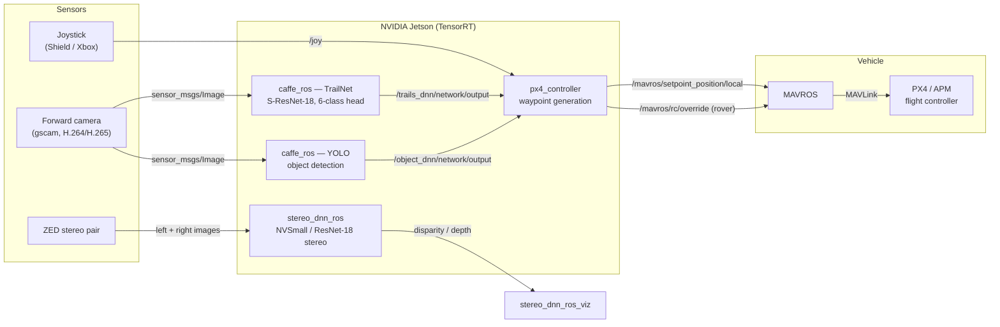

# Autonomous UAV Visual Navigation — NVIDIA Redtail Legacy Snapshot

[](https://github.com/khlaifiabilel/autonomous-uav-visual-navigation/actions/workflows/ci.yml)
[](LICENSE.md)
[](https://github.com/khlaifiabilel/autonomous-uav-visual-navigation/releases)
[](docs/jetson-agx-xavier.md)
[-lightgrey.svg)](docs/ros-packages.md)

Curated historical snapshot of **NVIDIA Redtail**, an autonomous visual-navigation research
project for drones and ground vehicles: a TrailNet deep neural network estimates the vehicle's
orientation and lateral offset relative to a forest trail from a single forward camera, and a
PX4/MAVROS controller converts those estimates into flight commands — all running onboard an
NVIDIA Jetson with TensorRT acceleration.

> [!WARNING]
> **Legacy research software.**
> NVIDIA states that Redtail has not been developed since 2020. This snapshot targets an
> obsolete platform stack: Ubuntu 16.04, ROS Kinetic, CUDA 9, cuDNN 7, TensorRT 3/4,
> OpenCV 3.3, TensorFlow 1.5, and Jetson TX1/TX2. It is not maintained upstream,
> safety-certified, or suitable for operational autonomous flight without independent
> engineering and validation.

## System Architecture



TrailNet's 6-way softmax head (3 view-orientation classes + 3 lateral-offset classes) is
converted into yaw and lateral corrections by `px4_controller`; YOLO detections can trigger a
safety stop (person class). See [`docs/architecture.md`](docs/architecture.md) for the full
dataflow, control-loop sequence diagram, and TensorRT engine pipeline.

## Documentation

| Document | Contents |
| --- | --- |
| [`docs/architecture.md`](docs/architecture.md) | System dataflow, control-loop sequence, TensorRT pipeline, codebase composition |
| [`docs/ros-packages.md`](docs/ros-packages.md) | Per-package reference: nodes, topics, parameters, launch files (verified against source) |
| [`docs/jetson-agx-xavier.md`](docs/jetson-agx-xavier.md) | Porting and maintenance guide for Jetson AGX Xavier |
| [`docs/models.md`](docs/models.md) | Model inventory with sizes, SHA-256 checksums, and reassembly instructions |
| [`docs/modernization-2026.md`](docs/modernization-2026.md) | 2026 target stack, architecture, and migration phase plan |
| [`docker/Dockerfile`](docker/Dockerfile) | 2026 development environment (CUDA 12.6, TensorRT 10, ROS 2 Humble) |
| [`CHANGELOG.md`](CHANGELOG.md) | Repository history in Keep-a-Changelog format |
| [`CITATION.cff`](CITATION.cff) | Citation metadata for this snapshot and the underlying research papers |

The original [Redtail wiki](https://github.com/NVIDIA-AI-IOT/redtail/wiki) remains the most
complete historical documentation:
[Jetson setup](https://github.com/NVIDIA-AI-IOT/redtail/wiki/Jetson-Setup) ·
[ROS nodes](https://github.com/NVIDIA-AI-IOT/redtail/wiki/ROS-Nodes) ·
[Models](https://github.com/NVIDIA-AI-IOT/redtail/wiki/Models) ·
[Datasets](https://github.com/NVIDIA-AI-IOT/redtail/wiki/Datasets) ·
[Simulation](https://github.com/NVIDIA-AI-IOT/redtail/wiki/Testing-in-Simulator) ·
[Launch sequence](https://github.com/NVIDIA-AI-IOT/redtail/wiki/Launch-Sequence-and-Flying).
Review every command, package source, container privilege, device path, and network setting
before use.

## Versioning

Single-branch model: **`main` is the living line**; immutable references are tags.

| Reference | Meaning |
| --- | --- |
| [`v1.0.0`](https://github.com/khlaifiabilel/autonomous-uav-visual-navigation/releases/tag/v1.0.0) | Faithful legacy snapshot of the final NVIDIA Redtail tree + documentation suite |
| `main` | v1.0.0 plus the 2026 modernization layer (environment, blueprint, tooling) |

Former platform branches (`agx-xavier`, `jetson-nano-2gb`, `ros_isaac`, `5-test`) were
consolidated into `main` after being aligned with v1.0.0; platform strategy now lives in
[`docs/modernization-2026.md`](docs/modernization-2026.md).

## 2026 Modernization

The 2026 target stack (ROS 2 Humble, CUDA 12.6, TensorRT 10, ONNX models, MAVROS 2, PX4 v1.15+)
is specified in [`docs/modernization-2026.md`](docs/modernization-2026.md), with a phased
migration plan and per-device Jetson strategy. A reproducible development environment ships in
this repository:

```bash
# from the repository root
docker build -f docker/Dockerfile -t redtail:2026 .
docker run --rm -it --gpus all -v "$PWD:/workspace/redtail" redtail:2026
```

Jetson Orin (JetPack 6): build with
`--build-arg BASE_IMAGE=nvcr.io/nvidia/l4t-jetpack:r36.3.0`. Jetson AGX Xavier (JetPack 5
ceiling) guidance is in [`docs/jetson-agx-xavier.md`](docs/jetson-agx-xavier.md).

## Provenance

The source tree is derived from
[NVIDIA-AI-IOT/redtail](https://github.com/NVIDIA-AI-IOT/redtail). Source headers, ROS package
metadata, models, scripts, and build files retain NVIDIA attribution.

This repository was imported without the original Git history. Compared with the final upstream
`master` tree, the source code is unchanged. Repository-specific changes are limited to:

- Removal of two upstream presentation PDF files
- Lossless optimization of four PNG images
- Repository metadata, security-policy, and governance files
- Documentation: this README, `docs/`, `CHANGELOG.md`, `CITATION.cff`, `CONTRIBUTING.md`
- Two metadata corrections recorded in the changelog (`px4_controller` package description;
  installer clone URL)

The original NVIDIA BSD-3-Clause license is preserved in [`LICENSE.md`](LICENSE.md).

## Components

- **TrailNet** — Caffe S-ResNet-18 model estimating trail-relative view orientation and lateral
  position from monocular RGB (3 + 3 softmax outputs)
- **caffe_ros** — TensorRT-backed ROS inference wrapper (FP32/FP16/INT8, engine caching,
  entropy calibration) for TrailNet and YOLO
- **px4_controller** — ROS controller fusing DNN output and joystick input into PX4 OFFBOARD
  setpoints (drone) or APM RC/waypoint commands (rover)
- **Stereo DNN** — TensorFlow checkpoints, TensorRT conversion tooling, custom CUDA/TensorRT
  plugins (3D convolution, cost volume, soft-argmax), sample application, and ROS nodes
- **Simulation & platform tooling** — historical Docker/Gazebo/PX4-SITL environments, camera
  calibration, Jetson device-tree patches, and airframe artifacts

## Repository Layout

| Path | Purpose |
| --- | --- |
| `models/` | TrailNet definitions, dataset tools, and pretrained TrailNet/YOLO assets |
| `ros/packages/caffe_ros/` | Caffe/TensorRT ROS inference and integration tests |
| `ros/packages/px4_controller/` | DNN-guided PX4/MAVROS controller |
| `ros/packages/stereo_dnn_ros/` | Stereo DNN ROS wrapper and visualization |
| `stereoDNN/` | CUDA/TensorRT stereo inference library, models, sample, and tests |
| `tools/camera_rig/` | Video processing and fisheye camera calibration |
| `tools/install/` | Historical Jetson TX1/TX2 device-tree patches |
| `tools/platforms/` | Historical drone and rover platform artifacts |
| `tools/simulation/` | Historical PX4, Gazebo, ROS, and Docker scripts |

There is no single top-level build. ROS packages use Catkin; Stereo DNN and the calibration
tools have separate CMake builds. See [`docs/ros-packages.md`](docs/ros-packages.md).

## Historical Compatibility

| Component | Historical target |
| --- | --- |
| Operating system | Ubuntu 16.04 |
| ROS | Kinetic (Erle artifacts: Indigo) |
| CUDA | 9.0 (one stale package dependency names 8.0) |
| cuDNN | 7.x |
| TensorRT | 3.0 and 4.0.1.6 |
| OpenCV | 3.3.1 |
| TensorFlow | 1.5 (stereo model conversion) |
| JetPack | 3.1 / 3.2 |
| Hardware | Jetson TX1/TX2 (`sm_53`/`sm_62`), PX4-compatible FCUs, ZED cameras |

These versions describe the imported project and are not a tested support matrix for this
repository. For current Jetson hardware, start from the
[AGX Xavier guide](docs/jetson-agx-xavier.md).

## Pretrained Assets

`models/pretrained/` contains TrailNet and split YOLO Caffe assets. Reconstruct the split YOLO
model with:

```bash
cat models/pretrained/yolo-relu.caffemodel.* > models/pretrained/yolo-relu.caffemodel
```

SHA-256 checksums for every pretrained artifact are listed in
[`docs/models.md`](docs/models.md). Serialized TensorRT plans (e.g., the bundled TX2 plan) are
tied to their TensorRT version and GPU and must not be assumed portable.

## Tests

- `caffe_ros`: rostest/GoogleTest coverage for TrailNet and YOLO FP32/FP16/INT8 paths
- `stereoDNN`: GoogleTest coverage for the custom CUDA/TensorRT plugins and tensor operations

No CI workflow is provided; running these tests requires the historical GPU/ROS stack or a
deliberate modernization effort (see the [AGX Xavier guide](docs/jetson-agx-xavier.md)).

## Safety and Limitations

- Do not use this repository as a production flight-control system.
- Validate perception and control changes in an isolated simulator before hardware testing.
- Maintain an independent manual override and follow applicable vehicle, airspace, and radio
  regulations.
- Historical scripts use obsolete package repositories, legacy NVIDIA Docker workflows, broad
  X11 permissions, and machine-specific paths.
- Several launch files contain fixed serial devices, camera devices, checkout paths, and
  private-network addresses.
- No cybersecurity, functional-safety, or aviation-compliance assessment is provided.

## Research References

- N. Smolyanskiy, A. Kamenev, J. Smith, S. Birchfield,
  *Toward Low-Flying Autonomous MAV Trail Navigation using Deep Neural Networks for
  Environmental Awareness*, IROS 2017. [arXiv:1705.02550](https://arxiv.org/abs/1705.02550)
- N. Smolyanskiy, A. Kamenev, S. Birchfield,
  *On the Importance of Stereo for Accurate Depth Estimation: An Efficient Semi-Supervised Deep
  Neural Network Approach*, CVPR Workshops 2018.
  [arXiv:1803.09719](https://arxiv.org/abs/1803.09719)
- [Original NVIDIA Redtail repository](https://github.com/NVIDIA-AI-IOT/redtail)

Citation metadata is provided in [`CITATION.cff`](CITATION.cff).

## License and Security

The imported NVIDIA Redtail source is distributed under the BSD-3-Clause terms in
[`LICENSE.md`](LICENSE.md). Preserve all NVIDIA copyright notices and third-party terms when
redistributing source, binaries, models, datasets, firmware, or documentation.

Report suspected vulnerabilities privately using the instructions in
[`.github/SECURITY.md`](.github/SECURITY.md). Contribution guidelines are in
[`CONTRIBUTING.md`](CONTRIBUTING.md).
